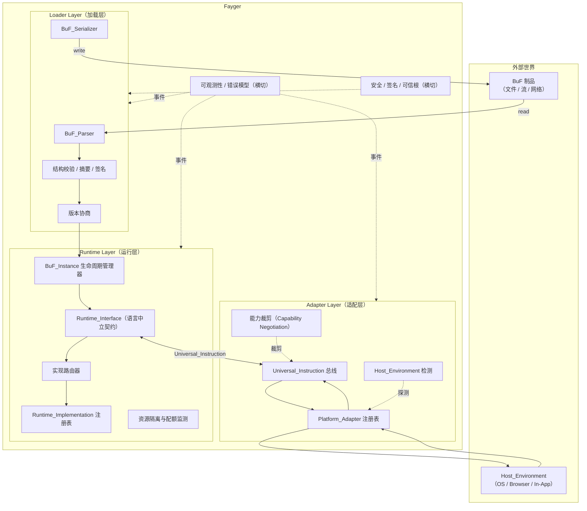
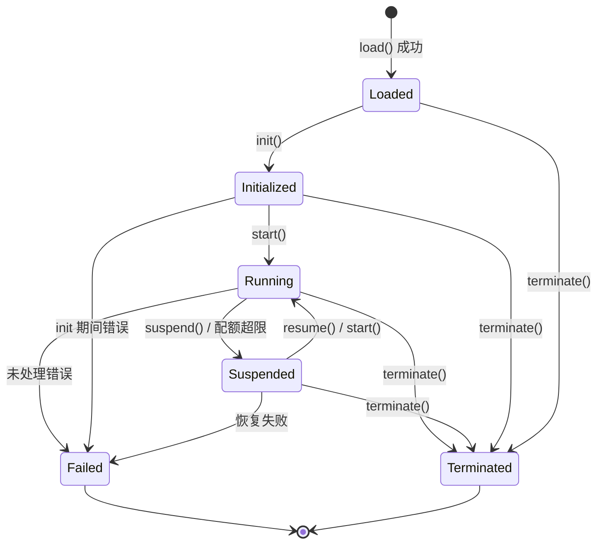
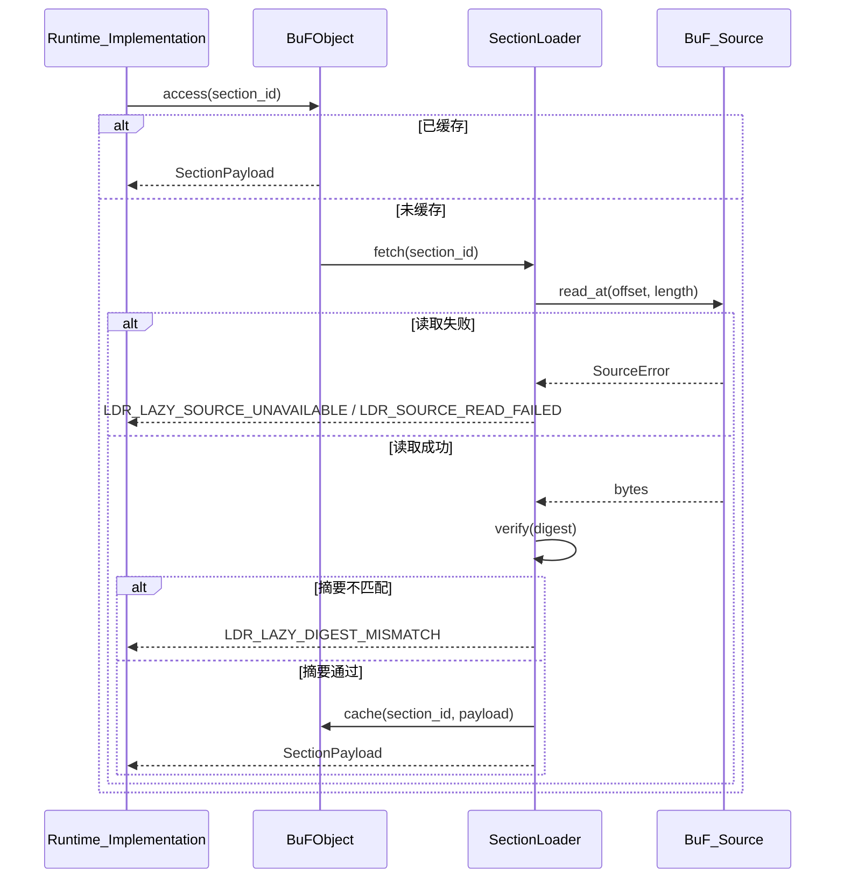
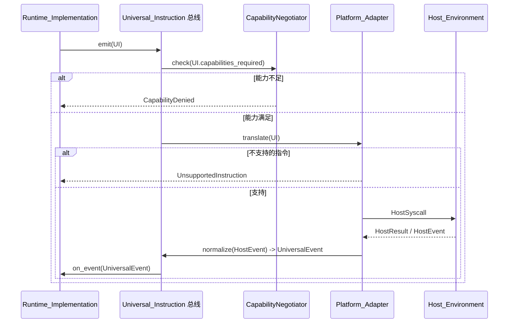

# Design Document

## Overview

Fayger 是 Fay 生态的虚拟运行环境，定位类似 JVM 之于 Java 字节码、Docker 之于容器镜像。它接收 BuF（Built-up Fay）作为输入制品，对其完成加载、校验、解释执行，并通过适配层屏蔽宿主差异。本设计文档基于 requirements.md 中确认的 13 项需求，给出第一阶段可实现的体系结构与关键组件设计。

设计目标按优先级排序：

1. **可移植性优先**：BuF 编译一次，可在桌面 / 服务器 / 浏览器 / 嵌入式宿主中执行；运行层与适配层之间通过稳定的 Universal_Instruction 解耦。
2. **多语言实现**：Runtime_Layer 通过语言中立的接口契约 Runtime_Interface 暴露能力，允许 Rust / Go / TypeScript 等多种 Runtime_Implementation 共存与替换。
3. **可证明的正确性**：BuF 解析-序列化必须满足往返一致性；Lifecycle 状态机迁移必须满足合法性约束；跨平台行为必须满足序列一致性。这些性质以可被属性测试验证的形式表达。
4. **安全可观测**：默认安全（强制签名模式）、默认静默（调试事件默认关闭）、错误结构化（统一错误模型 + 来源层标注 + 错误链）。

设计借鉴的外部体系：

- **JVM**：ClassLoader → Verifier → Linker → Initializer → ExecutionEngine 的链式职责切分；class file 格式（magic / version / constant pool / attributes）；JNI 作为宿主桥接。
- **Docker / OCI**：Image Manifest + Layers + Config 的三段式制品组织；containerd / runc 的分工；OCI Runtime Spec 作为运行时与制品的语言中立契约；Linux capabilities / cgroups / namespaces 的能力裁剪与资源隔离模型。
- **WASM / WASI**：模块加载阶段的结构性校验；host import 与 capability-based security；组件模型对接口契约的形式化描述。

非目标（第一阶段不涉及）：

- 跨 BuF_Instance 的共享内存模型与 IPC 协议（默认不共享，跨实例通信留待后续阶段）。
- JIT 编译与机器码生成（第一阶段以解释执行为基线，预留 ExecutionStrategy 抽象）。
- 分布式调度与多节点 Fayger 协同。
- BuF 的差量分发与分层缓存（先以单文件制品为基线，预留分层结构）。

## Architecture

### 三层结构与职责边界

Fayger 被划分为三个垂直分层，分别对应 JVM 中的"类加载 / 字节码执行 / 本地接口"以及 Docker 中的"镜像 / 运行时 / 宿主内核接口"角色。



### 调用方向与依赖规则

- **加载层 → 运行层**：单向，仅在加载完成时把 BuF 内存对象交给运行层创建 BuF_Instance。加载层不持有 BuF_Instance 引用，避免反向耦合。
- **运行层 ↔ 适配层**：双向，但通过 Universal_Instruction 总线传递，不直接相互引用类型。运行层仅依赖 `UniversalInstruction` 与 `UniversalEvent` 两个数据类型，不依赖任何 Platform_Adapter 实现。
- **运行层 → 加载层**：禁止。运行层若需要再次序列化 BuF（例如热更新场景），通过加载层暴露的服务接口调用，而不是反向反射加载层。
- **适配层 → 宿主**：单向。Platform_Adapter 拥有宿主 SDK / 系统调用的具体引用；运行层永不直接 import 宿主库。
- **横切层（Observability / Security）→ 三层**：通过事件总线与策略接口侵入，三层向外发出事件，向横切层查询策略，不反向依赖具体实现。

### 借鉴 JVM 的链式加载阶段

Loader_Layer 内部进一步切分为 JVM 风格的子阶段，便于错误定位与单测：

```
Read(Header/Manifest/Index) → Parse → Verify(Structural) → Verify(Digest of Header/Manifest/Index)
  → Verify(Signature) → NegotiateVersion → Select(Sections by LoadProfile) → Resolve(Dependencies)
  → Read(Selected Section Bodies)? → HandOff(to Runtime)
```

- **Read(Header/Manifest/Index)**：通过 BuF_Source 从制品中抽取 Header / Manifest / Section_Index / Trailer。这一组数据是后续所有阶段的可信骨架，无论 Eager 还是 Lazy 模式都必须在 load 调用返回前完整读取并校验。
- **Parse**：解析 Manifest 与 Section Index（不解码段体）。
- **Verify(Structural)**：检查 magic、版本字段、Section 边界、Manifest 必填字段。
- **Verify(Digest of Header/Manifest/Index)**：校验 Header、Manifest 与 Section Index 的整体摘要（Trailer 中的 `manifest_digest`）。每个 Section 段体的 digest 在该段被实际读取时校验。
- **Verify(Signature)**：当 Manifest 含签名信息或处于强制签名模式时执行。签名作用范围只覆盖 Header / Manifest_minus_signature / Section_Index，不依赖任何 Section 段体是否被读取。
- **NegotiateVersion**：检查 schema 版本与 Runtime_Interface 最低版本是否兼容。
- **Select(Sections by LoadProfile)**：根据调用方传入的 LoadProfile 与当前 Host_Environment，决定哪些 Section 被选中、哪些被跳过；Required Section 不满足约束时直接失败，Optional Section 不满足时跳过并记录原因。
- **Resolve**：解析 BuF 之间的依赖（第一阶段为单 BuF，预留接口）。
- **Read(Selected Section Bodies)**：仅在 LoadStrategy = Eager 时执行；逐段从 BuF_Source 读取并校验 digest。LoadStrategy = Lazy 时跳过此阶段，被选中 Section 的读取与校验推迟到首次访问。
- **HandOff**：把内存对象提交给 Runtime_Layer。Lazy 模式下对象内部持有 BuF_Source 引用与 SectionLoader。

每一阶段失败都产生带阶段标签的错误，进入统一错误模型，并在 `context.phase` 中标注 `eager` 或 `lazy`。

### 借鉴 Docker / OCI 的制品组织

BuF 制品在物理上对应 OCI Image 概念：

| OCI 概念 | BuF 对应物 |
| --- | --- |
| Image Manifest | BuF_Manifest |
| Image Config | BuF_Manifest 内的 `runtime` / `capabilities` / `quotas` 字段 |
| Layers | BuF Sections（code / data / assets / signature） |
| Distribution Spec | 第一阶段以单文件制品为基线，未来扩展 |
| Runtime Spec | Runtime_Interface 契约 |
| containerd | Runtime_Layer（生命周期管理 + 路由） |
| runc | Runtime_Implementation（具体执行器） |

### 借鉴 WASM / WASI 的能力安全模型

Adapter_Layer 采用 capability-based security：

- BuF_Manifest 声明 `requested_capabilities`（如 `fs.read`、`net.http`、`ui.dom`）。
- Platform_Adapter 声明 `available_capabilities`。
- 实际授予的能力 = `requested ∩ available ∩ host_policy`，三者皆不为空集时才允许进入 `Running`。
- 未声明的能力对 BuF 不可见（默认拒绝），与 WASI 的 host import 显式注入语义一致。

## Components and Interfaces

> 接口以语言中立的伪 IDL 描述。具体语言映射（Rust trait / Go interface / TypeScript interface）由各 Runtime_Implementation 自行决定，但语义必须等价。

### Loader Layer

**BuF_Parser**

```idl
interface BuF_Parser {
  // 从字节流解析为内存对象；不执行 Verify(Digest) 与 Verify(Signature)
  parse(bytes: Bytes) -> Result<BuFObject, ParseError>
}
```

**BuF_Serializer**

```idl
interface BuF_Serializer {
  // 把内存对象序列化回字节流；缺失必填字段直接报错
  serialize(obj: BuFObject) -> Result<Bytes, SerializeError>
}
```

**BuF_Source**

```idl
interface BuF_Source {
  // 必需：随机访问读
  read_at(offset: u64, length: u64) -> Result<Bytes, SourceError>
  // 必需：声明制品总长度
  length() -> Result<u64, SourceError>
  // 可选：状态查询与释放
  stat() -> Result<SourceStat, SourceError>
  close() -> Result<(), SourceError>
}
```

`BuF_Source` 是加载层与外部存储之间的最小契约。本地文件、HTTP Range、对象存储 SDK、IPFS 网关、用户自定义后端等都通过实现该接口接入。Loader_Layer 不感知具体后端，只依赖 `read_at` 与 `length`。

**LoadProfile / LoadStrategy**

```idl
struct LoadProfile {
  target_class: TargetClass            // desktop | server | browser | inapp | embedded | drone | camera | …
  capabilities: Set<Capability>        // 当前终端实际可用的能力集
  max_section_bytes: Option<u64>       // 单段允许读入的体积上限
  features: Set<Feature>               // 自定义运行时特征位
}

enum LoadStrategy { Eager, Lazy }
enum SectionVisibility { Required, Optional }

struct ProfileConstraints {
  required_capabilities: Set<Capability>
  max_size: Option<u64>
  required_features: Set<Feature>
  // 任一字段缺省视为"无该项约束"
}
```

**LoaderPipeline**

```idl
interface LoaderPipeline {
  load(
    source: BuF_Source,
    profile: LoadProfile,
    strategy: LoadStrategy,
    policy: LoaderPolicy
  ) -> Result<BuFObject, LoaderError>
  // policy 包含：require_signature、trusted_roots、allowed_schema_versions
}
```

`load` 在调用返回前一定会读取并校验 Header / Manifest / Section_Index。是否在返回前读取 Section 段体取决于 `strategy`。

**SectionLoader**

```idl
interface SectionLoader {
  // Lazy 模式下封装"首次访问触发读取 + digest 校验"
  fetch(id: SectionId) -> Result<SectionPayload, LoaderError>
  is_loaded(id: SectionId) -> bool
  loaded_ids() -> Set<SectionId>
}
```

SectionLoader 内部持有：

- 已加载段缓存（首次读取后留存，避免重复 IO 与重复校验）。
- 对 BuF_Source 的引用（生命周期由 LoaderPipeline 管理，外部不可替换）。
- Section_Index 的快照（加载阶段已完成结构与摘要校验，可信）。

**SignatureVerifier**

```idl
interface SignatureVerifier {
  verify(manifest: BuFManifest, sig: SignatureBlock, roots: TrustedRootSet)
    -> Result<(), SignatureError>
}
```

### Runtime Layer

**Runtime_Interface（语言中立契约）**

借鉴 OCI Runtime Spec 的"配置 + 命令"风格，并融合 JVM 的执行引擎抽象：

```idl
interface Runtime_Interface {
  // 元信息
  rt_version() -> RuntimeInterfaceVersion
  capabilities() -> Set<RuntimeCapability>

  // 生命周期
  load(obj: BuFObject) -> Result<InstanceId, RuntimeError>
  init(id: InstanceId) -> Result<(), RuntimeError>
  start(id: InstanceId) -> Result<(), RuntimeError>
  suspend(id: InstanceId) -> Result<(), RuntimeError>
  resume(id: InstanceId) -> Result<(), RuntimeError>
  terminate(id: InstanceId) -> Result<(), RuntimeError>

  // 状态查询
  state(id: InstanceId) -> Result<LifecycleState, RuntimeError>
  failure_info(id: InstanceId) -> Result<Option<FailureInfo>, RuntimeError>

  // 与适配层通信（运行层 → 适配层）
  emit(id: InstanceId, instr: UniversalInstruction) -> Result<UniversalReply, AdapterError>

  // 与适配层通信（适配层 → 运行层，宿主事件回送）
  on_event(id: InstanceId, event: UniversalEvent) -> Result<(), RuntimeError>
}
```

**RuntimeRegistry**

```idl
interface RuntimeRegistry {
  register(impl: Runtime_Implementation) -> Result<RegistrationId, RegistryError>
  // 校验 impl 是否实现 Runtime_Interface 全部必需方法；缺失则返回 missing_methods
  list() -> List<RuntimeImplementationDescriptor>
  resolve(manifest: BuFManifest) -> Result<RegistrationId, RegistryError>
  // 路由策略：按 manifest.runtime.preferred_impl → version 兼容性 → 注册顺序
}
```

**LifecycleManager**

负责 BuF_Instance 状态机的合法性校验、事件发布与失败保留。状态机定义详见下文 Data Models。

**ResourceMonitor**

```idl
interface ResourceMonitor {
  attach(id: InstanceId, quota: ResourceQuota)
  sample(id: InstanceId) -> ResourceUsage
  // 当 sample 显示超限，发出 QuotaExceeded 事件并触发 LifecycleManager.suspend
}
```

设计上每个 BuF_Instance 拥有独立的 RuntimeDataArea（堆 / 调用栈 / 句柄表），借鉴 JVM 每线程独立的 PC / 栈与每实例独立的方法区设计；不同实例之间默认无共享对象指针。

### Adapter Layer

**Universal_Instruction**

```idl
struct UniversalInstruction {
  category: InstructionCategory   // io | net | ui | time | random | crypto | proc | host
  opcode: u16                      // 类内编号
  operands: TLV[]                  // 类型-长度-值序列
  capabilities_required: Set<Capability>
}

struct UniversalEvent {
  category: EventCategory
  opcode: u16
  payload: TLV[]
}
```

指令集分类（第一阶段固定 8 类，预留 8 类以备扩展）：

| 类别 | 说明 | 借鉴 |
| --- | --- | --- |
| `io` | 文件 / 标准流 | POSIX read/write |
| `net` | 网络 I/O | WASI sock_* |
| `ui` | UI 渲染与输入 | DOM / 终端 TUI / Canvas |
| `time` | 时钟与定时器 | clock_time_get |
| `random` | 随机数 | random_get |
| `crypto` | 加密原语 | WASI crypto |
| `proc` | 进程 / 线程 / 信号 | POSIX |
| `host` | 宿主特定调用 | JNI / extism |

扩展机制：

- 类别字段保留位用于未来类别扩展；opcode 高位保留 0x8000-0xFFFF 用于实验性指令。
- Platform_Adapter 通过实现 `supported_instructions()` 自描述能力；未实现的指令在 `emit()` 时返回 `UnsupportedInstruction`。

**Platform_Adapter**

```idl
interface Platform_Adapter {
  descriptor() -> AdapterDescriptor
  // descriptor 包含 platform_id、supported_capabilities、supported_instructions

  match(host: HostEnvironment) -> bool
  translate(instr: UniversalInstruction) -> Result<HostSyscall, AdapterError>
  normalize(raw: HostEvent) -> Result<UniversalEvent, AdapterError>
}
```

**HostEnvironmentDetector**

```idl
interface HostEnvironmentDetector {
  detect() -> HostEnvironment
  // 返回 platform_id / os_kind / arch / sandbox_kind / runtime_features
}
```

**CapabilityNegotiator**

```idl
interface CapabilityNegotiator {
  negotiate(
    requested: Set<Capability>,
    available: Set<Capability>,
    policy: HostPolicy
  ) -> NegotiationResult
}

struct NegotiationResult {
  granted: Set<Capability>     // = requested ∩ available ∩ policy
  denied: Set<Capability>      // = requested \ granted
  warnings: List<Capability>   // 在 host 上以受限形式提供
}
```

第一阶段内置 4 个 Platform_Adapter：

- **NativeDesktop_Adapter**：Linux / macOS / Windows 桌面，能力全集。
- **Server_Adapter**：无 GUI 的服务器场景，禁用 `ui` 类别。
- **Browser_Adapter**：基于 Web API；禁用 `proc` 与大部分 `io`，`net` 受 fetch / WebSocket 限制；强能力裁剪。
- **InApp_Adapter**：嵌入到宿主应用进程，能力由宿主显式注入（最严格）。

### 横切组件

**ErrorModel**

```idl
struct FaygerError {
  code: ErrorCode             // 稳定的字符串/数字编码
  source_layer: Layer         // loader | runtime | adapter | host
  message: String
  context: Map<String, Value>
  cause: Option<Box<FaygerError>>   // 错误链
}
```

**EventBus**

```idl
interface EventBus {
  publish(event: FaygerEvent)
  subscribe(filter: EventFilter, handler: EventHandler) -> SubscriptionId
  set_debug_enabled(enabled: bool)   // 默认 false
}
```

**TrustStore**

```idl
interface TrustStore {
  current_roots() -> TrustedRootSet
  update(roots: TrustedRootSet)      // 下次 load 生效
  enforce_signature() -> bool         // 强制签名模式开关
}
```

## Data Models

### BuF 二进制格式

借鉴 JAR / OCI Image / WASM 的复合结构，BuF 采用 **Header + Manifest + Section Index + Sections + Trailer** 五段式：

```
+------------------------------------------------------------+
| Header        | magic="BUF\0" | format_version | flags     |
|               | manifest_offset, manifest_length            |
|               | section_index_offset, section_index_length  |
+------------------------------------------------------------+
| Manifest      | CBOR-encoded BuFManifest                    |
+------------------------------------------------------------+
| Section Index | [(section_id, kind, offset, length, digest, |
|               |   visibility, profile_constraints)]         |
+------------------------------------------------------------+
| Sections      | [code | data | assets | signature | ...]   |
+------------------------------------------------------------+
| Trailer       | total_length | manifest_digest | crc32     |
+------------------------------------------------------------+
```

设计要点：

- **Magic + Format Version**：前 8 字节固定，便于工具识别与拒绝错误流。
- **Manifest 单独成段**：可在不解码 Sections 段体的情况下完成版本协商、profile 选择与能力裁剪（与 OCI Image Manifest 同构）。
- **Section Index 是 Lazy 模式的可信索引**：每条索引项包含 `(offset, length, digest, visibility, profile_constraints)`。Section_Index 必须在加载阶段被完整读取且通过整体摘要校验，因为 Lazy 模式下后续按需读取依赖该索引中的 offset 与 digest。
- **每段 digest 在被实际读取时校验**：Eager 模式下在 load 阶段统一校验，Lazy 模式下在首次访问时校验。两种模式下 digest 数据来源都是 Section_Index 中的不可变快照。
- **Trailer**：包含整体长度与 Manifest 摘要，用于检测截断与防止"先签名后篡改 Manifest"攻击。
- **编码选择**：Manifest 与 Section_Index 使用 CBOR（确定性编码模式 RFC 8949 §4.2），保证序列化字节序唯一，从而支持往返一致性。
- **签名作用范围**：Header || Manifest_minus_signature || Section_Index。被跳过的 Section 段体不影响签名结果，因此部分加载与完整加载在签名验证上等价。

### BuF_Manifest 字段约定

```idl
struct BuFManifest {
  // 版本协商
  schema_version: SemVer                  // BuF schema 版本
  runtime_interface_min: SemVer           // 所需 Runtime_Interface 最低版本
  deprecation_notice: Option<String>      // 由 Fayger 在加载时填充

  // 入口与运行层选择
  entry: EntryPoint
  runtime: RuntimeRequirement {
    preferred_impl: Option<ImplementationId>
    selection_strategy: enum { Strict, PreferThenAny, Any }
  }

  // 能力声明
  capabilities: CapabilitySet              // 请求的能力集
  quotas: Option<ResourceQuota> {
    cpu_ms_per_sec: Option<u32>
    memory_bytes: Option<u64>
    io_bytes_per_sec: Option<u64>
  }

  // 内容索引（与 Section Index 一致性由 Verify(Digest) 保证）
  sections: List<SectionDescriptor> {
    id: SectionId
    kind: enum { Code, Data, Asset, Signature, Custom(String) }
    digest: Digest                          // 算法 + 摘要值
    length: u64
    visibility: SectionVisibility           // Required | Optional
    profile_constraints: ProfileConstraints // 可选；缺省视为无约束
  }

  // 签名（可选）
  signature: Option<SignatureBlock> {
    algorithm: SignatureAlgorithm           // ed25519 / ecdsa-p256 / rsa-pss-sha256
    public_key_ref: KeyRef                  // 或证书链
    signed_digest: Bytes                    // 对 (header || manifest_minus_signature || section_index) 的签名
  }

  // 自定义键（保留）
  extensions: Map<String, CborValue>
}
```

`schema_version` 与 `runtime_interface_min` 分别独立演进。前者控制 BuF 格式兼容；后者控制 Runtime_Interface 兼容（类似 JVM class file version 与 JVM API level 分离）。

### BuF 内存对象

```idl
struct BuFObject {
  manifest: BuFManifest
  raw_header: Header
  raw_trailer: Trailer

  // 部分加载结果
  selected_sections: Set<SectionId>             // 通过 profile 选择被纳入的 Section
  skipped_sections: List<SkipRecord> {          // 被跳过的 Optional Section 与原因
    id: SectionId
    reasons: Set<SkipReason>                    // CapabilityNotGranted | OverMaxSize | FeatureMissing | …
  }

  // 加载策略与按需读取
  strategy: LoadStrategy
  source_ref: Option<BuF_Source>                // 仅 Lazy 模式持有
  loader: Option<SectionLoader>                 // 仅 Lazy 模式持有

  // Eager 模式下已读取并校验的段体；Lazy 模式下作为缓存按需填充
  sections: Map<SectionId, SectionPayload>
}

enum SkipReason {
  CapabilityNotGranted, OverMaxSize, FeatureMissing, ExplicitlyDisabled
}
```

`raw_header` / `raw_trailer` 保留原始字节，使 `serialize(parse(bytes))` 在确定性 CBOR + 保留头尾的策略下能够实现字节级往返（强往返性质）。即便在弱往返模型下（仅结构等价），也由 `BuFObject` 的相等关系保证。

往返一致性在部分加载下的语义：等价关系按 `selected_sections` 范围比较，被跳过的 Section 不参与对比，但 `skipped_sections` 列表本身参与对比。这避免"两次部分加载得到不同子集却被认为等价"。

### 生命周期状态机



合法迁移集合（用于 Lifecycle 状态机的合法迁移性质）：

| 当前状态 | 允许的目标状态 |
| --- | --- |
| Loaded | Initialized, Terminated, Failed |
| Initialized | Running, Terminated, Failed |
| Running | Suspended, Terminated, Failed |
| Suspended | Running, Terminated, Failed |
| Terminated | （终态） |
| Failed | （终态） |

非法迁移示例：`Loaded → Running`（缺少 init）、`Terminated → 任意`、`Failed → Running`。

### Universal_Instruction 编码

每条指令以 TLV 串方式编码，便于扩展：

```
+--------+--------+----------+-------------------+
| cat(1) | op(2)  | caps(2)  | operands(TLV...)  |
+--------+--------+----------+-------------------+
```

- `cat`：类别枚举（占 1 字节，预留高位标志位）。
- `op`：类内编号（2 字节）。
- `caps`：所需能力位图（2 字节，第一阶段使用低位 16 项；超过则使用扩展段）。
- `operands`：每个 operand 为 `(type:1, length:varint, value)`。

### Lazy 模式下的按需读取流程



要点：

- Lazy 模式下任何 Section 只在第一次访问时被读取与校验，后续命中缓存。
- BuF_Source 引用由 BuFObject 持有，外部不可在加载完成后替换。
- 读取失败与摘要失败使用不同的稳定错误码，便于调用方区分基础设施问题与制品篡改。

### Universal_Instruction 双向翻译流程



### 错误模型

```idl
enum Layer { Loader, Runtime, Adapter, Host }
enum ErrorCode {
  // Loader
  LDR_PARSE_FAIL, LDR_DIGEST_MISMATCH, LDR_SIGNATURE_FAIL,
  LDR_SCHEMA_UNSUPPORTED, LDR_RUNTIME_VERSION_TOO_HIGH, LDR_MISSING_REQUIRED_FIELD,
  LDR_PROFILE_REQUIRED_SECTION_MISSING,
  LDR_LAZY_SOURCE_UNAVAILABLE, LDR_LAZY_DIGEST_MISMATCH, LDR_SOURCE_READ_FAILED,
  // Runtime
  RT_ILLEGAL_TRANSITION, RT_IMPL_NOT_FOUND, RT_IMPL_MISSING_METHODS,
  RT_QUOTA_EXCEEDED, RT_INSTANCE_FAILED,
  // Adapter
  ADP_NO_MATCHING_PLATFORM, ADP_UNSUPPORTED_INSTRUCTION,
  ADP_CAPABILITY_DENIED, ADP_HOST_CALL_FAILED,
}
```

错误链：当一次操作跨多层失败（例如 Adapter `ADP_HOST_CALL_FAILED` 触发 Runtime `RT_INSTANCE_FAILED`，再由 LifecycleManager 包装），`cause` 链按底→顶顺序保留所有节点。

## Correctness Properties


*A property is a characteristic or behavior that should hold true across all valid executions of a system — essentially, a formal statement about what the system should do. Properties serve as the bridge between human-readable specifications and machine-verifiable correctness guarantees.*

下列属性是从 requirements.md 中 acceptance criteria 经测试性分析与去重后得到的最小覆盖集。每条属性都以"For all / For any"的全称量化形式陈述，并标注其所验证的需求条款。

### Property 1: BuF 解析-序列化往返一致性

*For any* 合法的 BuFObject `o`，令 `bytes = serialize(o)`，则 `parse(bytes)` 必须成功并产出 `o'`，使得 `o ≡ o'`（结构等价：manifest 字段集合相等且 sections 内容逐字节相等）；进一步，在确定性 CBOR 编码下 `serialize(o') == bytes`。

**Validates: Requirements 1.1, 1.2, 2.2, 2.3**

### Property 2: 字节流破坏被检测

*For any* 合法 BuF 字节流 `bytes` 与任意单点破坏 `corrupt`（位翻转、截断、或对某个 section 字节做修改而不更新 manifest digest），`parse(corrupt(bytes))` 或后续 digest 校验阶段必须返回 `Err`，且错误对象包含失败位置（offset 或 section_id）与原因（结构错误 / 摘要不匹配）。

**Validates: Requirements 1.4, 1.5**

### Property 3: 必填字段缺失被拒绝

*For any* BuFObject `o`，若从其 Manifest 中移除任一必填字段（包括 `schema_version`、`runtime_interface_min`、`entry`、`sections`），则 `serialize(o)` 必须失败并在 `missing_fields` 中至少包含被移除的字段。

**Validates: Requirements 2.4, 10.1**

### Property 4: Schema 与 Runtime 版本协商

*For any* `(manifest, fayger_state)`，令 `s = manifest.schema_version`、`r = manifest.runtime_interface_min`、`S = fayger_state.supported_schema_range`、`D = fayger_state.deprecated_schemas`、`P = fayger_state.runtime_interface_provided`，加载结果必须满足下列决策表：

| 条件 | 期望结果 |
| --- | --- |
| `s ∉ S` | `Err(LDR_SCHEMA_UNSUPPORTED)`，`context.expected_range == S` |
| `r > P` | `Err(LDR_RUNTIME_VERSION_TOO_HIGH)`，`context.{required, provided}` 完整 |
| `s ∈ S \ D` 且 `r ≤ P` | `Ok`，`deprecation_notice == None` |
| `s ∈ D` 且 `r ≤ P` | `Ok`，`deprecation_notice` 非空 |

**Validates: Requirements 1.3, 10.2, 10.3, 10.4**

### Property 5: Runtime_Implementation 注册方法完备性

*For any* 候选实现 `impl`，令 `R` 为 Runtime_Interface 必需方法集合，`I = implemented_methods(impl)`，则 `register(impl)` 成功 当且仅当 `R ⊆ I`；当 `R ⊄ I` 时返回 `RT_IMPL_MISSING_METHODS` 且 `context.missing_methods == R \ I`。

**Validates: Requirements 3.3, 3.4**

### Property 6: 运行层路由策略

*For any* 已注册实现集合 `Impls` 与 manifest 中的 `runtime` 声明，`resolve(manifest)` 的结果 `r` 必须满足：

- `selection_strategy == Strict` ⟹ `r == preferred_impl ∧ preferred_impl ∈ Impls ∧ compatible(preferred_impl, manifest)`；否则返回 `RT_IMPL_NOT_FOUND`。
- `selection_strategy == PreferThenAny` ⟹ 若 `preferred_impl ∈ Impls ∧ compatible(...)` 则 `r == preferred_impl`，否则 `r ∈ { i ∈ Impls : compatible(i, manifest) }`。
- `selection_strategy == Any` ⟹ `r ∈ { i ∈ Impls : compatible(i, manifest) }`。

**Validates: Requirements 3.5**

### Property 7: Lifecycle 状态机合法迁移

*For any* 实例 `inst` 与一组生命周期指令序列 `cmds = [c₁, c₂, …, cₙ]`，令 `s₀ = Loaded`，对每一步 `i`：若 `cᵢ` 在 `allowed_transitions(sᵢ₋₁)` 中，则 `sᵢ = next(sᵢ₋₁, cᵢ)`；否则 `cᵢ` 返回 `RT_ILLEGAL_TRANSITION` 且 `sᵢ = sᵢ₋₁`、错误 context 包含 `current_state` 与 `allowed_set`。最终状态 `sₙ` 必须落在表中合法状态集合。

**Validates: Requirements 4.1, 4.2, 4.3, 4.4, 4.5, 4.7**

### Property 8: 失败状态保留错误上下文

*For any* 处于 `Running` 状态的实例 `inst`，若注入未处理错误 `e`，则其状态必须迁移至 `Failed`，且 `failure_info(inst.id)` 返回的对象必须包含触发失败的最末一条 Universal_Instruction 与错误对象 `e`。

**Validates: Requirements 4.6, 8.3**

### Property 9: Platform_Adapter 选择决策性

*For any* `host_env` 与已注册适配器集合 `Adapters`，令 `M = { a ∈ Adapters : a.match(host_env) }`，则 Fayger 启动结果必须满足：`M == ∅` ⟹ 返回 `ADP_NO_MATCHING_PLATFORM` 且不进入可服务状态；`M ≠ ∅` ⟹ 选中适配器 `a* ∈ M` 且选择是确定性的（按注册顺序或优先级一致）。

**Validates: Requirements 5.3, 5.4**

### Property 10: 不支持指令的处理

*For any* Universal_Instruction `instr` 与当前 Platform_Adapter `a`，若 `instr ∉ a.supported_instructions()`，则 `emit(instr)` 必须返回 `ADP_UNSUPPORTED_INSTRUCTION` 且 `context.instruction == instr.id`，且 host 上没有任何系统调用被触发。

**Validates: Requirements 5.5**

### Property 11: 跨平台 Lifecycle 与 Universal_Instruction 序列一致性

*For any* BuFObject `o` 与一对能力相同的 Platform_Adapter `(a₁, a₂)`，令 `(L₁, U₁) = run(o, a₁)`、`(L₂, U₂) = run(o, a₂)`，其中 `L` 为 Lifecycle_State 序列、`U` 为发出的 Universal_Instruction 序列，则必须有 `L₁ == L₂` 且 `U₁ == U₂`。

**Validates: Requirements 6.2**

### Property 12: 能力裁剪的集合代数

*For any* 三元组 `(requested, available, policy)`，令 `granted = negotiate(requested, available, policy).granted`，则必须满足：

- `granted == requested ∩ available ∩ policy`
- `denied == requested \ granted`
- 若 `manifest.required_capabilities \ granted ≠ ∅`，则 `start()` 必须返回错误且 `context.missing == required \ granted`，实例不进入 `Running`。

**Validates: Requirements 6.3, 6.4**

### Property 13: BuF_Instance 内存隔离

*For any* 两个并发存在的 BuF_Instance `i₁`、`i₂`（`i₁ ≠ i₂`），它们的 `RuntimeDataArea` 满足 `data_area(i₁) ∩ data_area(i₂) == ∅`，且对 `i₁` 的任意写操作不改变 `data_area(i₂)` 中的任何字节。

**Validates: Requirements 7.1**

### Property 14: 配额超限触发暂停

*For any* 实例 `inst` 在 `Running` 状态下的资源使用序列 `[u₀, u₁, …]` 与配额 `q`，令 `k = min { i : uᵢ 超出 q 中任一维度 }`（若存在），则在第 `k` 次采样后，实例状态必须迁移至 `Suspended`，且 LifecycleManager 发出的暂停事件 `context.resource` 等于首次超限的资源类型，`context.usage` 等于 `uₖ`。

**Validates: Requirements 7.3**

### Property 15: 实例失败的隔离性

*For any* `N` 个处于 `Running` 状态的 BuF_Instance `[i₁, …, i_N]`，若其中任一 `iₖ` 进入 `Failed`，则在不再向 `iⱼ (j ≠ k)` 注入额外故障的前提下，所有 `iⱼ` 的状态在事件时间线上仍保持 `Running`，且其后续 Universal_Instruction 序列与无故障基线一致。

**Validates: Requirements 7.4**

### Property 16: 错误模型的层标注完整性

*For any* 在 Loader / Runtime / Adapter 任一层产生的错误 `e`，`e` 必须是合法的 `FaygerError`（`code`、`source_layer`、`message`、`context` 字段非空），且 `e.source_layer` 等于实际产生错误的层。

**Validates: Requirements 8.1, 8.2**

### Property 17: 跨层错误链保留

*For any* 跨多层连续产生错误的操作 `op`，若注入点序列为 `[L₁, L₂, …, Lₘ]`（`m ≥ 2`），令最终返回错误为 `e`，则沿 `e.cause` 遍历得到的层序列必须等于 `[Lₘ, Lₘ₋₁, …, L₁]`，链长度 `≥ m`。

**Validates: Requirements 8.4**

### Property 18: Lifecycle 事件总线一致性

*For any* 实例 `inst` 与发生在其上的合法迁移序列 `[(s₀, s₁), (s₁, s₂), …]`，事件总线发出的事件序列 `[e₁, e₂, …]` 必须满足：长度相等、每个 `eᵢ.from == sᵢ₋₁`、`eᵢ.to == sᵢ`、`eᵢ.timestamp` 单调非递减。

**Validates: Requirements 9.2**

### Property 19: 签名校验决策

*For any* 三元组 `(buf, sig_state, enforce_mode)`，令 `has_sig = buf.manifest.signature.is_some()`、`sig_valid = verify(buf)`，加载结果必须满足：

| 条件 | 期望结果 |
| --- | --- |
| `enforce_mode == true ∧ has_sig == false` | `Err(LDR_SIGNATURE_FAIL)`，原因 `MissingSignature` |
| `has_sig == true ∧ sig_valid == false` | `Err(LDR_SIGNATURE_FAIL)`，原因 `InvalidSignature` |
| `has_sig == true ∧ sig_valid == true` | `Ok` |
| `enforce_mode == false ∧ has_sig == false` | `Ok` |

**Validates: Requirements 11.1, 11.2, 11.3**

### Property 20: 可信根更新可见性

*For any* 由 `Update(roots)` 与 `Load(buf)` 操作组成的时序序列 `Ops`，对其中每一次 `Load(buf)` 操作 `op`，`op` 在签名验证时使用的 `TrustedRootSet` 必须等于 `op` 之前最后一次 `Update` 的 roots（若无则为初始 roots）。

**Validates: Requirements 11.4**

### Property 21: Section 选择决策性

*For any* `(manifest, host_env, profile)`，令 `S = manifest.sections`，对每个 `s ∈ S` 定义谓词 `fits(s) = host_env ∪ profile 满足 s.profile_constraints`。则部分加载的结果必须满足：

- `selected = { s ∈ S : fits(s) }`
- 对任一 `s ∈ S \ selected`，若 `s.visibility == Required`，则 `load(...)` 必须返回 `Err(LDR_PROFILE_REQUIRED_SECTION_MISSING)`，错误 context 至少包含 `section_id` 与未满足的约束项列表。
- 对任一 `s ∈ S \ selected`，若 `s.visibility == Optional`，则 `s.id` 必须出现在结果对象的 `skipped_sections` 中，且 `reasons` 非空。
- 选择是确定性的：对相同 `(manifest, host_env, profile)`，`selected` 与 `skipped_sections` 完全相同。

**Validates: Requirements 12.1, 12.2, 12.3, 12.4**

### Property 22: Eager / Lazy 等价性

*For any* `(source, profile, policy)`，令 `obj_e = load(source, profile, Eager, policy)`、`obj_l = load(source, profile, Lazy, policy)`。若令 `force_all(o)` 表示对 BuFObject 中所有 `selected_sections` 触发一次访问，则必须有：

- `obj_e.selected_sections == obj_l.selected_sections`
- `obj_e.skipped_sections ≡ obj_l.skipped_sections`
- `obj_e.sections == force_all(obj_l).sections`（按段比较，逐字节相等）
- 两者在 `manifest`、`raw_header`、`raw_trailer`、`strategy` 之外的字段上等价。

**Validates: Requirements 13.2, 13.3, 13.4**

### Property 23: Lazy 首次访问校验

*For any* Lazy 模式下的 BuFObject `obj` 与任一 `id ∈ obj.selected_sections \ obj.loader.loaded_ids()`，对 `obj.loader.fetch(id)` 必须满足：

- 实际从 `obj.source_ref` 调用 `read_at(offset, length)` 至少一次。
- 读取的字节按 Section_Index 中声明的 digest 校验：摘要不匹配返回 `Err(LDR_LAZY_DIGEST_MISMATCH)`，且 `id` 不会被加入缓存。
- 若 `read_at` 返回错误，`fetch` 必须返回 `Err(LDR_LAZY_SOURCE_UNAVAILABLE)` 或 `Err(LDR_SOURCE_READ_FAILED)`，`context.section_id == id` 且 `cause` 链包含底层 SourceError。
- 校验通过后再次 `fetch(id)` 必须命中缓存，不再触发 `read_at`。

**Validates: Requirements 13.4, 13.5**

### Property 24: 部分加载下签名一致性

*For any* 制品 `b` 与任意两个 `LoadProfile` `p₁`、`p₂`（可能选中不同 Section 子集），令 `obj_i = load(b, pᵢ, strategy, policy)`，则：

- 若 `b` 的整体 Manifest 签名（覆盖 `Header || Manifest_minus_signature || Section_Index`）有效，则 `obj_1` 与 `obj_2` 的签名校验结果相同（均通过）。
- 若签名无效，则两次加载都返回 `Err(LDR_SIGNATURE_FAIL)`，与被选中的 Section 子集无关。
- 任何对被跳过 Section 段体的修改都不改变签名校验结果（被跳过段不在签名作用范围内）；任何对 Section_Index 的修改都改变签名校验结果。

**Validates: Requirements 12.5**

### Property 25: 阶段错误标注

*For any* 加载层产生的错误 `e`，`e.context.phase` 必须为 `"eager"` 或 `"lazy"` 之一，且与产生错误的实际阶段一致：

- Eager 模式下在 load 调用栈内产生的错误：`phase == "eager"`。
- Lazy 模式下在 SectionLoader.fetch 调用栈内产生的错误：`phase == "lazy"`。
- Eager / Lazy 都可能产生的错误（Header / Manifest / Section_Index 阶段）：`phase == "eager"`（这些阶段始终在 load 调用返回前完成）。

**Validates: Requirements 13.6**

## Error Handling

### 统一错误模型

所有面向用户返回的错误均通过 `FaygerError` 表达：

```idl
struct FaygerError {
  code: ErrorCode
  source_layer: Layer
  message: String
  context: Map<String, Value>
  cause: Option<Box<FaygerError>>
}
```

- `code` 是稳定的、可文档化的标识，用于调用方分支决策；不在跨版本中变更语义。
- `source_layer` 标注最初产生错误的层（Loader / Runtime / Adapter / Host），便于路由到对应模块的诊断手册。
- `message` 是面向人类的描述；`context` 是面向工具的结构化字段（offset、missing_fields、current_state、expected_range 等）。
- `cause` 用于跨层错误的因果链：包装错误时把底层错误置入 `cause`，避免吞掉信息。

### 错误产生与传播规则

1. **就近构造**：每一层在自己的边界内构造 `FaygerError` 并标注 `source_layer`。
2. **逐级包装**：上层若需要补充语义，必须在 `cause` 中保留下层错误，不得改写 `source_layer`。
3. **不丢失上下文**：`context` 至少包含触发错误的关键字段（如 schema_version、instr.id、resource_type）。
4. **失败保留**：进入 `Failed` 的 BuF_Instance 必须把最末一条 Universal_Instruction 与对应错误固化到 `failure_info` 中，直到实例被显式销毁。

### 关键错误处理路径

| 触发点 | 错误码 | 状态影响 |
| --- | --- | --- |
| BuF 字节流非法 | `LDR_PARSE_FAIL` | 不创建实例 |
| Section 摘要不匹配（Eager） | `LDR_DIGEST_MISMATCH` | 不创建实例 |
| Section 摘要不匹配（Lazy 首次访问） | `LDR_LAZY_DIGEST_MISMATCH` | 单次访问失败，实例可保留但该段不可用 |
| 签名验证失败 / 强制签名缺失 | `LDR_SIGNATURE_FAIL` | 不创建实例 |
| Schema 版本不支持 | `LDR_SCHEMA_UNSUPPORTED` | 不创建实例 |
| Runtime 接口版本过低 | `LDR_RUNTIME_VERSION_TOO_HIGH` | 不创建实例 |
| 必需 Section 在当前 profile 下不可加载 | `LDR_PROFILE_REQUIRED_SECTION_MISSING` | 不创建实例 |
| Lazy 后续访问 BuF_Source 不可用 | `LDR_LAZY_SOURCE_UNAVAILABLE` | 单次访问失败 |
| BuF_Source 读取错误（Eager 或 Lazy） | `LDR_SOURCE_READ_FAILED` | Eager：不创建实例；Lazy：单次访问失败 |
| Runtime_Implementation 缺方法 | `RT_IMPL_MISSING_METHODS` | 注册被拒 |
| 非法状态迁移 | `RT_ILLEGAL_TRANSITION` | 状态不变 |
| 资源配额超限 | `RT_QUOTA_EXCEEDED` | 迁移至 Suspended |
| 实例运行时未处理错误 | `RT_INSTANCE_FAILED` | 迁移至 Failed |
| 无匹配 Platform_Adapter | `ADP_NO_MATCHING_PLATFORM` | Fayger 不可服务 |
| Adapter 不支持的指令 | `ADP_UNSUPPORTED_INSTRUCTION` | 单指令失败 |
| 能力被拒绝 | `ADP_CAPABILITY_DENIED` | 不进入 Running |
| Host 系统调用失败 | `ADP_HOST_CALL_FAILED` | 视语义可恢复 / 失败 |

### 默认安全姿态

- 强制签名模式默认 **关闭**（出于开发便利），但发布版本建议在配置层默认 **开启**。
- 调试事件默认 **关闭**，需显式 `set_debug_enabled(true)`。
- 未声明的能力对 BuF **默认拒绝**，与 WASI capability-based security 一致。
- 未识别的 Universal_Instruction 类别 **默认拒绝**（`ADP_UNSUPPORTED_INSTRUCTION`），不允许"沉默放行"。
- 加载阶段 **签名校验先于 Section 选择**：先按整体 Manifest 签名验证制品来源，再据 LoadProfile 决定加载哪些 Section。这避免基于"被选中子集"的弱化签名语义。
- Lazy 模式下 **BuF_Source 引用由 Loader 持有**：调用方在加载完成后不能替换源；外部对源的并发修改不会改变已加载段的字节（每段在被首次访问时按 Section_Index 中的 digest 校验）。
- **加载阶段错误 `phase == "eager"`，运行时按需读取错误 `phase == "lazy"`**：调用方可基于 `phase` 字段对两类失败采取不同恢复策略。

## Testing Strategy

### PBT 适用性评估

Fayger 第一阶段是 **典型 PBT 适用** 的系统：核心组件（解析器 / 序列化器 / 状态机 / 版本协商 / 能力裁剪集合代数 / 错误链）都是带清晰输入-输出契约的纯逻辑或可被纯逻辑化的组件，且每个组件都存在大输入空间下的全称量化性质。因此本文件保留完整的 Correctness Properties 章节，并在 Testing Strategy 中规定属性测试为一等公民。

少数子系统不适合 PBT，将以例子测试 / 集成测试 / 架构测试方式补足：

- **架构依赖约束**（Req 3.2）：使用模块依赖图静态分析（如 ArchUnit / dep-cruiser）。
- **宿主日志通道集成**（Req 9.3）：通过 mock 通道做集成测试，1-3 个用例。
- **API 表面存在性**（Req 2.1 / 3.1 / 5.1 / 5.2 / 7.2 / 9.1）：以普通单元测试断言接口签名、默认值与可调用性。
- **内置适配器注册**（Req 6.1）：smoke 测试，单次断言 4 个内置适配器存在。

### 测试分层

| 层级 | 目标 | 方法 |
| --- | --- | --- |
| 单元测试 | 单组件具体例子与边界 | 例子测试 + 边界用例 |
| 属性测试 | 组件全称性质 | PBT 库 + ≥ 100 次迭代 |
| 状态机测试 | Lifecycle 合法迁移 | PBT 状态机模式（如 Hypothesis stateful / proptest state machine / fast-check stateful） |
| 集成测试 | 三层端到端、跨平台一致性 | 真实 / mock Platform_Adapter，1-3 用例 |
| 架构测试 | 依赖方向、import 黑名单 | 静态分析 |

### Property-Based Testing 规范

- **不自行实现 PBT 库**。Rust 项目使用 `proptest`，Go 使用 `gopter`，TypeScript 使用 `fast-check`，Python 使用 `hypothesis`。Runtime_Implementation 各自选择当地生态主流库。
- **每个 Correctness Property 对应单一 PBT 测试用例**，禁止把多个性质塞进一个测试。
- **每个 PBT 测试 ≥ 100 次迭代**，关键路径（解析器 / 状态机）建议 ≥ 1000 次。
- **每个 PBT 测试都带标注注释**，格式：

  ```text
  // Feature: fayger, Property {N}: {property_text}
  ```

- **生成器要求**：
  - BuFObject 生成器必须覆盖：空 sections、最大 section、缺字段、扩展字段、各类签名算法、确定性 CBOR 编码下的所有合法形态。
  - Universal_Instruction 生成器必须覆盖所有 8 个类别、保留 opcode、TLV 边界长度、能力位图全集与空集。
  - Lifecycle 指令序列生成器必须包含合法迁移序列与故意构造的非法迁移以测试 Property 7。
  - 能力集合生成器必须覆盖 ∅、单元素、全集、随机子集（Property 12）。
  - 字节流破坏生成器必须包含位翻转、截断、单字节修改三种模式（Property 2）。
  - LoadProfile 生成器必须覆盖：terminal_class 全集（含 drone / camera / embedded 等性能受限类别）、capabilities 子集、max_section_bytes 边界值（0 / 单段长度 - 1 / 单段长度 / 最大 u64）、features 全集与空集。
  - SectionDescriptor 生成器必须覆盖 visibility 的两种取值与 profile_constraints 的所有字段缺省 / 非缺省组合（Property 21）。
  - LoadStrategy 生成器在每个测试中同时覆盖 Eager 与 Lazy 两条路径（Property 22）。
  - BuF_Source 生成器至少包括三种实现：`InMemorySource`、`FlakySource`（按概率失败用于 Property 23）、`MutableSource`（被选段读取后修改未被选段，用于 Property 24）。

### 单元测试与集成测试边界

- 单元测试聚焦：API 表面（Req 2.1 / 3.1 / 5.1 / 5.2 / 9.1）、默认值（Req 9.4）、内置注册（Req 6.1）、单次失败信息查询（Req 8.3）。
- 集成测试聚焦：四个内置 Platform_Adapter 的端到端可用性、宿主日志通道映射（Req 9.3）、签名 + 可信根更新的真实流程。
- 跨平台一致性（Property 11）使用一对 mock Platform_Adapter 在 PBT 环境中实施，避免真实多平台测试的高成本。

### CI / 验证流程

- 所有 PBT 失败用例（counterexample）必须自动归档进回归测试集，确保已发现的反例不会回潮。
- 状态机性质（Property 7、18）使用状态机式 PBT，覆盖任意长度（≤ 64）的迁移序列。
- 部分加载性质（Property 21、24）以 manifest + profile 笛卡尔生成测试，每条至少 ≥ 200 次迭代。
- Lazy 模式性质（Property 22、23、25）以 BuF_Source mock（含 FlakySource）驱动状态机式 PBT，验证首次访问触发与失败错误码。
- 跨语言 Runtime_Implementation 必须通过同一份 Runtime_Interface 一致性测试套件（Conformance Suite）；Conformance Suite 中所有 Correctness Property 都以语言无关的语义形式出现，由各实现自行用本地 PBT 库表达。
