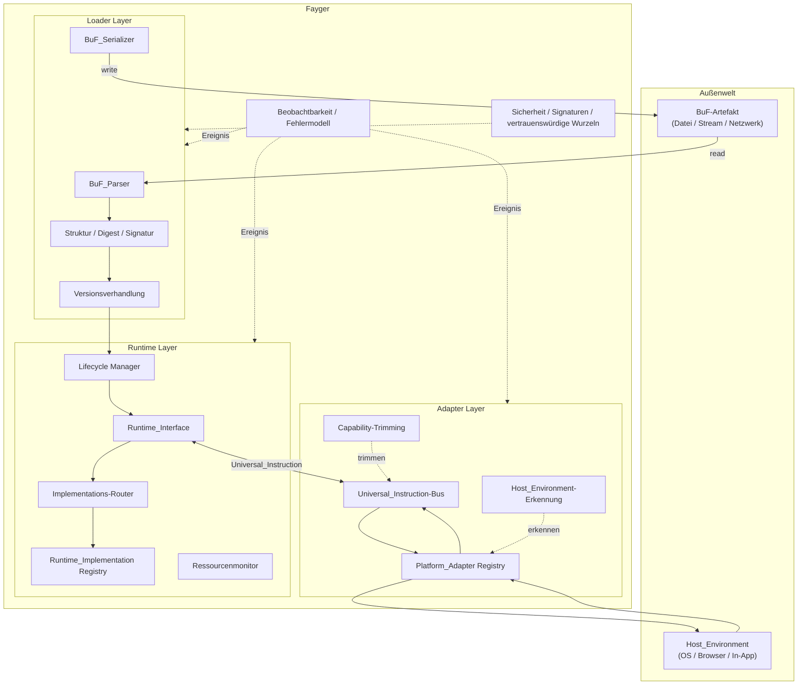

# Kapitel 2. Gesamtarchitektur

## 2.1 Drei Schichten

Fayger ist vertikal in drei Schichten unterteilt. Jede Schicht erfüllt ihre Verantwortung innerhalb ihrer Aufgabenteilung; Schichten kommunizieren ausschließlich über klar definierte Verträge.



## 2.2 Verantwortlichkeiten der Schichten

### Loader Layer

- Liest BuF über die *BuF_Source*-Abstraktion aus beliebigen Speicher-Backends (lokale Datei, HTTP Range, Object Storage, IPFS, benutzerdefiniertes Backend).
- Parst den Byte-Stream in ein In-Memory-Objekt.
- Prüft strukturelle Gültigkeit, Inhalts-Digests und Signaturen.
- Verhandelt mit dem aktuellen Fayger BuF-Schema und Runtime_Interface-Versionen.
- Wählt mit Section-Granularität die zu ladende Teilmenge gemäß dem vom Aufrufer übergebenen *LoadProfile*; überspringt Sections, die im aktuellen Umfeld nicht benötigt werden oder nicht passen.
- Wählt nach *LoadStrategy* zwischen vollem Vorab-Lesen (Eager) oder nur Header + Index, wobei Section-Bodies beim ersten Zugriff geholt werden (Lazy).
- Übergibt das fertige BuF-In-Memory-Objekt an die Laufzeitschicht.
- Umkehrfähigkeit: Serialisiert das In-Memory-Objekt zurück in Bytes für Tooling-Rückschreiben, Caching oder Repackaging.

### Runtime Layer

- Stellt *Runtime_Interface* als sprachneutralen Vertrag bereit.
- Pflegt das *Runtime_Implementation*-Registry und routet gemäß BuF_Manifest-Policy zur konkreten Implementierung.
- Verwaltet den Lebenszyklus jeder BuF_Instance (Loaded → Initialized → Running → Suspended → Terminated / Failed).
- Überwacht Ressourcennutzung pro Instanz und drosselt oder pausiert gemäß BuF_Manifest-Quotas.
- Kommuniziert mit der Adapterschicht über Universal_Instructions; selbst hängt sie an keinem konkreten Host.

### Adapter Layer

- Pflegt eine Menge von *Platform_Adaptern*, je einer pro Endgerät- / OS- / Hostklasse.
- Erkennt beim Start die aktuelle Host_Environment und wählt den passenden Adapter.
- Übersetzt Universal_Instructions der Laufzeitschicht in Systemaufrufe und normalisiert Host-Ereignisse zurück in Universal_Events.
- Trimmt das von BuF deklarierte Capability-Set auf die im aktuellen Host tatsächlich verfügbare Teilmenge.

## 2.3 Aufrufrichtung und Abhängigkeitsregeln

Die Abhängigkeitsrichtung ist Schlüssel zur langfristigen Evolvierbarkeit. Fayger erzwingt diese harten Regeln:

- **Loader → Runtime.** Einseitig. Der Loader übergibt nach dem Laden das In-Memory-Objekt und behält keine BuF_Instance.
- **Runtime ↔ Adapter.** Bidirektional über die Datentypen Universal_Instruction und Universal_Event. Die Laufzeit importiert nie direkt einen Platform_Adapter-Typ.
- **Runtime → Loader.** Verboten. Wenn die Laufzeit ein BuF erneut serialisieren muss (z. B. Hot Reload), nutzt sie eine vom Loader bereitgestellte Service-Schnittstelle, nicht innere Loader-Typen.
- **Adapter → Host.** Einseitig. Ein Platform_Adapter hält Host-SDK- und Systemaufrufreferenzen; die Laufzeit importiert nie direkt Hostbibliotheken.
- **Querschnitt (Beobachtbarkeit / Sicherheit) → drei Schichten.** Greift über Event-Bus und Policy-Schnittstellen ein. Die drei Schichten veröffentlichen Ereignisse und fragen Policies ab, hängen aber nicht an konkreten Querschnittsimplementierungen.

Kernzweck der Regeln: **Ein neuer Host darf die Laufzeitschicht nicht ändern; ein Wechsel der Laufzeit-Implementierung darf die Adapter nicht ändern.**

## 2.4 Übernommene Designs

### Verkettete Ladephasen der JVM

Die Loader-Schicht ist intern in JVM-artige Phasen aufgeteilt, was Fehlerzuordnung und Unit-Tests erleichtert:

```
Read(Header/Manifest/Index) → Parse → Verify(Structural)
  → Verify(Digest of Header/Manifest/Index) → Verify(Signature)
  → NegotiateVersion → Select(Sections by LoadProfile) → Resolve(Dependencies)
  → Read(Selected Section Bodies)?  → HandOff(to Runtime)
```

`Select(Sections by LoadProfile)` wählt zu ladende Sections anhand aktueller Geräte-Capabilities und Größenbeschränkungen. `Read(Selected Section Bodies)` läuft nur bei LoadStrategy = Eager; unter Lazy werden Lesen und Verifikation der ausgewählten Sections bis zum ersten Zugriff verzögert. Jede Phase erzeugt phasenmarkierte Fehler, die ins einheitliche Fehlermodell (Kapitel 6) fließen.

### Artefaktorganisation aus Docker / OCI

Ein BuF-Artefakt ist analog zu einem OCI Image organisiert:

| OCI-Konzept | BuF-Entsprechung |
| --- | --- |
| Image Manifest | BuF_Manifest |
| Image Config | Felder `runtime` / `capabilities` / `quotas` im BuF_Manifest |
| Layers | BuF Sections (code / data / assets / signature) |
| Distribution Spec | Einzeldatei-Artefakt in Phase 1; künftige Erweiterung |
| Runtime Spec | Runtime_Interface |
| containerd | Runtime_Layer (Lifecycle + Routing) |
| runc | Runtime_Implementation (Ausführer) |

### Capability-basierte Sicherheit aus WASM / WASI

Die Adapterschicht nutzt Capability-based Security:

- BuF_Manifest deklariert `requested_capabilities` (z. B. `fs.read`, `net.http`, `ui.dom`).
- Ein Platform_Adapter deklariert `available_capabilities`.
- Gewährt = `requested ∩ available ∩ host_policy`. Die Instanz geht nur dann in `Running`, wenn alle drei Schnittmengen nicht leer sind.
- Nicht deklarierte Capabilities sind für BuF unsichtbar (Default-Deny), entsprechend WASIs expliziter Host-Import-Semantik.

## 2.5 Umfang der ersten Phase und Nicht-Ziele

**Umfang der ersten Phase:**

- Einzelnes BuF laden und ausführen; mehrere BuF_Instances dürfen parallel laufen, teilen aber per Default nichts.
- Interpretierter Ausführungspfad; eine ExecutionStrategy-Abstraktion ist für spätere JIT reserviert.
- Vier eingebaute Platform_Adapter: Desktop / Server / Browser / In-App.
- Synchroner und asynchroner Anweisungsversand; Multi-Instanz-Isolation innerhalb eines Prozesses.

**Nicht-Ziele der ersten Phase:**

- Geteilter Speicher und IPC zwischen BuF_Instances.
- JIT-Kompilierung und Maschinencodeerzeugung.
- Verteilte Planung und Multi-Knoten-Fayger-Kollaboration.
- Differenzielle Verteilung von BuF und mehrschichtige Caches (Einzeldatei-Artefakt als Basis; mehrschichtige Struktur reserviert).
