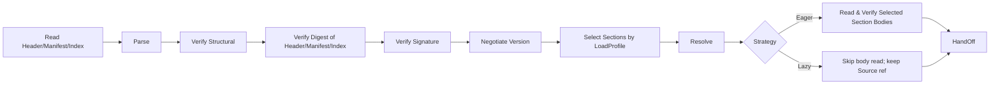
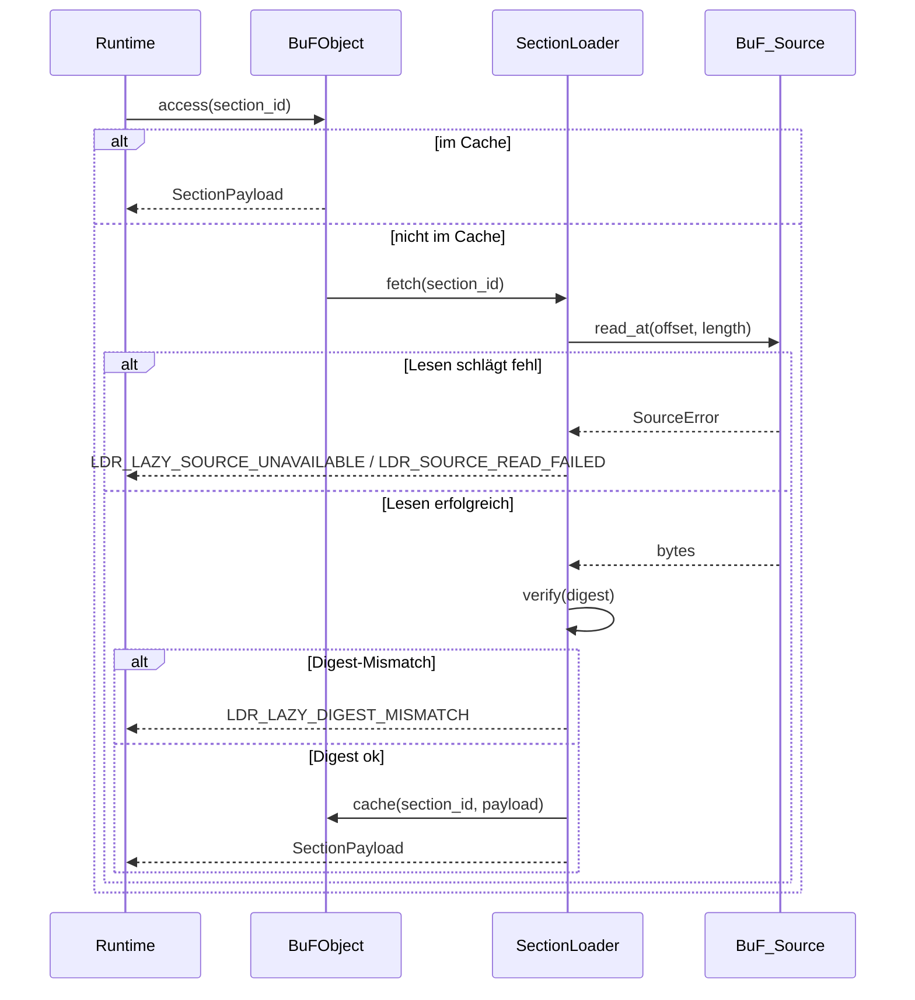

# Kapitel 3. Loader-Schicht

Die Loader-Schicht ist die Grenze zwischen Fayger und externen BuF-Artefakten. Ihre Aufgabe: ein BuF aus einem beliebigen Speicher-Backend zu lesen, je nach aktueller Umgebung und Aufruferpolicy zu entscheiden, welche Sections wann geladen werden, und Bytes in ein intern konsistentes BuF-In-Memory-Objekt zu verwandeln, das die Laufzeitschicht übernehmen kann — oder im Fehlerfall einen exakt lokalisierten, klassifizierbaren Fehler zurückzugeben.

## 3.1 BuF-Artefaktformat

BuF verwendet ein fünfteiliges Layout: **Header + Manifest + Section Index + Sections + Trailer**, in Anlehnung an JAR / OCI Image / WASM:

```
+------------------------------------------------------------+
| Header        | magic="BUF\0" | format_version | flags     |
|               | manifest_offset, manifest_length            |
|               | section_index_offset, section_index_length  |
+------------------------------------------------------------+
| Manifest      | CBOR-encoded BuFManifest                    |
+------------------------------------------------------------+
| Section Index | [(section_id, kind, offset, length, digest, |
|               |   visibility, profile_constraints)]         |
+------------------------------------------------------------+
| Sections      | [code | data | assets | signature | ...]   |
+------------------------------------------------------------+
| Trailer       | total_length | manifest_digest | crc32     |
+------------------------------------------------------------+
```

Designnotizen:

- **Magic + Format Version.** Feste erste 8 Byte, hilft Tooling beim Erkennen und Ablehnen fehlerhafter Streams.
- **Manifest als eigener Teil.** Erlaubt Versionsverhandlung, Profilauswahl und Capability-Trimming, ohne irgendeinen Section-Body zu dekodieren (isomorph zu OCI Image Manifest).
- **Section Index ist der vertrauenswürdige Index für den Lazy-Modus.** Jeder Eintrag enthält Offset, Länge, Digest, Visibility und profile_constraints. Der Section_Index muss beim Laden vollständig gelesen und per Gesamtdigest verifiziert werden, weil On-Demand-Fetches im Lazy-Modus auf ihm basieren.
- **Trailer.** Trägt Gesamtlänge und Manifest-Digest, erkennt Truncation und verhindert „erst signieren, dann Manifest manipulieren"-Angriffe.
- **Encoding.** Manifest und Section_Index nutzen CBOR im deterministischen Modus (RFC 8949 §4.2), so dass die Byteserialisierung eindeutig ist — Grundlage der Round-Trip-Äquivalenz.
- **Signaturumfang.** Header || Manifest_minus_signature || Section_Index. Übersprungene oder noch nicht geholte Section-Bodies fließen nicht in die Signatur ein, daher sind partielles und vollständiges Laden für die Signaturprüfung gleichwertig.

## 3.2 BuF_Manifest-Feldkonventionen

```idl
struct BuFManifest {
  // Versionsverhandlung
  schema_version: SemVer
  runtime_interface_min: SemVer
  deprecation_notice: Option<String>

  // Einstieg und Runtime-Auswahl
  entry: EntryPoint
  runtime: RuntimeRequirement {
    preferred_impl: Option<ImplementationId>
    selection_strategy: enum { Strict, PreferThenAny, Any }
  }

  // Capability-Deklarationen
  capabilities: CapabilitySet
  quotas: Option<ResourceQuota>

  // Inhaltsindex
  sections: List<SectionDescriptor> {
    id: SectionId
    kind: enum { Code, Data, Asset, Signature, Custom(String) }
    digest: Digest
    length: u64
    visibility: SectionVisibility           // Required | Optional
    profile_constraints: ProfileConstraints // Standard: keine Beschränkungen
  }

  // Signatur (optional)
  signature: Option<SignatureBlock>

  extensions: Map<String, CborValue>
}

struct ProfileConstraints {
  required_capabilities: Set<Capability>
  max_size: Option<u64>
  required_features: Set<Feature>
}
```

`schema_version` und `runtime_interface_min` entwickeln sich unabhängig: Erstere regelt die BuF-Format-Kompatibilität, Letztere die Runtime_Interface-Kompatibilität — analog zur Trennung von Class-File-Version und JVM-API-Level in der JVM.

## 3.3 Ladekette

Die Loader-Schicht ist intern in mehrere JVM-artige Phasen aufgeteilt:



Phasen:

- **Read Header/Manifest/Index.** Holt Header / Manifest / Section_Index / Trailer über die BuF_Source. Muss vor Rückkehr von `load` abgeschlossen sein, in Eager- wie Lazy-Modus.
- **Parse.** Parst Manifest und Section_Index (keine Bodies dekodieren).
- **Verify Structural.** Prüft Magic, Versionsfelder, Section-Grenzen, Manifest-Pflichtfelder.
- **Verify Digest of Header/Manifest/Index.** Verifiziert den Gesamtdigest von Header, Manifest und Section_Index (über `manifest_digest` und verwandte Felder im Trailer). Der Digest jedes Section-Bodies wird verifiziert, wenn diese Section tatsächlich geholt wird.
- **Verify Signature.** Läuft, wenn das Manifest Signaturinformationen trägt oder Erzwungener-Signaturmodus an ist. Signaturumfang deckt die drei Header-Teile ab; hängt nicht davon ab, ob Section-Bodies geholt werden.
- **Negotiate Version.** Prüft Kompatibilität von Schema und Runtime_Interface.
- **Select Sections by LoadProfile.** Bestimmt das ausgewählte Set gemäß LoadProfile und aktueller Host_Environment; siehe §3.7.
- **Resolve.** Auflösung von Abhängigkeiten zwischen BuFs (Phase 1: einzelnes BuF; Schnittstelle reserviert).
- **Read Selected Section Bodies.** Nur Eager-Modus. Liest jeden ausgewählten Section-Body über die BuF_Source und verifiziert dessen Digest.
- **HandOff.** Übergibt das In-Memory-Objekt an die Laufzeitschicht. Unter Lazy hält das Objekt eine BuF_Source-Referenz und einen SectionLoader.

Jede Phase markiert ihre Fehler mit Phasenname und Standortinfo und setzt `context.phase` auf `eager` oder `lazy`.

## 3.4 BuF_Source: Mehrquellen-Speicherabstraktion

```idl
interface BuF_Source {
  read_at(offset: u64, length: u64) -> Result<Bytes, SourceError>
  length() -> Result<u64, SourceError>
  stat() -> Result<SourceStat, SourceError>     // optional
  close() -> Result<(), SourceError>             // optional
}
```

Designnotizen:

- Die Loader-Schicht hängt nur am Minimalpaar `read_at` und `length`.
- Jedes Speichermedium mit Random-Access-Read kann als BuF_Source dienen: lokale Datei, HTTP Range, Object-Storage-SDK, IPFS-Gateway, Chunked-Flash auf eingebetteten Geräten, benutzerdefiniertes Backend.
- BuF_Source muss kein sequentielles Streaming implementieren, weil Lazy nach Offset springt.
- Auf kleinen Geräten (Drohne, Kamera) kann eine BuF_Source-Implementierung einen kleinen LRU-Cache enthalten oder direkt aus Chunked-Flash lesen; der Loader kennt die Strategie nicht.

## 3.5 BuF_Parser und BuF_Serializer

```idl
interface BuF_Parser {
  parse(bytes: Bytes) -> Result<BuFObject, ParseError>
}

interface BuF_Serializer {
  serialize(obj: BuFObject) -> Result<Bytes, SerializeError>
}
```

Innerhalb der `LoaderPipeline` ruft der Parser üblicherweise „Stück holen → parsen" über die BuF_Source auf; das byte-only `parse(bytes)` ist ein vereinfachter Einstieg für Unit-Tests und Tooling.

### In-Memory-Objekt (mit partiellem Laden)

```idl
struct BuFObject {
  manifest: BuFManifest
  raw_header: Header
  raw_trailer: Trailer

  selected_sections: Set<SectionId>
  skipped_sections: List<SkipRecord>     // (id, reasons)
  strategy: LoadStrategy
  source_ref: Option<BuF_Source>          // nur unter Lazy gehalten
  loader: Option<SectionLoader>           // nur unter Lazy gehalten
  sections: Map<SectionId, SectionPayload> // Eager: vollständig; Lazy: On-Demand-Cache
}

enum SkipReason {
  CapabilityNotGranted, OverMaxSize, FeatureMissing, ExplicitlyDisabled
}
```

Round-Trip-Äquivalenz unter partiellem Laden: Vergleich erfolgt über den Bereich der `selected_sections`; übersprungene Sections werden nicht verglichen, aber die `skipped_sections`-Liste selbst geht in den Vergleich ein. Das verhindert, dass zwei partielle Ladevorgänge mit unterschiedlichen Teilmengen als äquivalent gelten.

## 3.6 LoaderPipeline-Schnittstelle

```idl
struct LoadProfile {
  target_class: TargetClass             // desktop | server | browser | inapp | embedded | drone | camera | …
  capabilities: Set<Capability>
  max_section_bytes: Option<u64>
  features: Set<Feature>
}

enum LoadStrategy { Eager, Lazy }
enum SectionVisibility { Required, Optional }

struct LoaderPolicy {
  require_signature: bool
  trusted_roots: TrustedRootSet
  allowed_schema_versions: VersionRange
}

interface LoaderPipeline {
  load(
    source: BuF_Source,
    profile: LoadProfile,
    strategy: LoadStrategy,
    policy: LoaderPolicy
  ) -> Result<BuFObject, LoaderError>
}
```

`load` liest und verifiziert vor der Rückkehr stets Header / Manifest / Section_Index. Ob Section-Bodies vor der Rückkehr gelesen werden, hängt von `strategy` ab.

## 3.7 Partielles Laden: Sections nach Umgebung wählen

Endgeräte unterscheiden sich enorm. Ein Desktop kann ein vollständiges BuF laden; eine Drohne oder Kamera braucht vielleicht nur die Sections für „Steuerung + Video-Codec". Auswahlalgorithmus:

Für jedes `s ∈ manifest.sections` definieren wir das Prädikat

```
fits(s) = s.profile_constraints.required_capabilities ⊆ profile.capabilities
        ∧ (s.profile_constraints.max_size nicht gesetzt ∨ s.length ≤ s.profile_constraints.max_size)
        ∧ s.profile_constraints.required_features ⊆ profile.features
```

Auswahlergebnisse:

- `selected = { s : fits(s) }`, in `BuFObject.selected_sections` abgelegt.
- `s ∈ sections \ selected ∧ s.visibility == Required` ⟹ Laden schlägt fehl mit `LDR_PROFILE_REQUIRED_SECTION_MISSING`. Fehlerkontext enthält `section_id` und unerfüllte Beschränkungen.
- `s ∈ sections \ selected ∧ s.visibility == Optional` ⟹ kommt mit Gründen (CapabilityNotGranted / OverMaxSize / FeatureMissing / ExplicitlyDisabled) in `skipped_sections`.

Die Auswahl ist deterministisch: Gleiches (manifest, host_env, profile) liefert gleiches `selected` und `skipped_sections`.

### Beispiele

| Endgerät | Typisches LoadProfile | Auswahlverhalten |
| --- | --- | --- |
| Desktop | Volle Capabilities, kein max_section_bytes | Alle Sections ausgewählt |
| Server | ui deaktiviert, kein max_section_bytes | UI-Asset-Sections übersprungen (falls UI-abhängig deklariert) |
| Browser | Nur net.fetch / net.websocket / ui.dom, max_section_bytes ≈ 8 MiB | Übergroße Assets übersprungen; auf proc-Capabilities angewiesene Sections übersprungen |
| Drohne | Minimale Capabilities + max_section_bytes ≈ 1 MiB + features.realtime | Nur Steuerungs- und Codec-Sections; Lehrmaterial übersprungen |
| Kamera | Capabilities auf io.frame + crypto + net.rtsp begrenzt | Nur Videoverarbeitung und Uplink-Sections |

## 3.8 Ladestrategien: Eager vs. Lazy

### Eager

- Alle `selected_sections`-Bodies werden vor der Rückkehr von `load` gelesen und verifiziert.
- Geeignet für kleine BuFs, Szenarien ohne Netzzugriff nach dem Start oder „auf einen Schlag" Vorlieben.
- Fehler beim Laden tragen `phase == "eager"`.

### Lazy

- Nur Header / Manifest / Section_Index werden vor der Rückkehr von `load` gelesen und verifiziert.
- Ausgewählte Sections werden bei erstem Zugriff vom SectionLoader geholt und digest-verifiziert.
- Geeignet für große BuFs, On-Demand-Ausführung oder entfernte Quellen (HTTP / Object Storage).
- Fehler nach `load` tragen `phase == "lazy"` und können von Startfehlern getrennt behandelt werden.

```idl
interface SectionLoader {
  fetch(id: SectionId) -> Result<SectionPayload, LoaderError>
  is_loaded(id: SectionId) -> bool
  loaded_ids() -> Set<SectionId>
}
```

### Lazy-On-Demand-Fetch-Ablauf



### Eager-/Lazy-Äquivalenz

Für gleiche (source, profile, policy), unabhängig von der Strategie:

- `selected_sections` und `skipped_sections` sind identisch.
- Wenn man im Lazy-Ergebnis für jeden Eintrag in `selected_sections` einen Lesezugriff auslöst, sind die resultierenden Sections byteweise identisch zum Eager-Ergebnis.
- Lazy verschiebt Lesen und Verifikation nur in der Zeit; semantisch gibt es keinen Unterschied.

Diese Eigenschaft wird durchgängig per Property-Based Testing verifiziert.

## 3.9 Digest- und Signaturprüfung

### Digest

- Der Gesamtdigest von Header / Manifest / Section_Index wird beim Laden stets verifiziert.
- Der Digest jedes Section-Bodies stammt aus dem unveränderlichen Snapshot im Section_Index. Eager verifiziert alle ausgewählten Sections beim Laden; Lazy bei Erstzugriff.
- Eine Abweichung liefert `LDR_DIGEST_MISMATCH` (Eager) oder `LDR_LAZY_DIGEST_MISMATCH` (Lazy); der Fehlerkontext enthält die fehlerhafte `section_id`.

### Signatur

Der Signaturumfang ist `Header || Manifest_minus_signature || Section_Index`. Das bedeutet:

- Auch bei partiellem Laden bleibt die Signaturprüfung vollständig.
- Übersprungene Sections beeinflussen die Signaturprüfung nicht.
- Änderungen an Offset / Länge / Digest im Section_Index machen die Signatur ungültig.

Entscheidungstabelle der Signaturprüfung:

| Bedingung | Ergebnis |
| --- | --- |
| enforce_signature an ∧ keine Signatur | `Err(LDR_SIGNATURE_FAIL)`, Grund `MissingSignature` |
| Signatur vorhanden ∧ Verifikation schlägt fehl | `Err(LDR_SIGNATURE_FAIL)`, Grund `InvalidSignature` |
| Signatur vorhanden ∧ Verifikation ok | `Ok` |
| enforce_signature aus ∧ keine Signatur | `Ok` |

Das Set vertrauenswürdiger Wurzeln pflegt der *TrustStore*; Updates werden beim nächsten Laden wirksam (Kapitel 7).

**Kritische Reihenfolge.** Die Signaturprüfung erfolgt vor der Section-Auswahl. Erst wird die Herkunft des Artefakts per Gesamtsignatur des Manifests verifiziert; dann entscheidet das LoadProfile, welche Sections geladen werden. Damit wird eine geschwächte Semantik „nur die ausgewählte Teilmenge wird verifiziert" vermieden.

## 3.10 Versionsverhandlung

Eine Entscheidungstabelle:

| Bedingung | Ergebnis |
| --- | --- |
| schema-Version außerhalb des unterstützten Bereichs | `Err(LDR_SCHEMA_UNSUPPORTED)` mit erwartetem Bereich |
| runtime_interface_min höher als bereitgestellt | `Err(LDR_RUNTIME_VERSION_TOO_HIGH)` mit required / provided |
| schema im Bereich, nicht veraltet, runtime ok | `Ok` |
| schema veraltet, aber noch unterstützt | `Ok` mit Veraltungs-Hinweis |

Der Veraltungs-Hinweis wird über `BuFObject.manifest.deprecation_notice` exponiert, damit Tooling ihn anzeigen kann.

## 3.11 Fehlercodes

Stabile Fehlercodes der Loader-Schicht:

| Fehlercode | Auslöser |
| --- | --- |
| `LDR_PARSE_FAIL` | BuF-Bytestrom passt nicht zur Formatspezifikation |
| `LDR_DIGEST_MISMATCH` | Section-Digest-Mismatch in Eager-Phase |
| `LDR_LAZY_DIGEST_MISMATCH` | Section-Digest-Mismatch beim ersten Lazy-Zugriff |
| `LDR_SIGNATURE_FAIL` | Fehlende Signatur in Erzwingungsmodus oder ungültige Signatur |
| `LDR_SCHEMA_UNSUPPORTED` | schema-Version außerhalb des unterstützten Bereichs |
| `LDR_RUNTIME_VERSION_TOO_HIGH` | benötigtes Runtime_Interface höher als bereitgestellt |
| `LDR_MISSING_REQUIRED_FIELD` | Manifest fehlen Pflichtfelder beim Serialisieren |
| `LDR_PROFILE_REQUIRED_SECTION_MISSING` | Eine erforderliche Section ist im aktuellen Profil nicht ladbar |
| `LDR_LAZY_SOURCE_UNAVAILABLE` | BuF_Source bei nachfolgendem Lazy-Zugriff nicht verfügbar |
| `LDR_SOURCE_READ_FAILED` | BuF_Source-Lesefehler (Eager oder Lazy) |

Jeder Fehler-`context` enthält Standort und Grund und markiert die Phase über `context.phase = "eager" | "lazy"` für konsistente Diagnose im Tooling.
