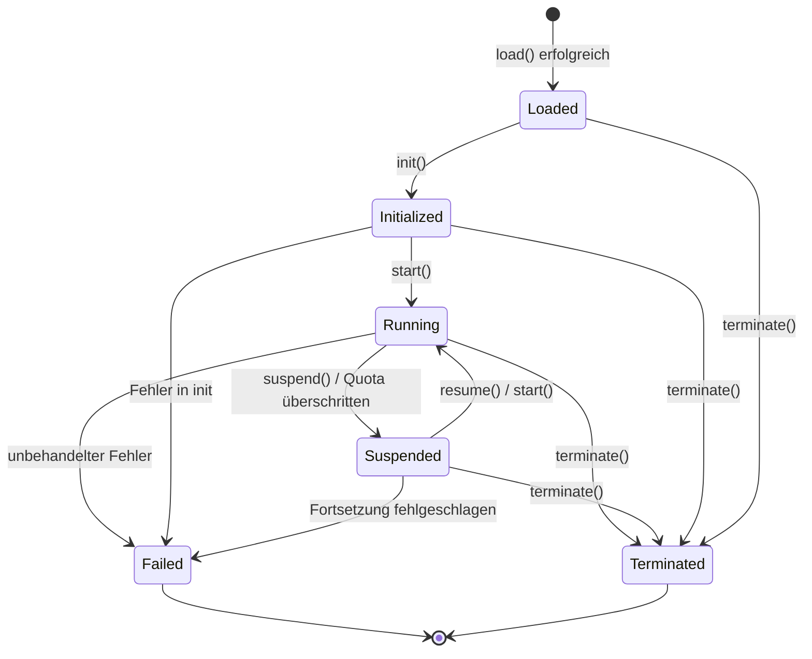

# Kapitel 4. Runtime-Schicht

Die Runtime-Schicht führt BuF-Semantik aus. Sie empfängt das von der Loader-Schicht übergebene BuF_Object, kommuniziert über Universal_Instructions mit der Adapter-Schicht und hängt an keinem konkreten Host.

## 4.1 Runtime_Interface (sprachneutraler Vertrag)

Runtime_Interface ist der stabile externe Vertrag der Runtime-Schicht. Jede Runtime_Implementation muss ihn semantisch äquivalent umsetzen — egal mit Rust-Traits, Go-Interfaces, TypeScript-Interfaces oder anderen Sprachmechanismen.

```idl
interface Runtime_Interface {
  // Metadaten
  rt_version() -> RuntimeInterfaceVersion
  capabilities() -> Set<RuntimeCapability>

  // Lebenszyklus
  load(obj: BuFObject) -> Result<InstanceId, RuntimeError>
  init(id: InstanceId) -> Result<(), RuntimeError>
  start(id: InstanceId) -> Result<(), RuntimeError>
  suspend(id: InstanceId) -> Result<(), RuntimeError>
  resume(id: InstanceId) -> Result<(), RuntimeError>
  terminate(id: InstanceId) -> Result<(), RuntimeError>

  // Statusabfragen
  state(id: InstanceId) -> Result<LifecycleState, RuntimeError>
  failure_info(id: InstanceId) -> Result<Option<FailureInfo>, RuntimeError>

  // Kommunikation mit der Adapterschicht
  emit(id: InstanceId, instr: UniversalInstruction) -> Result<UniversalReply, AdapterError>
  on_event(id: InstanceId, event: UniversalEvent) -> Result<(), RuntimeError>
}
```

Stilistisch übernommen von:

- **OCI Runtime Spec** „Konfiguration + Befehle"-Trennung: `load` reicht Konfiguration ein; `init / start / suspend / resume / terminate` sind Befehle.
- **JVM-Execution-Engine** Statusabfrage-Gewohnheit: `state` und `failure_info` sind jederzeit abrufbar.

## 4.2 Registrierung und Routing der Runtime_Implementation

```idl
interface RuntimeRegistry {
  register(impl: Runtime_Implementation) -> Result<RegistrationId, RegistryError>
  list() -> List<RuntimeImplementationDescriptor>
  resolve(manifest: BuFManifest) -> Result<RegistrationId, RegistryError>
}
```

### Methoden-Vollständigkeitsprüfung bei Registrierung

Das RuntimeRegistry prüft, ob eine Kandidaten-Implementierung alle erforderlichen Methoden des Runtime_Interface abdeckt:

- Sei `R` die Pflichtmethoden-Menge des Runtime_Interface und `I = implemented_methods(impl)`.
- `register(impl)` ist genau dann erfolgreich, wenn `R ⊆ I`.
- Sonst gibt es `RT_IMPL_MISSING_METHODS` zurück mit `R \ I` in `context.missing_methods`.

Die Prüfung läuft einmal bei Registrierung; zur Laufzeit fallen keine Kosten an.

### Routingstrategie

Im BuF_Manifest drücken `runtime.preferred_impl` und `runtime.selection_strategy` die Präferenz aus. Verhalten von `resolve(manifest)`:

- `Strict`: muss `preferred_impl` benutzen, kompatibel zum Manifest; sonst `RT_IMPL_NOT_FOUND`.
- `PreferThenAny`: bevorzugt `preferred_impl`; falls nicht verfügbar, beliebige kompatible Implementierung.
- `Any`: beliebige kompatible Implementierung.

„Kompatibel" heißt: `rt_version()` ≥ `manifest.runtime_interface_min` und `capabilities()` enthält das minimale Capability-Set des Manifests.

In einer einzigen Fayger-Instanz können mehrere registrierte Implementierungen koexistieren (z. B. eine Rust-Implementierung für Desktop und eine TypeScript-Implementierung für den Browser). Routing muss für Aufrufer vorhersagbar und debugbar bleiben.

## 4.3 Lebenszyklus einer BuF_Instance

### Zustandsautomat



### Tabelle legaler Übergänge

| Aktueller Zustand | Erlaubte Ziele |
| --- | --- |
| Loaded | Initialized, Terminated, Failed |
| Initialized | Running, Terminated, Failed |
| Running | Suspended, Terminated, Failed |
| Suspended | Running, Terminated, Failed |
| Terminated | (Endzustand) |
| Failed | (Endzustand) |

Beispiele illegaler Übergänge: `Loaded → Running` (init fehlt), `Terminated → beliebig`, `Failed → Running`.

Bei einem illegalen Übergang gibt die Runtime `RT_ILLEGAL_TRANSITION` zurück; der Fehlerkontext enthält `current_state` und `allowed_set`, der Zustand bleibt unverändert.

### Failed-Zustand

Eine Instanz, die in `Failed` geht, muss bewahren:

- Die letzte Universal_Instruction, die den Fehler ausgelöst hat.
- Das Fehlerobjekt, das den Fehler ausgelöst hat (mit der gesamten Cause-Kette).

Diese sind über `failure_info(id)` abrufbar, bis die Instanz explizit zerstört wird.

## 4.4 BuF_Instance-Datenbereich und Isolation

Jede BuF_Instance besitzt einen unabhängigen RuntimeDataArea:

- Unabhängiger Heap / Aufrufstack / Handle-Tabelle.
- Unabhängige Anweisungs-Dispatch-Queue.
- Unabhängige Ressourcennutzungs-Zähler.

Verschiedene Instanzen teilen standardmäßig keine Objektzeiger. Übernommen vom JVM-Modell mit thread-unabhängigem PC / Stack und instanzunabhängigem Methodenbereich.

Formal gilt für je zwei zur selben Zeit existierende Instanzen `i₁` und `i₂`:

```
data_area(i₁) ∩ data_area(i₂) == ∅
```

und jede Schreiboperation auf `i₁` ändert kein Byte in `data_area(i₂)`. Das ist eine der zentralen Isolations-Eigenschaften, die in Tests verifiziert werden.

## 4.5 Ressourcenüberwachung und Quotas

```idl
interface ResourceMonitor {
  attach(id: InstanceId, quota: ResourceQuota)
  sample(id: InstanceId) -> ResourceUsage
}
```

Überwachungsstrategie:

- Wenn das BuF_Manifest CPU- / Speicher- / I/O-Quotas deklariert, sampelt der `ResourceMonitor` periodisch.
- Überschreitet eine Dimension die Quota, wird ein `QuotaExceeded`-Ereignis ausgegeben und der Lifecycle-Manager versetzt die Instanz in `Suspended`.
- `context.resource` des Suspend-Ereignisses entspricht der zuerst überschrittenen Ressourcenart, `context.usage` dem Sample bei der ersten Überschreitung.

Die Ressourcenüberwachung nutzt Hostfähigkeiten (cgroups, Browser Performance API, Plattform-Timer …) und wird vom passenden Platform_Adapter geliefert. Die Runtime konsumiert nur die normalisierten Werte.

## 4.6 Fehler-Isolation zwischen Instanzen

Eine Instanz, die in `Failed` geht, darf andere `Running`-Instanzen nicht beeinträchtigen:

- Der Lifecycle-Manager bereinigt die fehlerhafte Instanz allein.
- Der Universal_Instruction-Versand anderer Instanzen bleibt unbeeinflusst.
- Der Event-Bus klassifiziert ausgefallene und gesunde Instanzen separat, um gegenseitige Blockaden zu vermeiden.

Formal: Bei N gleichzeitig laufenden Instanzen entspricht — wenn ein `iₖ` ausfällt — die Zustandszeitlinie und Universal_Instruction-Sequenz der übrigen `iⱼ` (`j ≠ k`) der ausfallfreien Baseline.

## 4.7 Schnittstelle zur Adapter-Schicht

Die Runtime emittiert `UniversalInstruction` an den Adapter und empfängt `UniversalReply` oder `UniversalEvent`:

```idl
fn emit(id: InstanceId, instr: UniversalInstruction) -> Result<UniversalReply, AdapterError>
fn on_event(id: InstanceId, event: UniversalEvent) -> Result<(), RuntimeError>
```

Die Runtime hängt nur an diesen beiden Datentypen und an keinem konkreten Platform_Adapter-Typ. Statische Abhängigkeitschecks setzen die Regel um (siehe Kapitel 8 Tooling-Empfehlungen).

## 4.8 Fehlercodes

Stabile Fehlercodes der Runtime-Schicht:

| Fehlercode | Auslöser |
| --- | --- |
| `RT_ILLEGAL_TRANSITION` | Illegaler Lebenszyklusübergang |
| `RT_IMPL_NOT_FOUND` | Routing fand keine passende Implementierung |
| `RT_IMPL_MISSING_METHODS` | Registrierte Implementierung fehlen Pflichtmethoden |
| `RT_QUOTA_EXCEEDED` | Ressourcennutzung überschreitet Quota; löst Suspended aus |
| `RT_INSTANCE_FAILED` | Instanz ist in Failed gegangen |
