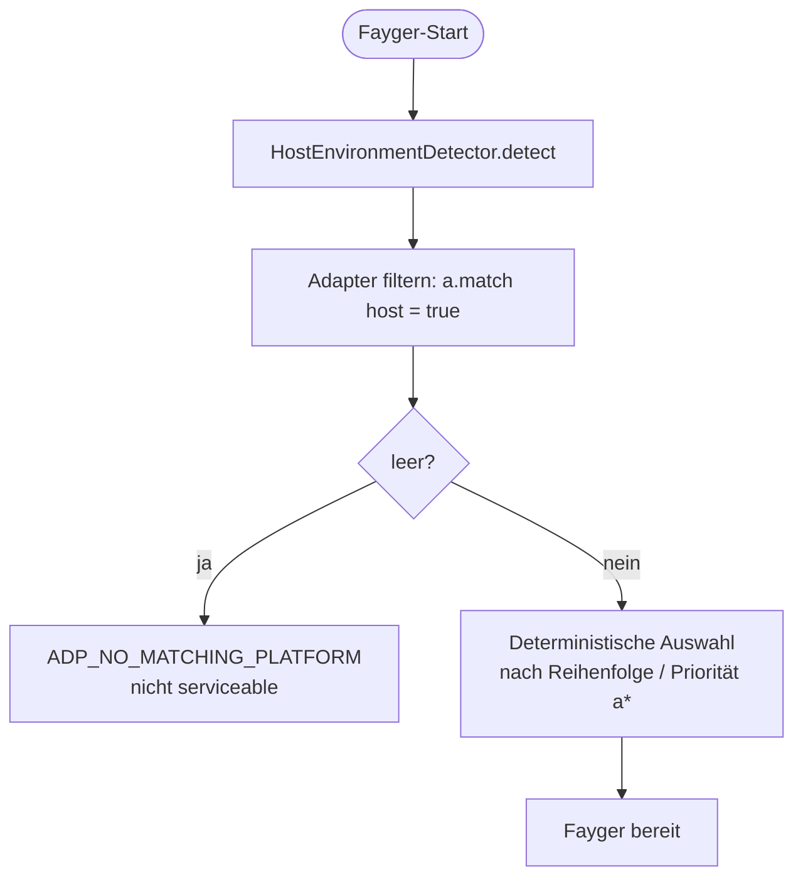
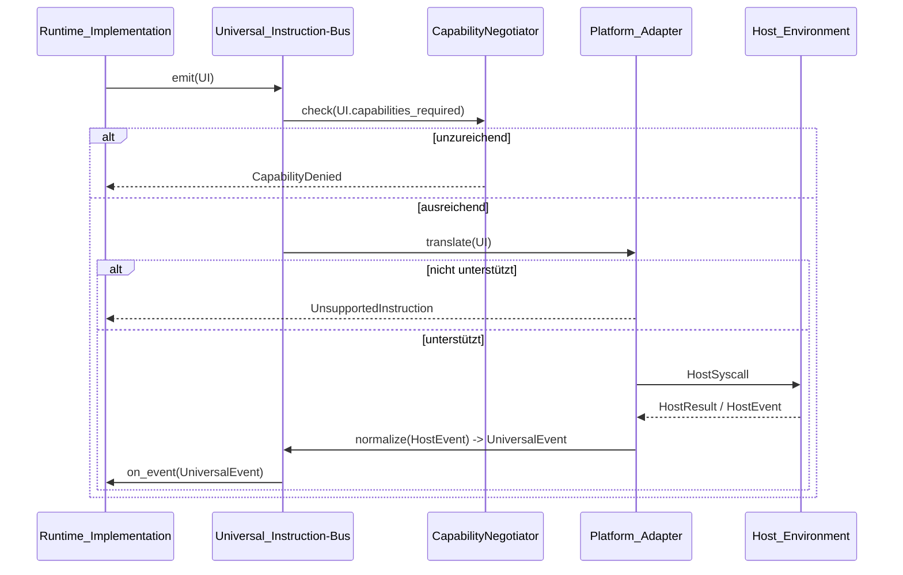

# Kapitel 5. Adapter-Schicht

Die Adapter-Schicht ist die Grenze zwischen Fayger und der Host_Environment. Sie empfängt Universal_Instructions von der Runtime-Schicht und übersetzt sie in Systemaufrufe, die der Host versteht; sie normalisiert Host-Ereignisse zu Universal_Events und sendet sie zurück an die Runtime-Schicht.

Einen neuen Host hinzuzufügen erfordert nur einen neuen Platform_Adapter — Runtime- und Loader-Schicht bleiben unverändert.

## 5.1 Datenform der Universal_Instruction

```idl
struct UniversalInstruction {
  category: InstructionCategory
  opcode: u16
  operands: TLV[]
  capabilities_required: Set<Capability>
}

struct UniversalEvent {
  category: EventCategory
  opcode: u16
  payload: TLV[]
}
```

Designnotizen:

- **category** ist die grobe Kategorie (io / net / ui / time / random / crypto / proc / host).
- **opcode** ist die Nummer innerhalb der Kategorie (2 Byte); das oberste Bit ist für experimentelle Anweisungen reserviert.
- **operands** ist eine TLV-Sequenz (type-length-value) für sprachübergreifende Dekodierung und Erweiterbarkeit.
- **capabilities_required** ist die Capability-Menge, die diese Anweisung benötigt; sie speist das Capability-Trimming.

### Kategorien (erste Phase)

| Kategorie | Beschreibung | Übernommen von |
| --- | --- | --- |
| `io` | Dateien / Standardströme | POSIX read / write |
| `net` | Netzwerk-I/O | WASI sock_* |
| `ui` | UI-Rendering und Eingabe | DOM / Terminal-TUI / Canvas |
| `time` | Uhren und Timer | clock_time_get |
| `random` | Zufallszahlen | random_get |
| `crypto` | Kryptografie-Primitive | WASI crypto |
| `proc` | Prozess / Thread / Signal | POSIX |
| `host` | Host-spezifische Aufrufe | JNI / extism |

8 reservierte Bits stehen für künftige Kategorien bereit.

### Encoding

Jede Anweisung wird so codiert:

```
+--------+--------+----------+-------------------+
| cat(1) | op(2)  | caps(2)  | operands(TLV...)  |
+--------+--------+----------+-------------------+
```

- `cat`: 1 Byte; obere Bits für Flags reserviert.
- `op`: 2 Byte.
- `caps`: 2 Byte Capability-Bitmap (16 niedrige Bits in Phase 1; ein Erweiterungssegment für mehr).
- `operands`: jeder Operand ist `(type:1, length:varint, value)`.

## 5.2 Platform_Adapter-Abstraktion

```idl
interface Platform_Adapter {
  descriptor() -> AdapterDescriptor
  match(host: HostEnvironment) -> bool
  translate(instr: UniversalInstruction) -> Result<HostSyscall, AdapterError>
  normalize(raw: HostEvent) -> Result<UniversalEvent, AdapterError>
}

struct AdapterDescriptor {
  platform_id: String
  supported_capabilities: Set<Capability>
  supported_instructions: Set<InstructionId>
}
```

Jeder Adapter beschreibt seine unterstützten Capabilities und Anweisungen selbst, sodass Capability-Trimming und „nicht unterstützte Anweisung"-Entscheidungen lokale Tabellen-Lookups sind, ohne Trial-and-Error zur Laufzeit.

## 5.3 Host_Environment-Erkennung und Adapterauswahl

```idl
interface HostEnvironmentDetector {
  detect() -> HostEnvironment
}

struct HostEnvironment {
  platform_id: String
  os_kind: OsKind
  arch: Arch
  sandbox_kind: SandboxKind
  runtime_features: Set<Feature>
}
```

Auswahlfluss beim Start:



Deterministische Auswahl: Bei gleicher Adaptermenge und gleicher Host_Environment liefert wiederholter Start denselben Adapter. So wird das „Phantom-Adapter"-Problem vermieden.

## 5.4 Capability-Trimming

```idl
interface CapabilityNegotiator {
  negotiate(
    requested: Set<Capability>,
    available: Set<Capability>,
    policy: HostPolicy
  ) -> NegotiationResult
}

struct NegotiationResult {
  granted: Set<Capability>
  denied: Set<Capability>
  warnings: List<Capability>
}
```

Mengenalgebra des Trimmings:

- `granted = requested ∩ available ∩ policy`
- `denied = requested \ granted`
- `warnings`: Capabilities, die der Host eingeschränkt bereitstellt (z. B. `net.http` unter den Fetch-Beschränkungen des Browsers).

Wenn `manifest.required_capabilities \ granted ≠ ∅`, muss `start()` einen Fehler liefern; `context.missing` entspricht der Differenz, die Instanz geht nicht in Running. Das ist die harte Regel „Nicht starten, wenn Capabilities fehlen".

Nicht deklarierte Capabilities sind für BuF unsichtbar (Default-Deny), entsprechend WASIs expliziter Host-Import-Semantik.

## 5.5 Bidirektionaler Übersetzungsfluss



Hinweise:

- Capability-Prüfung erfolgt vor `translate`, um unnötige Downstream-Aufrufe zu vermeiden.
- „Nicht unterstützte Anweisung" ist eine deterministische lokale Entscheidung (Tabellen-Lookup), die keinen Hostaufruf auslöst.
- Host-Ereignisse kommen über `normalize` zurück; die Runtime berührt nie rohe Host-Ereignisstrukturen.

## 5.6 Eingebaute Adapter der ersten Phase

| Adapter | Anwendungsfall | Capability-Trimming |
| --- | --- | --- |
| **NativeDesktop_Adapter** | Linux / macOS / Windows Desktop | Nahezu vollständige Capabilities; `ui` / `proc` / `io` / `net` voll verfügbar |
| **Server_Adapter** | Headless-Server | `ui` deaktiviert; `proc` policy-eingeschränkt |
| **Browser_Adapter** | Web-API-basiert | `proc` und ein Großteil von `io` deaktiviert; `net` auf fetch / WebSocket beschränkt; starkes Trimming |
| **InApp_Adapter** | Eingebettet in einen Host-Anwendungsprozess | Capabilities werden vom Host explizit injiziert; am restriktivsten; verfügbare `host`-Opcodes deklariert der Host |

Diese Adapter sind Referenzimplementierungen. Dritte können eigene Adapter registrieren, etwa eingebettete Endgeräte oder spezifische IDE-Einbettungen.

## 5.7 Plattformübergreifende Konsistenz

Dasselbe BuF, geladen und ausgeführt auf verschiedenen Platform_Adaptern, muss der Runtime dieselbe Lifecycle_State-Sequenz und dieselbe Universal_Instruction-Sequenz zeigen:

- Jegliche Differenz, die zur Sequenz-Divergenz führen würde, muss vor `start` durch Capability-Trimming abgelehnt werden, nicht stillschweigend zur Laufzeit divergiert werden.
- Optimierungen mit „äquivalent, aber anderer Pfad" dürfen verschiedene Pfade nicht in der Universal_Instruction-Sequenz exponieren.

Diese Eigenschaft wird per PBT verifiziert, indem ein Paar Mock-Adapter mit gleichen Capabilities parallel läuft und die Sequenzen verglichen werden.

## 5.8 Fehlercodes

Stabile Fehlercodes der Adapter-Schicht:

| Fehlercode | Auslöser |
| --- | --- |
| `ADP_NO_MATCHING_PLATFORM` | Kein Adapter passt zum aktuellen Host |
| `ADP_UNSUPPORTED_INSTRUCTION` | Aktueller Adapter unterstützt die Anweisung nicht |
| `ADP_CAPABILITY_DENIED` | Nach Trimming reichen die Capabilities nicht für die Anweisung |
| `ADP_HOST_CALL_FAILED` | Nach Übersetzung in Systemaufruf scheiterte die Hostseite |

`ADP_UNSUPPORTED_INSTRUCTION` darf keinen Hostaufruf auslösen; nur der Fehler wird zurückgegeben. Das ist der „Default-Deny"-Stand auf Anweisungsebene.
