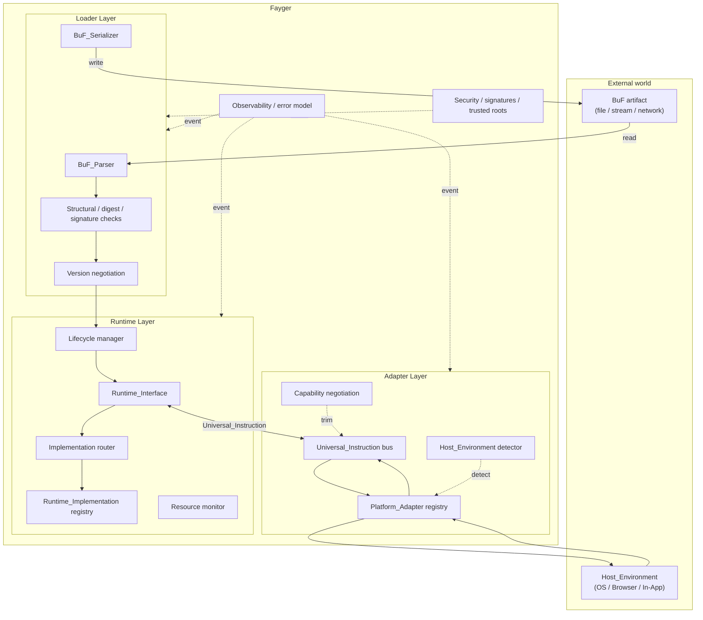

# Chapter 2. Overall Architecture

## 2.1 Three layers

Fayger is divided vertically into three layers. Each layer fulfills its responsibilities within its own division of work, and layers communicate only through well-defined contracts.



## 2.2 Responsibilities of each layer

### Loader Layer

- Reads a BuF from any storage backend through the *BuF_Source* abstraction (local file, HTTP Range, object storage, IPFS, user-defined backend).
- Parses the byte stream into an in-memory object.
- Verifies structural validity, content digests, and signatures.
- Negotiates BuF schema and Runtime_Interface versions with the current Fayger.
- Selects, at section granularity, the subset to load based on the caller-supplied *LoadProfile*; skips sections that the current environment does not need or cannot fit.
- Chooses to read all bodies upfront (Eager) or to read only header + index and defer section bodies to first access (Lazy), based on *LoadStrategy*.
- Hands the ready BuF in-memory object off to the runtime layer.
- Inverse capability: serializes the in-memory object back to bytes for tooling write-back, caching, or repackaging.

### Runtime Layer

- Exposes *Runtime_Interface* as a language-neutral contract.
- Maintains the *Runtime_Implementation* registry and routes to a concrete implementation per BuF_Manifest policy.
- Manages each BuF_Instance's lifecycle (Loaded → Initialized → Running → Suspended → Terminated / Failed).
- Monitors per-instance resource usage and applies throttling or suspension per BuF_Manifest quotas.
- Communicates with the adapter layer through Universal_Instruction; it depends on no concrete host.

### Adapter Layer

- Maintains a set of *Platform_Adapters*, each corresponding to a class of terminal / OS / host.
- Detects the current Host_Environment at startup and matches the appropriate adapter.
- Translates Universal_Instructions from the runtime layer into system calls and normalizes host events back into Universal_Events.
- Trims the BuF-declared capability set down to the subset actually available on the current host.

## 2.3 Call direction and dependency rules

Dependency direction is the key to long-term evolvability. Fayger enforces these hard rules:

- **Loader → Runtime.** One-way. Once load completes, the loader hands off the in-memory object and does not retain any BuF_Instance.
- **Runtime ↔ Adapter.** Two-way through the Universal_Instruction and Universal_Event data types. The runtime never imports any Platform_Adapter type directly.
- **Runtime → Loader.** Forbidden. If the runtime needs to re-serialize a BuF (for example, hot reload), it goes through a service interface exposed by the loader, not by reaching back into loader internals.
- **Adapter → Host.** One-way. A Platform_Adapter holds references to host SDKs and system calls; the runtime never imports host libraries directly.
- **Cross-cutting (observability / security) → all three layers.** Reaches in through the event bus and policy interfaces. The three layers publish events and query policies, but do not depend on cross-cutting implementations.

The point of these rules is: **adding a new host should not change the runtime; replacing a runtime implementation should not change the adapters**.

## 2.4 Borrowed designs

### Borrowing the chained loading phases of the JVM

The loader layer is internally split into JVM-style sub-phases for clear error attribution and unit testing:

```
Read(Header/Manifest/Index) → Parse → Verify(Structural)
  → Verify(Digest of Header/Manifest/Index) → Verify(Signature)
  → NegotiateVersion → Select(Sections by LoadProfile) → Resolve(Dependencies)
  → Read(Selected Section Bodies)?  → HandOff(to Runtime)
```

`Select(Sections by LoadProfile)` selects sections to load based on current terminal capabilities and size constraints. `Read(Selected Section Bodies)` runs only when LoadStrategy = Eager; under Lazy, reading and verification of selected sections defer to first access. Each phase produces phase-tagged errors that flow into the unified error model (Chapter 6).

### Borrowing artifact organization from Docker / OCI

A BuF artifact is organized like an OCI Image:

| OCI concept | BuF counterpart |
| --- | --- |
| Image Manifest | BuF_Manifest |
| Image Config | The `runtime` / `capabilities` / `quotas` fields of BuF_Manifest |
| Layers | BuF Sections (code / data / assets / signature) |
| Distribution Spec | Single-file artifact in the first phase; future extension |
| Runtime Spec | Runtime_Interface |
| containerd | Runtime_Layer (lifecycle + routing) |
| runc | Runtime_Implementation (the executor) |

### Borrowing the capability-based security model from WASM / WASI

The adapter layer uses capability-based security:

- BuF_Manifest declares `requested_capabilities` (e.g., `fs.read`, `net.http`, `ui.dom`).
- A Platform_Adapter declares `available_capabilities`.
- Granted = `requested ∩ available ∩ host_policy`. The instance enters `Running` only if all three are non-empty in their intersections.
- Capabilities not declared are invisible to BuF (default deny), matching WASI's explicit host-import semantics.

## 2.5 First-phase scope and non-goals

**First-phase scope:**

- Single-BuF load and execution; multiple BuF_Instances may run concurrently but share nothing by default.
- Interpreted execution path; an ExecutionStrategy abstraction is reserved for future JIT.
- Four built-in Platform_Adapters: desktop / server / browser / In-App.
- Synchronous and asynchronous instruction dispatch; multi-instance isolation within a single process.

**First-phase non-goals:**

- Shared memory and IPC between BuF_Instances.
- JIT compilation and machine-code generation.
- Distributed scheduling and multi-node Fayger collaboration.
- Differential distribution of BuF and layered caches (single-file artifact baseline; layered structure reserved).
