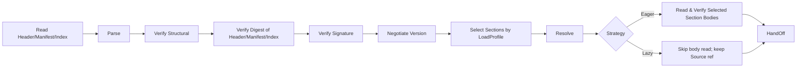
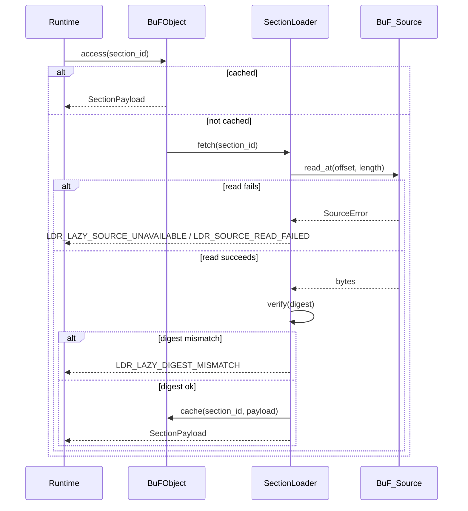

# Chapter 3. Loader Layer

The loader layer is the boundary between Fayger and external BuF artifacts. Its job is to read a BuF from any storage backend, choose which sections to load and when, and turn bytes into an internally consistent BuF in-memory object that the runtime layer can take over — or, on failure, return a precisely located, classifiable error.

## 3.1 BuF artifact format

BuF uses a five-part layout: **Header + Manifest + Section Index + Sections + Trailer**, borrowing from JAR / OCI Image / WASM:

```
+------------------------------------------------------------+
| Header        | magic="BUF\0" | format_version | flags     |
|               | manifest_offset, manifest_length            |
|               | section_index_offset, section_index_length  |
+------------------------------------------------------------+
| Manifest      | CBOR-encoded BuFManifest                    |
+------------------------------------------------------------+
| Section Index | [(section_id, kind, offset, length, digest, |
|               |   visibility, profile_constraints)]         |
+------------------------------------------------------------+
| Sections      | [code | data | assets | signature | ...]   |
+------------------------------------------------------------+
| Trailer       | total_length | manifest_digest | crc32     |
+------------------------------------------------------------+
```

Design notes:

- **Magic + Format Version.** Fixed first 8 bytes for tooling identification and rejection of malformed streams.
- **Manifest as a separate part.** Allows version negotiation, profile selection, and capability trimming without decoding any section body (isomorphic to OCI Image Manifest).
- **Section Index is the trusted index for Lazy mode.** Each entry contains offset, length, digest, visibility, and profile_constraints. The Section_Index must be fully read and digest-verified during load, because Lazy on-demand fetches rely on it.
- **Trailer.** Carries the total length and the Manifest digest, enabling truncation detection and preventing "sign first, then tamper Manifest" attacks.
- **Encoding.** Manifest and Section_Index use CBOR in deterministic encoding mode (RFC 8949 §4.2) so the byte serialization is unique — the cornerstone of round-trip equivalence.
- **Signature scope.** Header || Manifest_minus_signature || Section_Index. Skipped or not-yet-fetched section bodies do not participate in signature computation, so partial load and full load are equivalent for signature verification.

## 3.2 BuF_Manifest field conventions

```idl
struct BuFManifest {
  // Version negotiation
  schema_version: SemVer
  runtime_interface_min: SemVer
  deprecation_notice: Option<String>

  // Entry and runtime selection
  entry: EntryPoint
  runtime: RuntimeRequirement {
    preferred_impl: Option<ImplementationId>
    selection_strategy: enum { Strict, PreferThenAny, Any }
  }

  // Capability declarations
  capabilities: CapabilitySet
  quotas: Option<ResourceQuota>

  // Content index
  sections: List<SectionDescriptor> {
    id: SectionId
    kind: enum { Code, Data, Asset, Signature, Custom(String) }
    digest: Digest
    length: u64
    visibility: SectionVisibility           // Required | Optional
    profile_constraints: ProfileConstraints // Defaults to no constraints
  }

  // Signature (optional)
  signature: Option<SignatureBlock>

  extensions: Map<String, CborValue>
}

struct ProfileConstraints {
  required_capabilities: Set<Capability>
  max_size: Option<u64>
  required_features: Set<Feature>
}
```

`schema_version` and `runtime_interface_min` evolve independently. The former governs BuF format compatibility, the latter governs Runtime_Interface compatibility — analogous to how the JVM separates class file version from JVM API level.

## 3.3 The loading chain

The loader is internally split into multiple JVM-style phases:



Phase responsibilities:

- **Read Header/Manifest/Index.** Pulls Header / Manifest / Section_Index / Trailer through the BuF_Source. Must complete before `load` returns, in either Eager or Lazy mode.
- **Parse.** Parses Manifest and Section_Index (does not decode section bodies).
- **Verify Structural.** Checks magic, version fields, section bounds, required Manifest fields.
- **Verify Digest of Header/Manifest/Index.** Verifies the holistic digest of Header, Manifest, and Section_Index (via `manifest_digest` and related fields in the Trailer). Each section body's digest is verified when that section is actually fetched.
- **Verify Signature.** Runs when the Manifest carries signature info or when enforce-signature mode is on. Signature scope covers the three header parts; it does not depend on whether section bodies are fetched.
- **Negotiate Version.** Checks schema and Runtime_Interface compatibility.
- **Select Sections by LoadProfile.** Decides the selected set per the caller-supplied LoadProfile and the current Host_Environment; see §3.7.
- **Resolve.** Resolves dependencies between BuFs (single-BuF in the first phase; reserved interface).
- **Read Selected Section Bodies.** Eager mode only. Reads each selected section body through BuF_Source and verifies its digest.
- **HandOff.** Hands the in-memory object off to the runtime layer. Under Lazy, the object retains a BuF_Source reference and a SectionLoader.

Each phase tags its errors with phase name and location info, and sets `context.phase` to `eager` or `lazy`.

## 3.4 BuF_Source: multi-source storage abstraction

```idl
interface BuF_Source {
  read_at(offset: u64, length: u64) -> Result<Bytes, SourceError>
  length() -> Result<u64, SourceError>
  stat() -> Result<SourceStat, SourceError>     // optional
  close() -> Result<(), SourceError>             // optional
}
```

Design notes:

- The loader depends only on the minimal pair `read_at` and `length`.
- Any storage medium that supports random-access read can serve as a BuF_Source: local file, HTTP Range, object-storage SDK, IPFS gateway, chunked Flash on embedded devices, user-defined backend.
- BuF_Source need not implement sequential streaming, because Lazy mode jumps by offset.
- For small devices (drone, camera), a BuF_Source implementation may include a small LRU cache or read directly from chunked Flash; the loader is unaware of the strategy.

## 3.5 BuF_Parser and BuF_Serializer

```idl
interface BuF_Parser {
  parse(bytes: Bytes) -> Result<BuFObject, ParseError>
}

interface BuF_Serializer {
  serialize(obj: BuFObject) -> Result<Bytes, SerializeError>
}
```

Inside `LoaderPipeline`, the parser typically calls BuF_Source as "fetch a chunk → parse it"; the byte-only `parse(bytes)` is a simplified entry point for unit tests and tooling.

### In-memory object (with partial loading)

```idl
struct BuFObject {
  manifest: BuFManifest
  raw_header: Header
  raw_trailer: Trailer

  selected_sections: Set<SectionId>
  skipped_sections: List<SkipRecord>     // (id, reasons)
  strategy: LoadStrategy
  source_ref: Option<BuF_Source>          // held only under Lazy
  loader: Option<SectionLoader>           // held only under Lazy
  sections: Map<SectionId, SectionPayload> // full under Eager; on-demand cache under Lazy
}

enum SkipReason {
  CapabilityNotGranted, OverMaxSize, FeatureMissing, ExplicitlyDisabled
}
```

Round-trip equivalence under partial loading: equivalence is compared over the `selected_sections` range; skipped sections do not participate in comparison, but the `skipped_sections` list itself does. This avoids treating two partial loads with different subsets as equivalent.

## 3.6 LoaderPipeline interface

```idl
struct LoadProfile {
  target_class: TargetClass             // desktop | server | browser | inapp | embedded | drone | camera | …
  capabilities: Set<Capability>
  max_section_bytes: Option<u64>
  features: Set<Feature>
}

enum LoadStrategy { Eager, Lazy }
enum SectionVisibility { Required, Optional }

struct LoaderPolicy {
  require_signature: bool
  trusted_roots: TrustedRootSet
  allowed_schema_versions: VersionRange
}

interface LoaderPipeline {
  load(
    source: BuF_Source,
    profile: LoadProfile,
    strategy: LoadStrategy,
    policy: LoaderPolicy
  ) -> Result<BuFObject, LoaderError>
}
```

`load` always reads and verifies Header / Manifest / Section_Index before returning. Whether section bodies are read before returning depends on `strategy`.

## 3.7 Partial load: choose sections by environment

Terminals vary widely in capability. A desktop can load a full BuF; a drone or camera may only need the "control + video codec" sections. The selection algorithm:

For each `s ∈ manifest.sections`, define the predicate

```
fits(s) = s.profile_constraints.required_capabilities ⊆ profile.capabilities
        ∧ (s.profile_constraints.max_size not set ∨ s.length ≤ s.profile_constraints.max_size)
        ∧ s.profile_constraints.required_features ⊆ profile.features
```

Selection results:

- `selected = { s : fits(s) }`, placed into `BuFObject.selected_sections`.
- `s ∈ sections \ selected ∧ s.visibility == Required` ⟹ load fails with `LDR_PROFILE_REQUIRED_SECTION_MISSING`. Error context includes `section_id` and the unmet constraint items.
- `s ∈ sections \ selected ∧ s.visibility == Optional` ⟹ goes into `skipped_sections` with reasons (CapabilityNotGranted / OverMaxSize / FeatureMissing / ExplicitlyDisabled).

Selection is deterministic: the same (manifest, host_env, profile) yields the same `selected` and `skipped_sections`.

### Examples

| Terminal | Typical LoadProfile | Selection behavior |
| --- | --- | --- |
| Desktop | full capabilities, no max_section_bytes | All sections selected |
| Server | ui disabled, no max_section_bytes | UI asset sections skipped (if they declare ui dependency) |
| Browser | only net.fetch / net.websocket / ui.dom, max_section_bytes ≈ 8 MiB | Oversized assets skipped; sections requiring proc capabilities skipped |
| Drone | minimal capabilities + max_section_bytes ≈ 1 MiB + features.realtime | Only control and codec sections; tutorial assets skipped |
| Camera | capabilities limited to io.frame + crypto + net.rtsp | Only video processing and uplink sections |

## 3.8 Load strategies: Eager vs Lazy

### Eager

- All `selected_sections` bodies are read and verified before `load` returns.
- Suits small BuFs, no-network-after-startup scenarios, or "all in one shot" preferences.
- Errors during load have `phase == "eager"`.

### Lazy

- Only Header / Manifest / Section_Index are read and verified before `load` returns.
- Selected sections are fetched and digest-verified by SectionLoader on first access.
- Suits large BuFs, on-demand execution, or remote sources (HTTP / object storage).
- Errors after `load` have `phase == "lazy"` and can be handled separately from startup errors.

```idl
interface SectionLoader {
  fetch(id: SectionId) -> Result<SectionPayload, LoaderError>
  is_loaded(id: SectionId) -> bool
  loaded_ids() -> Set<SectionId>
}
```

### Lazy on-demand fetch flow



### Eager / Lazy equivalence

For the same (source, profile, policy), regardless of strategy:

- `selected_sections` and `skipped_sections` are identical.
- After triggering reads for every entry in `selected_sections` of a Lazy result, the resulting sections equal the Eager result byte-for-byte.
- Lazy only postpones reading and verification in time; it introduces no semantic difference.

This property is continuously verified by property-based testing.

## 3.9 Digest and signature verification

### Digest

- The holistic digest of Header / Manifest / Section_Index is always verified during load.
- Each section body's digest comes from the immutable snapshot in Section_Index. Eager verifies all selected sections during load; Lazy verifies on first access.
- A mismatch returns `LDR_DIGEST_MISMATCH` (Eager) or `LDR_LAZY_DIGEST_MISMATCH` (Lazy); the error context contains the failing `section_id`.

### Signature

The signature scope is `Header || Manifest_minus_signature || Section_Index`. This means:

- Signature verification stays complete under partial loading.
- Skipped sections do not affect signature verification.
- Modifying offset / length / digest in Section_Index invalidates the signature.

Signature verification decision table:

| Condition | Result |
| --- | --- |
| enforce_signature on ∧ no signature | `Err(LDR_SIGNATURE_FAIL)`, reason `MissingSignature` |
| signature present ∧ verification fails | `Err(LDR_SIGNATURE_FAIL)`, reason `InvalidSignature` |
| signature present ∧ verification passes | `Ok` |
| enforce_signature off ∧ no signature | `Ok` |

The trusted-root set is maintained by *TrustStore* and updates take effect on the next load (Chapter 7).

**Critical ordering.** Signature verification precedes Section selection. The artifact's origin is verified by holistic Manifest signature first; then LoadProfile decides which sections to load. This avoids weakened "verify only the selected subset" semantics.

## 3.10 Version negotiation

A decision table:

| Condition | Result |
| --- | --- |
| schema version outside supported range | `Err(LDR_SCHEMA_UNSUPPORTED)` with the expected range |
| runtime_interface_min higher than provided | `Err(LDR_RUNTIME_VERSION_TOO_HIGH)` with required / provided |
| schema in supported range, not deprecated, runtime ok | `Ok` |
| schema deprecated but still supported | `Ok` with deprecation notice |

The deprecation notice is exposed through `BuFObject.manifest.deprecation_notice` so upper-level tooling can surface it.

## 3.11 Error codes

Stable error codes produced by the loader layer:

| Error code | Trigger |
| --- | --- |
| `LDR_PARSE_FAIL` | BuF byte stream does not match the format spec |
| `LDR_DIGEST_MISMATCH` | Section digest mismatch during Eager phase |
| `LDR_LAZY_DIGEST_MISMATCH` | Section digest mismatch on first Lazy access |
| `LDR_SIGNATURE_FAIL` | Missing signature in enforce mode, or invalid signature |
| `LDR_SCHEMA_UNSUPPORTED` | schema version outside supported range |
| `LDR_RUNTIME_VERSION_TOO_HIGH` | Required Runtime_Interface higher than provided |
| `LDR_MISSING_REQUIRED_FIELD` | Manifest missing required fields during serialization |
| `LDR_PROFILE_REQUIRED_SECTION_MISSING` | A Required section is unloadable under the current profile |
| `LDR_LAZY_SOURCE_UNAVAILABLE` | BuF_Source unavailable during a subsequent Lazy access |
| `LDR_SOURCE_READ_FAILED` | BuF_Source read error (Eager or Lazy) |

Each error's `context` carries the failure location and reason, and tags the phase via `context.phase = "eager" | "lazy"` for consistent diagnostics across tooling.
