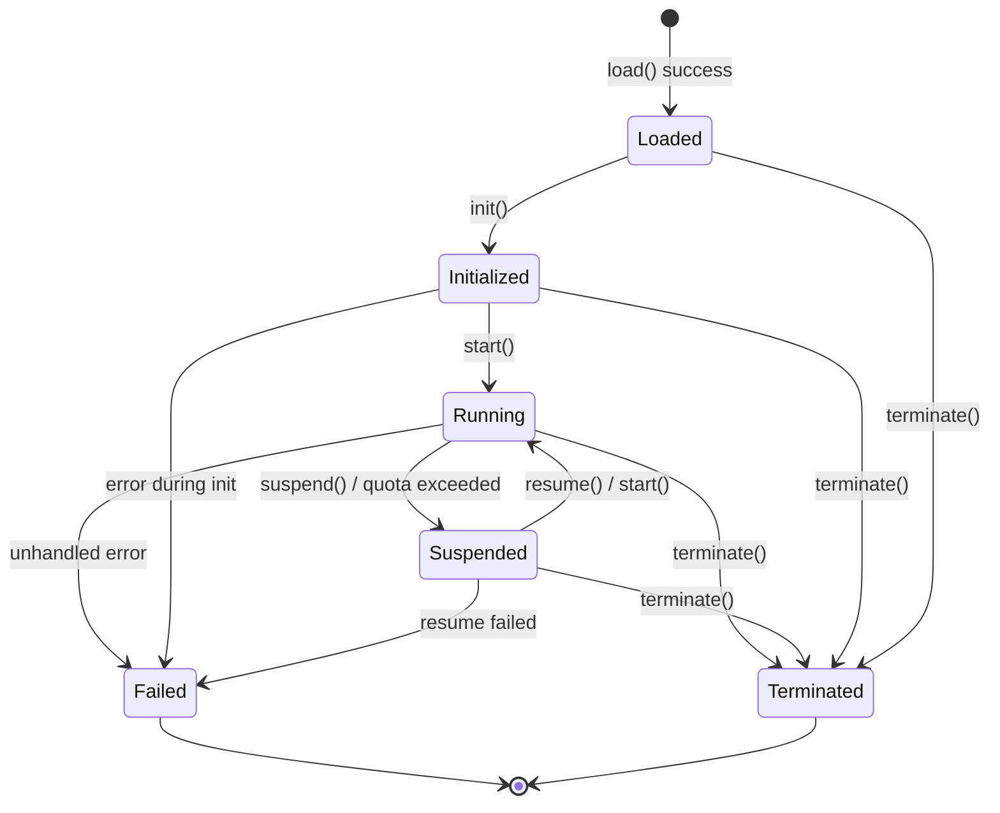

# Chapter 4. Runtime Layer

The runtime layer executes BuF semantics. It receives a BuF_Object handed off by the loader layer, communicates with the adapter layer through Universal_Instructions, and depends on no concrete host.

## 4.1 Runtime_Interface (language-neutral contract)

Runtime_Interface is the runtime layer's stable external contract. Every Runtime_Implementation must implement it with semantically equivalent behavior, regardless of whether it uses Rust traits, Go interfaces, TypeScript interfaces, or other language mechanisms.

```idl
interface Runtime_Interface {
  // Metadata
  rt_version() -> RuntimeInterfaceVersion
  capabilities() -> Set<RuntimeCapability>

  // Lifecycle
  load(obj: BuFObject) -> Result<InstanceId, RuntimeError>
  init(id: InstanceId) -> Result<(), RuntimeError>
  start(id: InstanceId) -> Result<(), RuntimeError>
  suspend(id: InstanceId) -> Result<(), RuntimeError>
  resume(id: InstanceId) -> Result<(), RuntimeError>
  terminate(id: InstanceId) -> Result<(), RuntimeError>

  // State queries
  state(id: InstanceId) -> Result<LifecycleState, RuntimeError>
  failure_info(id: InstanceId) -> Result<Option<FailureInfo>, RuntimeError>

  // Adapter-layer communication
  emit(id: InstanceId, instr: UniversalInstruction) -> Result<UniversalReply, AdapterError>
  on_event(id: InstanceId, event: UniversalEvent) -> Result<(), RuntimeError>
}
```

The design borrows from:

- **OCI Runtime Spec** "config + commands" separation: `load` submits configuration; `init / start / suspend / resume / terminate` are commands.
- **JVM execution engine** state-query habit: `state` and `failure_info` are queryable at any time.

## 4.2 Runtime_Implementation registration and routing

```idl
interface RuntimeRegistry {
  register(impl: Runtime_Implementation) -> Result<RegistrationId, RegistryError>
  list() -> List<RuntimeImplementationDescriptor>
  resolve(manifest: BuFManifest) -> Result<RegistrationId, RegistryError>
}
```

### Method-completeness check at registration

The RuntimeRegistry verifies that a candidate implementation covers all required methods of Runtime_Interface:

- Let `R` be the required-method set of Runtime_Interface and `I = implemented_methods(impl)`.
- `register(impl)` succeeds iff `R ⊆ I`.
- Otherwise it returns `RT_IMPL_MISSING_METHODS` with `R \ I` in `context.missing_methods`.

The check happens once at registration; runtime-time pays nothing.

### Routing strategy

BuF_Manifest expresses preference for a runtime implementation through `runtime.preferred_impl` and `runtime.selection_strategy`. The behavior of `resolve(manifest)`:

- `Strict`: must use `preferred_impl`, which must be compatible with the manifest; otherwise returns `RT_IMPL_NOT_FOUND`.
- `PreferThenAny`: prefer `preferred_impl`; if unavailable, fall back to any compatible implementation.
- `Any`: pick any compatible implementation.

"Compatible" means the implementation's `rt_version()` ≥ `manifest.runtime_interface_min` and its `capabilities()` covers the manifest's minimum capability set.

A single Fayger instance can host multiple registered implementations (for example, a Rust implementation for desktop and a TypeScript implementation for browser). Routing must be predictable and debuggable for the caller.

## 4.3 BuF_Instance lifecycle

### State machine



### Legal-transition table

| Current state | Allowed targets |
| --- | --- |
| Loaded | Initialized, Terminated, Failed |
| Initialized | Running, Terminated, Failed |
| Running | Suspended, Terminated, Failed |
| Suspended | Running, Terminated, Failed |
| Terminated | (terminal) |
| Failed | (terminal) |

Examples of illegal transitions: `Loaded → Running` (missing init), `Terminated → anywhere`, `Failed → Running`.

When an illegal transition is attempted, the runtime returns `RT_ILLEGAL_TRANSITION`; the error context contains `current_state` and `allowed_set`, and the state does not change.

### Failed state

An instance that enters `Failed` must retain:

- The last Universal_Instruction that triggered the failure.
- The error object that triggered the failure (with the entire cause chain).

These are queryable through `failure_info(id)` until the instance is explicitly destroyed.

## 4.4 BuF_Instance data area and isolation

Each BuF_Instance owns an independent RuntimeDataArea:

- Independent heap / call stack / handle table.
- Independent instruction-dispatch queue.
- Independent resource-usage counters.

Different instances share no object pointers by default. This borrows from the JVM's per-thread independent PC / stack and per-instance independent method area.

Formally, for any two concurrently existing instances `i₁` and `i₂`:

```
data_area(i₁) ∩ data_area(i₂) == ∅
```

and any write to `i₁` does not change any byte in `data_area(i₂)`. This is one of the core isolation properties verified during testing.

## 4.5 Resource monitoring and quotas

```idl
interface ResourceMonitor {
  attach(id: InstanceId, quota: ResourceQuota)
  sample(id: InstanceId) -> ResourceUsage
}
```

Monitoring policy:

- When BuF_Manifest declares CPU / memory / I/O quotas, `ResourceMonitor` samples periodically.
- If any dimension exceeds its quota, a `QuotaExceeded` event is emitted, and the lifecycle manager moves the instance to `Suspended`.
- The suspend event's `context.resource` equals the resource type that first exceeded the quota; `context.usage` equals the sampled value at first violation.

Resource monitoring uses host capabilities (cgroups, browser Performance API, platform timers, etc.) provided by the corresponding Platform_Adapter. The runtime only consumes the normalized samples.

## 4.6 Failure isolation between instances

An instance entering `Failed` must not affect other instances in `Running`:

- The lifecycle manager reclaims the failing instance's resources on its own.
- Other instances' Universal_Instruction dispatch is unaffected.
- The event bus categorizes failing and healthy instances separately to avoid mutual blocking.

Formally: with N concurrently running instances, if any `iₖ` fails, the state timelines and Universal_Instruction sequences of the remaining `iⱼ` (`j ≠ k`) match the no-failure baseline.

## 4.7 Interface to the adapter layer

The runtime emits `UniversalInstruction` to the adapter and receives `UniversalReply` or `UniversalEvent`:

```idl
fn emit(id: InstanceId, instr: UniversalInstruction) -> Result<UniversalReply, AdapterError>
fn on_event(id: InstanceId, event: UniversalEvent) -> Result<(), RuntimeError>
```

The runtime depends on these two data types only and on no concrete Platform_Adapter type. Static dependency checks enforce this rule (see Chapter 8 tooling recommendations).

## 4.8 Error codes

Stable error codes produced by the runtime layer:

| Error code | Trigger |
| --- | --- |
| `RT_ILLEGAL_TRANSITION` | Illegal lifecycle transition |
| `RT_IMPL_NOT_FOUND` | Routing strategy did not find a matching implementation |
| `RT_IMPL_MISSING_METHODS` | Registered implementation missing required methods |
| `RT_QUOTA_EXCEEDED` | Resource usage exceeds quota; triggers Suspended |
| `RT_INSTANCE_FAILED` | Instance entered Failed |
