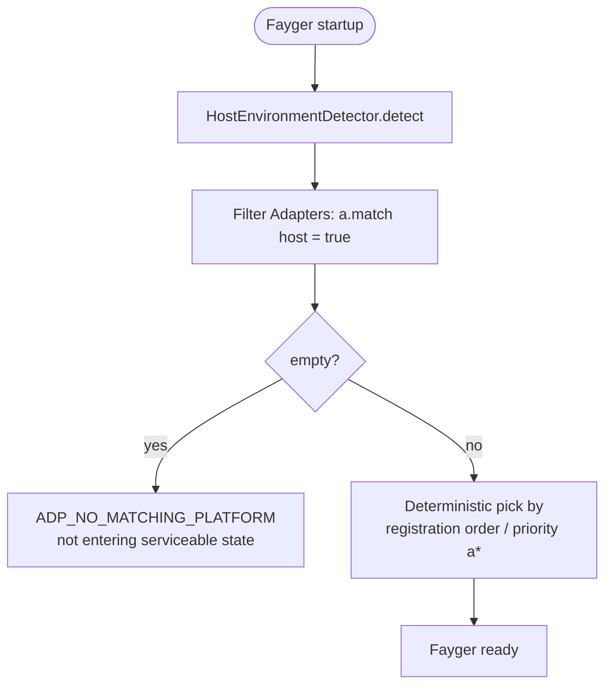
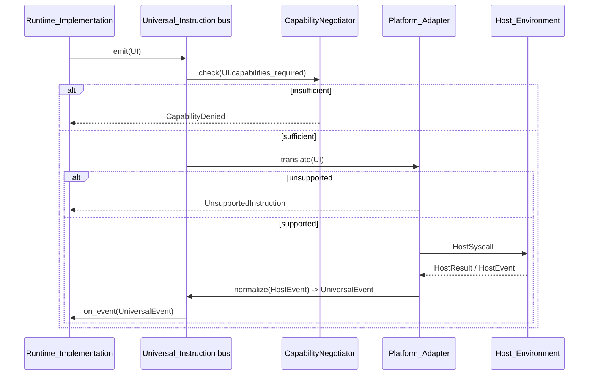

# Chapter 5. Adapter Layer

The adapter layer is the boundary between Fayger and the Host_Environment. It receives Universal_Instructions from the runtime layer and translates them into system calls the host understands; it normalizes host events into Universal_Events sent back to the runtime layer.

Adding a new host requires adding a Platform_Adapter only — the runtime and loader layers stay unchanged.

## 5.1 Universal_Instruction data shape

```idl
struct UniversalInstruction {
  category: InstructionCategory
  opcode: u16
  operands: TLV[]
  capabilities_required: Set<Capability>
}

struct UniversalEvent {
  category: EventCategory
  opcode: u16
  payload: TLV[]
}
```

Design notes:

- **category** is the coarse classification (io / net / ui / time / random / crypto / proc / host).
- **opcode** is the within-category id (2 bytes); the high bit is reserved for experimental instructions.
- **operands** is a TLV (type-length-value) sequence for cross-language decoding and extensibility.
- **capabilities_required** is the capability set this instruction needs; it feeds capability negotiation.

### Categories (first phase)

| Category | Description | Borrowed from |
| --- | --- | --- |
| `io` | files / standard streams | POSIX read / write |
| `net` | network I/O | WASI sock_* |
| `ui` | UI rendering and input | DOM / terminal TUI / Canvas |
| `time` | clocks and timers | clock_time_get |
| `random` | random numbers | random_get |
| `crypto` | cryptographic primitives | WASI crypto |
| `proc` | process / thread / signal | POSIX |
| `host` | host-specific calls | JNI / extism |

8 reserved bits remain for future categories.

### Encoding

Each instruction is encoded as:

```
+--------+--------+----------+-------------------+
| cat(1) | op(2)  | caps(2)  | operands(TLV...)  |
+--------+--------+----------+-------------------+
```

- `cat`: 1 byte; high bits reserved for flags.
- `op`: 2 bytes.
- `caps`: 2 bytes capability bitmap (16 low bits in phase one; an extension segment is used for more).
- `operands`: each operand is `(type:1, length:varint, value)`.

## 5.2 Platform_Adapter abstraction

```idl
interface Platform_Adapter {
  descriptor() -> AdapterDescriptor
  match(host: HostEnvironment) -> bool
  translate(instr: UniversalInstruction) -> Result<HostSyscall, AdapterError>
  normalize(raw: HostEvent) -> Result<UniversalEvent, AdapterError>
}

struct AdapterDescriptor {
  platform_id: String
  supported_capabilities: Set<Capability>
  supported_instructions: Set<InstructionId>
}
```

Each adapter self-describes its supported capabilities and instructions, making capability trimming and "unsupported instruction" decisions a local table lookup that does not rely on runtime trial-and-error.

## 5.3 Host_Environment detection and adapter selection

```idl
interface HostEnvironmentDetector {
  detect() -> HostEnvironment
}

struct HostEnvironment {
  platform_id: String
  os_kind: OsKind
  arch: Arch
  sandbox_kind: SandboxKind
  runtime_features: Set<Feature>
}
```

Selection flow at startup:



Deterministic selection: under the same set of adapters and the same Host_Environment, repeated startups pick the same adapter. This avoids the "phantom adapter" problem.

## 5.4 Capability trimming

```idl
interface CapabilityNegotiator {
  negotiate(
    requested: Set<Capability>,
    available: Set<Capability>,
    policy: HostPolicy
  ) -> NegotiationResult
}

struct NegotiationResult {
  granted: Set<Capability>
  denied: Set<Capability>
  warnings: List<Capability>
}
```

Set algebra of trimming:

- `granted = requested ∩ available ∩ policy`
- `denied = requested \ granted`
- `warnings`: capabilities provided in a restricted form on the host (for example `net.http` under the browser's fetch limits).

If `manifest.required_capabilities \ granted ≠ ∅`, `start()` must return an error; `context.missing` equals the difference, and the instance does not enter Running. This is the hard rule of "don't start if capabilities are insufficient".

Undeclared capabilities are invisible to BuF (default deny), matching WASI's explicit host-import semantics.

## 5.5 Two-way translation flow



Notes:

- Capability check happens before translate, avoiding unnecessary downstream calls.
- "Unsupported instruction" is a deterministic local decision (table lookup) that triggers no host call.
- Host events return through `normalize`; the runtime never touches raw host event structures.

## 5.6 First-phase built-in adapters

| Adapter | Use case | Capability trimming |
| --- | --- | --- |
| **NativeDesktop_Adapter** | Linux / macOS / Windows desktop | Near-full capability set; `ui` / `proc` / `io` / `net` fully available |
| **Server_Adapter** | Headless server | `ui` disabled; `proc` policy-restricted |
| **Browser_Adapter** | Web API based | `proc` and most `io` disabled; `net` limited to fetch / WebSocket; strong trimming |
| **InApp_Adapter** | Embedded into a host application process | Capabilities explicitly injected by host; strictest; available `host` opcodes declared by the host |

These adapters are reference implementations. Third parties may register their own adapters, e.g., embedded terminals, specific IDE embeddings.

## 5.7 Cross-platform consistency

The same BuF loaded and executed on different Platform_Adapters must yield the same Lifecycle_State sequence and the same Universal_Instruction sequence to the runtime layer:

- Any difference that would cause sequence divergence must be rejected by capability trimming before `start`, not silently diverged during execution.
- Any "equivalent but different path" optimization must not surface different paths in the Universal_Instruction sequence.

This property is verified via property-based testing by running a pair of mock adapters with equal capabilities in parallel and comparing sequences.

## 5.8 Error codes

Stable error codes produced by the adapter layer:

| Error code | Trigger |
| --- | --- |
| `ADP_NO_MATCHING_PLATFORM` | No adapter matches the current host |
| `ADP_UNSUPPORTED_INSTRUCTION` | The current adapter does not support the instruction |
| `ADP_CAPABILITY_DENIED` | After trimming, capabilities are insufficient for the instruction |
| `ADP_HOST_CALL_FAILED` | The adapter translated to a system call but the host side failed |

`ADP_UNSUPPORTED_INSTRUCTION` must guarantee no host call is made; only the error is returned. This is the "default deny" stance at the instruction level.
