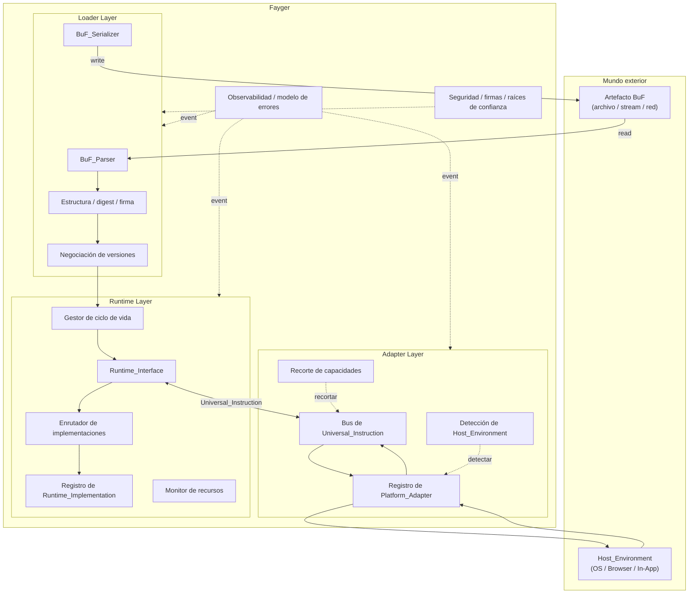

# Capítulo 2. Arquitectura General

## 2.1 Tres capas

Fayger se divide verticalmente en tres capas. Cada una cumple su responsabilidad en su división de trabajo y las capas se comunican solo a través de contratos bien definidos.



## 2.2 Responsabilidades de cada capa

### Loader Layer

- Lee BuF desde cualquier backend de almacenamiento mediante la abstracción *BuF_Source* (archivo local, HTTP Range, almacenamiento de objetos, IPFS, backend definido por el usuario).
- Parsea el flujo de bytes en un objeto en memoria.
- Verifica validez estructural, digests del contenido y firmas.
- Negocia con el Fayger actual versiones de schema BuF y de Runtime_Interface.
- Selecciona, con granularidad de Section, el subconjunto a cargar según el *LoadProfile* del llamador; omite Sections que el entorno no necesita o que no caben.
- Elige según *LoadStrategy* entre leer todo por adelantado (Eager) o leer solo cabecera + índice y diferir los cuerpos de Section al primer acceso (Lazy).
- Entrega el objeto BuF en memoria a la capa de ejecución.
- Capacidad inversa: serializa el objeto en memoria de vuelta a bytes para reescritura, caché o re-empaquetado.

### Runtime Layer

- Expone *Runtime_Interface* como contrato neutro al lenguaje.
- Mantiene el registro de *Runtime_Implementation* y enruta a una implementación concreta según la política del BuF_Manifest.
- Gestiona el ciclo de vida de cada BuF_Instance (Loaded → Initialized → Running → Suspended → Terminated / Failed).
- Monitorea uso de recursos por instancia y aplica throttling o suspensión según las cuotas del BuF_Manifest.
- Comunica con la capa de adaptación a través de Universal_Instruction; ella misma no depende de ningún anfitrión concreto.

### Adapter Layer

- Mantiene un conjunto de *Platform_Adapter*, cada uno correspondiendo a una clase de terminal / SO / anfitrión.
- Detecta al inicio el Host_Environment actual y selecciona el adaptador adecuado.
- Traduce Universal_Instructions de la capa de ejecución a llamadas al sistema y normaliza eventos del anfitrión a Universal_Events.
- Recorta el conjunto de capacidades declarado por BuF al subconjunto realmente disponible en el anfitrión actual.

## 2.3 Dirección de llamadas y reglas de dependencia

La dirección de las dependencias es clave para la evolución a largo plazo. Fayger impone estas reglas duras:

- **Loader → Runtime.** Unidireccional. Tras la carga, el loader entrega el objeto en memoria y no retiene ningún BuF_Instance.
- **Runtime ↔ Adapter.** Bidireccional a través de los tipos Universal_Instruction y Universal_Event. La capa de ejecución nunca importa directamente un tipo Platform_Adapter.
- **Runtime → Loader.** Prohibido. Si la capa de ejecución necesita reserializar un BuF (por ejemplo, hot reload), pasa por una interfaz de servicio expuesta por el loader, sin alcanzar internos del loader.
- **Adapter → Host.** Unidireccional. Un Platform_Adapter mantiene referencias a SDKs y llamadas del anfitrión; la capa de ejecución nunca importa librerías del anfitrión directamente.
- **Transversal (observabilidad / seguridad) → tres capas.** Entran a través del bus de eventos y de las interfaces de política. Las tres capas publican eventos y consultan políticas, pero no dependen de implementaciones transversales concretas.

El propósito central de estas reglas es: **agregar un nuevo anfitrión no debe cambiar la capa de ejecución; reemplazar la implementación de la capa de ejecución no debe cambiar los adaptadores**.

## 2.4 Diseños tomados prestados

### Fases encadenadas de carga al estilo JVM

La capa de carga se divide internamente en fases tipo JVM, lo que facilita la atribución de errores y las pruebas unitarias:

```
Read(Header/Manifest/Index) → Parse → Verify(Structural)
  → Verify(Digest of Header/Manifest/Index) → Verify(Signature)
  → NegotiateVersion → Select(Sections by LoadProfile) → Resolve(Dependencies)
  → Read(Selected Section Bodies)?  → HandOff(to Runtime)
```

`Select(Sections by LoadProfile)` elige qué Sections cargar según las capacidades del terminal y los límites de tamaño actuales. `Read(Selected Section Bodies)` solo se ejecuta con LoadStrategy = Eager; en Lazy la lectura y verificación de las Sections seleccionadas se difieren al primer acceso. Cada fase produce errores etiquetados por fase que entran al modelo de errores unificado (Capítulo 6).

### Organización de artefactos al estilo Docker / OCI

Un artefacto BuF se organiza como una imagen OCI:

| Concepto OCI | Equivalente BuF |
| --- | --- |
| Image Manifest | BuF_Manifest |
| Image Config | Campos `runtime` / `capabilities` / `quotas` del BuF_Manifest |
| Layers | BuF Sections (code / data / assets / signature) |
| Distribution Spec | Artefacto en archivo único en la fase 1; extensión futura |
| Runtime Spec | Runtime_Interface |
| containerd | Runtime_Layer (ciclo de vida + enrutamiento) |
| runc | Runtime_Implementation (ejecutor) |

### Modelo de seguridad basado en capacidades de WASM / WASI

La capa de adaptación usa seguridad basada en capacidades:

- BuF_Manifest declara `requested_capabilities` (p. ej., `fs.read`, `net.http`, `ui.dom`).
- Un Platform_Adapter declara `available_capabilities`.
- Concedidas = `requested ∩ available ∩ host_policy`. La instancia entra en `Running` solo si las tres intersecciones no son vacías.
- Las capacidades no declaradas son invisibles para BuF (negar por defecto), igual que la semántica explícita de host import de WASI.

## 2.5 Alcance y no objetivos de la primera fase

**Alcance de la primera fase:**

- Carga y ejecución de un único BuF; varias BuF_Instances pueden correr en paralelo, pero sin compartir nada por defecto.
- Camino de ejecución interpretado; se reserva una abstracción ExecutionStrategy para futuro JIT.
- Cuatro Platform_Adapters integrados: escritorio / servidor / navegador / In-App.
- Despacho síncrono y asíncrono de instrucciones; aislamiento de varias instancias en un solo proceso.

**No objetivos de la primera fase:**

- Memoria compartida e IPC entre BuF_Instances.
- Compilación JIT y generación de código máquina.
- Planificación distribuida y colaboración de Fayger en múltiples nodos.
- Distribución diferencial de BuF y caché por capas (artefacto en archivo único como base; estructura por capas reservada).
