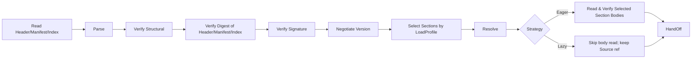
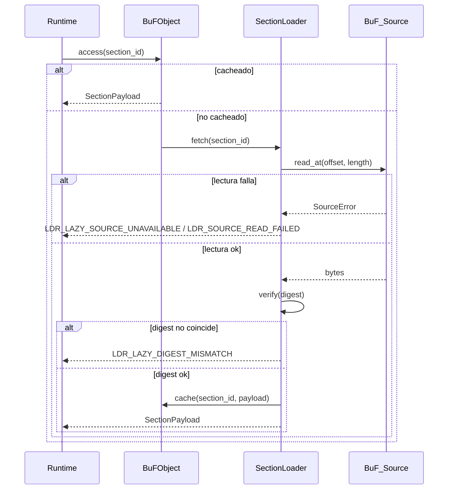

# Capítulo 3. Capa de Carga

La capa de carga es la frontera entre Fayger y los artefactos BuF externos. Su trabajo: leer un BuF desde cualquier backend de almacenamiento, decidir qué Sections cargar y cuándo según el entorno y la política del llamador, y convertir bytes en un objeto BuF en memoria, internamente consistente, que la capa de ejecución pueda asumir; o, ante un fallo, devolver un error con ubicación precisa y clasificable.

## 3.1 Formato del artefacto BuF

BuF usa un layout de cinco partes: **Header + Manifest + Section Index + Sections + Trailer**, tomando prestado de JAR / OCI Image / WASM:

```
+------------------------------------------------------------+
| Header        | magic="BUF\0" | format_version | flags     |
|               | manifest_offset, manifest_length            |
|               | section_index_offset, section_index_length  |
+------------------------------------------------------------+
| Manifest      | CBOR-encoded BuFManifest                    |
+------------------------------------------------------------+
| Section Index | [(section_id, kind, offset, length, digest, |
|               |   visibility, profile_constraints)]         |
+------------------------------------------------------------+
| Sections      | [code | data | assets | signature | ...]   |
+------------------------------------------------------------+
| Trailer       | total_length | manifest_digest | crc32     |
+------------------------------------------------------------+
```

Notas de diseño:

- **Magic + Format Version.** Los primeros 8 bytes son fijos; ayudan al tooling a identificar y rechazar streams malformados.
- **Manifest como parte separada.** Permite negociación de versiones, selección por perfil y recorte de capacidades sin decodificar ningún cuerpo de Section (isomorfo a OCI Image Manifest).
- **Section Index es el índice confiable del modo Lazy.** Cada entrada incluye offset, longitud, digest, visibility y profile_constraints. El Section_Index debe leerse completo y verificarse por digest durante la carga, porque los fetches bajo demanda en Lazy dependen de él.
- **Trailer.** Lleva la longitud total y el digest del Manifest; permite detectar truncamiento y prevenir ataques de "firmar primero, manipular el Manifest después".
- **Codificación.** Manifest y Section_Index usan CBOR en modo determinista (RFC 8949 §4.2), de modo que la serialización sea única — base de la equivalencia ida y vuelta.
- **Alcance de la firma.** Header || Manifest_minus_signature || Section_Index. Los cuerpos de Sections omitidas o aún no obtenidos no participan en el cálculo de la firma; por tanto, carga parcial y carga completa son equivalentes para la verificación de firma.

## 3.2 Convenciones de campos del BuF_Manifest

```idl
struct BuFManifest {
  // Negociación de versiones
  schema_version: SemVer
  runtime_interface_min: SemVer
  deprecation_notice: Option<String>

  // Entrada y selección de runtime
  entry: EntryPoint
  runtime: RuntimeRequirement {
    preferred_impl: Option<ImplementationId>
    selection_strategy: enum { Strict, PreferThenAny, Any }
  }

  // Declaración de capacidades
  capabilities: CapabilitySet
  quotas: Option<ResourceQuota>

  // Índice de contenido
  sections: List<SectionDescriptor> {
    id: SectionId
    kind: enum { Code, Data, Asset, Signature, Custom(String) }
    digest: Digest
    length: u64
    visibility: SectionVisibility           // Required | Optional
    profile_constraints: ProfileConstraints // Por defecto sin restricciones
  }

  // Firma (opcional)
  signature: Option<SignatureBlock>

  extensions: Map<String, CborValue>
}

struct ProfileConstraints {
  required_capabilities: Set<Capability>
  max_size: Option<u64>
  required_features: Set<Feature>
}
```

`schema_version` y `runtime_interface_min` evolucionan independientemente. El primero gobierna la compatibilidad de formato; el segundo, la compatibilidad de Runtime_Interface — análogo a separar versión del class file y nivel de API de la JVM.

## 3.3 La cadena de carga

La capa de carga se divide internamente en varias fases tipo JVM:



Responsabilidades por fase:

- **Read Header/Manifest/Index.** Recupera Header / Manifest / Section_Index / Trailer mediante BuF_Source. Debe completarse antes de que `load` retorne, en Eager o Lazy.
- **Parse.** Parsea Manifest y Section_Index (sin decodificar cuerpos).
- **Verify Structural.** Comprueba magic, campos de versión, límites de Sections, campos requeridos del Manifest.
- **Verify Digest of Header/Manifest/Index.** Verifica el digest holístico de Header, Manifest y Section_Index (vía `manifest_digest` y campos relacionados del Trailer). El digest de cada cuerpo de Section se verifica cuando esa Section se obtiene.
- **Verify Signature.** Se ejecuta cuando el Manifest lleva firma o cuando el modo de firma forzada está activo. El alcance de la firma cubre las tres partes del encabezado; no depende de si los cuerpos se obtienen.
- **Negotiate Version.** Comprueba compatibilidad de schema y de Runtime_Interface.
- **Select Sections by LoadProfile.** Decide el conjunto seleccionado según el LoadProfile y la Host_Environment actual; ver §3.7.
- **Resolve.** Resuelve dependencias entre BuFs (en la fase 1 es BuF único; interfaz reservada).
- **Read Selected Section Bodies.** Solo en Eager. Lee cada cuerpo seleccionado vía BuF_Source y verifica su digest.
- **HandOff.** Entrega el objeto en memoria a la capa de ejecución. En Lazy, el objeto retiene una referencia BuF_Source y un SectionLoader.

Cada fase etiqueta sus errores con nombre de fase y ubicación, y pone `context.phase` en `eager` o `lazy`.

## 3.4 BuF_Source: abstracción de almacenamiento multi-fuente

```idl
interface BuF_Source {
  read_at(offset: u64, length: u64) -> Result<Bytes, SourceError>
  length() -> Result<u64, SourceError>
  stat() -> Result<SourceStat, SourceError>     // opcional
  close() -> Result<(), SourceError>             // opcional
}
```

Notas de diseño:

- La capa de carga depende solo del par mínimo `read_at` y `length`.
- Cualquier medio que ofrezca lectura de acceso aleatorio puede ser BuF_Source: archivo local, HTTP Range, SDK de almacenamiento de objetos, gateway IPFS, Flash en bloques en dispositivos embebidos, backend definido por el usuario.
- BuF_Source no necesita implementar streaming secuencial: Lazy salta por offset.
- Para dispositivos pequeños (drones, cámaras), una implementación de BuF_Source puede tener una pequeña LRU o leer directamente de Flash en bloques; el cargador no conoce la estrategia.

## 3.5 BuF_Parser y BuF_Serializer

```idl
interface BuF_Parser {
  parse(bytes: Bytes) -> Result<BuFObject, ParseError>
}

interface BuF_Serializer {
  serialize(obj: BuFObject) -> Result<Bytes, SerializeError>
}
```

Dentro de `LoaderPipeline`, el parser suele llamar a BuF_Source como "obtener un trozo → parsearlo"; el `parse(bytes)` solo-bytes es un punto de entrada simplificado para tests y tooling.

### Objeto en memoria (con carga parcial)

```idl
struct BuFObject {
  manifest: BuFManifest
  raw_header: Header
  raw_trailer: Trailer

  selected_sections: Set<SectionId>
  skipped_sections: List<SkipRecord>     // (id, reasons)
  strategy: LoadStrategy
  source_ref: Option<BuF_Source>          // retenido solo en Lazy
  loader: Option<SectionLoader>           // retenido solo en Lazy
  sections: Map<SectionId, SectionPayload> // completo en Eager; caché bajo demanda en Lazy
}

enum SkipReason {
  CapabilityNotGranted, OverMaxSize, FeatureMissing, ExplicitlyDisabled
}
```

Equivalencia ida y vuelta bajo carga parcial: la equivalencia se compara sobre el rango `selected_sections`; las Sections omitidas no participan en la comparación, pero sí participa la propia lista `skipped_sections`. Esto evita tratar como equivalentes dos cargas parciales con subconjuntos distintos.

## 3.6 Interfaz LoaderPipeline

```idl
struct LoadProfile {
  target_class: TargetClass             // desktop | server | browser | inapp | embedded | drone | camera | …
  capabilities: Set<Capability>
  max_section_bytes: Option<u64>
  features: Set<Feature>
}

enum LoadStrategy { Eager, Lazy }
enum SectionVisibility { Required, Optional }

struct LoaderPolicy {
  require_signature: bool
  trusted_roots: TrustedRootSet
  allowed_schema_versions: VersionRange
}

interface LoaderPipeline {
  load(
    source: BuF_Source,
    profile: LoadProfile,
    strategy: LoadStrategy,
    policy: LoaderPolicy
  ) -> Result<BuFObject, LoaderError>
}
```

`load` siempre lee y verifica Header / Manifest / Section_Index antes de retornar. Si los cuerpos de Section se leen antes de retornar depende de `strategy`.

## 3.7 Carga parcial: elegir Sections por entorno

Las terminales varían enormemente en capacidad. Un escritorio puede cargar un BuF completo; un dron o una cámara quizá solo necesite las Sections de "control + códec de video". Algoritmo de selección:

Para cada `s ∈ manifest.sections` definimos el predicado

```
fits(s) = s.profile_constraints.required_capabilities ⊆ profile.capabilities
        ∧ (s.profile_constraints.max_size no fijado ∨ s.length ≤ s.profile_constraints.max_size)
        ∧ s.profile_constraints.required_features ⊆ profile.features
```

Resultados:

- `selected = { s : fits(s) }`, en `BuFObject.selected_sections`.
- `s ∈ sections \ selected ∧ s.visibility == Required` ⟹ la carga falla con `LDR_PROFILE_REQUIRED_SECTION_MISSING`. El context incluye `section_id` y los items de restricción no cumplidos.
- `s ∈ sections \ selected ∧ s.visibility == Optional` ⟹ entra en `skipped_sections` con razones (CapabilityNotGranted / OverMaxSize / FeatureMissing / ExplicitlyDisabled).

La selección es determinista: el mismo (manifest, host_env, profile) produce el mismo `selected` y `skipped_sections`.

### Ejemplos

| Terminal | LoadProfile típico | Comportamiento de selección |
| --- | --- | --- |
| Escritorio | capabilities completo, sin max_section_bytes | Todas las Sections seleccionadas |
| Servidor | ui deshabilitado, sin max_section_bytes | Sections de UI omitidas (si declaran dependencia ui) |
| Navegador | solo net.fetch / net.websocket / ui.dom, max_section_bytes ≈ 8 MiB | Activos sobredimensionados omitidos; Sections que requieren proc omitidas |
| Drone | capabilities mínimo + max_section_bytes ≈ 1 MiB + features.realtime | Solo control y codec; tutoriales omitidos |
| Cámara | capabilities limitado a io.frame + crypto + net.rtsp | Solo procesamiento de video y uplink |

## 3.8 Estrategias: Eager vs Lazy

### Eager

- Todos los cuerpos de `selected_sections` se leen y verifican antes de que `load` retorne.
- Adecuado para BuFs pequeños, escenarios sin red tras el inicio o preferencia "todo de una".
- Errores durante la carga llevan `phase == "eager"`.

### Lazy

- Solo Header / Manifest / Section_Index se leen y verifican antes de retornar de `load`.
- Las Sections seleccionadas se obtienen y verifican por digest al primer acceso por SectionLoader.
- Adecuado para BuFs grandes, ejecución bajo demanda o fuentes remotas (HTTP / object storage).
- Errores tras `load` llevan `phase == "lazy"` y pueden manejarse separadamente de los de inicio.

```idl
interface SectionLoader {
  fetch(id: SectionId) -> Result<SectionPayload, LoaderError>
  is_loaded(id: SectionId) -> bool
  loaded_ids() -> Set<SectionId>
}
```

### Flujo de fetch bajo demanda en Lazy



### Equivalencia Eager / Lazy

Para el mismo (source, profile, policy), independientemente de la estrategia:

- `selected_sections` y `skipped_sections` son idénticos.
- Si en el resultado Lazy se dispara una lectura para cada entrada de `selected_sections`, el resultado coincide byte a byte con el de Eager.
- Lazy solo pospone lectura y verificación en el tiempo; no introduce diferencias semánticas.

Esta propiedad se verifica continuamente con PBT.

## 3.9 Verificación de digest y firma

### Digest

- El digest holístico de Header / Manifest / Section_Index siempre se verifica al cargar.
- El digest de cada cuerpo de Section proviene del snapshot inmutable en Section_Index. Eager los verifica al cargar; Lazy al primer acceso.
- Una falta de coincidencia devuelve `LDR_DIGEST_MISMATCH` (Eager) o `LDR_LAZY_DIGEST_MISMATCH` (Lazy); el context incluye la `section_id` fallida.

### Firma

El alcance de la firma es `Header || Manifest_minus_signature || Section_Index`. Esto significa:

- Aun con carga parcial la verificación de firma es completa.
- Las Sections omitidas no afectan el resultado de firma.
- Modificar offset / length / digest en Section_Index invalida la firma.

Tabla de decisión de la firma:

| Condición | Resultado |
| --- | --- |
| enforce_signature on ∧ sin firma | `Err(LDR_SIGNATURE_FAIL)`, razón `MissingSignature` |
| firma presente ∧ verificación falla | `Err(LDR_SIGNATURE_FAIL)`, razón `InvalidSignature` |
| firma presente ∧ verificación ok | `Ok` |
| enforce_signature off ∧ sin firma | `Ok` |

El conjunto de raíces de confianza lo mantiene *TrustStore*; las actualizaciones surten efecto en la siguiente carga (Capítulo 7).

**Orden crítico.** La verificación de firma precede a la selección de Sections. Primero se verifica el origen del artefacto con la firma holística del Manifest; luego LoadProfile decide qué Sections cargar. Esto evita una semántica débil de "verificar solo el subconjunto seleccionado".

## 3.10 Negociación de versiones

Tabla de decisión:

| Condición | Resultado |
| --- | --- |
| versión schema fuera del rango soportado | `Err(LDR_SCHEMA_UNSUPPORTED)` con el rango esperado |
| runtime_interface_min mayor que el provisto | `Err(LDR_RUNTIME_VERSION_TOO_HIGH)` con required / provided |
| schema dentro del rango, no obsoleto, runtime ok | `Ok` |
| schema obsoleto pero aún soportado | `Ok` con aviso de obsolescencia |

El aviso se expone vía `BuFObject.manifest.deprecation_notice` para que el tooling lo muestre.

## 3.11 Códigos de error

Códigos estables de la capa de carga:

| Código | Disparador |
| --- | --- |
| `LDR_PARSE_FAIL` | El stream BuF no cumple la especificación |
| `LDR_DIGEST_MISMATCH` | Discrepancia de digest en fase Eager |
| `LDR_LAZY_DIGEST_MISMATCH` | Discrepancia de digest en primer acceso Lazy |
| `LDR_SIGNATURE_FAIL` | Firma ausente en modo forzado o firma inválida |
| `LDR_SCHEMA_UNSUPPORTED` | Versión de schema fuera del rango soportado |
| `LDR_RUNTIME_VERSION_TOO_HIGH` | Runtime_Interface requerido mayor que el provisto |
| `LDR_MISSING_REQUIRED_FIELD` | Faltan campos requeridos del Manifest al serializar |
| `LDR_PROFILE_REQUIRED_SECTION_MISSING` | Una Section requerida no es cargable bajo el perfil actual |
| `LDR_LAZY_SOURCE_UNAVAILABLE` | BuF_Source no disponible en un acceso Lazy posterior |
| `LDR_SOURCE_READ_FAILED` | Error de lectura de BuF_Source (Eager o Lazy) |

Cada `context` lleva ubicación y razón, y etiqueta la fase con `context.phase = "eager" | "lazy"` para diagnóstico consistente.
