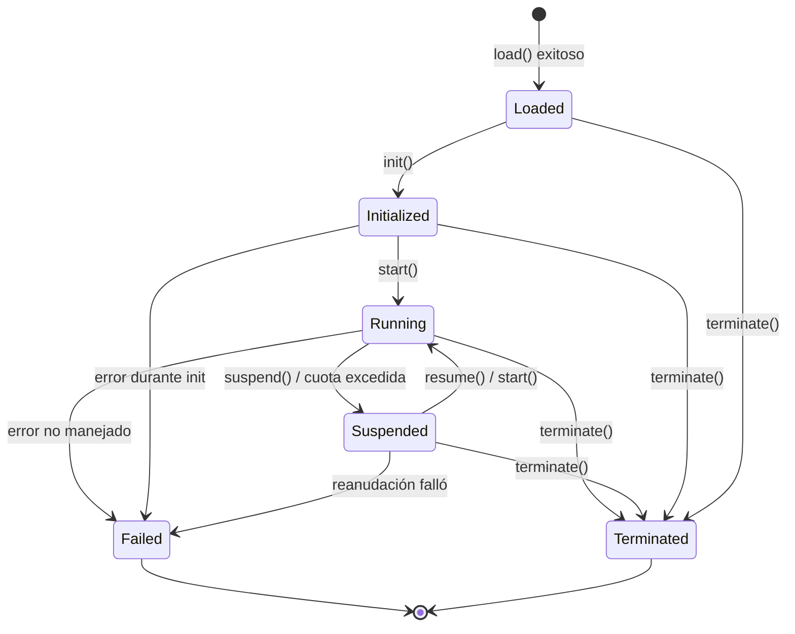

# Capítulo 4. Capa de Ejecución

La capa de ejecución ejecuta la semántica de BuF. Recibe el BuF_Object entregado por la capa de carga, se comunica con la capa de adaptación a través de Universal_Instructions y no depende de ningún anfitrión concreto.

## 4.1 Runtime_Interface (contrato neutro al lenguaje)

Runtime_Interface es el contrato externo estable de la capa de ejecución. Toda Runtime_Implementation debe implementarlo con comportamiento semánticamente equivalente, sin importar si usa traits de Rust, interfaces de Go o de TypeScript u otros mecanismos.

```idl
interface Runtime_Interface {
  // Metadatos
  rt_version() -> RuntimeInterfaceVersion
  capabilities() -> Set<RuntimeCapability>

  // Ciclo de vida
  load(obj: BuFObject) -> Result<InstanceId, RuntimeError>
  init(id: InstanceId) -> Result<(), RuntimeError>
  start(id: InstanceId) -> Result<(), RuntimeError>
  suspend(id: InstanceId) -> Result<(), RuntimeError>
  resume(id: InstanceId) -> Result<(), RuntimeError>
  terminate(id: InstanceId) -> Result<(), RuntimeError>

  // Consultas de estado
  state(id: InstanceId) -> Result<LifecycleState, RuntimeError>
  failure_info(id: InstanceId) -> Result<Option<FailureInfo>, RuntimeError>

  // Comunicación con la capa de adaptación
  emit(id: InstanceId, instr: UniversalInstruction) -> Result<UniversalReply, AdapterError>
  on_event(id: InstanceId, event: UniversalEvent) -> Result<(), RuntimeError>
}
```

El diseño toma prestado:

- **OCI Runtime Spec** "configuración + comandos": `load` envía configuración; `init / start / suspend / resume / terminate` son comandos.
- **Motor de ejecución de la JVM** hábito de consultas de estado: `state` y `failure_info` se pueden consultar en cualquier momento.

## 4.2 Registro y enrutamiento de Runtime_Implementation

```idl
interface RuntimeRegistry {
  register(impl: Runtime_Implementation) -> Result<RegistrationId, RegistryError>
  list() -> List<RuntimeImplementationDescriptor>
  resolve(manifest: BuFManifest) -> Result<RegistrationId, RegistryError>
}
```

### Comprobación de completitud de métodos al registrar

El RuntimeRegistry comprueba si una implementación candidata cubre todos los métodos requeridos:

- Sea `R` el conjunto requerido y `I = implemented_methods(impl)`.
- `register(impl)` tiene éxito si y solo si `R ⊆ I`.
- En caso contrario devuelve `RT_IMPL_MISSING_METHODS` con `R \ I` en `context.missing_methods`.

La comprobación se hace una vez al registrar; en tiempo de ejecución no hay coste.

### Estrategia de enrutamiento

BuF_Manifest expresa preferencia con `runtime.preferred_impl` y `runtime.selection_strategy`. Comportamiento de `resolve(manifest)`:

- `Strict`: debe usar `preferred_impl`, y debe ser compatible con el manifest; si no, `RT_IMPL_NOT_FOUND`.
- `PreferThenAny`: prefiere `preferred_impl`; si no está disponible, cae a cualquier compatible.
- `Any`: cualquier implementación compatible.

"Compatible" significa que `rt_version()` ≥ `manifest.runtime_interface_min` y que `capabilities()` cubre el conjunto mínimo del manifest.

Una sola Fayger puede alojar varias implementaciones registradas (por ejemplo, una Rust para escritorio y una TypeScript para navegador). El enrutamiento debe ser predecible y depurable para el llamador.

## 4.3 Ciclo de vida de BuF_Instance

### Máquina de estados



### Tabla de transiciones legales

| Estado actual | Objetivos permitidos |
| --- | --- |
| Loaded | Initialized, Terminated, Failed |
| Initialized | Running, Terminated, Failed |
| Running | Suspended, Terminated, Failed |
| Suspended | Running, Terminated, Failed |
| Terminated | (terminal) |
| Failed | (terminal) |

Ejemplos ilegales: `Loaded → Running` (falta init), `Terminated → cualquier`, `Failed → Running`.

Ante una transición ilegal, el runtime devuelve `RT_ILLEGAL_TRANSITION`; el context incluye `current_state` y `allowed_set`, y el estado no cambia.

### Estado Failed

Una instancia que entra en `Failed` debe retener:

- La última Universal_Instruction que disparó el fallo.
- El objeto de error que disparó el fallo (con la cadena de causas completa).

Se consultan vía `failure_info(id)` hasta que la instancia se destruya explícitamente.

## 4.4 Área de datos de BuF_Instance y aislamiento

Cada BuF_Instance posee un RuntimeDataArea independiente:

- Heap / pila de llamadas / tabla de handles independientes.
- Cola de despacho de instrucciones independiente.
- Contadores de uso de recursos independientes.

Las instancias no comparten punteros a objetos por defecto. Toma prestado del modelo de la JVM con PC / pila por hilo y área de métodos por instancia.

Formalmente, para cualquier par `i₁`, `i₂` que existan a la vez:

```
data_area(i₁) ∩ data_area(i₂) == ∅
```

y cualquier escritura en `i₁` no cambia ningún byte de `data_area(i₂)`. Es una de las propiedades de aislamiento centrales que se verifican en pruebas.

## 4.5 Monitoreo de recursos y cuotas

```idl
interface ResourceMonitor {
  attach(id: InstanceId, quota: ResourceQuota)
  sample(id: InstanceId) -> ResourceUsage
}
```

Política de monitoreo:

- Cuando BuF_Manifest declara cuotas de CPU / memoria / I/O, `ResourceMonitor` muestrea periódicamente.
- Si alguna dimensión excede la cuota, se emite un `QuotaExceeded` y el gestor de ciclo de vida mueve la instancia a `Suspended`.
- El `context.resource` del evento de suspensión equivale al recurso que excedió primero; `context.usage` al valor muestreado en la primera violación.

El monitoreo usa capacidades del anfitrión (cgroups, Performance API del navegador, temporizadores de plataforma…) provistas por el Platform_Adapter correspondiente. La capa de ejecución solo consume las muestras normalizadas.

## 4.6 Aislamiento de fallos entre instancias

Una instancia que entra en `Failed` no debe afectar a otras en `Running`:

- El gestor de ciclo de vida reclama por su cuenta los recursos de la instancia fallida.
- El despacho de Universal_Instructions de las demás no se ve afectado.
- El bus de eventos clasifica fallidas y sanas por separado para evitar bloqueos mutuos.

Formalmente: con N instancias en ejecución, si alguna `iₖ` falla, las líneas de tiempo de estado y secuencias de Universal_Instruction de las demás `iⱼ` (`j ≠ k`) coinciden con la línea base sin fallos.

## 4.7 Interfaz hacia la capa de adaptación

La ejecución emite `UniversalInstruction` al adaptador y recibe `UniversalReply` o `UniversalEvent`:

```idl
fn emit(id: InstanceId, instr: UniversalInstruction) -> Result<UniversalReply, AdapterError>
fn on_event(id: InstanceId, event: UniversalEvent) -> Result<(), RuntimeError>
```

La capa de ejecución depende solo de estos dos tipos y de ningún tipo concreto de Platform_Adapter. Comprobaciones estáticas de dependencias garantizan la regla (ver Capítulo 8 recomendaciones de tooling).

## 4.8 Códigos de error

Códigos estables de la capa de ejecución:

| Código | Disparador |
| --- | --- |
| `RT_ILLEGAL_TRANSITION` | Transición ilegal de ciclo de vida |
| `RT_IMPL_NOT_FOUND` | El enrutamiento no encontró implementación compatible |
| `RT_IMPL_MISSING_METHODS` | A la implementación registrada le faltan métodos requeridos |
| `RT_QUOTA_EXCEEDED` | Uso de recursos excede cuota; dispara Suspended |
| `RT_INSTANCE_FAILED` | La instancia entró en Failed |
