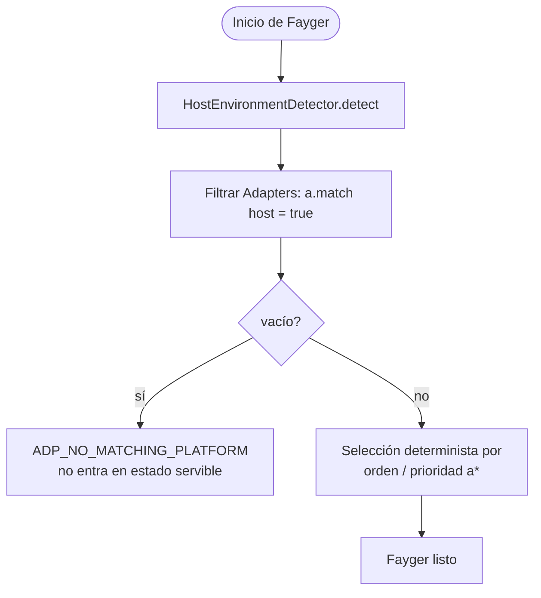
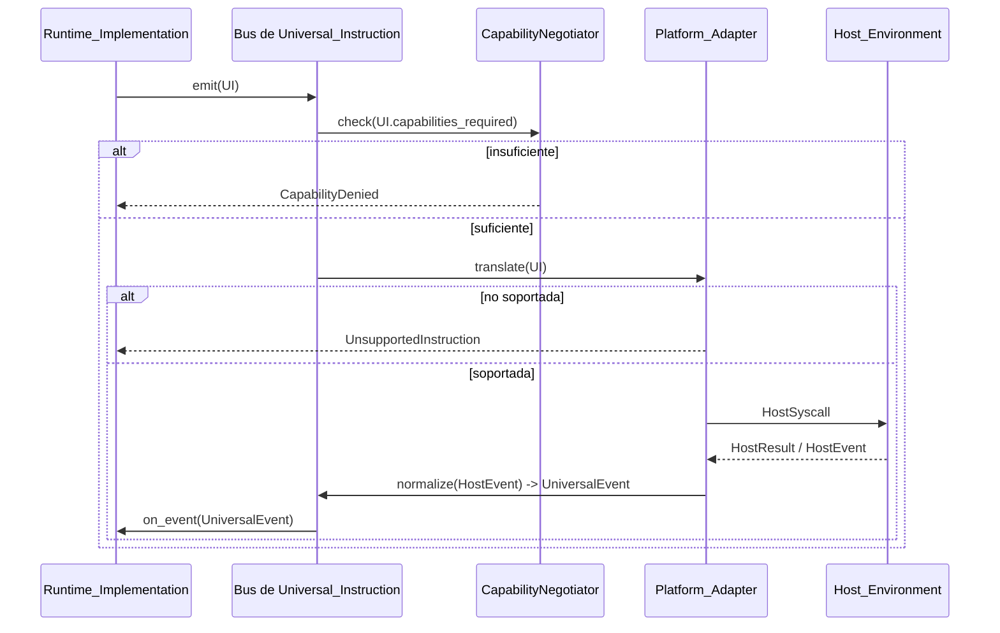

# Capítulo 5. Capa de Adaptación

La capa de adaptación es la frontera entre Fayger y la Host_Environment. Recibe Universal_Instructions de la capa de ejecución y las traduce a llamadas al sistema que el anfitrión entiende; también normaliza eventos del anfitrión a Universal_Events y los devuelve a la capa de ejecución.

Añadir un anfitrión nuevo solo requiere un Platform_Adapter; las capas de carga y ejecución no cambian.

## 5.1 Forma de los datos de Universal_Instruction

```idl
struct UniversalInstruction {
  category: InstructionCategory
  opcode: u16
  operands: TLV[]
  capabilities_required: Set<Capability>
}

struct UniversalEvent {
  category: EventCategory
  opcode: u16
  payload: TLV[]
}
```

Notas de diseño:

- **category** es la clasificación gruesa (io / net / ui / time / random / crypto / proc / host).
- **opcode** es el id dentro de la categoría (2 bytes); el bit alto está reservado para instrucciones experimentales.
- **operands** es una secuencia TLV (type-length-value) para decodificación entre lenguajes y extensibilidad.
- **capabilities_required** es el conjunto de capacidades que esta instrucción necesita; alimenta el recorte.

### Categorías (primera fase)

| Categoría | Descripción | Inspirada en |
| --- | --- | --- |
| `io` | archivos / streams estándar | POSIX read / write |
| `net` | I/O de red | WASI sock_* |
| `ui` | renderizado y entrada UI | DOM / TUI / Canvas |
| `time` | relojes y temporizadores | clock_time_get |
| `random` | aleatorios | random_get |
| `crypto` | primitivas criptográficas | WASI crypto |
| `proc` | proceso / hilo / señal | POSIX |
| `host` | llamadas específicas del anfitrión | JNI / extism |

8 bits se reservan para futuras categorías.

### Codificación

Cada instrucción se codifica como:

```
+--------+--------+----------+-------------------+
| cat(1) | op(2)  | caps(2)  | operands(TLV...)  |
+--------+--------+----------+-------------------+
```

- `cat`: 1 byte; bits altos reservados a flags.
- `op`: 2 bytes.
- `caps`: bitmap de capacidades de 2 bytes (16 bits bajos en fase 1; segmento de extensión para más).
- `operands`: cada operando es `(type:1, length:varint, value)`.

## 5.2 Abstracción Platform_Adapter

```idl
interface Platform_Adapter {
  descriptor() -> AdapterDescriptor
  match(host: HostEnvironment) -> bool
  translate(instr: UniversalInstruction) -> Result<HostSyscall, AdapterError>
  normalize(raw: HostEvent) -> Result<UniversalEvent, AdapterError>
}

struct AdapterDescriptor {
  platform_id: String
  supported_capabilities: Set<Capability>
  supported_instructions: Set<InstructionId>
}
```

Cada adaptador autodescribe las capacidades e instrucciones que soporta, de modo que el recorte y la decisión "instrucción no soportada" se vuelven búsquedas locales en tabla, sin prueba y error en runtime.

## 5.3 Detección de Host_Environment y elección de adaptador

```idl
interface HostEnvironmentDetector {
  detect() -> HostEnvironment
}

struct HostEnvironment {
  platform_id: String
  os_kind: OsKind
  arch: Arch
  sandbox_kind: SandboxKind
  runtime_features: Set<Feature>
}
```

Flujo de selección al inicio:



Selección determinista: con el mismo conjunto de adaptadores y la misma Host_Environment, los inicios sucesivos eligen el mismo. Evita el problema del "adaptador fantasma".

## 5.4 Recorte de capacidades

```idl
interface CapabilityNegotiator {
  negotiate(
    requested: Set<Capability>,
    available: Set<Capability>,
    policy: HostPolicy
  ) -> NegotiationResult
}

struct NegotiationResult {
  granted: Set<Capability>
  denied: Set<Capability>
  warnings: List<Capability>
}
```

Álgebra de conjuntos del recorte:

- `granted = requested ∩ available ∩ policy`
- `denied = requested \ granted`
- `warnings`: capacidades provistas en forma restringida por el anfitrión (p. ej., `net.http` bajo restricciones de fetch del navegador).

Si `manifest.required_capabilities \ granted ≠ ∅`, `start()` debe devolver error; `context.missing` igual a la diferencia, y la instancia no entra en Running. Es la regla dura "no iniciar si faltan capacidades".

Las capacidades no declaradas son invisibles para BuF (denegar por defecto), igual que la semántica explícita de host import de WASI.

## 5.5 Flujo de traducción bidireccional



Notas:

- La verificación de capacidades ocurre antes de translate, evitando llamadas innecesarias.
- "Instrucción no soportada" es una decisión local determinista (lookup en tabla); no dispara llamada al anfitrión.
- Los eventos del anfitrión vuelven por `normalize`; la capa de ejecución nunca toca estructuras crudas del anfitrión.

## 5.6 Adaptadores integrados de la primera fase

| Adaptador | Caso | Recorte de capacidades |
| --- | --- | --- |
| **NativeDesktop_Adapter** | Linux / macOS / Windows escritorio | Capacidades casi completas; `ui` / `proc` / `io` / `net` totalmente disponibles |
| **Server_Adapter** | Servidor sin GUI | `ui` deshabilitado; `proc` restringido por política |
| **Browser_Adapter** | Basado en Web API | `proc` y la mayoría de `io` deshabilitados; `net` limitado a fetch / WebSocket; recorte fuerte |
| **InApp_Adapter** | Embebido en proceso de aplicación anfitriona | Capacidades inyectadas explícitamente por el anfitrión; el más estricto; opcodes `host` declarados por el anfitrión |

Estos son implementaciones de referencia. Terceros pueden registrar adaptadores propios, p. ej., terminales embebidas o IDEs específicos.

## 5.7 Consistencia entre plataformas

Un mismo BuF cargado y ejecutado en distintos Platform_Adapters debe producir a la capa de ejecución la misma secuencia Lifecycle_State y la misma secuencia Universal_Instruction:

- Cualquier diferencia que cause divergencia debe rechazarse antes de `start` mediante recorte de capacidades, y no divergir silenciosamente en ejecución.
- Las optimizaciones "equivalentes pero por caminos distintos" no deben exponer caminos distintos en la secuencia Universal_Instruction.

La propiedad se verifica con PBT corriendo un par de adaptadores mock con capacidades iguales en paralelo y comparando las secuencias.

## 5.8 Códigos de error

Códigos estables de la capa de adaptación:

| Código | Disparador |
| --- | --- |
| `ADP_NO_MATCHING_PLATFORM` | Ningún adaptador coincide con el anfitrión |
| `ADP_UNSUPPORTED_INSTRUCTION` | El adaptador actual no soporta la instrucción |
| `ADP_CAPABILITY_DENIED` | Tras recorte, capacidades insuficientes para la instrucción |
| `ADP_HOST_CALL_FAILED` | El adaptador tradujo a llamada al sistema y el anfitrión falló |

`ADP_UNSUPPORTED_INSTRUCTION` no debe disparar ninguna llamada al anfitrión; solo se devuelve el error. Es la postura "denegar por defecto" en el nivel de instrucción.
