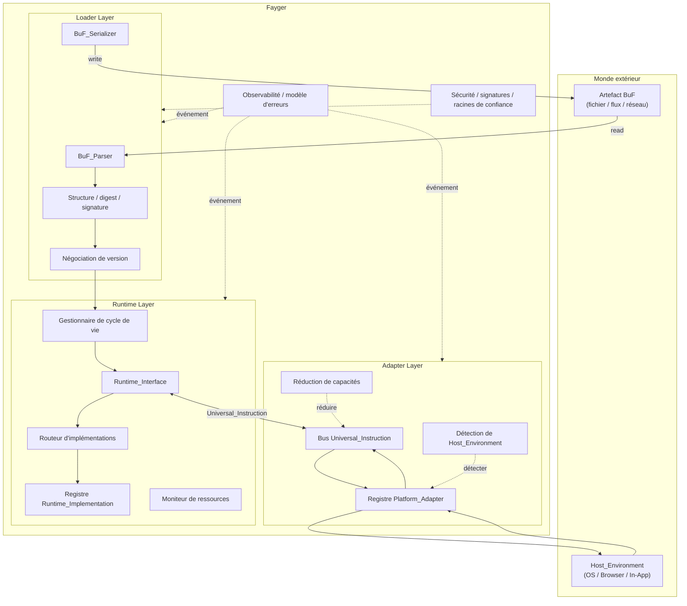

# Chapitre 2. Architecture Générale

## 2.1 Trois couches

Fayger est divisé verticalement en trois couches. Chacune assume sa responsabilité dans son périmètre, et les couches communiquent uniquement via des contrats bien définis.



## 2.2 Responsabilités par couche

### Loader Layer

- Lit un BuF depuis n'importe quel backend de stockage via l'abstraction *BuF_Source* (fichier local, HTTP Range, stockage objet, IPFS, backend utilisateur).
- Parse le flux d'octets en un objet en mémoire.
- Vérifie la validité structurelle, les digests de contenu et les signatures.
- Négocie avec le Fayger courant les versions de schéma BuF et de Runtime_Interface.
- Sélectionne, à granularité Section, le sous-ensemble à charger selon le *LoadProfile* fourni par l'appelant ; saute les Sections non nécessaires ou trop volumineuses pour l'environnement courant.
- Choisit selon *LoadStrategy* entre tout lire en amont (Eager) ou ne lire que l'en-tête + l'index, les corps de Section étant récupérés au premier accès (Lazy).
- Remet l'objet BuF en mémoire prêt à la couche d'exécution.
- Capacité inverse : sérialise l'objet en mémoire en octets pour la réécriture par les outils, le caching ou le repackaging.

### Runtime Layer

- Expose *Runtime_Interface* comme contrat neutre vis-à-vis du langage.
- Maintient le registre *Runtime_Implementation* et route vers une implémentation concrète selon la politique du BuF_Manifest.
- Gère le cycle de vie de chaque BuF_Instance (Loaded → Initialized → Running → Suspended → Terminated / Failed).
- Surveille l'utilisation des ressources par instance et applique la limitation ou la suspension selon les quotas du BuF_Manifest.
- Communique avec la couche d'adaptation via Universal_Instructions ; elle-même ne dépend d'aucun hôte concret.

### Adapter Layer

- Maintient un ensemble de *Platform_Adapter*, chacun correspondant à une classe de terminal / OS / hôte.
- Détecte au démarrage la Host_Environment courante et choisit l'adaptateur approprié.
- Traduit les Universal_Instructions de la couche d'exécution en appels système et normalise les événements hôte en Universal_Events.
- Réduit l'ensemble de capacités déclaré par BuF au sous-ensemble réellement disponible sur l'hôte courant.

## 2.3 Sens d'appel et règles de dépendance

Le sens des dépendances est la clé de l'évolutivité à long terme. Fayger applique ces règles strictes :

- **Loader → Runtime.** Unidirectionnel. Une fois le chargement terminé, le loader remet l'objet et ne conserve aucune BuF_Instance.
- **Runtime ↔ Adapter.** Bidirectionnel via les types Universal_Instruction et Universal_Event. La couche d'exécution n'importe jamais directement un type Platform_Adapter.
- **Runtime → Loader.** Interdit. Si la couche d'exécution doit reséréaliser un BuF (par ex. hot reload), elle passe par une interface de service exposée par le loader, pas par les internes du loader.
- **Adapter → Hôte.** Unidirectionnel. Un Platform_Adapter détient les références aux SDK et appels hôte ; la couche d'exécution n'importe jamais directement les bibliothèques hôte.
- **Transverse (observabilité / sécurité) → trois couches.** Pénètre via le bus d'événements et les interfaces de politique. Les trois couches publient des événements et interrogent des politiques, sans dépendre des implémentations transverses concrètes.

Le but central de ces règles : **ajouter un nouvel hôte ne doit pas modifier la couche d'exécution ; remplacer une implémentation d'exécution ne doit pas modifier les adaptateurs**.

## 2.4 Designs empruntés

### Phases de chargement chaînées comme la JVM

La couche de chargement est divisée en interne en phases de style JVM, ce qui facilite l'attribution d'erreurs et les tests unitaires :

```
Read(Header/Manifest/Index) → Parse → Verify(Structural)
  → Verify(Digest of Header/Manifest/Index) → Verify(Signature)
  → NegotiateVersion → Select(Sections by LoadProfile) → Resolve(Dependencies)
  → Read(Selected Section Bodies)?  → HandOff(to Runtime)
```

`Select(Sections by LoadProfile)` choisit les Sections à charger selon les capacités du terminal et les contraintes de taille. `Read(Selected Section Bodies)` ne s'exécute qu'avec LoadStrategy = Eager ; en Lazy, lecture et vérification des Sections sélectionnées sont différées au premier accès. Chaque phase produit des erreurs étiquetées par phase, intégrées au modèle d'erreurs unifié (chapitre 6).

### Organisation d'artefact à la Docker / OCI

Un artefact BuF est organisé comme une image OCI :

| Concept OCI | Équivalent BuF |
| --- | --- |
| Image Manifest | BuF_Manifest |
| Image Config | Champs `runtime` / `capabilities` / `quotas` du BuF_Manifest |
| Layers | BuF Sections (code / data / assets / signature) |
| Distribution Spec | Artefact mono-fichier en phase 1 ; extension future |
| Runtime Spec | Runtime_Interface |
| containerd | Runtime_Layer (cycle de vie + routage) |
| runc | Runtime_Implementation (exécuteur) |

### Modèle de sécurité par capacités, à la WASM / WASI

La couche d'adaptation utilise la sécurité par capacités :

- BuF_Manifest déclare `requested_capabilities` (par ex. `fs.read`, `net.http`, `ui.dom`).
- Un Platform_Adapter déclare `available_capabilities`.
- Accordées = `requested ∩ available ∩ host_policy`. L'instance entre en `Running` seulement si les trois intersections sont non vides.
- Les capacités non déclarées sont invisibles pour BuF (refus par défaut), conformément à la sémantique d'import hôte explicite de WASI.

## 2.5 Périmètre de la première phase et non-objectifs

**Périmètre de la première phase :**

- Chargement et exécution d'un BuF unique ; plusieurs BuF_Instances peuvent tourner en parallèle, sans rien partager par défaut.
- Chemin d'exécution interprété ; une abstraction ExecutionStrategy est réservée pour un futur JIT.
- Quatre Platform_Adapter intégrés : bureau / serveur / navigateur / In-App.
- Distribution synchrone et asynchrone des instructions ; isolation multi-instance dans un seul processus.

**Non-objectifs de la première phase :**

- Mémoire partagée et IPC entre BuF_Instances.
- Compilation JIT et génération de code machine.
- Planification distribuée et collaboration multi-nœuds de Fayger.
- Distribution différentielle de BuF et caches en couches (artefact mono-fichier comme base ; structure en couches réservée).
