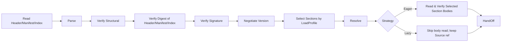
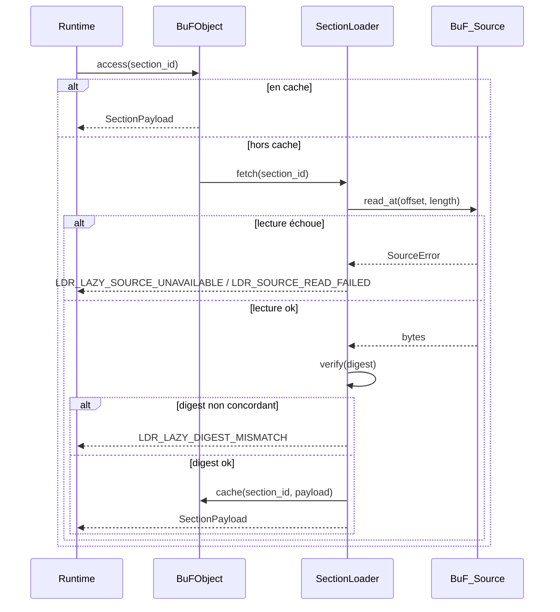

# Chapitre 3. Couche de Chargement

La couche de chargement est la frontière entre Fayger et les artefacts BuF externes. Sa tâche : lire un BuF depuis n'importe quel backend de stockage, décider quelles Sections charger et quand selon l'environnement et la politique de l'appelant, et transformer les octets en un objet BuF en mémoire interne cohérent que la couche d'exécution peut prendre en main — ou, en cas d'échec, renvoyer une erreur localisée avec précision et classifiable.

## 3.1 Format de l'artefact BuF

BuF utilise une disposition en cinq parties : **Header + Manifest + Section Index + Sections + Trailer**, inspirée de JAR / OCI Image / WASM :

```
+------------------------------------------------------------+
| Header        | magic="BUF\0" | format_version | flags     |
|               | manifest_offset, manifest_length            |
|               | section_index_offset, section_index_length  |
+------------------------------------------------------------+
| Manifest      | CBOR-encoded BuFManifest                    |
+------------------------------------------------------------+
| Section Index | [(section_id, kind, offset, length, digest, |
|               |   visibility, profile_constraints)]         |
+------------------------------------------------------------+
| Sections      | [code | data | assets | signature | ...]   |
+------------------------------------------------------------+
| Trailer       | total_length | manifest_digest | crc32     |
+------------------------------------------------------------+
```

Notes de conception :

- **Magic + Format Version.** Les 8 premiers octets sont fixes ; aident le tooling à identifier et rejeter les flux mal formés.
- **Manifest comme partie séparée.** Permet la négociation de version, la sélection par profil et la réduction de capacités sans décoder le moindre corps de Section (isomorphe à OCI Image Manifest).
- **Section Index : index de confiance du mode Lazy.** Chaque entrée contient offset, longueur, digest, visibility et profile_constraints. Le Section_Index doit être lu en entier et vérifié au chargement, car les fetches à la demande en Lazy en dépendent.
- **Trailer.** Porte la longueur totale et le digest du Manifest ; permet de détecter la troncature et de prévenir les attaques « signer puis altérer le Manifest ».
- **Encodage.** Manifest et Section_Index utilisent CBOR en mode déterministe (RFC 8949 §4.2), de sorte que la sérialisation soit unique — base de l'équivalence aller-retour.
- **Périmètre de signature.** Header || Manifest_minus_signature || Section_Index. Les corps de Sections sautées ou pas encore récupérés ne participent pas au calcul de la signature ; donc chargement partiel et complet sont équivalents pour la vérification.

## 3.2 Conventions de champs du BuF_Manifest

```idl
struct BuFManifest {
  // Négociation de version
  schema_version: SemVer
  runtime_interface_min: SemVer
  deprecation_notice: Option<String>

  // Point d'entrée et sélection runtime
  entry: EntryPoint
  runtime: RuntimeRequirement {
    preferred_impl: Option<ImplementationId>
    selection_strategy: enum { Strict, PreferThenAny, Any }
  }

  // Déclaration des capacités
  capabilities: CapabilitySet
  quotas: Option<ResourceQuota>

  // Index de contenu
  sections: List<SectionDescriptor> {
    id: SectionId
    kind: enum { Code, Data, Asset, Signature, Custom(String) }
    digest: Digest
    length: u64
    visibility: SectionVisibility           // Required | Optional
    profile_constraints: ProfileConstraints // par défaut sans contrainte
  }

  // Signature (optionnel)
  signature: Option<SignatureBlock>

  extensions: Map<String, CborValue>
}

struct ProfileConstraints {
  required_capabilities: Set<Capability>
  max_size: Option<u64>
  required_features: Set<Feature>
}
```

`schema_version` et `runtime_interface_min` évoluent indépendamment : le premier régit la compatibilité de format BuF ; le second la compatibilité de Runtime_Interface — analogue à la séparation entre version de class file et niveau d'API JVM.

## 3.3 Chaîne de chargement

La couche de chargement est divisée en plusieurs phases de style JVM :



Responsabilités par phase :

- **Read Header/Manifest/Index.** Récupère via BuF_Source les Header / Manifest / Section_Index / Trailer. Doit être terminé avant le retour de `load`, en Eager comme en Lazy.
- **Parse.** Parse Manifest et Section_Index (sans décoder les corps).
- **Verify Structural.** Vérifie magic, champs de version, bornes des Sections, champs requis du Manifest.
- **Verify Digest of Header/Manifest/Index.** Vérifie le digest holistique de Header, Manifest et Section_Index (via `manifest_digest` et champs liés du Trailer). Le digest de chaque corps de Section est vérifié au moment où la Section est effectivement récupérée.
- **Verify Signature.** S'exécute si le Manifest porte une signature ou si le mode signature obligatoire est activé. Le périmètre de signature couvre les trois parties d'en-tête ; ne dépend pas du fait que les corps soient récupérés.
- **Negotiate Version.** Vérifie la compatibilité de schema et de Runtime_Interface.
- **Select Sections by LoadProfile.** Décide l'ensemble sélectionné selon le LoadProfile et la Host_Environment courante ; voir §3.7.
- **Resolve.** Résout les dépendances entre BuFs (phase 1 : BuF unique ; interface réservée).
- **Read Selected Section Bodies.** Mode Eager seulement. Lit chaque corps sélectionné via BuF_Source et vérifie son digest.
- **HandOff.** Remet l'objet à la couche d'exécution. En Lazy, l'objet conserve une référence BuF_Source et un SectionLoader.

Chaque phase étiquette ses erreurs avec le nom de phase et la localisation, et fixe `context.phase` à `eager` ou `lazy`.

## 3.4 BuF_Source : abstraction de stockage multi-source

```idl
interface BuF_Source {
  read_at(offset: u64, length: u64) -> Result<Bytes, SourceError>
  length() -> Result<u64, SourceError>
  stat() -> Result<SourceStat, SourceError>     // optionnel
  close() -> Result<(), SourceError>             // optionnel
}
```

Notes de conception :

- La couche de chargement ne dépend que du couple minimal `read_at` et `length`.
- Tout support offrant la lecture à accès aléatoire peut être un BuF_Source : fichier local, HTTP Range, SDK de stockage objet, passerelle IPFS, Flash en blocs sur appareils embarqués, backend utilisateur.
- BuF_Source n'a pas besoin d'implémenter le streaming séquentiel ; Lazy saute par offset.
- Sur petits appareils (drones, caméras), une implémentation BuF_Source peut inclure un petit cache LRU ou lire directement depuis du Flash en blocs ; le loader ignore la stratégie.

## 3.5 BuF_Parser et BuF_Serializer

```idl
interface BuF_Parser {
  parse(bytes: Bytes) -> Result<BuFObject, ParseError>
}

interface BuF_Serializer {
  serialize(obj: BuFObject) -> Result<Bytes, SerializeError>
}
```

Dans `LoaderPipeline`, le parser appelle généralement BuF_Source en mode « récupérer un morceau → parser » ; le `parse(bytes)` à octets seuls est un point d'entrée simplifié pour les tests unitaires et le tooling.

### Objet en mémoire (avec chargement partiel)

```idl
struct BuFObject {
  manifest: BuFManifest
  raw_header: Header
  raw_trailer: Trailer

  selected_sections: Set<SectionId>
  skipped_sections: List<SkipRecord>     // (id, reasons)
  strategy: LoadStrategy
  source_ref: Option<BuF_Source>          // détenu seulement en Lazy
  loader: Option<SectionLoader>           // détenu seulement en Lazy
  sections: Map<SectionId, SectionPayload> // complet en Eager ; cache à la demande en Lazy
}

enum SkipReason {
  CapabilityNotGranted, OverMaxSize, FeatureMissing, ExplicitlyDisabled
}
```

Équivalence aller-retour en chargement partiel : la comparaison se fait sur l'étendue `selected_sections` ; les Sections sautées ne participent pas, mais la liste `skipped_sections` elle-même participe à la comparaison. Cela évite que deux chargements partiels avec sous-ensembles différents soient considérés équivalents.

## 3.6 Interface LoaderPipeline

```idl
struct LoadProfile {
  target_class: TargetClass             // desktop | server | browser | inapp | embedded | drone | camera | …
  capabilities: Set<Capability>
  max_section_bytes: Option<u64>
  features: Set<Feature>
}

enum LoadStrategy { Eager, Lazy }
enum SectionVisibility { Required, Optional }

struct LoaderPolicy {
  require_signature: bool
  trusted_roots: TrustedRootSet
  allowed_schema_versions: VersionRange
}

interface LoaderPipeline {
  load(
    source: BuF_Source,
    profile: LoadProfile,
    strategy: LoadStrategy,
    policy: LoaderPolicy
  ) -> Result<BuFObject, LoaderError>
}
```

`load` lit et vérifie toujours Header / Manifest / Section_Index avant de retourner. Lire ou non les corps avant le retour dépend de `strategy`.

## 3.7 Chargement partiel : choisir les Sections selon l'environnement

Les terminales varient énormément en capacité. Un poste de bureau peut charger un BuF complet ; un drone ou une caméra ne peut avoir besoin que des Sections « contrôle + codec vidéo ». Algorithme de sélection :

Pour chaque `s ∈ manifest.sections`, on définit le prédicat

```
fits(s) = s.profile_constraints.required_capabilities ⊆ profile.capabilities
        ∧ (s.profile_constraints.max_size non défini ∨ s.length ≤ s.profile_constraints.max_size)
        ∧ s.profile_constraints.required_features ⊆ profile.features
```

Résultats :

- `selected = { s : fits(s) }`, placé dans `BuFObject.selected_sections`.
- `s ∈ sections \ selected ∧ s.visibility == Required` ⟹ chargement échoué avec `LDR_PROFILE_REQUIRED_SECTION_MISSING`. Le contexte contient `section_id` et les contraintes non satisfaites.
- `s ∈ sections \ selected ∧ s.visibility == Optional` ⟹ entre dans `skipped_sections` avec raisons (CapabilityNotGranted / OverMaxSize / FeatureMissing / ExplicitlyDisabled).

La sélection est déterministe : un même (manifest, host_env, profile) produit le même `selected` et `skipped_sections`.

### Exemples

| Terminale | LoadProfile typique | Comportement |
| --- | --- | --- |
| Bureau | capabilities complet, pas de max_section_bytes | Toutes les Sections |
| Serveur | ui désactivé, pas de max_section_bytes | Sections UI sautées (si dépendance ui) |
| Navigateur | seulement net.fetch / net.websocket / ui.dom, max_section_bytes ≈ 8 MiB | Assets surdimensionnés sautés ; Sections nécessitant proc sautées |
| Drone | capabilities minimal + max_section_bytes ≈ 1 MiB + features.realtime | Seulement contrôle et codec ; tutoriels sautés |
| Caméra | capabilities limité à io.frame + crypto + net.rtsp | Seulement traitement vidéo et uplink |

## 3.8 Stratégies : Eager vs Lazy

### Eager

- Tous les corps de `selected_sections` sont lus et vérifiés avant le retour de `load`.
- Convient aux petits BuFs, aux scénarios sans accès réseau après le démarrage ou à la préférence « tout d'un coup ».
- Erreurs au chargement : `phase == "eager"`.

### Lazy

- Seuls Header / Manifest / Section_Index sont lus et vérifiés avant le retour de `load`.
- Les Sections sélectionnées sont récupérées et vérifiées au premier accès par SectionLoader.
- Convient aux BuFs volumineux, à l'exécution à la demande ou aux sources distantes (HTTP / stockage objet).
- Erreurs après `load` : `phase == "lazy"`. Peuvent être traitées séparément des erreurs de démarrage.

```idl
interface SectionLoader {
  fetch(id: SectionId) -> Result<SectionPayload, LoaderError>
  is_loaded(id: SectionId) -> bool
  loaded_ids() -> Set<SectionId>
}
```

### Flux de récupération à la demande en Lazy



### Équivalence Eager / Lazy

Pour le même (source, profile, policy), quelle que soit la stratégie :

- `selected_sections` et `skipped_sections` sont identiques.
- Si l'on déclenche une lecture pour chaque entrée de `selected_sections` du résultat Lazy, le contenu coïncide octet par octet avec celui d'Eager.
- Lazy ne fait que différer dans le temps la lecture et la vérification ; il n'introduit aucune différence sémantique.

Cette propriété est continuellement vérifiée par PBT.

## 3.9 Vérification de digest et de signature

### Digest

- Le digest holistique de Header / Manifest / Section_Index est toujours vérifié au chargement.
- Le digest de chaque corps de Section vient du snapshot immuable du Section_Index : Eager les vérifie tous au chargement ; Lazy au premier accès.
- Une non-concordance retourne `LDR_DIGEST_MISMATCH` (Eager) ou `LDR_LAZY_DIGEST_MISMATCH` (Lazy) ; le contexte porte la `section_id` fautive.

### Signature

Le périmètre est `Header || Manifest_minus_signature || Section_Index`. Cela implique :

- Même en chargement partiel, la vérification de signature reste complète.
- Les Sections sautées n'influencent pas la signature.
- Modifier offset / length / digest dans Section_Index invalide la signature.

Tableau de décision :

| Condition | Résultat |
| --- | --- |
| enforce_signature on ∧ pas de signature | `Err(LDR_SIGNATURE_FAIL)`, raison `MissingSignature` |
| signature présente ∧ vérification échoue | `Err(LDR_SIGNATURE_FAIL)`, raison `InvalidSignature` |
| signature présente ∧ vérification ok | `Ok` |
| enforce_signature off ∧ pas de signature | `Ok` |

L'ensemble des racines de confiance est maintenu par *TrustStore* ; les mises à jour prennent effet au prochain chargement (chapitre 7).

**Ordre critique.** La vérification de signature précède la sélection des Sections. On vérifie d'abord l'origine de l'artefact via la signature holistique du Manifest ; ensuite LoadProfile décide quelles Sections charger. Cela évite une sémantique affaiblie « ne vérifier que le sous-ensemble sélectionné ».

## 3.10 Négociation de version

Tableau de décision :

| Condition | Résultat |
| --- | --- |
| version de schema hors plage supportée | `Err(LDR_SCHEMA_UNSUPPORTED)` avec la plage attendue |
| runtime_interface_min supérieur au fourni | `Err(LDR_RUNTIME_VERSION_TOO_HIGH)` avec required / provided |
| schema dans la plage et non déprécié, runtime ok | `Ok` |
| schema déprécié mais encore supporté | `Ok` avec avis de dépréciation |

L'avis est exposé via `BuFObject.manifest.deprecation_notice` afin que le tooling puisse l'afficher.

## 3.11 Codes d'erreur

Codes stables produits par la couche de chargement :

| Code | Déclencheur |
| --- | --- |
| `LDR_PARSE_FAIL` | Flux BuF non conforme à la spécification |
| `LDR_DIGEST_MISMATCH` | Mismatch de digest de Section (phase Eager) |
| `LDR_LAZY_DIGEST_MISMATCH` | Mismatch de digest au premier accès Lazy |
| `LDR_SIGNATURE_FAIL` | Signature manquante en mode obligatoire ou signature invalide |
| `LDR_SCHEMA_UNSUPPORTED` | Version de schema hors plage supportée |
| `LDR_RUNTIME_VERSION_TOO_HIGH` | Runtime_Interface requis supérieur au fourni |
| `LDR_MISSING_REQUIRED_FIELD` | Champs requis du Manifest manquants à la sérialisation |
| `LDR_PROFILE_REQUIRED_SECTION_MISSING` | Section requise non chargeable sous le profil courant |
| `LDR_LAZY_SOURCE_UNAVAILABLE` | BuF_Source indisponible lors d'un accès Lazy ultérieur |
| `LDR_SOURCE_READ_FAILED` | Erreur de lecture BuF_Source (Eager ou Lazy) |

Chaque `context` contient la localisation et la raison, et marque la phase via `context.phase = "eager" | "lazy"` pour un diagnostic cohérent côté outils.
