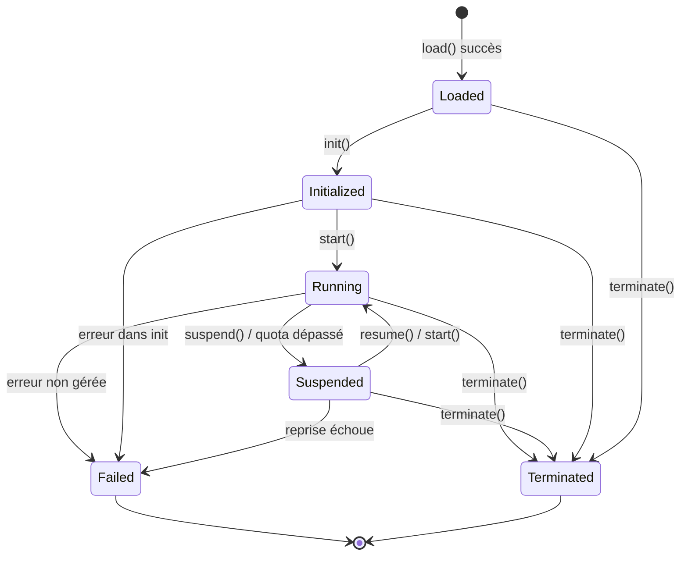

# Chapitre 4. Couche d'Exécution

La couche d'exécution exécute la sémantique de BuF. Elle reçoit le BuF_Object remis par la couche de chargement, communique avec la couche d'adaptation via Universal_Instructions et ne dépend d'aucun hôte concret.

## 4.1 Runtime_Interface (contrat neutre vis-à-vis du langage)

Runtime_Interface est le contrat externe stable. Toute Runtime_Implementation doit l'implémenter de manière sémantiquement équivalente, qu'elle utilise des traits Rust, interfaces Go ou TypeScript ou autres mécanismes.

```idl
interface Runtime_Interface {
  // Métadonnées
  rt_version() -> RuntimeInterfaceVersion
  capabilities() -> Set<RuntimeCapability>

  // Cycle de vie
  load(obj: BuFObject) -> Result<InstanceId, RuntimeError>
  init(id: InstanceId) -> Result<(), RuntimeError>
  start(id: InstanceId) -> Result<(), RuntimeError>
  suspend(id: InstanceId) -> Result<(), RuntimeError>
  resume(id: InstanceId) -> Result<(), RuntimeError>
  terminate(id: InstanceId) -> Result<(), RuntimeError>

  // Requêtes d'état
  state(id: InstanceId) -> Result<LifecycleState, RuntimeError>
  failure_info(id: InstanceId) -> Result<Option<FailureInfo>, RuntimeError>

  // Communication avec la couche d'adaptation
  emit(id: InstanceId, instr: UniversalInstruction) -> Result<UniversalReply, AdapterError>
  on_event(id: InstanceId, event: UniversalEvent) -> Result<(), RuntimeError>
}
```

Le design emprunte à :

- **OCI Runtime Spec** « configuration + commandes » : `load` soumet la configuration ; `init / start / suspend / resume / terminate` sont des commandes.
- **Moteur d'exécution JVM** habitude de requêtes d'état : `state` et `failure_info` interrogeables à tout moment.

## 4.2 Enregistrement et routage de Runtime_Implementation

```idl
interface RuntimeRegistry {
  register(impl: Runtime_Implementation) -> Result<RegistrationId, RegistryError>
  list() -> List<RuntimeImplementationDescriptor>
  resolve(manifest: BuFManifest) -> Result<RegistrationId, RegistryError>
}
```

### Vérification de complétude des méthodes à l'enregistrement

Le RuntimeRegistry vérifie que l'implémentation candidate couvre toutes les méthodes requises :

- Soit `R` l'ensemble requis et `I = implemented_methods(impl)`.
- `register(impl)` réussit si et seulement si `R ⊆ I`.
- Sinon il renvoie `RT_IMPL_MISSING_METHODS` avec `R \ I` dans `context.missing_methods`.

Le contrôle a lieu une fois à l'enregistrement ; aucune dépense au runtime.

### Stratégie de routage

Le BuF_Manifest exprime sa préférence via `runtime.preferred_impl` et `runtime.selection_strategy`. Comportement de `resolve(manifest)` :

- `Strict` : doit utiliser `preferred_impl`, qui doit être compatible avec le manifest ; sinon `RT_IMPL_NOT_FOUND`.
- `PreferThenAny` : préférer `preferred_impl` ; sinon, n'importe quelle compatible.
- `Any` : n'importe quelle implémentation compatible.

« Compatible » signifie `rt_version()` ≥ `manifest.runtime_interface_min` et `capabilities()` couvrant l'ensemble minimal du manifest.

Une seule Fayger peut héberger plusieurs implémentations enregistrées (par ex. une Rust pour le bureau et une TypeScript pour le navigateur). Le routage doit rester prévisible et débogable pour l'appelant.

## 4.3 Cycle de vie d'une BuF_Instance

### Machine à états



### Table des transitions légales

| État courant | Cibles permises |
| --- | --- |
| Loaded | Initialized, Terminated, Failed |
| Initialized | Running, Terminated, Failed |
| Running | Suspended, Terminated, Failed |
| Suspended | Running, Terminated, Failed |
| Terminated | (terminal) |
| Failed | (terminal) |

Exemples illégaux : `Loaded → Running` (init manquant), `Terminated → quoi que ce soit`, `Failed → Running`.

Sur une transition illégale, le runtime renvoie `RT_ILLEGAL_TRANSITION` ; le contexte contient `current_state` et `allowed_set`, l'état ne change pas.

### État Failed

Une instance entrant en `Failed` doit conserver :

- La dernière Universal_Instruction qui a déclenché l'échec.
- L'objet d'erreur qui a déclenché l'échec (avec toute la chaîne de causes).

Ils sont interrogeables via `failure_info(id)` jusqu'à destruction explicite.

## 4.4 Zone de données et isolation des BuF_Instance

Chaque BuF_Instance possède une RuntimeDataArea indépendante :

- Heap / pile d'appels / table de handles indépendants.
- File de distribution d'instructions indépendante.
- Compteurs d'utilisation de ressources indépendants.

Les instances ne partagent pas de pointeurs d'objets par défaut. Cela emprunte au modèle JVM avec PC / pile par thread et zone de méthodes par instance.

Formellement, pour deux instances simultanées `i₁` et `i₂` :

```
data_area(i₁) ∩ data_area(i₂) == ∅
```

et toute écriture sur `i₁` ne change aucun octet de `data_area(i₂)`. C'est l'une des propriétés d'isolation centrales vérifiées en tests.

## 4.5 Surveillance des ressources et quotas

```idl
interface ResourceMonitor {
  attach(id: InstanceId, quota: ResourceQuota)
  sample(id: InstanceId) -> ResourceUsage
}
```

Politique :

- Quand BuF_Manifest déclare des quotas CPU / mémoire / I/O, `ResourceMonitor` échantillonne périodiquement.
- Lorsqu'une dimension dépasse, un `QuotaExceeded` est émis et le gestionnaire de cycle de vie passe l'instance en `Suspended`.
- `context.resource` de l'événement de suspension correspond à la première ressource dépassée ; `context.usage` à la valeur échantillonnée à la première violation.

La surveillance utilise des capacités hôte (cgroups, Performance API du navigateur, timers de plate-forme…) fournies par le Platform_Adapter correspondant. La couche d'exécution ne consomme que les échantillons normalisés.

## 4.6 Isolation des défaillances entre instances

Une instance entrant en `Failed` ne doit pas affecter les autres en `Running` :

- Le gestionnaire de cycle de vie récupère seul les ressources de l'instance défaillante.
- Le dispatch des Universal_Instructions des autres reste inchangé.
- Le bus d'événements classifie séparément les défaillantes et les saines pour éviter le blocage mutuel.

Formellement : avec N instances en cours, si `iₖ` échoue, les chronologies d'état et les séquences Universal_Instruction des autres `iⱼ` (`j ≠ k`) coïncident avec la base sans défaut.

## 4.7 Interface vers la couche d'adaptation

L'exécution émet `UniversalInstruction` à l'adaptateur et reçoit `UniversalReply` ou `UniversalEvent` :

```idl
fn emit(id: InstanceId, instr: UniversalInstruction) -> Result<UniversalReply, AdapterError>
fn on_event(id: InstanceId, event: UniversalEvent) -> Result<(), RuntimeError>
```

La couche d'exécution ne dépend que de ces deux types et d'aucun type Platform_Adapter concret. Des contrôles de dépendance statiques garantissent la règle (cf. recommandations d'outillage du chapitre 8).

## 4.8 Codes d'erreur

Codes stables produits par la couche d'exécution :

| Code | Déclencheur |
| --- | --- |
| `RT_ILLEGAL_TRANSITION` | Transition illégale du cycle de vie |
| `RT_IMPL_NOT_FOUND` | Routage sans implémentation correspondante |
| `RT_IMPL_MISSING_METHODS` | Implémentation enregistrée à laquelle il manque des méthodes |
| `RT_QUOTA_EXCEEDED` | Utilisation excédant le quota ; déclenche Suspended |
| `RT_INSTANCE_FAILED` | L'instance est entrée en Failed |
