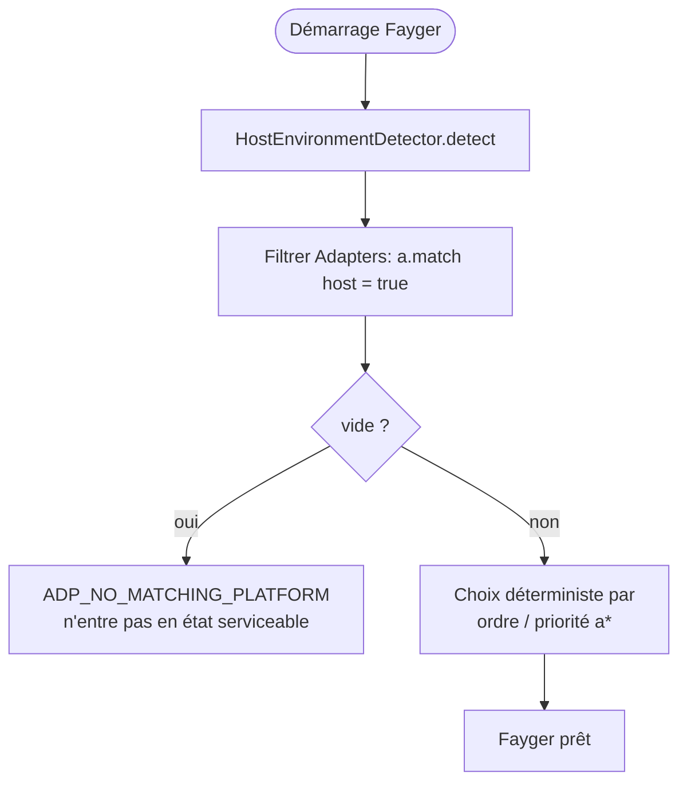
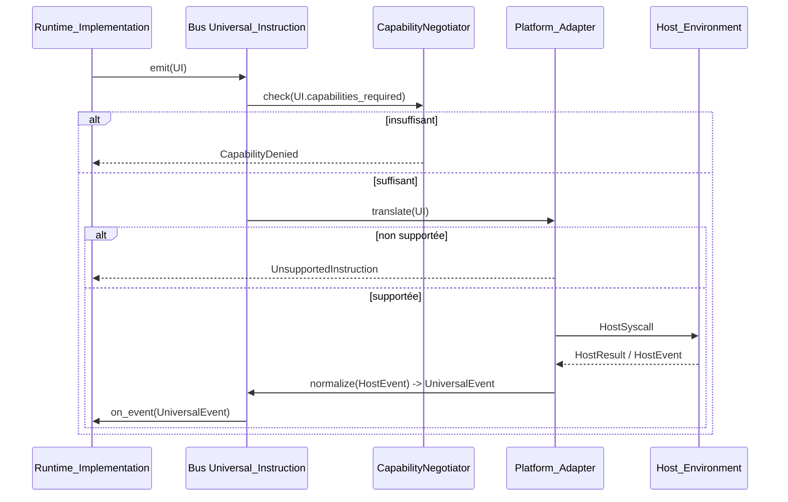

# Chapitre 5. Couche d'Adaptation

La couche d'adaptation est la frontière entre Fayger et la Host_Environment. Elle reçoit les Universal_Instructions de la couche d'exécution et les traduit en appels système compréhensibles par l'hôte ; elle normalise les événements de l'hôte en Universal_Events renvoyés à la couche d'exécution.

Ajouter un nouvel hôte ne nécessite qu'un nouveau Platform_Adapter — les couches de chargement et d'exécution restent inchangées.

## 5.1 Forme des données Universal_Instruction

```idl
struct UniversalInstruction {
  category: InstructionCategory
  opcode: u16
  operands: TLV[]
  capabilities_required: Set<Capability>
}

struct UniversalEvent {
  category: EventCategory
  opcode: u16
  payload: TLV[]
}
```

Notes de conception :

- **category** est la classification grossière (io / net / ui / time / random / crypto / proc / host).
- **opcode** est l'identifiant intra-catégorie (2 octets) ; le bit haut est réservé aux instructions expérimentales.
- **operands** est une séquence TLV (type-length-value) pour le décodage multi-langage et l'extensibilité.
- **capabilities_required** est l'ensemble de capacités nécessaire à cette instruction ; il alimente la réduction de capacités.

### Catégories (première phase)

| Catégorie | Description | Inspirée de |
| --- | --- | --- |
| `io` | fichiers / flux standard | POSIX read / write |
| `net` | I/O réseau | WASI sock_* |
| `ui` | rendu et entrée UI | DOM / TUI / Canvas |
| `time` | horloges et timers | clock_time_get |
| `random` | aléatoire | random_get |
| `crypto` | primitives cryptographiques | WASI crypto |
| `proc` | processus / thread / signal | POSIX |
| `host` | appels spécifiques à l'hôte | JNI / extism |

8 bits sont réservés pour de futures catégories.

### Encodage

Chaque instruction est codée :

```
+--------+--------+----------+-------------------+
| cat(1) | op(2)  | caps(2)  | operands(TLV...)  |
+--------+--------+----------+-------------------+
```

- `cat` : 1 octet ; bits hauts réservés aux drapeaux.
- `op` : 2 octets.
- `caps` : bitmap de capacités sur 2 octets (16 bits bas en phase 1 ; segment d'extension au-delà).
- `operands` : chaque opérande est `(type:1, length:varint, value)`.

## 5.2 Abstraction Platform_Adapter

```idl
interface Platform_Adapter {
  descriptor() -> AdapterDescriptor
  match(host: HostEnvironment) -> bool
  translate(instr: UniversalInstruction) -> Result<HostSyscall, AdapterError>
  normalize(raw: HostEvent) -> Result<UniversalEvent, AdapterError>
}

struct AdapterDescriptor {
  platform_id: String
  supported_capabilities: Set<Capability>
  supported_instructions: Set<InstructionId>
}
```

Chaque adaptateur s'auto-décrit pour ses capacités et instructions ; la réduction de capacités et la décision « instruction non supportée » deviennent des recherches locales en table, sans tâtonnement à l'exécution.

## 5.3 Détection de Host_Environment et choix de l'adaptateur

```idl
interface HostEnvironmentDetector {
  detect() -> HostEnvironment
}

struct HostEnvironment {
  platform_id: String
  os_kind: OsKind
  arch: Arch
  sandbox_kind: SandboxKind
  runtime_features: Set<Feature>
}
```

Flux de sélection au démarrage :



Choix déterministe : avec le même ensemble d'adaptateurs et la même Host_Environment, des démarrages successifs choisissent le même adaptateur. Cela évite le problème de l'« adaptateur fantôme ».

## 5.4 Réduction de capacités

```idl
interface CapabilityNegotiator {
  negotiate(
    requested: Set<Capability>,
    available: Set<Capability>,
    policy: HostPolicy
  ) -> NegotiationResult
}

struct NegotiationResult {
  granted: Set<Capability>
  denied: Set<Capability>
  warnings: List<Capability>
}
```

Algèbre des ensembles :

- `granted = requested ∩ available ∩ policy`
- `denied = requested \ granted`
- `warnings` : capacités disponibles sous forme restreinte sur l'hôte (par ex. `net.http` sous les contraintes fetch du navigateur).

Si `manifest.required_capabilities \ granted ≠ ∅`, `start()` doit renvoyer une erreur ; `context.missing` égal à la différence ; l'instance n'entre pas en Running. Règle dure « pas de démarrage si capacités insuffisantes ».

Les capacités non déclarées sont invisibles pour BuF (refus par défaut), conformément à la sémantique d'import hôte explicite de WASI.

## 5.5 Flux de traduction bidirectionnelle



Notes :

- La vérification de capacités se fait avant translate, évitant des appels inutiles vers l'aval.
- « Instruction non supportée » est une décision locale déterministe (lookup) qui ne déclenche aucun appel hôte.
- Les événements hôte reviennent par `normalize` ; la couche d'exécution ne touche jamais aux structures brutes.

## 5.6 Adaptateurs intégrés de la première phase

| Adaptateur | Cas d'usage | Réduction de capacités |
| --- | --- | --- |
| **NativeDesktop_Adapter** | Linux / macOS / Windows bureau | Capacités quasi complètes ; `ui` / `proc` / `io` / `net` totalement disponibles |
| **Server_Adapter** | Serveur sans GUI | `ui` désactivé ; `proc` restreint par politique |
| **Browser_Adapter** | Basé sur Web API | `proc` et la majorité d'`io` désactivés ; `net` limité à fetch / WebSocket ; réduction forte |
| **InApp_Adapter** | Embarqué dans un processus d'application hôte | Capacités explicitement injectées par l'hôte ; le plus strict ; opcodes `host` déclarés par l'hôte |

Ce sont des implémentations de référence. Des tiers peuvent enregistrer leurs propres adaptateurs (terminales embarquées, intégrations IDE spécifiques, etc.).

## 5.7 Cohérence multi-plateforme

Un même BuF chargé et exécuté sur différents Platform_Adapters doit produire à la couche d'exécution la même séquence Lifecycle_State et la même séquence Universal_Instruction :

- Toute différence susceptible de provoquer une divergence doit être rejetée avant `start` par la réduction de capacités, et non diverger en silence pendant l'exécution.
- Les optimisations « équivalent mais chemin différent » ne doivent pas exposer des chemins différents dans la séquence Universal_Instruction.

La propriété est vérifiée par PBT en exécutant en parallèle une paire d'adaptateurs mock à capacités égales et en comparant les séquences.

## 5.8 Codes d'erreur

Codes stables produits par la couche d'adaptation :

| Code | Déclencheur |
| --- | --- |
| `ADP_NO_MATCHING_PLATFORM` | Aucun adaptateur ne correspond à l'hôte |
| `ADP_UNSUPPORTED_INSTRUCTION` | L'adaptateur courant ne supporte pas l'instruction |
| `ADP_CAPABILITY_DENIED` | Capacités insuffisantes après réduction |
| `ADP_HOST_CALL_FAILED` | Échec côté hôte après traduction en appel système |

`ADP_UNSUPPORTED_INSTRUCTION` ne doit déclencher aucun appel hôte ; seule l'erreur est renvoyée. C'est l'incarnation du « refus par défaut » au niveau instruction.
