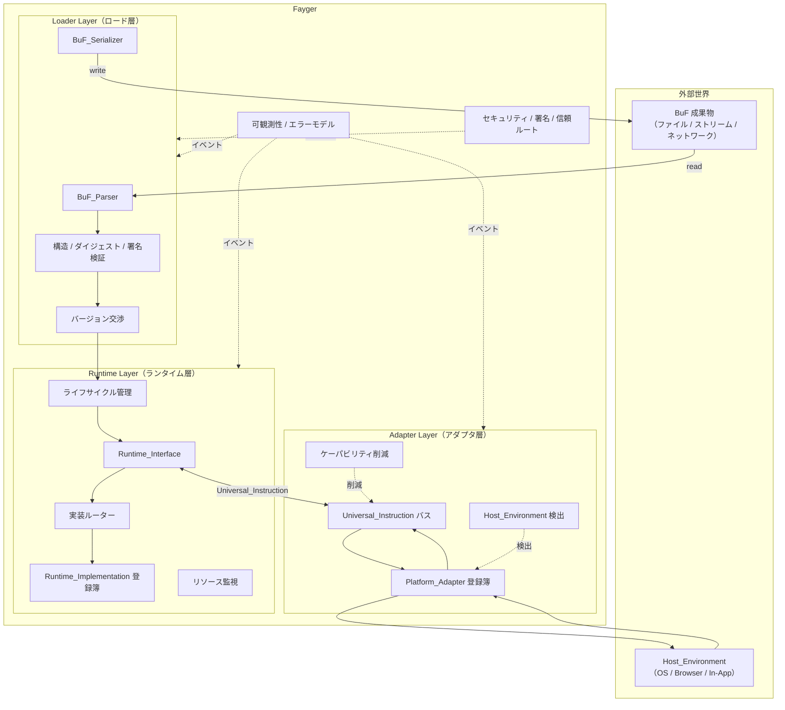

# 第 2 章 全体アーキテクチャ

## 2.1 三層構成

Fayger は垂直方向に三層へ分割されます。各層は自分の分担で職責を果たし、層間は明確に定義された契約だけで通信します。



## 2.2 各層の責務

### ロード層

- *BuF_Source* 抽象を介して任意の格納バックエンド（ローカルファイル、HTTP Range、オブジェクトストレージ、IPFS、ユーザー定義）から BuF を読み取ります。
- バイト列をメモリ上のオブジェクトに解析します。
- 構造の妥当性、内容ダイジェスト、署名を検証します。
- 現在の Fayger と BuF schema・Runtime_Interface バージョンを交渉します。
- 呼び出し側が指定する *LoadProfile* に従い、Section 単位でロード対象を選別します。現在の実行環境で不要・収まらない Section はスキップします。
- *LoadStrategy* に従って、選択された Section をすべて先読みする（Eager）か、ヘッダ + インデックスだけ読み本体は実行時に取得する（Lazy）かを選びます。
- 完成した BuF メモリオブジェクトをランタイム層へ引き渡します。
- 逆方向：メモリオブジェクトを再びバイト列に直列化（書き戻し、キャッシュ、再パッケージ向け）。

### ランタイム層

- *Runtime_Interface* を言語非依存の契約として公開します。
- *Runtime_Implementation* 登録簿を保持し、BuF_Manifest のポリシーに従って具体実装へルーティングします。
- 各 BuF_Instance のライフサイクル（Loaded → Initialized → Running → Suspended → Terminated / Failed）を管理します。
- インスタンスごとのリソース利用を監視し、BuF_Manifest のクォータに応じて抑制または停止します。
- Universal_Instruction を通じてアダプタ層と通信し、自身は具体ホストに依存しません。

### アダプタ層

- 端末 / OS / ホストごとに対応する *Platform_Adapter* 群を保持します。
- 起動時に現在の Host_Environment を検出し、適切なアダプタを選びます。
- ランタイム層が発する Universal_Instruction をシステム呼び出しに翻訳し、ホストイベントを Universal_Event に正規化して返します。
- BuF が宣言したケーパビリティ集合を、現在のホストで実際に利用できる部分集合へ削減します。

## 2.3 呼び出し方向と依存規則

依存方向は長期の進化可能性の鍵です。Fayger は次の硬い規則を採用します：

- **ロード層 → ランタイム層**：単方向。ロード完了後にメモリオブジェクトを引き渡し、BuF_Instance を保持しません。
- **ランタイム層 ↔ アダプタ層**：Universal_Instruction と Universal_Event を通じた双方向通信のみ。ランタイム層は Platform_Adapter 型を直接 import しません。
- **ランタイム層 → ロード層**：禁止。BuF を再直列化する必要がある場合（例：ホットリロード）はロード層が公開するサービスインターフェイス経由で行い、内部型を逆参照しません。
- **アダプタ層 → ホスト**：単方向。Platform_Adapter がホスト SDK・システム呼び出しの参照を保持。ランタイム層はホストライブラリを直接 import しません。
- **横断（可観測性 / セキュリティ）→ 三層**：イベントバスとポリシーインターフェイス経由で侵入。三層はイベント発行・ポリシー問い合わせを行いますが、横断層の具体実装には逆依存しません。

これら規則の核心は次の通りです：**新しいホストを追加してもランタイム層は変えない。ランタイム実装を入れ替えてもアダプタは変えない**。

## 2.4 借用した体系

### JVM のチェーン式ロード段

ロード層は内部で JVM 風の段に分割し、エラー特定と単体テストを容易にします：

```
Read(Header/Manifest/Index) → Parse → Verify(Structural)
  → Verify(Digest of Header/Manifest/Index) → Verify(Signature)
  → NegotiateVersion → Select(Sections by LoadProfile) → Resolve(Dependencies)
  → Read(Selected Section Bodies)?  → HandOff(to Runtime)
```

`Select(Sections by LoadProfile)` は端末ケーパビリティとサイズ制約に基づき、ロード対象の Section を選別します。`Read(Selected Section Bodies)` は LoadStrategy = Eager のときだけ実行され、Lazy では選択された Section の読み出しと検証は初回アクセスまで遅延します。各段の失敗は段名タグ付きのエラーとして統一エラーモデルへ流れます（第 6 章）。

### Docker / OCI の成果物編成

BuF 成果物の物理編成は OCI Image に対応します：

| OCI 概念 | BuF 対応物 |
| --- | --- |
| Image Manifest | BuF_Manifest |
| Image Config | BuF_Manifest 内の `runtime` / `capabilities` / `quotas` |
| Layers | BuF Sections（code / data / assets / signature） |
| Distribution Spec | 第一フェーズは単一ファイル成果物が基線、後続で拡張 |
| Runtime Spec | Runtime_Interface |
| containerd | Runtime_Layer（ライフサイクル + ルーティング） |
| runc | Runtime_Implementation（具体的な実行器） |

### WASM / WASI のケーパビリティセキュリティモデル

アダプタ層は capability-based security を採用します：

- BuF_Manifest が `requested_capabilities`（例：`fs.read`、`net.http`、`ui.dom`）を宣言。
- Platform_Adapter が `available_capabilities` を宣言。
- 実際に付与されるケーパビリティ = `requested ∩ available ∩ host_policy`。三者の交わりが空でないときのみ `Running` に入れます。
- 宣言されていないケーパビリティは BuF からは見えません（既定拒否）。WASI の host import の明示的注入と同じ意味論です。

## 2.5 第一フェーズの範囲と非目標

**第一フェーズの範囲**：

- 単一 BuF のロードと実行。複数 BuF_Instance は並行可能だが既定で共有なし。
- 解釈実行パス。将来 JIT を加えるための ExecutionStrategy 抽象を予約。
- 内蔵 Platform_Adapter 4 種：デスクトップ / サーバー / ブラウザ / In-App。
- 同期・非同期命令ディスパッチ、単一プロセス内の多インスタンス分離。

**第一フェーズの非目標**：

- BuF_Instance 間の共有メモリと IPC プロトコル。
- JIT コンパイルと機械語生成。
- 分散スケジューリングと多ノード Fayger 連携。
- BuF の差分配布と分層キャッシュ（単一ファイル成果物を基線、分層構造を予約）。
