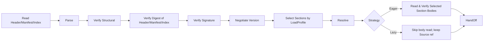
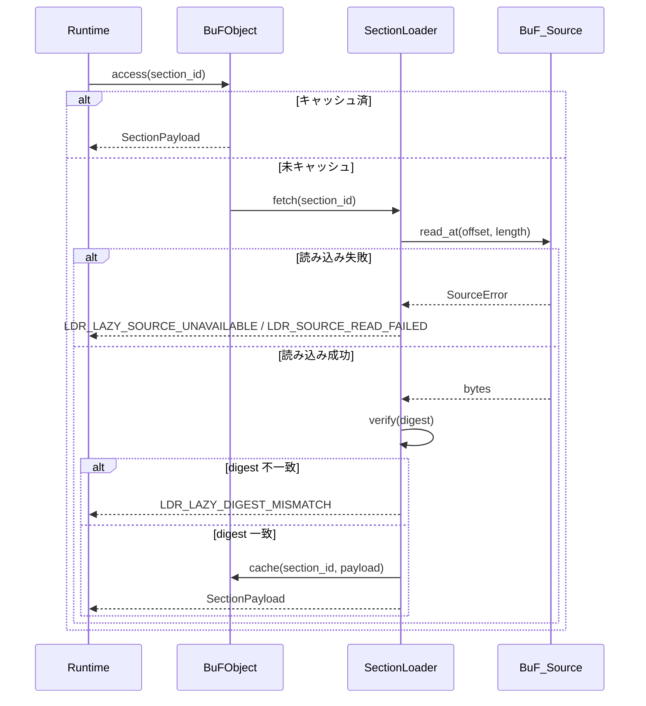

# 第 3 章 ロード層

ロード層は Fayger と外部 BuF 成果物の境界です。任意の格納バックエンドから BuF を読み、現在の実行環境と呼び出し側のポリシーに従ってどの Section をいつロードするかを選び、バイト列を内部一貫性のある BuF メモリオブジェクトに変換します。失敗時は位置と原因が明示された分類可能なエラーを返します。

## 3.1 BuF 成果物フォーマット

BuF は **Header + Manifest + Section Index + Sections + Trailer** の五段構成を採用します（JAR / OCI Image / WASM の複合構成を参考）：

```
+------------------------------------------------------------+
| Header        | magic="BUF\0" | format_version | flags     |
|               | manifest_offset, manifest_length            |
|               | section_index_offset, section_index_length  |
+------------------------------------------------------------+
| Manifest      | CBOR-encoded BuFManifest                    |
+------------------------------------------------------------+
| Section Index | [(section_id, kind, offset, length, digest, |
|               |   visibility, profile_constraints)]         |
+------------------------------------------------------------+
| Sections      | [code | data | assets | signature | ...]   |
+------------------------------------------------------------+
| Trailer       | total_length | manifest_digest | crc32     |
+------------------------------------------------------------+
```

設計要点：

- **Magic + Format Version**：先頭 8 バイト固定。ツールの識別と不正ストリームの拒否に有用。
- **Manifest を独立段に**：Section 本体を解読せずに、バージョン交渉・プロファイル選択・ケーパビリティ削減を完了できます（OCI Image Manifest と同型）。
- **Section Index は Lazy モードの信頼インデックス**：各エントリにオフセット、長さ、digest、visibility、profile_constraints を含みます。Lazy のオンデマンド読み出しが依存するため、ロード時に完全に読み込み総合ダイジェスト検証を必ず通します。
- **Trailer**：全体長と Manifest ダイジェストを保持。切り詰め検出と「署名後 Manifest 改竄」の防止に用います。
- **エンコーディング**：Manifest と Section_Index は CBOR の確定的エンコーディング（RFC 8949 §4.2）を使用。直列化バイト列が一意化され、ラウンドトリップ等価性の礎となります。
- **署名スコープ**：Header || Manifest_minus_signature || Section_Index。スキップまたは未読の Section 本体は署名計算に参加しないため、部分ロードと完全ロードは署名検証上等価です。

## 3.2 BuF_Manifest フィールド規約

```idl
struct BuFManifest {
  // バージョン交渉
  schema_version: SemVer
  runtime_interface_min: SemVer
  deprecation_notice: Option<String>

  // エントリとランタイム選択
  entry: EntryPoint
  runtime: RuntimeRequirement {
    preferred_impl: Option<ImplementationId>
    selection_strategy: enum { Strict, PreferThenAny, Any }
  }

  // ケーパビリティ宣言
  capabilities: CapabilitySet
  quotas: Option<ResourceQuota>

  // 内容インデックス
  sections: List<SectionDescriptor> {
    id: SectionId
    kind: enum { Code, Data, Asset, Signature, Custom(String) }
    digest: Digest
    length: u64
    visibility: SectionVisibility           // Required | Optional
    profile_constraints: ProfileConstraints // 既定で制約なし
  }

  // 署名（任意）
  signature: Option<SignatureBlock>

  extensions: Map<String, CborValue>
}

struct ProfileConstraints {
  required_capabilities: Set<Capability>
  max_size: Option<u64>
  required_features: Set<Feature>
}
```

`schema_version` と `runtime_interface_min` は独立に進化します。前者は BuF 形式の互換性を、後者は Runtime_Interface の互換性を制御します（JVM の class file version と JVM API level の分離と同様）。

## 3.3 ロードチェーン

ロード層は内部で JVM 風に複数段に分けられます：



各段の責務：

- **Read Header/Manifest/Index**：BuF_Source 経由で Header / Manifest / Section_Index / Trailer を取り出します。Eager / Lazy いずれでも load 戻り前に完了します。
- **Parse**：Manifest と Section_Index を解析（本体は解読しない）。
- **Verify Structural**：magic、バージョンフィールド、Section 境界、Manifest 必須フィールドを点検。
- **Verify Digest of Header/Manifest/Index**：Header、Manifest、Section_Index の総合ダイジェストを検証（Trailer の `manifest_digest` などを通じて）。各 Section 本体の digest はその段が実際に読まれた時点で検証。
- **Verify Signature**：Manifest が署名情報を含むか強制署名モードのときに実行。署名スコープはヘッダ三段のみで、Section 本体の読み出し有無に依存しません。
- **Negotiate Version**：schema バージョンと Runtime_Interface 最低バージョンの互換性を点検。
- **Select Sections by LoadProfile**：呼び出し側の LoadProfile と現在の Host_Environment に従って選択集合を決定（§3.7）。
- **Resolve**：BuF 間の依存関係を解決（第一フェーズは単一 BuF、インターフェイスは予約）。
- **Read Selected Section Bodies**：Eager のみ実行。BuF_Source から段ごとに読み digest 検証。
- **HandOff**：メモリオブジェクトをランタイム層へ提出。Lazy 時はオブジェクトが BuF_Source 参照と SectionLoader を保持。

各段の失敗は段名と位置情報をエラーオブジェクトに付け、`context.phase` に `eager` または `lazy` を記します。

## 3.4 BuF_Source：多源ストレージ抽象

```idl
interface BuF_Source {
  read_at(offset: u64, length: u64) -> Result<Bytes, SourceError>
  length() -> Result<u64, SourceError>
  stat() -> Result<SourceStat, SourceError>     // 任意
  close() -> Result<(), SourceError>             // 任意
}
```

設計要点：

- ロード層は `read_at` と `length` の最小操作のみに依存。
- ランダムアクセス読み出しを提供する任意の媒体が BuF_Source となれます：ローカルファイル、HTTP Range、オブジェクトストレージ SDK、IPFS ゲートウェイ、組み込み機器の分割 Flash、ユーザー定義バックエンドなど。
- BuF_Source は順次ストリームを実装する必要はありません（Lazy はオフセットでジャンプ読み）。
- 小型機器（ドローン、カメラ）向けには、LRU 小キャッシュ付きや分割 Flash に直接アクセスする実装が可能。ロード層は具体戦略を意識しません。

## 3.5 BuF_Parser と BuF_Serializer

```idl
interface BuF_Parser {
  parse(bytes: Bytes) -> Result<BuFObject, ParseError>
}

interface BuF_Serializer {
  serialize(obj: BuFObject) -> Result<Bytes, SerializeError>
}
```

LoaderPipeline 内では Parser は通常「断片を取得 → 解析」のように BuF_Source を呼びます。バイト列のみの `parse(bytes)` は単体テストやツール用途の簡易入口です。

### メモリオブジェクト（部分ロード対応）

```idl
struct BuFObject {
  manifest: BuFManifest
  raw_header: Header
  raw_trailer: Trailer

  selected_sections: Set<SectionId>
  skipped_sections: List<SkipRecord>     // (id, reasons)
  strategy: LoadStrategy
  source_ref: Option<BuF_Source>          // Lazy のみ保持
  loader: Option<SectionLoader>           // Lazy のみ保持
  sections: Map<SectionId, SectionPayload> // Eager は全量、Lazy は需要時キャッシュ
}

enum SkipReason {
  CapabilityNotGranted, OverMaxSize, FeatureMissing, ExplicitlyDisabled
}
```

部分ロードでのラウンドトリップ等価性の意味：等価関係は `selected_sections` の範囲で比較します。スキップされた Section は比較に参加しませんが、`skipped_sections` 自体は比較対象になります。

## 3.6 LoaderPipeline インターフェイス

```idl
struct LoadProfile {
  target_class: TargetClass             // desktop | server | browser | inapp | embedded | drone | camera | …
  capabilities: Set<Capability>
  max_section_bytes: Option<u64>
  features: Set<Feature>
}

enum LoadStrategy { Eager, Lazy }
enum SectionVisibility { Required, Optional }

struct LoaderPolicy {
  require_signature: bool
  trusted_roots: TrustedRootSet
  allowed_schema_versions: VersionRange
}

interface LoaderPipeline {
  load(
    source: BuF_Source,
    profile: LoadProfile,
    strategy: LoadStrategy,
    policy: LoaderPolicy
  ) -> Result<BuFObject, LoaderError>
}
```

`load` は戻る前に必ず Header / Manifest / Section_Index を読み検証します。Section 本体を戻る前に読むかは `strategy` 次第です。

## 3.7 部分ロード：実行環境による Section 選択

端末は多様で性能差が大きく、デスクトップは BuF を全量読み込めますが、ドローンやカメラは「制御 + 動画コーデック」段だけで足りる可能性があります。Section 選択アルゴリズム：

各 `s ∈ manifest.sections` について述語を定義：

```
fits(s) = s.profile_constraints.required_capabilities ⊆ profile.capabilities
        ∧ (s.profile_constraints.max_size 未設定 ∨ s.length ≤ s.profile_constraints.max_size)
        ∧ s.profile_constraints.required_features ⊆ profile.features
```

選択結果：

- `selected = { s : fits(s) }` を `BuFObject.selected_sections` に。
- `s ∈ sections \ selected ∧ s.visibility == Required` ⟹ load 失敗。`LDR_PROFILE_REQUIRED_SECTION_MISSING` を返却し、context に `section_id` と未充足の制約項を含む。
- `s ∈ sections \ selected ∧ s.visibility == Optional` ⟹ `skipped_sections` に追加し、理由（CapabilityNotGranted / OverMaxSize / FeatureMissing / ExplicitlyDisabled）を記録。

選択は決定論的：同じ (manifest, host_env, profile) なら selected と skipped_sections は完全に一致。

### 例

| 端末 | 典型的 LoadProfile | 選択挙動 |
| --- | --- | --- |
| デスクトップ | capabilities 全集合、max_section_bytes 未設定 | 全 Section を選択 |
| サーバー | ui 無効、max_section_bytes 未設定 | ui 資源段をスキップ（ui 依存を宣言する場合） |
| ブラウザ | net.fetch / net.websocket / ui.dom のみ、max_section_bytes ≈ 8 MiB | 大きすぎる資源段をスキップ、proc 依存段もスキップ |
| ドローン | 極小 capabilities + max_section_bytes ≈ 1 MiB + features.realtime | control と codec のみロード、教材資源はスキップ |
| カメラ | capabilities は io.frame + crypto + net.rtsp のみ | 動画処理と上り段だけロード |

## 3.8 ロード戦略：Eager と Lazy

### Eager

- `load` 戻り前に全 `selected_sections` の本体を読み digest 検証。
- BuF が小さい / 起動後ネットワーク不要 / 「一度に揃える」希望 に向きます。
- ロード期エラーの `phase == "eager"`。

### Lazy

- `load` 戻り前は Header / Manifest / Section_Index のみ読み検証。
- 選択された段は初回アクセス時に SectionLoader が読み digest 検証を実行。
- BuF が大きい / オンデマンド実行 / 遠隔ソース（HTTP / オブジェクトストレージ） に向きます。
- 後続のアクセスで生じるエラー `phase == "lazy"`、起動期エラーと独立に扱えます。

```idl
interface SectionLoader {
  fetch(id: SectionId) -> Result<SectionPayload, LoaderError>
  is_loaded(id: SectionId) -> bool
  loaded_ids() -> Set<SectionId>
}
```

### Lazy オンデマンド読み出しフロー



### Eager と Lazy の等価性

同じ (source, profile, policy) について、strategy が Eager でも Lazy でも：

- `selected_sections` と `skipped_sections` は完全一致。
- Lazy の結果に対し `selected_sections` 全部の読み出しを発火させた後、Eager 結果と sections がバイト単位で一致。
- Lazy は読み出しと検証を時間的に遅延させるだけで、意味論の差異は生じません。

この性質はプロパティテストで継続検証します。

## 3.9 ダイジェストと署名検証

### ダイジェスト

- Header / Manifest / Section_Index の総合ダイジェストはロード期に必ず検証。
- 各 Section 本体の digest は Section_Index 内の不変スナップショットから取得：Eager はロード期にまとめて検証、Lazy は初回アクセス時に検証。
- 不一致は `LDR_DIGEST_MISMATCH`（Eager）または `LDR_LAZY_DIGEST_MISMATCH`（Lazy）。エラー文脈に失敗した `section_id` を含めます。

### 署名

署名スコープは `Header || Manifest_minus_signature || Section_Index`。これは：

- 部分ロードでも署名検証は完全に保たれます。
- スキップされた Section は署名結果に影響しません。
- Section_Index の offset / length / digest を改変すると署名は無効になります。

署名検証の決定表：

| 条件 | 期待結果 |
| --- | --- |
| 強制署名 ON ∧ 署名なし | `Err(LDR_SIGNATURE_FAIL)`、理由 `MissingSignature` |
| 署名あり ∧ 検証失敗 | `Err(LDR_SIGNATURE_FAIL)`、理由 `InvalidSignature` |
| 署名あり ∧ 検証成功 | `Ok` |
| 強制署名 OFF ∧ 署名なし | `Ok` |

信頼ルート集合は *TrustStore* が管理し、更新は次回ロードで反映されます（第 7 章）。

**重要な順序**：署名検証は Section 選択より前。Manifest 全体署名で成果物の出所を検証してから、LoadProfile によりロード対象を決定します。これにより「選択された部分集合に対する署名」という弱化を回避します。

## 3.10 バージョン交渉

決定表：

| 条件 | 期待結果 |
| --- | --- |
| schema バージョンが対応範囲外 | `Err(LDR_SCHEMA_UNSUPPORTED)`、期待範囲を含む |
| Runtime_Interface 最低バージョンが現状より高い | `Err(LDR_RUNTIME_VERSION_TOO_HIGH)`、required / provided を含む |
| schema が範囲内かつ非廃止、Runtime も満たす | `Ok` |
| schema が廃止予定だが対応中 | `Ok`、廃止通知付き |

廃止通知は `BuFObject.manifest.deprecation_notice` 経由で上位ツールに伝わります。

## 3.11 エラーコード

ロード層が生む安定エラーコード：

| エラーコード | 発生条件 |
| --- | --- |
| `LDR_PARSE_FAIL` | BuF バイト列が形式仕様に合わない |
| `LDR_DIGEST_MISMATCH` | Section ダイジェスト不一致（Eager） |
| `LDR_LAZY_DIGEST_MISMATCH` | Section ダイジェスト不一致（Lazy 初回アクセス） |
| `LDR_SIGNATURE_FAIL` | 強制モード下の署名欠落、または署名無効 |
| `LDR_SCHEMA_UNSUPPORTED` | schema バージョンが対応範囲外 |
| `LDR_RUNTIME_VERSION_TOO_HIGH` | 必要 Runtime_Interface が現状より高い |
| `LDR_MISSING_REQUIRED_FIELD` | 直列化時に Manifest 必須フィールド欠落 |
| `LDR_PROFILE_REQUIRED_SECTION_MISSING` | 現プロファイル下で Required Section がロード不可 |
| `LDR_LAZY_SOURCE_UNAVAILABLE` | Lazy 後続アクセスで BuF_Source 不可 |
| `LDR_SOURCE_READ_FAILED` | BuF_Source 読み出しエラー（Eager または Lazy） |

各エラーの `context` は失敗位置と原因の鍵値ペアを少なくとも含み、`context.phase = "eager" | "lazy"` でフェーズを示し、ツールチェーンで一貫した診断を可能にします。
