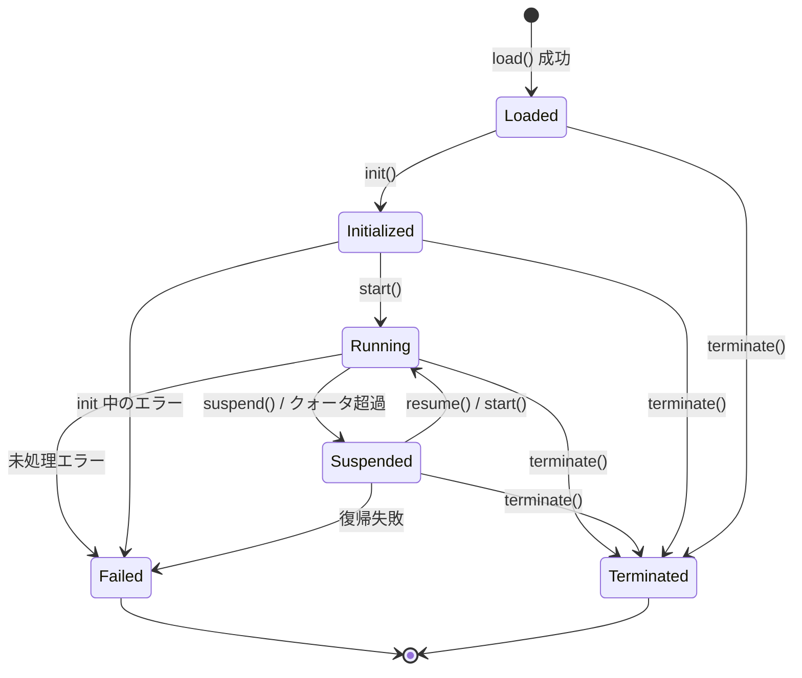

# 第 4 章 ランタイム層

ランタイム層は BuF 意味論の実行者です。ロード層から渡される BuF_Object を受け取り、Universal_Instruction を通じてアダプタ層と通信し、自身は具体ホストに依存しません。

## 4.1 Runtime_Interface（言語非依存契約）

Runtime_Interface はランタイム層の対外安定契約です。すべての Runtime_Implementation は、Rust trait、Go interface、TypeScript interface など言語機構を問わず、意味論的に等価な形でこの契約を実装します。

```idl
interface Runtime_Interface {
  // メタ情報
  rt_version() -> RuntimeInterfaceVersion
  capabilities() -> Set<RuntimeCapability>

  // ライフサイクル
  load(obj: BuFObject) -> Result<InstanceId, RuntimeError>
  init(id: InstanceId) -> Result<(), RuntimeError>
  start(id: InstanceId) -> Result<(), RuntimeError>
  suspend(id: InstanceId) -> Result<(), RuntimeError>
  resume(id: InstanceId) -> Result<(), RuntimeError>
  terminate(id: InstanceId) -> Result<(), RuntimeError>

  // 状態問い合わせ
  state(id: InstanceId) -> Result<LifecycleState, RuntimeError>
  failure_info(id: InstanceId) -> Result<Option<FailureInfo>, RuntimeError>

  // アダプタ層との通信
  emit(id: InstanceId, instr: UniversalInstruction) -> Result<UniversalReply, AdapterError>
  on_event(id: InstanceId, event: UniversalEvent) -> Result<(), RuntimeError>
}
```

設計は次から借用：

- **OCI Runtime Spec** の「設定 + 命令」分離：load は設定提出、init / start / suspend / resume / terminate は命令。
- **JVM 実行エンジン** の状態問い合わせ：state と failure_info はいつでも問い合わせ可能。

## 4.2 Runtime_Implementation の登録とルーティング

```idl
interface RuntimeRegistry {
  register(impl: Runtime_Implementation) -> Result<RegistrationId, RegistryError>
  list() -> List<RuntimeImplementationDescriptor>
  resolve(manifest: BuFManifest) -> Result<RegistrationId, RegistryError>
}
```

### 登録時のメソッド完全性検査

RuntimeRegistry は候補実装が Runtime_Interface の必須メソッドを網羅するか検査します：

- `R` を Runtime_Interface 必須メソッド集合、`I = implemented_methods(impl)` とする。
- `register(impl)` の成功条件は `R ⊆ I`。
- そうでない場合、`RT_IMPL_MISSING_METHODS` を返し、`context.missing_methods` に `R \ I` を含めます。

検査は登録時に一度だけ。実行時のコストはかかりません。

### ルーティング戦略

BuF_Manifest は `runtime.preferred_impl` と `runtime.selection_strategy` でランタイム実装の選好を表現します。`resolve(manifest)` の挙動：

- `Strict`：必ず `preferred_impl` を使用、かつ manifest と互換であること。さもなくば `RT_IMPL_NOT_FOUND`。
- `PreferThenAny`：優先 `preferred_impl`。利用不可なら互換実装の中から任意。
- `Any`：互換実装の中から任意。

「互換」とは実装の `rt_version()` ≥ `manifest.runtime_interface_min` かつ `capabilities()` が manifest の最小ケーパビリティ集合を含むこと。

同じ Fayger インスタンスに複数の登録実装が存在することがあり得ます（例：デスクトップ用の Rust 実装、ブラウザ用の TypeScript 実装）。具体的なルーティング結果は呼び出し側にとって予測可能・デバッグ可能であるべきです。

## 4.3 BuF_Instance ライフサイクル

### 状態機械



### 合法遷移表

| 現状態 | 許容遷移先 |
| --- | --- |
| Loaded | Initialized, Terminated, Failed |
| Initialized | Running, Terminated, Failed |
| Running | Suspended, Terminated, Failed |
| Suspended | Running, Terminated, Failed |
| Terminated | （終端） |
| Failed | （終端） |

不正な遷移の例：`Loaded → Running`（init を欠く）、`Terminated → 任意`、`Failed → Running`。

不正遷移命令を受けた場合は `RT_ILLEGAL_TRANSITION` を返却。エラー context に `current_state` と `allowed_set` を含め、状態は変えません。

### 失敗状態

`Failed` に入ったインスタンスは次を保持しなければなりません：

- 失敗を引き起こした最後の Universal_Instruction。
- 失敗を引き起こしたエラーオブジェクト（cause チェーン全体）。

これらは明示的に破棄されるまで `failure_info(id)` で問い合わせ可能です。

## 4.4 BuF_Instance のデータ領域と分離

各 BuF_Instance は独立した RuntimeDataArea を保有します：

- 独立したヒープ / 呼び出しスタック / ハンドルテーブル。
- 独立した命令ディスパッチキュー。
- 独立したリソース利用カウンタ。

異なるインスタンス間では既定でオブジェクトポインタを共有しません。これは JVM のスレッドごと独立 PC / スタック、インスタンスごと独立メソッド領域に倣います。

形式的に、並行する任意の二つの実体 `i₁`、`i₂` について：

```
data_area(i₁) ∩ data_area(i₂) == ∅
```

かつ `i₁` への任意の書き込みが `data_area(i₂)` のどのバイトも変更しません。テストで検証する核となる隔離性質の一つです。

## 4.5 リソース監視とクォータ

```idl
interface ResourceMonitor {
  attach(id: InstanceId, quota: ResourceQuota)
  sample(id: InstanceId) -> ResourceUsage
}
```

監視戦略：

- BuF_Manifest が CPU / メモリ / I/O のクォータを宣言する場合、`ResourceMonitor` が周期的にサンプリング。
- いずれかの次元で超過した場合、`QuotaExceeded` イベントを発し、ライフサイクル管理がインスタンスを `Suspended` に遷移。
- 一時停止イベントの `context.resource` は最初に超過した資源種別、`context.usage` は超過時のサンプル値。

リソース監視はホスト機能（cgroups、ブラウザ Performance API、プラットフォームタイマーなど）を利用し、対応する Platform_Adapter が提供します。ランタイム層は正規化済みのサンプル値だけを消費します。

## 4.6 インスタンス間の障害分離

任意のインスタンスが `Failed` に入っても、`Running` の他のインスタンスに影響しません：

- 故障インスタンスのリソースは LifecycleManager が単独で回収。
- 他のインスタンスの Universal_Instruction ディスパッチは影響を受けません。
- イベントバスは故障インスタンスと正常インスタンスを別々に分類し、相互ブロックを避けます。

形式的に：N 個のインスタンスが並行実行中、ある `iₖ` が故障した場合、他の `iⱼ`（`j ≠ k`）の状態時間軸と Universal_Instruction 列は故障なし基線と一致します。

## 4.7 アダプタ層とのインターフェイス形態

ランタイム層は `UniversalInstruction` を発し、アダプタ層が `UniversalReply` または `UniversalEvent` を返します：

```idl
fn emit(id: InstanceId, instr: UniversalInstruction) -> Result<UniversalReply, AdapterError>
fn on_event(id: InstanceId, event: UniversalEvent) -> Result<(), RuntimeError>
```

ランタイム層はこの二データ型のみに依存し、具体 Platform_Adapter 型に依存しません。静的依存検査で保証します（第 8 章 ツール推奨を参照）。

## 4.8 エラーコード

ランタイム層が生む安定エラーコード：

| エラーコード | 発生条件 |
| --- | --- |
| `RT_ILLEGAL_TRANSITION` | 不正なライフサイクル遷移 |
| `RT_IMPL_NOT_FOUND` | ルーティングで一致実装を見つけられず |
| `RT_IMPL_MISSING_METHODS` | 登録された実装が必須メソッドを欠く |
| `RT_QUOTA_EXCEEDED` | リソース利用がクォータを超過、Suspended を発動 |
| `RT_INSTANCE_FAILED` | インスタンスが Failed に入った |
