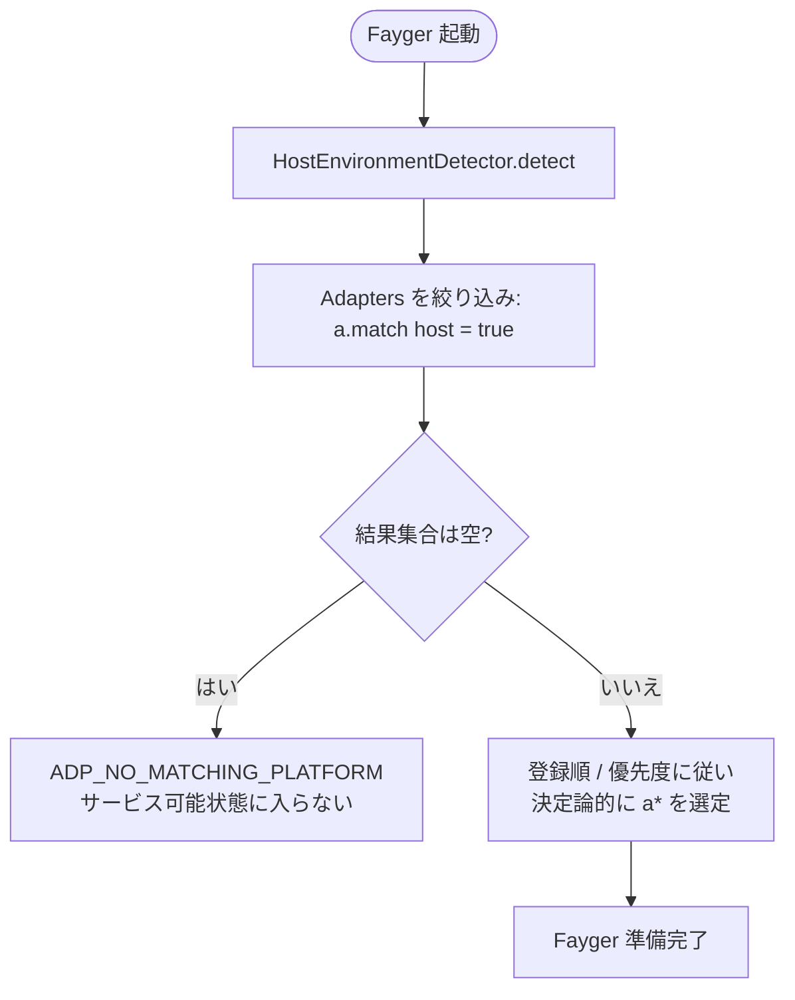
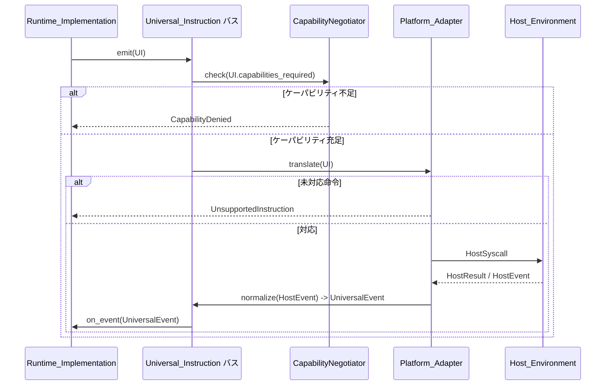

# 第 5 章 アダプタ層

アダプタ層は Fayger と Host_Environment の境界です。ランタイム層が発する Universal_Instruction を受け取り、ホストが理解できるシステム呼び出しに翻訳します。同時にホストイベントを Universal_Event に正規化してランタイム層へ返します。

新しいホストの追加は Platform_Adapter の追加だけで済み、ランタイム層とロード層は無変更です。

## 5.1 Universal_Instruction データ形式

```idl
struct UniversalInstruction {
  category: InstructionCategory
  opcode: u16
  operands: TLV[]
  capabilities_required: Set<Capability>
}

struct UniversalEvent {
  category: EventCategory
  opcode: u16
  payload: TLV[]
}
```

設計要点：

- **category** は粗粒度分類（io / net / ui / time / random / crypto / proc / host）。
- **opcode** はカテゴリ内番号で 2 バイト。上位ビットを実験命令向けに予約。
- **operands** は TLV（type-length-value）列。多言語のデコードと拡張に有用。
- **capabilities_required** はこの命令が必要とするケーパビリティ集合。ケーパビリティ削減の入力となります。

### カテゴリ集合（第一フェーズ）

| カテゴリ | 説明 | 借用元 |
| --- | --- | --- |
| `io` | ファイル / 標準ストリーム | POSIX read / write |
| `net` | ネットワーク I/O | WASI sock_* |
| `ui` | UI 描画と入力 | DOM / 端末 TUI / Canvas |
| `time` | 時計とタイマー | clock_time_get |
| `random` | 乱数 | random_get |
| `crypto` | 暗号プリミティブ | WASI crypto |
| `proc` | プロセス / スレッド / シグナル | POSIX |
| `host` | ホスト固有呼び出し | JNI / extism |

8 カテゴリのうち 8 ビットを将来拡張のため予約。

### エンコーディング

各命令は次の配置で符号化：

```
+--------+--------+----------+-------------------+
| cat(1) | op(2)  | caps(2)  | operands(TLV...)  |
+--------+--------+----------+-------------------+
```

- `cat`：1 バイト。上位はフラグ用に予約。
- `op`：2 バイト。
- `caps`：2 バイトのケーパビリティビットマップ（第一フェーズは下位 16 項を使用、超過時は拡張段）。
- `operands`：各 operand は `(type:1, length:varint, value)`。

## 5.2 Platform_Adapter 抽象

```idl
interface Platform_Adapter {
  descriptor() -> AdapterDescriptor
  match(host: HostEnvironment) -> bool
  translate(instr: UniversalInstruction) -> Result<HostSyscall, AdapterError>
  normalize(raw: HostEvent) -> Result<UniversalEvent, AdapterError>
}

struct AdapterDescriptor {
  platform_id: String
  supported_capabilities: Set<Capability>
  supported_instructions: Set<InstructionId>
}
```

各アダプタは自分の対応ケーパビリティと命令集を自描述します。これによりケーパビリティ削減と「未対応命令」判断はローカルなテーブル参照となり、実行時の試行錯誤に依存しません。

## 5.3 Host_Environment 検出とアダプタ選定

```idl
interface HostEnvironmentDetector {
  detect() -> HostEnvironment
}

struct HostEnvironment {
  platform_id: String
  os_kind: OsKind
  arch: Arch
  sandbox_kind: SandboxKind
  runtime_features: Set<Feature>
}
```

起動時の選定フロー：



決定論的選定とは、同じアダプタ集合と同じ Host_Environment 下では起動を繰り返しても同じアダプタが選ばれること。これは「ファントムアダプタ」問題を避けます。

## 5.4 ケーパビリティ削減

```idl
interface CapabilityNegotiator {
  negotiate(
    requested: Set<Capability>,
    available: Set<Capability>,
    policy: HostPolicy
  ) -> NegotiationResult
}

struct NegotiationResult {
  granted: Set<Capability>
  denied: Set<Capability>
  warnings: List<Capability>
}
```

削減の集合代数：

- `granted = requested ∩ available ∩ policy`
- `denied = requested \ granted`
- `warnings`：ホスト上で制限付きで提供されるケーパビリティ（例：ブラウザ fetch 制限下の `net.http`）。

`manifest.required_capabilities \ granted ≠ ∅` の場合、`start()` は必ずエラーを返し、`context.missing` を差集合とします。インスタンスは Running に入りません。これは「ケーパビリティ不足時は起動禁止」という硬制約です。

宣言されていないケーパビリティは BuF からは見えません（既定拒否）。WASI の host import 明示注入と同じ意味論。

## 5.5 双方向翻訳フロー



要点：

- ケーパビリティ検査は translate より前に行い、不要な下層呼び出しを避ける。
- 「未対応命令」は決定論的なローカル判断（テーブル参照）で、いかなるホスト呼び出しも引き起こさない。
- ホストイベントは `normalize` を経てランタイム層に戻り、ランタイム層は生のホストイベント構造に触れない。

## 5.6 第一フェーズ内蔵アダプタ

| アダプタ | 適用シナリオ | ケーパビリティ削減 |
| --- | --- | --- |
| **NativeDesktop_Adapter** | Linux / macOS / Windows デスクトップ | ケーパビリティはほぼ全集合。`ui` / `proc` / `io` / `net` 完全利用可 |
| **Server_Adapter** | GUI なしのサーバー | `ui` カテゴリ無効、`proc` はポリシー制限 |
| **Browser_Adapter** | Web API ベース | `proc` と大半の `io` を無効。`net` は fetch / WebSocket に限定。強い削減 |
| **InApp_Adapter** | ホストアプリプロセスへ埋め込み | ケーパビリティはホスト明示注入。最も厳格。`host` カテゴリの利用可 opcode はホストが宣言 |

これらは参照実装。第三者は組み込み端末や特定 IDE 埋め込みなど、独自アダプタを登録できます。

## 5.7 クロスプラットフォーム一貫性

同じ BuF を異なる Platform_Adapter でロードして実行した場合、ランタイム層が観測する Lifecycle_State 列と発行する Universal_Instruction 列は一致しなければなりません：

- 列の乖離をもたらす差異は、実行中に黙って発散させず、必ず start 前にケーパビリティ削減で拒否する。
- 「等価だが経路が異なる」ような最適化は、Universal_Instruction 列に異なる経路を露呈してはなりません。

この性質は、ケーパビリティが等しい一対のモックアダプタを並行実行し、列の等価性を比較することで検証します。

## 5.8 エラーコード

アダプタ層が生む安定エラーコード：

| エラーコード | 発生条件 |
| --- | --- |
| `ADP_NO_MATCHING_PLATFORM` | 現ホストに適合するアダプタなし |
| `ADP_UNSUPPORTED_INSTRUCTION` | 現アダプタが当該命令を未サポート |
| `ADP_CAPABILITY_DENIED` | 削減後のケーパビリティが命令実行に不足 |
| `ADP_HOST_CALL_FAILED` | 命令をシステム呼び出しに翻訳した後ホスト側で失敗 |

`ADP_UNSUPPORTED_INSTRUCTION` はホスト呼び出しを一切起こさず、エラーのみ返すこと。命令層における「既定拒否」姿勢の体現。
