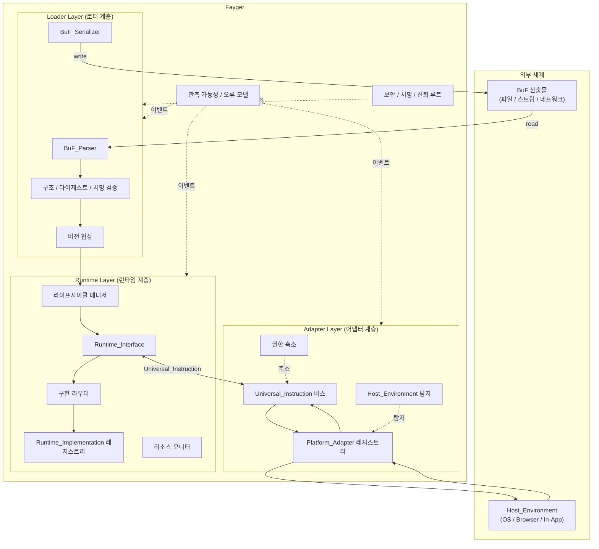

# 제 2 장 전체 아키텍처

## 2.1 3 계층 구분

Fayger 는 수직 방향으로 3 계층으로 분리됩니다. 각 계층은 자신의 분담 안에서 책임을 다하며, 계층 간에는 명확히 정의된 계약으로만 통신합니다.



## 2.2 각 계층의 책임

### 로더 계층

- *BuF_Source* 추상화를 통해 임의 저장 백엔드(로컬 파일, HTTP Range, 객체 스토리지, IPFS, 사용자 정의)에서 BuF 를 읽습니다.
- 바이트 스트림을 메모리 객체로 파싱합니다.
- 구조 적법성, 콘텐츠 다이제스트, 서명을 검증합니다.
- 현재 Fayger 와 BuF schema, Runtime_Interface 버전을 협상합니다.
- 호출자가 제공한 *LoadProfile* 에 따라 Section 단위로 적재 대상을 선택하고, 현재 환경에 불필요하거나 들어가지 않는 Section 을 건너뜁니다.
- *LoadStrategy* 에 따라 모든 선택된 Section 을 한 번에 읽거나(Eager), 헤더 + 인덱스만 읽고 본체는 실행 중에 가져옵니다(Lazy).
- 준비된 BuF 메모리 객체를 런타임 계층에 넘깁니다.
- 역방향: 메모리 객체를 다시 바이트로 직렬화(쓰기 회수, 캐싱, 재패키징 용도).

### 런타임 계층

- *Runtime_Interface* 를 언어 중립 계약으로 노출합니다.
- *Runtime_Implementation* 레지스트리를 유지하며, BuF_Manifest 정책에 따라 구체 구현으로 라우팅합니다.
- 각 BuF_Instance 의 라이프사이클(Loaded → Initialized → Running → Suspended → Terminated / Failed)을 관리합니다.
- 인스턴스별 리소스 사용을 모니터링하고 BuF_Manifest 의 쿼터에 따라 제한 또는 일시 정지합니다.
- Universal_Instruction 을 통해 어댑터 계층과 통신하며, 자신은 어떤 구체 호스트에도 의존하지 않습니다.

### 어댑터 계층

- 단말 / OS / 호스트별로 대응하는 *Platform_Adapter* 집합을 유지합니다.
- 시작 시 현재 Host_Environment 를 탐지하고 적절한 어댑터를 선택합니다.
- 런타임 계층의 Universal_Instruction 을 시스템 호출로 번역하고, 호스트 이벤트를 Universal_Event 로 정규화하여 돌려줍니다.
- BuF 가 선언한 권한 집합을 현재 호스트에서 실제로 사용 가능한 부분 집합으로 축소합니다.

## 2.3 호출 방향과 의존 규칙

의존 방향은 장기 진화 가능성의 핵심입니다. Fayger 는 다음과 같은 단단한 규칙을 채택합니다:

- **로더 → 런타임**: 단방향. 적재 완료 후 메모리 객체를 넘기고, BuF_Instance 를 보유하지 않습니다.
- **런타임 ↔ 어댑터**: Universal_Instruction 과 Universal_Event 데이터 타입을 통한 양방향 통신만. 런타임 계층은 어떤 Platform_Adapter 타입도 직접 import 하지 않습니다.
- **런타임 → 로더**: 금지. 런타임이 BuF 를 다시 직렬화해야 하는 경우(예: 핫 리로드)에는 로더가 노출하는 서비스 인터페이스를 통하며, 내부 타입을 역참조하지 않습니다.
- **어댑터 → 호스트**: 단방향. Platform_Adapter 가 호스트 SDK 와 시스템 호출 참조를 보유합니다. 런타임은 호스트 라이브러리를 직접 import 하지 않습니다.
- **횡단(관측 / 보안) → 3 계층**: 이벤트 버스와 정책 인터페이스로 침투. 3 계층은 외부로 이벤트를 발행하고 정책을 조회하지만, 횡단 계층의 구체 구현에 역의존하지 않습니다.

이 규칙들의 핵심 목적은: **새 호스트를 추가해도 런타임은 바꾸지 않고, 런타임 구현을 교체해도 어댑터는 바꾸지 않는다**.

## 2.4 차용한 체계

### JVM 의 사슬형 적재 단계

로더 계층은 내부에서 JVM 풍의 단계로 분할되어, 오류 위치 파악과 단위 테스트에 유리합니다:

```
Read(Header/Manifest/Index) → Parse → Verify(Structural)
  → Verify(Digest of Header/Manifest/Index) → Verify(Signature)
  → NegotiateVersion → Select(Sections by LoadProfile) → Resolve(Dependencies)
  → Read(Selected Section Bodies)?  → HandOff(to Runtime)
```

`Select(Sections by LoadProfile)` 단계는 현재 단말 권한과 크기 제약에 따라 적재할 Section 을 선별합니다. `Read(Selected Section Bodies)` 는 LoadStrategy = Eager 일 때만 실행되고, Lazy 모드에서는 선택된 Section 의 읽기와 검증을 첫 접근까지 미룹니다. 각 단계의 실패는 단계 태그가 붙은 오류로 통일 오류 모델로 들어갑니다(제 6 장).

### Docker / OCI 의 산출물 구조

BuF 산출물의 물리적 구조는 OCI Image 에 대응합니다:

| OCI 개념 | BuF 대응 |
| --- | --- |
| Image Manifest | BuF_Manifest |
| Image Config | BuF_Manifest 의 `runtime` / `capabilities` / `quotas` 필드 |
| Layers | BuF Sections (code / data / assets / signature) |
| Distribution Spec | 1 단계는 단일 파일 산출물 기준선, 향후 확장 |
| Runtime Spec | Runtime_Interface |
| containerd | Runtime_Layer (라이프사이클 + 라우팅) |
| runc | Runtime_Implementation (구체 실행기) |

### WASM / WASI 의 권한 보안 모델

어댑터 계층은 capability-based security 를 채택합니다:

- BuF_Manifest 가 `requested_capabilities`(예: `fs.read`, `net.http`, `ui.dom`) 를 선언.
- Platform_Adapter 가 `available_capabilities` 를 선언.
- 실제 부여 권한 = `requested ∩ available ∩ host_policy`. 셋 모두의 교집합이 비어 있지 않을 때만 `Running` 으로 진입합니다.
- 선언되지 않은 권한은 BuF 에 보이지 않습니다(기본 거부). WASI 의 host import 명시 주입 의미론과 일치합니다.

## 2.5 1 단계 범위와 비목표

**1 단계 범위:**

- 단일 BuF 적재와 실행. 다중 BuF_Instance 는 동시 가능하나 기본적으로 공유 없음.
- 해석 실행 경로. 향후 JIT 도입을 위한 ExecutionStrategy 추상화를 예약.
- 4 가지 내장 Platform_Adapter: 데스크톱 / 서버 / 브라우저 / In-App.
- 동기·비동기 명령 디스패치, 단일 프로세스 내 다중 인스턴스 격리.

**1 단계 비목표:**

- BuF_Instance 간 공유 메모리와 IPC 프로토콜.
- JIT 컴파일과 머신 코드 생성.
- 분산 스케줄링과 다중 노드 Fayger 협업.
- BuF 의 차분 분배와 계층 캐시(단일 파일 산출물 기준선, 계층 구조는 예약).
