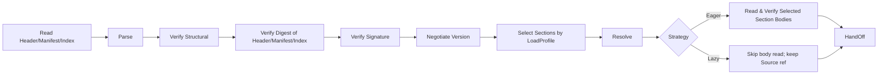
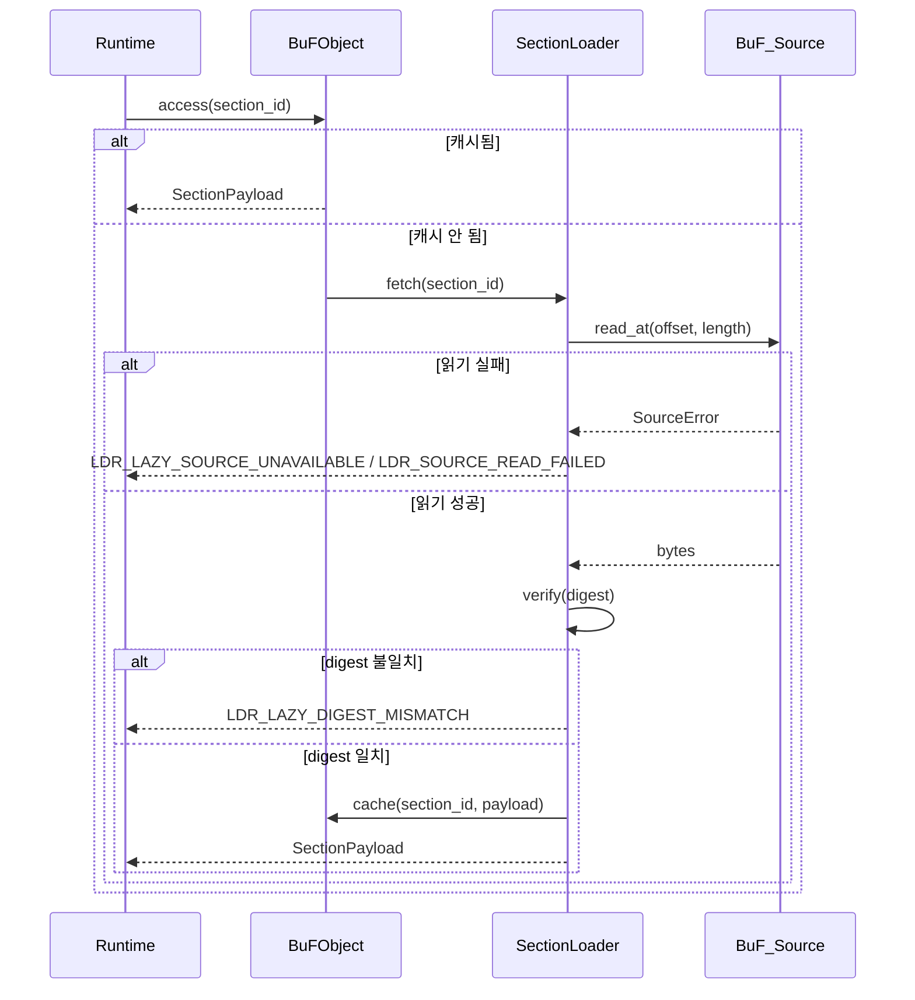

# 제 3 장 로더 계층

로더 계층은 Fayger 와 외부 BuF 산출물 사이의 경계입니다. 임의의 저장 백엔드에서 BuF 를 읽고, 현재 실행 환경과 호출자 정책에 따라 어떤 Section 을 언제 적재할지 선택하며, 바이트를 런타임 계층이 받을 수 있는 내부 일관 메모리 객체로 변환합니다. 임의 단계에서 실패하면 위치와 원인을 명시한, 분류 가능한 오류를 반환합니다.

## 3.1 BuF 산출물 형식

BuF 는 **Header + Manifest + Section Index + Sections + Trailer** 의 5 단 구조를 채택합니다(JAR / OCI Image / WASM 의 복합 구조 참고):

```
+------------------------------------------------------------+
| Header        | magic="BUF\0" | format_version | flags     |
|               | manifest_offset, manifest_length            |
|               | section_index_offset, section_index_length  |
+------------------------------------------------------------+
| Manifest      | CBOR-encoded BuFManifest                    |
+------------------------------------------------------------+
| Section Index | [(section_id, kind, offset, length, digest, |
|               |   visibility, profile_constraints)]         |
+------------------------------------------------------------+
| Sections      | [code | data | assets | signature | ...]   |
+------------------------------------------------------------+
| Trailer       | total_length | manifest_digest | crc32     |
+------------------------------------------------------------+
```

설계 요점:

- **Magic + Format Version**: 처음 8 바이트 고정. 도구의 식별과 잘못된 스트림 거부에 유용.
- **Manifest 가 독립 단**: Section 본체를 디코딩하지 않고도 버전 협상, 프로파일 선택, 권한 축소를 완료할 수 있음(OCI Image Manifest 와 동형).
- **Section Index 는 Lazy 모드의 신뢰 인덱스**: 각 항목은 위치, 길이, 다이제스트, visibility, profile_constraints 를 포함. Lazy 의 온디맨드 읽기가 의존하므로, 적재 단계에서 반드시 완전 읽기와 전체 다이제스트 검증을 통과해야 합니다.
- **Trailer**: 전체 길이와 Manifest 다이제스트 보유. 잘림 감지와 "서명 후 Manifest 변조" 공격 방지에 사용.
- **인코딩**: Manifest 와 Section_Index 는 CBOR 결정적 인코딩 모드(RFC 8949 §4.2)를 사용. 직렬화 바이트 시퀀스가 유일해져, 라운드트립 동치성의 초석이 됩니다.
- **서명 범위**: Header || Manifest_minus_signature || Section_Index. 건너뛰거나 아직 읽지 않은 Section 본체는 서명 계산에 참여하지 않으므로, 부분 적재와 완전 적재가 서명 검증상 동치입니다.

## 3.2 BuF_Manifest 필드 규약

```idl
struct BuFManifest {
  // 버전 협상
  schema_version: SemVer
  runtime_interface_min: SemVer
  deprecation_notice: Option<String>

  // 진입점과 런타임 선택
  entry: EntryPoint
  runtime: RuntimeRequirement {
    preferred_impl: Option<ImplementationId>
    selection_strategy: enum { Strict, PreferThenAny, Any }
  }

  // 권한 선언
  capabilities: CapabilitySet
  quotas: Option<ResourceQuota>

  // 콘텐츠 인덱스
  sections: List<SectionDescriptor> {
    id: SectionId
    kind: enum { Code, Data, Asset, Signature, Custom(String) }
    digest: Digest
    length: u64
    visibility: SectionVisibility           // Required | Optional
    profile_constraints: ProfileConstraints // 기본은 제약 없음
  }

  // 서명(선택)
  signature: Option<SignatureBlock>

  extensions: Map<String, CborValue>
}

struct ProfileConstraints {
  required_capabilities: Set<Capability>
  max_size: Option<u64>
  required_features: Set<Feature>
}
```

`schema_version` 과 `runtime_interface_min` 은 독립 진화합니다. 전자는 BuF 형식 호환성을, 후자는 Runtime_Interface 호환성을 통제합니다(JVM 의 class file version 과 JVM API level 분리와 동일).

## 3.3 적재 사슬

로더 계층 내부는 JVM 풍의 다단계로 분리됩니다:



각 단계의 책임:

- **Read Header/Manifest/Index**: BuF_Source 를 통해 Header / Manifest / Section_Index / Trailer 를 읽습니다. Eager / Lazy 모두 load 반환 전에 완료해야 합니다.
- **Parse**: Manifest 와 Section_Index 를 파싱(본체는 디코딩하지 않음).
- **Verify Structural**: magic, 버전 필드, Section 경계, Manifest 필수 필드를 점검.
- **Verify Digest of Header/Manifest/Index**: Header, Manifest, Section_Index 의 전체 다이제스트를 검증(Trailer 의 `manifest_digest` 등을 통해). 각 Section 본체의 digest 는 해당 Section 이 실제로 읽힐 때 검증.
- **Verify Signature**: Manifest 가 서명 정보를 포함하거나 강제 서명 모드일 때 실행. 서명 범위는 헤더 3 단만, Section 본체 읽기 여부에 의존하지 않음.
- **Negotiate Version**: schema 버전과 Runtime_Interface 최소 버전의 호환성 점검.
- **Select Sections by LoadProfile**: 호출자의 LoadProfile 과 현재 Host_Environment 에 따라 선택 집합 결정(§3.7).
- **Resolve**: BuF 간 의존성 해석(1 단계는 단일 BuF, 인터페이스만 예약).
- **Read Selected Section Bodies**: Eager 만 실행. BuF_Source 에서 단별로 읽고 digest 검증.
- **HandOff**: 메모리 객체를 런타임 계층에 제출. Lazy 일 때 객체는 BuF_Source 참조와 SectionLoader 를 보유.

각 단계 실패는 단계 이름과 위치 정보를 오류 객체에 표시하고, `context.phase` 에 `eager` 또는 `lazy` 를 표시합니다.

## 3.4 BuF_Source: 다중 소스 저장 추상화

```idl
interface BuF_Source {
  read_at(offset: u64, length: u64) -> Result<Bytes, SourceError>
  length() -> Result<u64, SourceError>
  stat() -> Result<SourceStat, SourceError>     // 선택
  close() -> Result<(), SourceError>             // 선택
}
```

설계 요점:

- 로더 계층은 `read_at` 와 `length` 의 최소 연산에만 의존.
- 임의 접근 읽기를 제공하는 어떤 매체든 BuF_Source 가 될 수 있습니다: 로컬 파일, HTTP Range, 객체 스토리지 SDK, IPFS 게이트웨이, 임베디드 기기의 분할 Flash, 사용자 정의 백엔드.
- BuF_Source 는 순차 스트림을 구현할 필요 없습니다. Lazy 가 오프셋으로 점프 읽기 하기 때문.
- 소형 기기(드론, 카메라)용 BuF_Source 구현은 LRU 소형 캐시 또는 분할 Flash 직접 접근으로 가능. 로더는 구체 전략을 알지 못합니다.

## 3.5 BuF_Parser 와 BuF_Serializer

```idl
interface BuF_Parser {
  parse(bytes: Bytes) -> Result<BuFObject, ParseError>
}

interface BuF_Serializer {
  serialize(obj: BuFObject) -> Result<Bytes, SerializeError>
}
```

LoaderPipeline 내부에서 Parser 는 보통 "조각 가져오기 → 파싱" 방식으로 BuF_Source 를 호출합니다. 바이트 스트림만 받는 `parse(bytes)` 는 단위 테스트와 도구용 단순 진입점입니다.

### 메모리 객체(부분 적재 포함)

```idl
struct BuFObject {
  manifest: BuFManifest
  raw_header: Header
  raw_trailer: Trailer

  selected_sections: Set<SectionId>
  skipped_sections: List<SkipRecord>     // (id, reasons)
  strategy: LoadStrategy
  source_ref: Option<BuF_Source>          // Lazy 만 보유
  loader: Option<SectionLoader>           // Lazy 만 보유
  sections: Map<SectionId, SectionPayload> // Eager 전량, Lazy 는 온디맨드 캐시
}

enum SkipReason {
  CapabilityNotGranted, OverMaxSize, FeatureMissing, ExplicitlyDisabled
}
```

부분 적재 하에서의 라운드트립 동치성 의미: 동치 관계는 `selected_sections` 범위로 비교합니다. 건너뛴 Section 은 비교에 참여하지 않으나, `skipped_sections` 자체는 비교 대상입니다.

## 3.6 LoaderPipeline 인터페이스

```idl
struct LoadProfile {
  target_class: TargetClass             // desktop | server | browser | inapp | embedded | drone | camera | …
  capabilities: Set<Capability>
  max_section_bytes: Option<u64>
  features: Set<Feature>
}

enum LoadStrategy { Eager, Lazy }
enum SectionVisibility { Required, Optional }

struct LoaderPolicy {
  require_signature: bool
  trusted_roots: TrustedRootSet
  allowed_schema_versions: VersionRange
}

interface LoaderPipeline {
  load(
    source: BuF_Source,
    profile: LoadProfile,
    strategy: LoadStrategy,
    policy: LoaderPolicy
  ) -> Result<BuFObject, LoaderError>
}
```

`load` 는 반환 전에 반드시 Header / Manifest / Section_Index 를 읽고 검증합니다. 반환 전에 Section 본체를 읽을지 여부는 `strategy` 에 따릅니다.

## 3.7 부분 적재: 실행 환경별 Section 선택

단말 형태가 다양하고 성능 차이가 큽니다. 데스크톱은 BuF 전량을 적재할 수 있지만, 드론이나 카메라는 BuF 의 "제어 + 비디오 코덱" 단만 필요할 수 있습니다. Section 선택 알고리즘:

각 `s ∈ manifest.sections` 에 대해 술어 정의:

```
fits(s) = s.profile_constraints.required_capabilities ⊆ profile.capabilities
        ∧ (s.profile_constraints.max_size 미설정 ∨ s.length ≤ s.profile_constraints.max_size)
        ∧ s.profile_constraints.required_features ⊆ profile.features
```

선택 결과:

- `selected = { s : fits(s) }` 를 `BuFObject.selected_sections` 에.
- `s ∈ sections \ selected ∧ s.visibility == Required` ⟹ load 실패. `LDR_PROFILE_REQUIRED_SECTION_MISSING` 반환, context 에 `section_id` 와 미충족 제약 항목 포함.
- `s ∈ sections \ selected ∧ s.visibility == Optional` ⟹ `skipped_sections` 에 추가, 사유(CapabilityNotGranted / OverMaxSize / FeatureMissing / ExplicitlyDisabled) 기록.

선택은 결정적입니다: 동일 (manifest, host_env, profile) 에서 selected 와 skipped_sections 는 완전히 동일.

### 사례

| 단말 | 전형적 LoadProfile | 선택 동작 |
| --- | --- | --- |
| 데스크톱 | capabilities 전집합, max_section_bytes 미설정 | 모든 Section 선택 |
| 서버 | ui 비활성, max_section_bytes 미설정 | ui 자원 단을 건너뜀(ui 의존 선언 시) |
| 브라우저 | net.fetch / net.websocket / ui.dom 만, max_section_bytes ≈ 8 MiB | 너무 큰 자원 단 건너뜀, proc 의존 단도 건너뜀 |
| 드론 | 최소 capabilities + max_section_bytes ≈ 1 MiB + features.realtime | control 과 codec 만 적재, 교육 자원은 건너뜀 |
| 카메라 | capabilities 가 io.frame + crypto + net.rtsp 만 | 비디오 처리와 업링크 단만 적재 |

## 3.8 적재 전략: Eager vs Lazy

### Eager

- `load` 반환 전에 모든 `selected_sections` 본체를 읽고 digest 검증.
- BuF 가 작거나, 시작 후 네트워크 접근이 없거나, "한 번에" 가져가고 싶은 시나리오에 적합.
- 적재 단계 오류의 `phase == "eager"`.

### Lazy

- `load` 반환 전에는 Header / Manifest / Section_Index 만 읽고 검증.
- 선택된 단은 첫 접근 시 SectionLoader 가 읽고 digest 검증을 수행.
- BuF 가 크거나, 온디맨드 실행이거나, 소스가 원격(HTTP / 객체 스토리지)일 때 적합.
- 후속 접근에서 발생한 오류 `phase == "lazy"`. 시작 단계 오류와 독립 처리 가능.

```idl
interface SectionLoader {
  fetch(id: SectionId) -> Result<SectionPayload, LoaderError>
  is_loaded(id: SectionId) -> bool
  loaded_ids() -> Set<SectionId>
}
```

### Lazy 모드 온디맨드 읽기 흐름



### Eager / Lazy 동치성

동일 (source, profile, policy) 에 대해 strategy 가 Eager 든 Lazy 든:

- `selected_sections` 와 `skipped_sections` 는 완전히 동일.
- Lazy 결과의 모든 `selected_sections` 에 대해 한 번씩 읽기를 발생시킨 뒤, Eager 결과와 sections 가 바이트 단위로 동일.
- Lazy 는 시간상으로 읽기와 검증을 미룰 뿐, 의미상의 차이를 만들지 않습니다.

이 성질은 속성 기반 테스트로 지속 검증합니다.

## 3.9 다이제스트와 서명 검증

### 다이제스트

- Header / Manifest / Section_Index 의 전체 다이제스트는 적재 단계에서 반드시 검증.
- 각 Section 본체의 digest 는 Section_Index 의 불변 스냅샷에서 옴: Eager 는 적재 단계에서 일괄 검증, Lazy 는 첫 접근 시 검증.
- 어느 단이라도 불일치면 `LDR_DIGEST_MISMATCH`(Eager) 또는 `LDR_LAZY_DIGEST_MISMATCH`(Lazy) 반환. 오류 컨텍스트에 실패한 `section_id` 포함.

### 서명

서명 범위는 `Header || Manifest_minus_signature || Section_Index`. 이는:

- 부분 적재라도 서명 검증은 완전합니다.
- 건너뛴 Section 은 서명 결과에 영향이 없습니다.
- Section_Index 의 offset / length / digest 를 변경하면 서명이 무효화됩니다.

서명 검증의 결정표:

| 조건 | 기대 결과 |
| --- | --- |
| 강제 서명 ON ∧ 서명 없음 | `Err(LDR_SIGNATURE_FAIL)`, 사유 `MissingSignature` |
| 서명 있음 ∧ 검증 실패 | `Err(LDR_SIGNATURE_FAIL)`, 사유 `InvalidSignature` |
| 서명 있음 ∧ 검증 통과 | `Ok` |
| 강제 서명 OFF ∧ 서명 없음 | `Ok` |

신뢰 루트 집합은 *TrustStore* 가 관리하며, 갱신은 다음 적재 시 적용됩니다(제 7 장).

**핵심 순서**: 서명 검증이 Section 선택보다 앞섭니다. Manifest 전체 서명으로 산출물 출처를 검증한 뒤, LoadProfile 로 적재 대상을 결정합니다. 이는 "선택된 부분 집합" 기준의 약화된 서명 의미를 피하기 위함입니다.

## 3.10 버전 협상

결정표:

| 조건 | 기대 결과 |
| --- | --- |
| schema 버전이 지원 범위 밖 | `Err(LDR_SCHEMA_UNSUPPORTED)`, 기대 범위 포함 |
| Runtime_Interface 최소 버전이 현재보다 높음 | `Err(LDR_RUNTIME_VERSION_TOO_HIGH)`, required / provided 포함 |
| schema 가 지원 범위 내 미폐기, Runtime 충족 | `Ok` |
| schema 가 폐기 예정이나 지원 중 | `Ok`, 폐기 알림 부착 |

폐기 알림은 `BuFObject.manifest.deprecation_notice` 를 통해 상위 도구에 노출됩니다.

## 3.11 오류 코드

로더 계층이 만드는 안정 오류 코드:

| 오류 코드 | 발생 조건 |
| --- | --- |
| `LDR_PARSE_FAIL` | BuF 바이트 스트림이 형식 사양과 맞지 않음 |
| `LDR_DIGEST_MISMATCH` | Section 다이제스트 불일치(Eager 단계) |
| `LDR_LAZY_DIGEST_MISMATCH` | Section 다이제스트 불일치(Lazy 첫 접근) |
| `LDR_SIGNATURE_FAIL` | 강제 모드 하의 서명 부재 또는 서명 무효 |
| `LDR_SCHEMA_UNSUPPORTED` | schema 버전 지원 범위 밖 |
| `LDR_RUNTIME_VERSION_TOO_HIGH` | 필요한 Runtime_Interface 가 현재보다 높음 |
| `LDR_MISSING_REQUIRED_FIELD` | 직렬화 시 Manifest 필수 필드 누락 |
| `LDR_PROFILE_REQUIRED_SECTION_MISSING` | 현 프로파일 하 Required Section 적재 불가 |
| `LDR_LAZY_SOURCE_UNAVAILABLE` | Lazy 후속 접근에서 BuF_Source 사용 불가 |
| `LDR_SOURCE_READ_FAILED` | BuF_Source 읽기 오류(Eager 또는 Lazy) |

각 오류의 `context` 는 실패 위치와 사유 키-값 쌍을 최소한 포함하며, `context.phase = "eager" | "lazy"` 로 단계를 표시하여 도구 체인에서 일관 진단을 가능하게 합니다.
