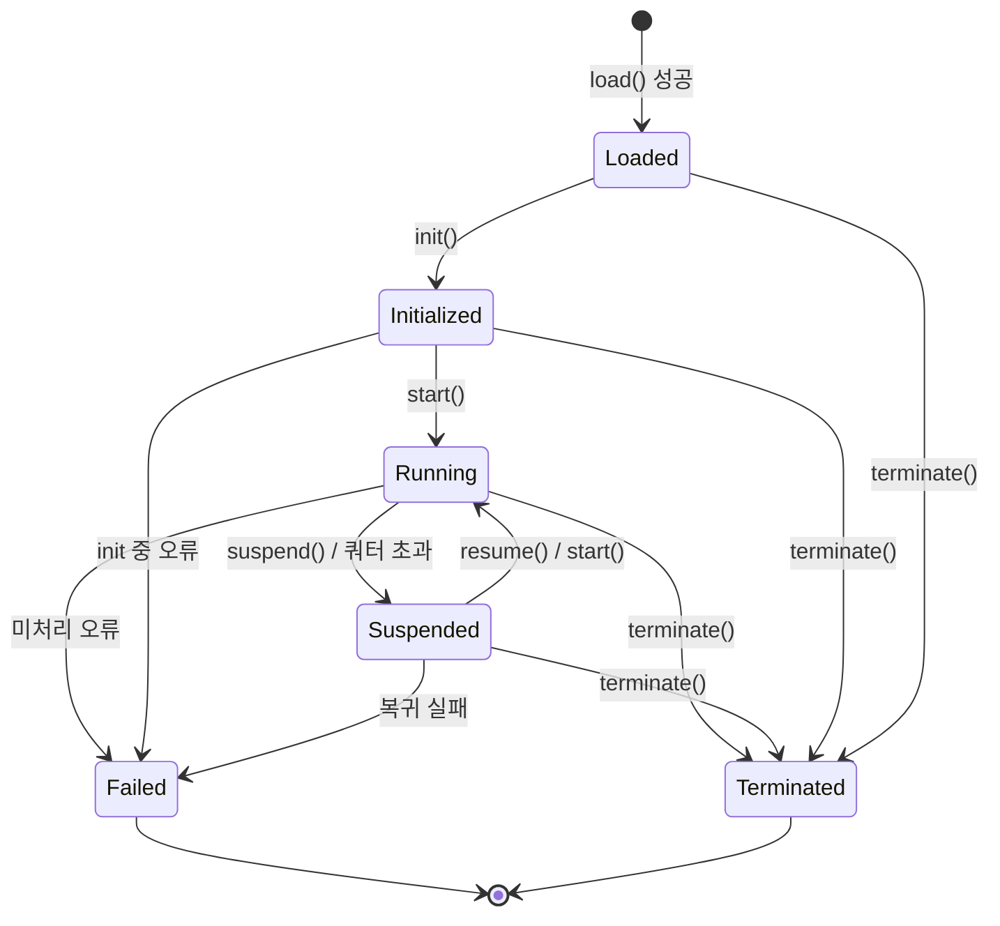

# 제 4 장 런타임 계층

런타임 계층은 BuF 의미론의 실행자입니다. 위로는 로더 계층이 넘긴 BuF_Object 를 받고, 아래로는 Universal_Instruction 을 통해 어댑터 계층과 통신합니다. 자신은 어떤 구체 호스트에도 의존하지 않습니다.

## 4.1 Runtime_Interface (언어 중립 계약)

Runtime_Interface 는 런타임 계층의 안정된 외부 계약입니다. 모든 Runtime_Implementation 은 Rust trait, Go interface, TypeScript interface 등 어떤 언어 메커니즘을 쓰든, 의미상 동등한 형태로 이 계약을 구현해야 합니다.

```idl
interface Runtime_Interface {
  // 메타 정보
  rt_version() -> RuntimeInterfaceVersion
  capabilities() -> Set<RuntimeCapability>

  // 라이프사이클
  load(obj: BuFObject) -> Result<InstanceId, RuntimeError>
  init(id: InstanceId) -> Result<(), RuntimeError>
  start(id: InstanceId) -> Result<(), RuntimeError>
  suspend(id: InstanceId) -> Result<(), RuntimeError>
  resume(id: InstanceId) -> Result<(), RuntimeError>
  terminate(id: InstanceId) -> Result<(), RuntimeError>

  // 상태 조회
  state(id: InstanceId) -> Result<LifecycleState, RuntimeError>
  failure_info(id: InstanceId) -> Result<Option<FailureInfo>, RuntimeError>

  // 어댑터 계층과의 통신
  emit(id: InstanceId, instr: UniversalInstruction) -> Result<UniversalReply, AdapterError>
  on_event(id: InstanceId, event: UniversalEvent) -> Result<(), RuntimeError>
}
```

설계는 다음에서 차용:

- **OCI Runtime Spec** 의 "설정 + 명령" 분리: load 가 설정 제출, init / start / suspend / resume / terminate 는 명령.
- **JVM 실행 엔진** 의 상태 조회 관습: state 와 failure_info 는 어느 시점에서나 조회 가능.

## 4.2 Runtime_Implementation 등록과 라우팅

```idl
interface RuntimeRegistry {
  register(impl: Runtime_Implementation) -> Result<RegistrationId, RegistryError>
  list() -> List<RuntimeImplementationDescriptor>
  resolve(manifest: BuFManifest) -> Result<RegistrationId, RegistryError>
}
```

### 등록 시 메서드 완전성 검사

RuntimeRegistry 는 후보 구현이 Runtime_Interface 의 모든 필수 메서드를 갖추었는지 검사합니다:

- `R` 을 Runtime_Interface 필수 메서드 집합, `I = implemented_methods(impl)` 로.
- `register(impl)` 성공의 필요충분조건은 `R ⊆ I`.
- 그렇지 않으면 `RT_IMPL_MISSING_METHODS` 를 반환하고 `context.missing_methods` 에 `R \ I` 를 채웁니다.

이 검사는 등록 시 한 번만 수행되며, 실행 시에는 비용이 들지 않습니다.

### 라우팅 전략

BuF_Manifest 는 `runtime.preferred_impl` 과 `runtime.selection_strategy` 로 런타임 구현 선호를 표현합니다. `resolve(manifest)` 의 동작:

- `Strict`: 반드시 `preferred_impl` 사용, 그리고 manifest 와 호환이어야 함. 그렇지 않으면 `RT_IMPL_NOT_FOUND`.
- `PreferThenAny`: `preferred_impl` 우선. 사용 불가 시 호환되는 임의 구현으로 대체.
- `Any`: 호환되는 구현 중 임의 선택.

"호환" 이란 구현의 `rt_version()` ≥ `manifest.runtime_interface_min` 이며 `capabilities()` 가 manifest 의 최소 권한 집합을 포함함을 뜻합니다.

같은 Fayger 인스턴스에 여러 등록 구현이 동시에 존재할 수 있습니다(예: 데스크톱용 Rust 구현, 브라우저용 TypeScript 구현). 구체적인 라우팅 결과는 호출자에게 예측 가능하고 디버깅 가능해야 합니다.

## 4.3 BuF_Instance 라이프사이클

### 상태 기계



### 합법 전이 표

| 현재 상태 | 허용 대상 |
| --- | --- |
| Loaded | Initialized, Terminated, Failed |
| Initialized | Running, Terminated, Failed |
| Running | Suspended, Terminated, Failed |
| Suspended | Running, Terminated, Failed |
| Terminated | (종료 상태) |
| Failed | (종료 상태) |

불법 전이 예: `Loaded → Running`(init 누락), `Terminated → 임의`, `Failed → Running`.

불법 전이 명령을 받으면 `RT_ILLEGAL_TRANSITION` 을 반환하고, 오류 context 에 `current_state` 와 `allowed_set` 을 포함하며 상태는 변경되지 않습니다.

### Failed 상태

`Failed` 에 들어간 인스턴스는 다음을 보존해야 합니다:

- 실패를 유발한 마지막 Universal_Instruction.
- 실패를 유발한 오류 객체(전체 cause 체인 포함).

이는 명시적으로 폐기되기 전까지 `failure_info(id)` 로 조회 가능합니다.

## 4.4 BuF_Instance 데이터 영역과 격리

각 BuF_Instance 는 독립적인 RuntimeDataArea 를 보유합니다:

- 독립적인 힙 / 호출 스택 / 핸들 테이블.
- 독립적인 명령 디스패치 큐.
- 독립적인 리소스 사용 카운터.

다른 인스턴스 간에는 기본적으로 객체 포인터를 공유하지 않습니다. 이는 JVM 의 스레드별 독립 PC / 스택, 인스턴스별 독립 메서드 영역 설계를 차용합니다.

형식상, 동시에 존재하는 임의 두 인스턴스 `i₁`, `i₂` 에 대해:

```
data_area(i₁) ∩ data_area(i₂) == ∅
```

이며 `i₁` 에 대한 어떤 쓰기도 `data_area(i₂)` 의 어떤 바이트도 변경하지 않습니다. 테스트에서 검증할 핵심 격리 성질 중 하나입니다.

## 4.5 리소스 모니터링과 쿼터

```idl
interface ResourceMonitor {
  attach(id: InstanceId, quota: ResourceQuota)
  sample(id: InstanceId) -> ResourceUsage
}
```

모니터링 정책:

- BuF_Manifest 가 CPU / 메모리 / I/O 쿼터를 선언했을 때 `ResourceMonitor` 가 주기적으로 샘플링.
- 어느 차원이라도 초과하면 `QuotaExceeded` 이벤트를 발행하고, 라이프사이클 매니저가 인스턴스를 `Suspended` 로 전이.
- 일시 정지 이벤트의 `context.resource` 는 처음 초과한 리소스 종류, `context.usage` 는 처음 초과 시의 샘플 값.

리소스 모니터링은 호스트 기능(cgroups, 브라우저 Performance API, 플랫폼 타이머 등)을 사용하며, 해당 Platform_Adapter 가 제공합니다. 런타임 계층은 정규화된 샘플 값만 소비합니다.

## 4.6 인스턴스 간 장애 격리

임의의 인스턴스가 `Failed` 에 들어가도 `Running` 의 다른 인스턴스에 영향을 주지 않습니다:

- 장애 인스턴스의 리소스는 LifecycleManager 가 단독 회수.
- 다른 인스턴스의 Universal_Instruction 디스패치는 영향을 받지 않음.
- 이벤트 버스는 장애 인스턴스와 정상 인스턴스를 분류하여 상호 차단을 피함.

형식상: N 개 인스턴스가 동시에 실행 중일 때 어느 `iₖ` 가 장애가 나도, 나머지 `iⱼ`(`j ≠ k`) 의 상태 시간선과 Universal_Instruction 시퀀스는 무장애 기준선과 일치합니다.

## 4.7 어댑터 계층과의 인터페이스 형태

런타임 계층은 `UniversalInstruction` 을 발행하고 어댑터 계층은 `UniversalReply` 또는 `UniversalEvent` 를 돌려보냅니다:

```idl
fn emit(id: InstanceId, instr: UniversalInstruction) -> Result<UniversalReply, AdapterError>
fn on_event(id: InstanceId, event: UniversalEvent) -> Result<(), RuntimeError>
```

런타임 계층은 이 두 데이터 타입에만 의존하며, 어떤 구체 Platform_Adapter 타입에도 의존하지 않습니다. 정적 의존 검사로 보장합니다(제 8 장 도구 권장 참조).

## 4.8 오류 코드

런타임 계층이 만드는 안정 오류 코드:

| 오류 코드 | 발생 조건 |
| --- | --- |
| `RT_ILLEGAL_TRANSITION` | 불법 라이프사이클 전이 |
| `RT_IMPL_NOT_FOUND` | 라우팅 전략이 일치 구현을 찾지 못함 |
| `RT_IMPL_MISSING_METHODS` | 등록된 구현이 필수 메서드 누락 |
| `RT_QUOTA_EXCEEDED` | 리소스 사용이 쿼터 초과, Suspended 발동 |
| `RT_INSTANCE_FAILED` | 인스턴스가 Failed 에 진입 |
