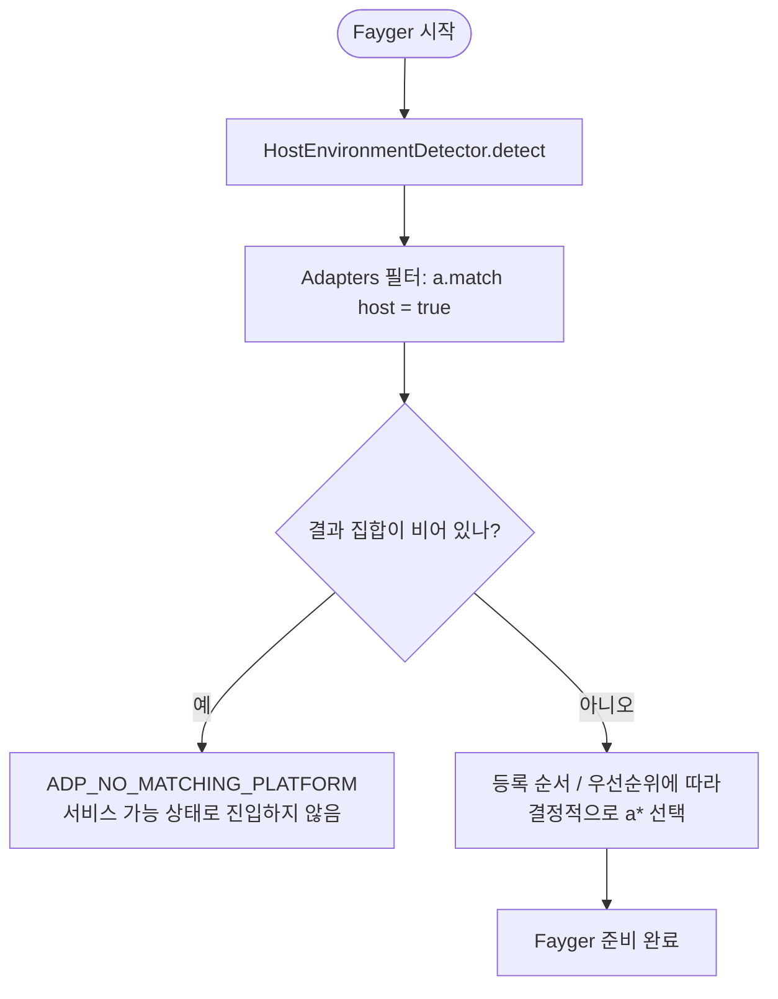
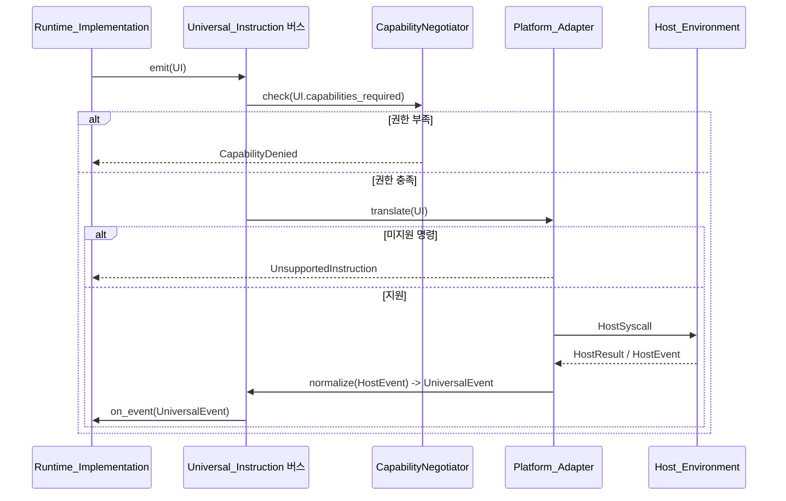

# 제 5 장 어댑터 계층

어댑터 계층은 Fayger 와 Host_Environment 사이의 경계입니다. 런타임 계층이 발행한 Universal_Instruction 을 받아서 호스트가 이해할 수 있는 시스템 호출로 번역합니다. 동시에 호스트가 만든 이벤트를 Universal_Event 로 정규화하여 런타임 계층에 돌려줍니다.

새로운 호스트 추가는 Platform_Adapter 추가만으로 충분하며, 런타임 계층과 로더 계층은 변경하지 않습니다.

## 5.1 Universal_Instruction 데이터 형태

```idl
struct UniversalInstruction {
  category: InstructionCategory
  opcode: u16
  operands: TLV[]
  capabilities_required: Set<Capability>
}

struct UniversalEvent {
  category: EventCategory
  opcode: u16
  payload: TLV[]
}
```

설계 요점:

- **category** 는 거시적 분류(io / net / ui / time / random / crypto / proc / host).
- **opcode** 는 카테고리 내 번호로 2 바이트. 상위 비트는 실험적 명령용 예약.
- **operands** 는 TLV(type-length-value) 시퀀스. 다중 언어 디코딩과 확장에 유리.
- **capabilities_required** 는 이 명령이 필요로 하는 권한 집합. 권한 축소의 입력.

### 카테고리 집합 (1 단계)

| 카테고리 | 설명 | 차용 |
| --- | --- | --- |
| `io` | 파일 / 표준 스트림 | POSIX read / write |
| `net` | 네트워크 I/O | WASI sock_* |
| `ui` | UI 렌더링과 입력 | DOM / 터미널 TUI / Canvas |
| `time` | 시계와 타이머 | clock_time_get |
| `random` | 난수 | random_get |
| `crypto` | 암호화 원시 | WASI crypto |
| `proc` | 프로세스 / 스레드 / 신호 | POSIX |
| `host` | 호스트 특화 호출 | JNI / extism |

8 카테고리 중 8 비트는 향후 확장용으로 예약합니다.

### 인코딩

각 명령은 다음 배치로 인코딩합니다:

```
+--------+--------+----------+-------------------+
| cat(1) | op(2)  | caps(2)  | operands(TLV...)  |
+--------+--------+----------+-------------------+
```

- `cat`: 1 바이트. 상위 비트는 플래그 예약.
- `op`: 2 바이트.
- `caps`: 2 바이트 권한 비트맵(1 단계는 하위 16 항만 사용, 초과 시 확장 단 사용).
- `operands`: 각 operand 는 `(type:1, length:varint, value)`.

## 5.2 Platform_Adapter 추상화

```idl
interface Platform_Adapter {
  descriptor() -> AdapterDescriptor
  match(host: HostEnvironment) -> bool
  translate(instr: UniversalInstruction) -> Result<HostSyscall, AdapterError>
  normalize(raw: HostEvent) -> Result<UniversalEvent, AdapterError>
}

struct AdapterDescriptor {
  platform_id: String
  supported_capabilities: Set<Capability>
  supported_instructions: Set<InstructionId>
}
```

각 어댑터는 자신이 지원하는 권한과 명령 집합을 자기 기술합니다. 이로써 권한 축소와 "지원하지 않는 명령" 결정은 모두 로컬 테이블 조회 작업이 되어 실행 중 시행착오에 의존하지 않습니다.

## 5.3 Host_Environment 탐지와 어댑터 선택

```idl
interface HostEnvironmentDetector {
  detect() -> HostEnvironment
}

struct HostEnvironment {
  platform_id: String
  os_kind: OsKind
  arch: Arch
  sandbox_kind: SandboxKind
  runtime_features: Set<Feature>
}
```

시작 시 선택 흐름:



결정적 선택이란 동일한 어댑터 집합과 동일한 Host_Environment 하에서 여러 번 시작해도 동일한 어댑터가 선택됨을 의미합니다. "유령 어댑터" 문제를 방지합니다.

## 5.4 권한 축소

```idl
interface CapabilityNegotiator {
  negotiate(
    requested: Set<Capability>,
    available: Set<Capability>,
    policy: HostPolicy
  ) -> NegotiationResult
}

struct NegotiationResult {
  granted: Set<Capability>
  denied: Set<Capability>
  warnings: List<Capability>
}
```

축소의 집합 대수:

- `granted = requested ∩ available ∩ policy`
- `denied = requested \ granted`
- `warnings`: 호스트에서 제한된 형태로 제공되는 권한(예: 브라우저 fetch 제한 하의 `net.http`).

`manifest.required_capabilities \ granted ≠ ∅` 인 경우 `start()` 는 반드시 오류를 반환하고, `context.missing` 은 차집합과 같으며, 인스턴스는 Running 으로 진입하지 않습니다. 이는 "권한 부족 시 시작 금지" 의 단단한 제약입니다.

선언되지 않은 권한은 BuF 에 보이지 않습니다(기본 거부). WASI 의 host import 명시 주입 의미와 일치합니다.

## 5.5 양방향 번역 흐름



요점:

- 권한 검사는 translate 보다 먼저 수행하여 불필요한 하위 호출을 피합니다.
- "미지원 명령" 은 결정적인 로컬 결정(테이블 조회)으로, 어떤 호스트 호출도 발생시키지 않습니다.
- 호스트 이벤트는 `normalize` 를 거쳐 런타임 계층으로 돌아오며, 런타임 계층은 원시 호스트 이벤트 구조에 절대 닿지 않습니다.

## 5.6 1 단계 내장 어댑터

| 어댑터 | 적용 시나리오 | 권한 축소 요점 |
| --- | --- | --- |
| **NativeDesktop_Adapter** | Linux / macOS / Windows 데스크톱 | 권한 거의 전체 집합. `ui` / `proc` / `io` / `net` 완전 사용 가능 |
| **Server_Adapter** | GUI 없는 서버 | `ui` 카테고리 비활성, `proc` 정책 제한 |
| **Browser_Adapter** | Web API 기반 | `proc` 와 대부분의 `io` 비활성. `net` 은 fetch / WebSocket 제한. 강한 축소 |
| **InApp_Adapter** | 호스트 앱 프로세스에 임베드 | 권한은 호스트가 명시 주입. 가장 엄격. `host` 카테고리의 사용 가능 opcode 는 호스트가 선언 |

이들은 참조 구현입니다. 제 3 자는 임베디드 단말, 특정 IDE 임베드 등 자체 어댑터를 등록할 수 있습니다.

## 5.7 크로스 플랫폼 일관성

같은 BuF 를 다른 Platform_Adapter 에서 적재하고 실행할 때, 런타임 계층이 관측한 Lifecycle_State 시퀀스와 발행한 Universal_Instruction 시퀀스는 일치해야 합니다:

- 시퀀스를 발산시킬 수 있는 차이는 반드시 start 이전에 권한 축소로 거부해야 하며, 실행 중에 조용히 발산시켜서는 안 됩니다.
- "동등하지만 경로가 다른" 듯 보이는 최적화는 Universal_Instruction 시퀀스에 다른 경로를 노출해서는 안 됩니다.

이 성질은 동일 권한의 모의 어댑터 한 쌍을 병행 실행하고 시퀀스 동등성을 비교하여 검증합니다.

## 5.8 오류 코드

어댑터 계층이 만드는 안정 오류 코드:

| 오류 코드 | 발생 조건 |
| --- | --- |
| `ADP_NO_MATCHING_PLATFORM` | 현재 호스트에 일치하는 어댑터가 없음 |
| `ADP_UNSUPPORTED_INSTRUCTION` | 현재 어댑터가 명령을 지원하지 않음 |
| `ADP_CAPABILITY_DENIED` | 축소 후 권한이 명령 실행에 부족 |
| `ADP_HOST_CALL_FAILED` | 어댑터가 명령을 시스템 호출로 번역한 후 호스트 측 실패 |

`ADP_UNSUPPORTED_INSTRUCTION` 은 어떤 호스트 호출도 일으키지 않고 오류만 반환해야 합니다. 명령 계층에서의 "기본 거부" 자세의 구현입니다.
