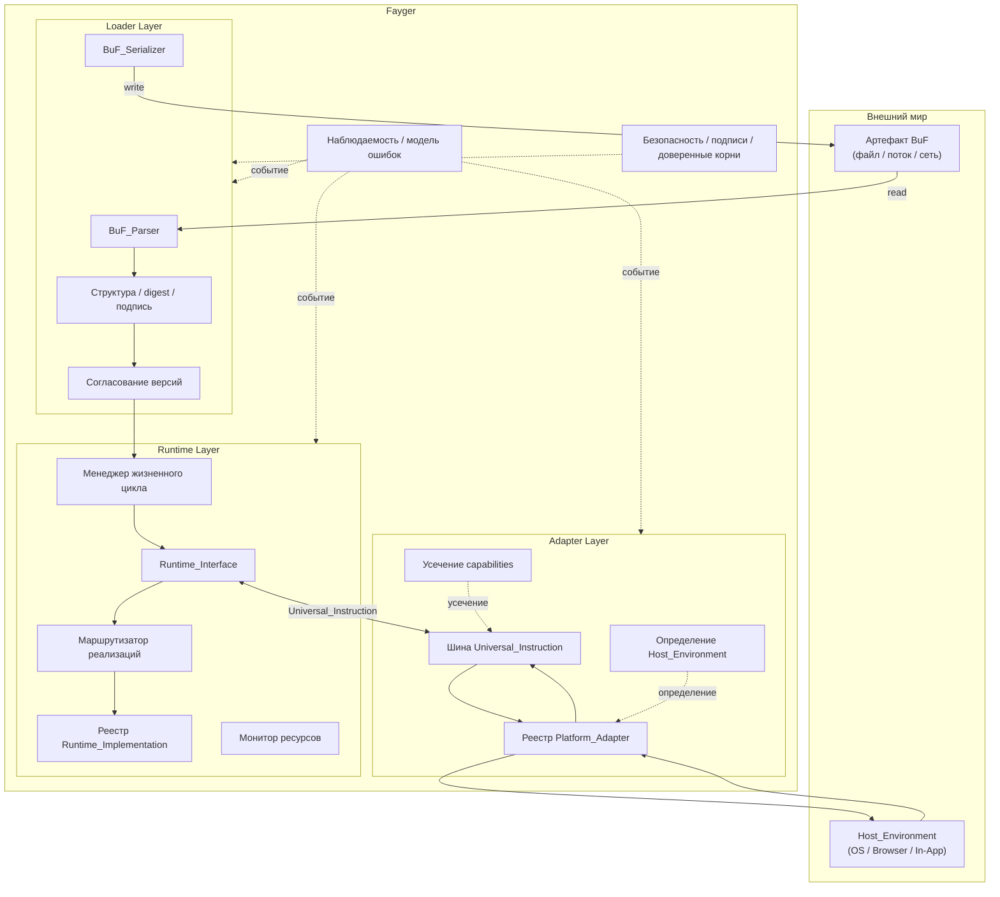

# Глава 2. Общая Архитектура

## 2.1 Три слоя

Fayger вертикально делится на три слоя. Каждый из них выполняет свою ответственность в рамках своей области, и слои взаимодействуют только через чётко определённые контракты.



## 2.2 Ответственности слоёв

### Loader Layer

- Читает BuF из любого бэкенда хранения через абстракцию *BuF_Source* (локальный файл, HTTP Range, объектное хранилище, IPFS, пользовательский бэкенд).
- Парсит поток байт в объект в памяти.
- Проверяет структурную корректность, content-digests и подписи.
- Согласует с текущим Fayger версии BuF schema и Runtime_Interface.
- На уровне Section выбирает подмножество для загрузки согласно *LoadProfile* вызывающей стороны; пропускает Sections, не нужные текущему окружению или не помещающиеся.
- По *LoadStrategy* выбирает: читать всё заранее (Eager) или только заголовок + индекс, а тела Sections подгружать при первом обращении (Lazy).
- Передаёт готовый объект BuF в памяти исполняющему слою.
- Обратная возможность: сериализует объект в памяти обратно в байты для перезаписи, кеширования или переупаковки.

### Runtime Layer

- Выставляет *Runtime_Interface* как языконезависимый контракт.
- Поддерживает реестр *Runtime_Implementation* и маршрутизирует к конкретной реализации согласно политике BuF_Manifest.
- Управляет жизненным циклом каждого BuF_Instance (Loaded → Initialized → Running → Suspended → Terminated / Failed).
- Мониторит использование ресурсов на инстанс и применяет ограничение или приостановку согласно квотам BuF_Manifest.
- Общается со слоем адаптации через Universal_Instructions; сам не зависит ни от какого конкретного хоста.

### Adapter Layer

- Поддерживает набор *Platform_Adapter*, по одному на класс терминали / ОС / хоста.
- Определяет при старте текущую Host_Environment и выбирает подходящий адаптер.
- Переводит Universal_Instructions от исполняющего слоя в системные вызовы и нормализует события хоста в Universal_Events.
- Усекает заявленный BuF набор capabilities до подмножества, реально доступного на текущем хосте.

## 2.3 Направление вызовов и правила зависимости

Направление зависимостей — ключ к долгосрочной эволюции. Fayger применяет следующие жёсткие правила:

- **Loader → Runtime.** Однонаправленно. После загрузки loader передаёт объект и не удерживает BuF_Instance.
- **Runtime ↔ Adapter.** Двунаправленно через типы данных Universal_Instruction и Universal_Event. Исполняющий слой никогда не импортирует напрямую тип Platform_Adapter.
- **Runtime → Loader.** Запрещено. Если исполняющему слою нужно повторно сериализовать BuF (например, hot reload), он использует сервисный интерфейс loader, а не его внутренние типы.
- **Adapter → Хост.** Однонаправленно. Platform_Adapter держит ссылки на SDK и системные вызовы хоста; исполняющий слой никогда не импортирует библиотеки хоста напрямую.
- **Сквозные (наблюдаемость / безопасность) → три слоя.** Входят через шину событий и интерфейсы политик. Три слоя публикуют события и спрашивают политики, но не зависят от конкретных реализаций сквозных слоёв.

Главная цель этих правил: **добавление нового хоста не должно менять исполняющий слой; замена реализации исполнения не должна менять адаптеры**.

## 2.4 Заимствованные дизайны

### Цепочечные фазы загрузки в стиле JVM

Слой загрузки внутри разбит на JVM-подобные фазы, что упрощает атрибуцию ошибок и юнит-тесты:

```
Read(Header/Manifest/Index) → Parse → Verify(Structural)
  → Verify(Digest of Header/Manifest/Index) → Verify(Signature)
  → NegotiateVersion → Select(Sections by LoadProfile) → Resolve(Dependencies)
  → Read(Selected Section Bodies)?  → HandOff(to Runtime)
```

`Select(Sections by LoadProfile)` выбирает Sections для загрузки по capabilities терминали и ограничениям размера. `Read(Selected Section Bodies)` выполняется только при LoadStrategy = Eager; в Lazy чтение и проверка выбранных Sections откладываются до первого обращения. Каждая фаза порождает ошибки с тегом фазы, поступающие в единую модель ошибок (глава 6).

### Организация артефактов в стиле Docker / OCI

Артефакт BuF структурно соответствует образу OCI:

| Концепция OCI | Соответствие в BuF |
| --- | --- |
| Image Manifest | BuF_Manifest |
| Image Config | Поля `runtime` / `capabilities` / `quotas` BuF_Manifest |
| Layers | BuF Sections (code / data / assets / signature) |
| Distribution Spec | Однофайловый артефакт в фазе 1; будущее расширение |
| Runtime Spec | Runtime_Interface |
| containerd | Runtime_Layer (жизненный цикл + маршрутизация) |
| runc | Runtime_Implementation (исполнитель) |

### Модель безопасности по capabilities, как в WASM / WASI

Слой адаптации использует capability-based security:

- BuF_Manifest объявляет `requested_capabilities` (например, `fs.read`, `net.http`, `ui.dom`).
- Platform_Adapter объявляет `available_capabilities`.
- Выданные = `requested ∩ available ∩ host_policy`. Инстанс переходит в `Running` только если все три пересечения непусты.
- Не объявленные capabilities невидимы для BuF (deny by default), что соответствует семантике явного host-импорта в WASI.

## 2.5 Объём первой фазы и не-цели

**Объём первой фазы:**

- Загрузка и исполнение одного BuF; несколько BuF_Instances могут работать параллельно, но по умолчанию ничего не разделяют.
- Интерпретируемый путь исполнения; абстракция ExecutionStrategy зарезервирована под будущий JIT.
- Четыре встроенных Platform_Adapter: десктоп / сервер / браузер / In-App.
- Синхронный и асинхронный диспетчинг инструкций; изоляция нескольких инстансов в одном процессе.

**Не-цели первой фазы:**

- Разделяемая память и IPC между BuF_Instances.
- JIT-компиляция и генерация машинного кода.
- Распределённое планирование и многоузловая кооперация Fayger.
- Дифференциальная дистрибуция BuF и слоистый кеш (однофайловый артефакт как база; слоистая структура зарезервирована).
