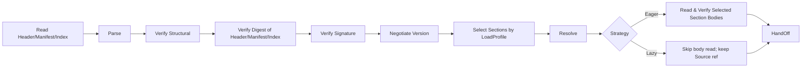
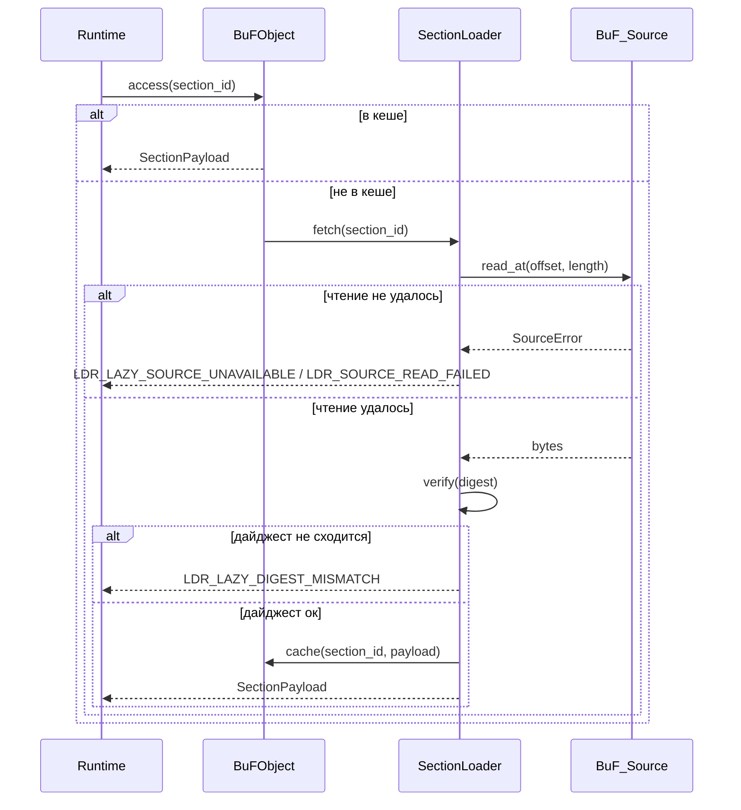

# Глава 3. Слой Загрузки

Слой загрузки — граница между Fayger и внешними артефактами BuF. Его задача: прочитать BuF из любого бэкенда хранения, решить, какие Sections и когда загружать, исходя из текущего окружения и политики вызывающей стороны, и превратить байты во внутренне согласованный объект BuF в памяти, который примет исполняющий слой; либо — при сбое — вернуть точно локализованную и классифицируемую ошибку.

## 3.1 Формат артефакта BuF

BuF использует пятичастный формат: **Header + Manifest + Section Index + Sections + Trailer**, с заимствованиями из JAR / OCI Image / WASM:

```
+------------------------------------------------------------+
| Header        | magic="BUF\0" | format_version | flags     |
|               | manifest_offset, manifest_length            |
|               | section_index_offset, section_index_length  |
+------------------------------------------------------------+
| Manifest      | CBOR-encoded BuFManifest                    |
+------------------------------------------------------------+
| Section Index | [(section_id, kind, offset, length, digest, |
|               |   visibility, profile_constraints)]         |
+------------------------------------------------------------+
| Sections      | [code | data | assets | signature | ...]   |
+------------------------------------------------------------+
| Trailer       | total_length | manifest_digest | crc32     |
+------------------------------------------------------------+
```

Заметки по дизайну:

- **Magic + Format Version.** Первые 8 байт фиксированы; помогают инструментам идентифицировать поток и отбрасывать испорченные.
- **Manifest как отдельная часть.** Позволяет согласовать версии, отобрать по профилю и усечь capabilities, не декодируя ни одно тело Section (изоморфно OCI Image Manifest).
- **Section Index — доверенный индекс для Lazy-режима.** Каждая запись содержит offset, длину, digest, visibility и profile_constraints. Section_Index должен быть прочитан полностью и проверен по дайджесту при загрузке, поскольку on-demand-чтения в Lazy зависят от него.
- **Trailer.** Несёт общую длину и дайджест Manifest; помогает обнаружить усечение и предотвращает атаки «сначала подписать, потом изменить Manifest».
- **Кодирование.** Manifest и Section_Index используют CBOR в детерминированном режиме (RFC 8949 §4.2), что даёт уникальную сериализацию — основа эквивалентности «туда-обратно».
- **Область подписи.** Header || Manifest_minus_signature || Section_Index. Тела пропущенных или ещё не извлечённых Sections не участвуют в вычислении подписи; поэтому частичная и полная загрузка эквивалентны для проверки подписи.

## 3.2 Конвенции полей BuF_Manifest

```idl
struct BuFManifest {
  // Согласование версий
  schema_version: SemVer
  runtime_interface_min: SemVer
  deprecation_notice: Option<String>

  // Точка входа и выбор runtime
  entry: EntryPoint
  runtime: RuntimeRequirement {
    preferred_impl: Option<ImplementationId>
    selection_strategy: enum { Strict, PreferThenAny, Any }
  }

  // Объявление capabilities
  capabilities: CapabilitySet
  quotas: Option<ResourceQuota>

  // Индекс содержимого
  sections: List<SectionDescriptor> {
    id: SectionId
    kind: enum { Code, Data, Asset, Signature, Custom(String) }
    digest: Digest
    length: u64
    visibility: SectionVisibility           // Required | Optional
    profile_constraints: ProfileConstraints // По умолчанию без ограничений
  }

  // Подпись (опционально)
  signature: Option<SignatureBlock>

  extensions: Map<String, CborValue>
}

struct ProfileConstraints {
  required_capabilities: Set<Capability>
  max_size: Option<u64>
  required_features: Set<Feature>
}
```

`schema_version` и `runtime_interface_min` развиваются независимо: первое управляет совместимостью формата BuF, второе — совместимостью Runtime_Interface (по аналогии с разделением версии class file и уровня API JVM).

## 3.3 Цепочка загрузки

Слой загрузки внутренне разбит на несколько JVM-подобных фаз:



Ответственности фаз:

- **Read Header/Manifest/Index.** Извлекает через BuF_Source Header / Manifest / Section_Index / Trailer. Должна завершиться до возврата `load`, как в Eager, так и в Lazy.
- **Parse.** Парсит Manifest и Section_Index (без декодирования тел).
- **Verify Structural.** Проверяет magic, поля версии, границы Sections, обязательные поля Manifest.
- **Verify Digest of Header/Manifest/Index.** Проверяет общий дайджест Header, Manifest и Section_Index (через `manifest_digest` и связанные поля Trailer). Дайджест каждого тела Section проверяется в момент фактического извлечения этой Section.
- **Verify Signature.** Выполняется, когда Manifest содержит подпись или включён режим обязательной подписи. Область подписи покрывает три части заголовка; не зависит от того, извлечены ли тела Sections.
- **Negotiate Version.** Проверяет совместимость schema и Runtime_Interface.
- **Select Sections by LoadProfile.** Определяет выбранный набор по LoadProfile и текущей Host_Environment; см. §3.7.
- **Resolve.** Разрешает зависимости между BuFs (фаза 1: один BuF; интерфейс зарезервирован).
- **Read Selected Section Bodies.** Только Eager. Читает каждое выбранное тело Section через BuF_Source и проверяет его дайджест.
- **HandOff.** Передаёт объект в памяти исполняющему слою. В Lazy объект сохраняет ссылку BuF_Source и SectionLoader.

Каждая фаза помечает свои ошибки именем фазы и информацией о местоположении и устанавливает `context.phase` в `eager` или `lazy`.

## 3.4 BuF_Source: абстракция многоисточникового хранения

```idl
interface BuF_Source {
  read_at(offset: u64, length: u64) -> Result<Bytes, SourceError>
  length() -> Result<u64, SourceError>
  stat() -> Result<SourceStat, SourceError>     // опционально
  close() -> Result<(), SourceError>             // опционально
}
```

Заметки по дизайну:

- Слой загрузки зависит только от минимальной пары `read_at` и `length`.
- Любой носитель, поддерживающий чтение со случайным доступом, может выступать как BuF_Source: локальный файл, HTTP Range, SDK объектного хранилища, шлюз IPFS, чанкованный Flash на встраиваемых устройствах, пользовательский бэкенд.
- BuF_Source не обязан реализовывать последовательный стриминг — Lazy ходит по offset.
- Для маленьких устройств (дроны, камеры) реализация BuF_Source может включать небольшой LRU-кеш или читать прямо из чанкованного Flash; loader не знает стратегию.

## 3.5 BuF_Parser и BuF_Serializer

```idl
interface BuF_Parser {
  parse(bytes: Bytes) -> Result<BuFObject, ParseError>
}

interface BuF_Serializer {
  serialize(obj: BuFObject) -> Result<Bytes, SerializeError>
}
```

Внутри `LoaderPipeline` парсер обычно вызывает BuF_Source как «получить кусок → распарсить»; чисто байтовый `parse(bytes)` — упрощённая точка входа для юнит-тестов и инструментов.

### Объект в памяти (с частичной загрузкой)

```idl
struct BuFObject {
  manifest: BuFManifest
  raw_header: Header
  raw_trailer: Trailer

  selected_sections: Set<SectionId>
  skipped_sections: List<SkipRecord>     // (id, reasons)
  strategy: LoadStrategy
  source_ref: Option<BuF_Source>          // удерживается только в Lazy
  loader: Option<SectionLoader>           // удерживается только в Lazy
  sections: Map<SectionId, SectionPayload> // в Eager — целиком; в Lazy — кеш по требованию
}

enum SkipReason {
  CapabilityNotGranted, OverMaxSize, FeatureMissing, ExplicitlyDisabled
}
```

Семантика эквивалентности «туда-обратно» при частичной загрузке: эквивалентность сравнивается на диапазоне `selected_sections`; пропущенные Sections не участвуют в сравнении, но сам список `skipped_sections` участвует. Это исключает признание эквивалентными двух частичных загрузок с разными подмножествами.

## 3.6 Интерфейс LoaderPipeline

```idl
struct LoadProfile {
  target_class: TargetClass             // desktop | server | browser | inapp | embedded | drone | camera | …
  capabilities: Set<Capability>
  max_section_bytes: Option<u64>
  features: Set<Feature>
}

enum LoadStrategy { Eager, Lazy }
enum SectionVisibility { Required, Optional }

struct LoaderPolicy {
  require_signature: bool
  trusted_roots: TrustedRootSet
  allowed_schema_versions: VersionRange
}

interface LoaderPipeline {
  load(
    source: BuF_Source,
    profile: LoadProfile,
    strategy: LoadStrategy,
    policy: LoaderPolicy
  ) -> Result<BuFObject, LoaderError>
}
```

`load` всегда читает и проверяет Header / Manifest / Section_Index до возврата. Читать ли тела Sections до возврата — зависит от `strategy`.

## 3.7 Частичная загрузка: выбор Sections по окружению

Терминалы сильно различаются по возможностям. Десктоп может загрузить полный BuF; дрону или камере достаточно Sections «управление + видеокодек». Алгоритм выбора:

Для каждого `s ∈ manifest.sections` определяем предикат

```
fits(s) = s.profile_constraints.required_capabilities ⊆ profile.capabilities
        ∧ (s.profile_constraints.max_size не задано ∨ s.length ≤ s.profile_constraints.max_size)
        ∧ s.profile_constraints.required_features ⊆ profile.features
```

Результаты:

- `selected = { s : fits(s) }`, помещается в `BuFObject.selected_sections`.
- `s ∈ sections \ selected ∧ s.visibility == Required` ⟹ загрузка проваливается с `LDR_PROFILE_REQUIRED_SECTION_MISSING`. Контекст содержит `section_id` и невыполненные пункты ограничений.
- `s ∈ sections \ selected ∧ s.visibility == Optional` ⟹ попадает в `skipped_sections` с причинами (CapabilityNotGranted / OverMaxSize / FeatureMissing / ExplicitlyDisabled).

Выбор детерминирован: одинаковые (manifest, host_env, profile) дают одинаковые `selected` и `skipped_sections`.

### Примеры

| Терминал | Типичный LoadProfile | Поведение |
| --- | --- | --- |
| Десктоп | полный capabilities, без max_section_bytes | Все Sections выбраны |
| Сервер | ui отключен, без max_section_bytes | UI-ассеты пропущены (если объявлены зависимыми от ui) |
| Браузер | только net.fetch / net.websocket / ui.dom, max_section_bytes ≈ 8 MiB | Слишком крупные ассеты пропущены; Sections, требующие proc, пропущены |
| Дрон | минимальный capabilities + max_section_bytes ≈ 1 MiB + features.realtime | Только control и codec; обучающие материалы пропущены |
| Камера | capabilities ограничен io.frame + crypto + net.rtsp | Только видеообработка и uplink |

## 3.8 Стратегии: Eager vs Lazy

### Eager

- Все тела `selected_sections` читаются и проверяются до возврата `load`.
- Подходит для маленьких BuF, сценариев без сети после старта или предпочтения «всё разом».
- Ошибки на загрузке имеют `phase == "eager"`.

### Lazy

- До возврата `load` читаются и проверяются только Header / Manifest / Section_Index.
- Выбранные Sections извлекаются и проверяются по дайджесту при первом обращении SectionLoader'ом.
- Подходит для крупных BuF, исполнения по требованию или удалённых источников (HTTP / объектное хранилище).
- Ошибки после `load` имеют `phase == "lazy"` и могут обрабатываться отдельно от стартовых.

```idl
interface SectionLoader {
  fetch(id: SectionId) -> Result<SectionPayload, LoaderError>
  is_loaded(id: SectionId) -> bool
  loaded_ids() -> Set<SectionId>
}
```

### Поток подгрузки в Lazy



### Эквивалентность Eager / Lazy

Для одних и тех же (source, profile, policy), независимо от стратегии:

- `selected_sections` и `skipped_sections` идентичны.
- Если в Lazy-результате запустить чтение для каждой записи `selected_sections`, итоговые sections побайтно совпадут с Eager-результатом.
- Lazy лишь откладывает чтение и проверку во времени; семантической разницы нет.

Свойство непрерывно проверяется PBT.

## 3.9 Проверка дайджеста и подписи

### Дайджест

- Общий дайджест Header / Manifest / Section_Index всегда проверяется на загрузке.
- Дайджест каждого тела Section берётся из неизменяемого снапшота в Section_Index: Eager проверяет все выбранные на загрузке; Lazy — при первом обращении.
- Несовпадение возвращает `LDR_DIGEST_MISMATCH` (Eager) или `LDR_LAZY_DIGEST_MISMATCH` (Lazy); контекст содержит проваленный `section_id`.

### Подпись

Область подписи — `Header || Manifest_minus_signature || Section_Index`. Это значит:

- Даже при частичной загрузке проверка подписи остаётся полной.
- Пропущенные Sections не влияют на результат подписи.
- Изменение offset / length / digest в Section_Index делает подпись недействительной.

Таблица решений:

| Условие | Результат |
| --- | --- |
| enforce_signature on ∧ нет подписи | `Err(LDR_SIGNATURE_FAIL)`, причина `MissingSignature` |
| подпись есть ∧ проверка проваливается | `Err(LDR_SIGNATURE_FAIL)`, причина `InvalidSignature` |
| подпись есть ∧ проверка проходит | `Ok` |
| enforce_signature off ∧ нет подписи | `Ok` |

Набор доверенных корней поддерживает *TrustStore*; обновления вступают в силу со следующей загрузки (глава 7).

**Критический порядок.** Проверка подписи предшествует выбору Sections. Сначала проверяется источник артефакта целостной подписью Manifest; затем LoadProfile решает, что грузить. Это исключает ослабленную семантику «проверять только выбранное подмножество».

## 3.10 Согласование версий

Таблица решений:

| Условие | Результат |
| --- | --- |
| версия schema вне поддерживаемого диапазона | `Err(LDR_SCHEMA_UNSUPPORTED)` с ожидаемым диапазоном |
| runtime_interface_min выше предоставленного | `Err(LDR_RUNTIME_VERSION_TOO_HIGH)` с required / provided |
| schema в диапазоне, не deprecated, runtime ок | `Ok` |
| schema deprecated, но всё ещё поддерживается | `Ok` с уведомлением о deprecation |

Уведомление выставляется через `BuFObject.manifest.deprecation_notice` для отображения инструментами.

## 3.11 Коды ошибок

Стабильные коды слоя загрузки:

| Код | Триггер |
| --- | --- |
| `LDR_PARSE_FAIL` | Поток BuF не соответствует спецификации формата |
| `LDR_DIGEST_MISMATCH` | Несовпадение дайджеста Section в фазе Eager |
| `LDR_LAZY_DIGEST_MISMATCH` | Несовпадение дайджеста при первом доступе в Lazy |
| `LDR_SIGNATURE_FAIL` | Отсутствие подписи в режиме обязательной или невалидная подпись |
| `LDR_SCHEMA_UNSUPPORTED` | Версия schema вне поддерживаемого диапазона |
| `LDR_RUNTIME_VERSION_TOO_HIGH` | Требуемый Runtime_Interface выше предоставленного |
| `LDR_MISSING_REQUIRED_FIELD` | При сериализации в Manifest отсутствуют обязательные поля |
| `LDR_PROFILE_REQUIRED_SECTION_MISSING` | Required Section не подгружается под текущим профилем |
| `LDR_LAZY_SOURCE_UNAVAILABLE` | BuF_Source недоступен при последующем доступе в Lazy |
| `LDR_SOURCE_READ_FAILED` | Ошибка чтения BuF_Source (Eager или Lazy) |

В `context` каждой ошибки минимум — местоположение и причина в виде ключ-значение, плюс `context.phase = "eager" | "lazy"` для согласованной диагностики в инструментах.
