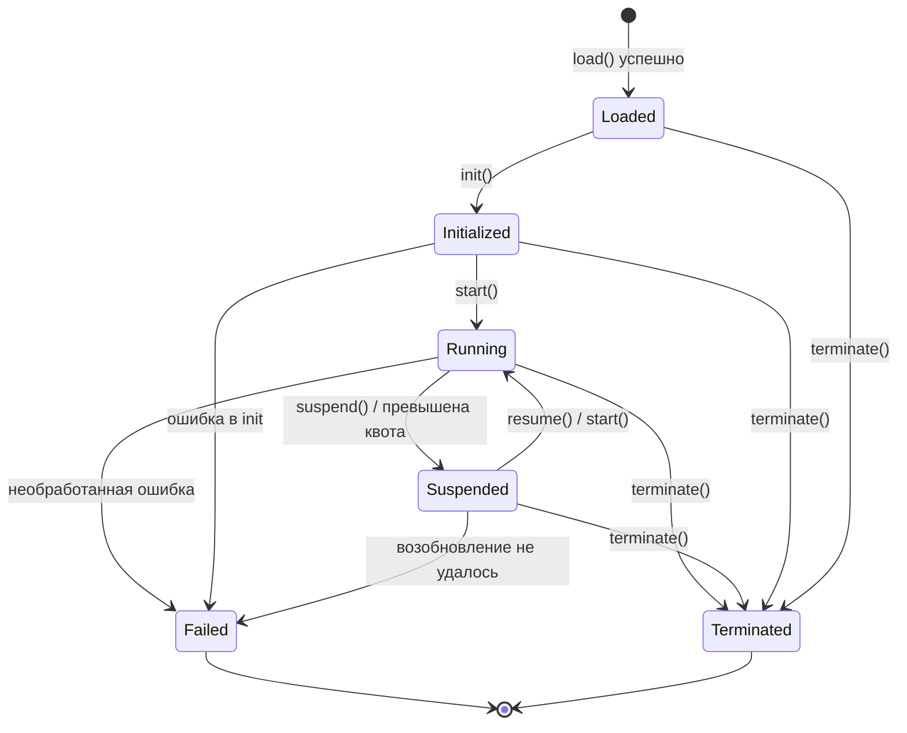

# Глава 4. Слой Исполнения

Слой исполнения исполняет семантику BuF. Он принимает BuF_Object от слоя загрузки, общается со слоем адаптации через Universal_Instructions и не зависит ни от какого конкретного хоста.

## 4.1 Runtime_Interface (языконезависимый контракт)

Runtime_Interface — стабильный внешний контракт слоя исполнения. Любая Runtime_Implementation должна реализовать его семантически эквивалентно, независимо от того, использует ли она Rust traits, Go interfaces, TypeScript interfaces или другие механизмы.

```idl
interface Runtime_Interface {
  // Метаданные
  rt_version() -> RuntimeInterfaceVersion
  capabilities() -> Set<RuntimeCapability>

  // Жизненный цикл
  load(obj: BuFObject) -> Result<InstanceId, RuntimeError>
  init(id: InstanceId) -> Result<(), RuntimeError>
  start(id: InstanceId) -> Result<(), RuntimeError>
  suspend(id: InstanceId) -> Result<(), RuntimeError>
  resume(id: InstanceId) -> Result<(), RuntimeError>
  terminate(id: InstanceId) -> Result<(), RuntimeError>

  // Запросы состояния
  state(id: InstanceId) -> Result<LifecycleState, RuntimeError>
  failure_info(id: InstanceId) -> Result<Option<FailureInfo>, RuntimeError>

  // Связь со слоем адаптации
  emit(id: InstanceId, instr: UniversalInstruction) -> Result<UniversalReply, AdapterError>
  on_event(id: InstanceId, event: UniversalEvent) -> Result<(), RuntimeError>
}
```

Дизайн заимствует:

- **OCI Runtime Spec** разделение «конфигурация + команды»: `load` подаёт конфигурацию; `init / start / suspend / resume / terminate` — команды.
- **Engine исполнения JVM** привычку запросов состояния: `state` и `failure_info` доступны в любой момент.

## 4.2 Регистрация и маршрутизация Runtime_Implementation

```idl
interface RuntimeRegistry {
  register(impl: Runtime_Implementation) -> Result<RegistrationId, RegistryError>
  list() -> List<RuntimeImplementationDescriptor>
  resolve(manifest: BuFManifest) -> Result<RegistrationId, RegistryError>
}
```

### Проверка полноты методов при регистрации

RuntimeRegistry проверяет, что кандидат реализует все обязательные методы Runtime_Interface:

- Пусть `R` — множество обязательных методов, `I = implemented_methods(impl)`.
- `register(impl)` успешно тогда и только тогда, когда `R ⊆ I`.
- Иначе возвращается `RT_IMPL_MISSING_METHODS` с `R \ I` в `context.missing_methods`.

Проверка выполняется один раз при регистрации; в рантайме затрат нет.

### Стратегия маршрутизации

BuF_Manifest выражает предпочтения через `runtime.preferred_impl` и `runtime.selection_strategy`. Поведение `resolve(manifest)`:

- `Strict`: должно использоваться `preferred_impl`, совместимое с manifest; иначе `RT_IMPL_NOT_FOUND`.
- `PreferThenAny`: предпочесть `preferred_impl`; если недоступно — любая совместимая.
- `Any`: любая совместимая реализация.

«Совместимая» означает `rt_version()` ≥ `manifest.runtime_interface_min` и `capabilities()` покрывает минимальный набор capabilities из manifest.

В одном Fayger могут одновременно существовать несколько зарегистрированных реализаций (например, Rust для десктопа и TypeScript для браузера). Маршрутизация должна быть предсказуемой и отлаживаемой для вызывающей стороны.

## 4.3 Жизненный цикл BuF_Instance

### Конечный автомат



### Таблица легальных переходов

| Текущее состояние | Допустимые цели |
| --- | --- |
| Loaded | Initialized, Terminated, Failed |
| Initialized | Running, Terminated, Failed |
| Running | Suspended, Terminated, Failed |
| Suspended | Running, Terminated, Failed |
| Terminated | (терминальное) |
| Failed | (терминальное) |

Примеры нелегальных переходов: `Loaded → Running` (нет init), `Terminated → любое`, `Failed → Running`.

При нелегальном переходе runtime возвращает `RT_ILLEGAL_TRANSITION`; контекст содержит `current_state` и `allowed_set`, состояние не меняется.

### Состояние Failed

Инстанс, перешедший в `Failed`, должен сохранить:

- Последнюю Universal_Instruction, вызвавшую сбой.
- Объект ошибки, вызвавший сбой (со всей цепочкой causes).

Они доступны через `failure_info(id)` до явного уничтожения инстанса.

## 4.4 Область данных BuF_Instance и изоляция

Каждый BuF_Instance владеет независимой RuntimeDataArea:

- Независимая куча / стек вызовов / таблица handle.
- Независимая очередь диспетчинга инструкций.
- Независимые счётчики использования ресурсов.

Разные инстансы по умолчанию не разделяют указатели на объекты. Это заимствует JVM-модель с независимыми PC / стеком на поток и областью методов на инстанс.

Формально, для любых двух одновременно существующих инстансов `i₁` и `i₂`:

```
data_area(i₁) ∩ data_area(i₂) == ∅
```

и любая запись в `i₁` не меняет ни одного байта в `data_area(i₂)`. Это одно из основных свойств изоляции, проверяемых тестами.

## 4.5 Мониторинг ресурсов и квоты

```idl
interface ResourceMonitor {
  attach(id: InstanceId, quota: ResourceQuota)
  sample(id: InstanceId) -> ResourceUsage
}
```

Стратегия мониторинга:

- Когда BuF_Manifest объявляет квоты CPU / памяти / I/O, `ResourceMonitor` периодически выбирает значения.
- При превышении любой размерности генерируется `QuotaExceeded`, и менеджер жизненного цикла переводит инстанс в `Suspended`.
- `context.resource` события приостановки равно ресурсу, превышенному первым; `context.usage` — выборке в момент первого превышения.

Мониторинг использует возможности хоста (cgroups, Performance API браузера, таймеры платформы и т. п.), которые предоставляет соответствующий Platform_Adapter. Слой исполнения потребляет только нормализованные значения.

## 4.6 Изоляция сбоев между инстансами

Инстанс, перешедший в `Failed`, не должен влиять на другие в `Running`:

- Менеджер жизненного цикла самостоятельно высвобождает ресурсы сбойного инстанса.
- Диспетчинг Universal_Instruction других инстансов не затрагивается.
- Шина событий разделяет сбойные и здоровые инстансы, чтобы избежать взаимного блокирования.

Формально: при N одновременно работающих инстансах, если `iₖ` сбоит, временные линии состояний и последовательности Universal_Instruction остальных `iⱼ` (`j ≠ k`) совпадают с базисом без сбоя.

## 4.7 Интерфейс к слою адаптации

Слой исполнения отправляет `UniversalInstruction` адаптеру и получает `UniversalReply` или `UniversalEvent`:

```idl
fn emit(id: InstanceId, instr: UniversalInstruction) -> Result<UniversalReply, AdapterError>
fn on_event(id: InstanceId, event: UniversalEvent) -> Result<(), RuntimeError>
```

Слой исполнения зависит только от этих двух типов и ни от какого конкретного типа Platform_Adapter. Правило обеспечивается статическими проверками зависимостей (см. рекомендации по инструментарию в главе 8).

## 4.8 Коды ошибок

Стабильные коды слоя исполнения:

| Код | Триггер |
| --- | --- |
| `RT_ILLEGAL_TRANSITION` | Нелегальный переход жизненного цикла |
| `RT_IMPL_NOT_FOUND` | Маршрутизация не нашла подходящую реализацию |
| `RT_IMPL_MISSING_METHODS` | У зарегистрированной реализации нет обязательных методов |
| `RT_QUOTA_EXCEEDED` | Превышение квоты; провоцирует Suspended |
| `RT_INSTANCE_FAILED` | Инстанс перешёл в Failed |
