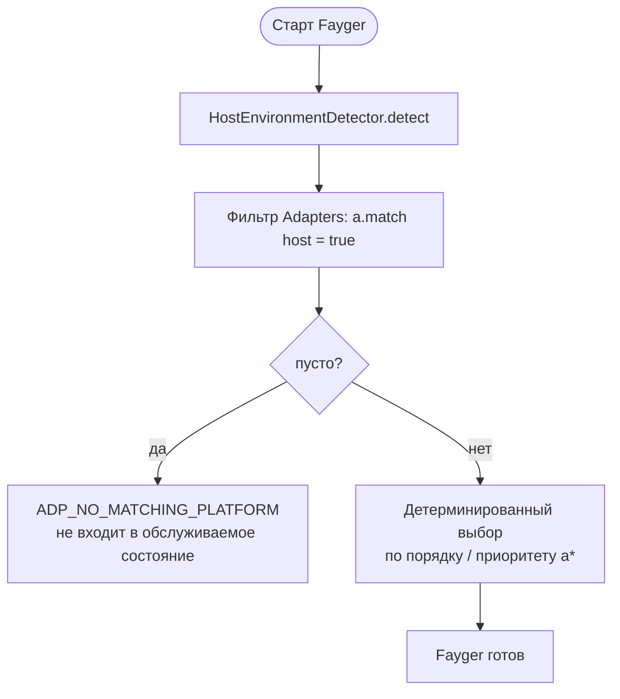
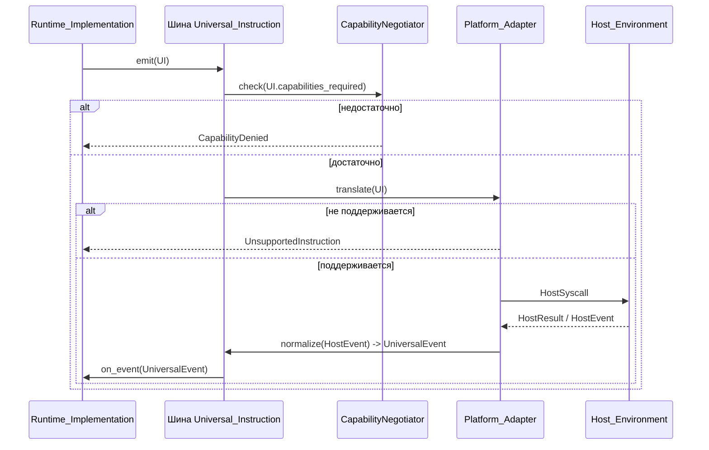

# Глава 5. Слой Адаптации

Слой адаптации — граница между Fayger и Host_Environment. Он принимает Universal_Instructions от слоя исполнения и переводит их в системные вызовы, понятные хосту; он же нормализует события хоста в Universal_Events, возвращаемые в слой исполнения.

Добавление нового хоста требует только нового Platform_Adapter — слои загрузки и исполнения остаются без изменений.

## 5.1 Форма данных Universal_Instruction

```idl
struct UniversalInstruction {
  category: InstructionCategory
  opcode: u16
  operands: TLV[]
  capabilities_required: Set<Capability>
}

struct UniversalEvent {
  category: EventCategory
  opcode: u16
  payload: TLV[]
}
```

Заметки по дизайну:

- **category** — крупная классификация (io / net / ui / time / random / crypto / proc / host).
- **opcode** — id внутри категории (2 байта); старший бит зарезервирован под экспериментальные инструкции.
- **operands** — последовательность TLV (type-length-value) для межязыкового декодирования и расширяемости.
- **capabilities_required** — множество capabilities, нужных инструкции; вход для усечения capabilities.

### Категории (первая фаза)

| Категория | Описание | Заимствовано у |
| --- | --- | --- |
| `io` | файлы / стандартные потоки | POSIX read / write |
| `net` | сетевой I/O | WASI sock_* |
| `ui` | рендеринг UI и ввод | DOM / TUI / Canvas |
| `time` | часы и таймеры | clock_time_get |
| `random` | случайные числа | random_get |
| `crypto` | криптопримитивы | WASI crypto |
| `proc` | процесс / поток / сигнал | POSIX |
| `host` | специфичные для хоста вызовы | JNI / extism |

8 битов зарезервированы под будущие категории.

### Кодирование

Каждая инструкция кодируется как:

```
+--------+--------+----------+-------------------+
| cat(1) | op(2)  | caps(2)  | operands(TLV...)  |
+--------+--------+----------+-------------------+
```

- `cat`: 1 байт; старшие биты зарезервированы под флаги.
- `op`: 2 байта.
- `caps`: 2-байтная битовая карта capabilities (16 младших бит в фазе 1; для большего — расширительный сегмент).
- `operands`: каждый — `(type:1, length:varint, value)`.

## 5.2 Абстракция Platform_Adapter

```idl
interface Platform_Adapter {
  descriptor() -> AdapterDescriptor
  match(host: HostEnvironment) -> bool
  translate(instr: UniversalInstruction) -> Result<HostSyscall, AdapterError>
  normalize(raw: HostEvent) -> Result<UniversalEvent, AdapterError>
}

struct AdapterDescriptor {
  platform_id: String
  supported_capabilities: Set<Capability>
  supported_instructions: Set<InstructionId>
}
```

Каждый адаптер сам описывает свои capabilities и инструкции, поэтому усечение и решения «не поддерживается» становятся локальным lookup'ом по таблице, без проб и ошибок во время выполнения.

## 5.3 Определение Host_Environment и выбор адаптера

```idl
interface HostEnvironmentDetector {
  detect() -> HostEnvironment
}

struct HostEnvironment {
  platform_id: String
  os_kind: OsKind
  arch: Arch
  sandbox_kind: SandboxKind
  runtime_features: Set<Feature>
}
```

Поток выбора при старте:



Детерминированный выбор: при одном и том же наборе адаптеров и одной и той же Host_Environment повторные запуски выбирают один и тот же адаптер. Это исключает проблему «фантомного адаптера».

## 5.4 Усечение capabilities

```idl
interface CapabilityNegotiator {
  negotiate(
    requested: Set<Capability>,
    available: Set<Capability>,
    policy: HostPolicy
  ) -> NegotiationResult
}

struct NegotiationResult {
  granted: Set<Capability>
  denied: Set<Capability>
  warnings: List<Capability>
}
```

Алгебра множеств усечения:

- `granted = requested ∩ available ∩ policy`
- `denied = requested \ granted`
- `warnings`: capabilities, доступные на хосте в ограниченной форме (например, `net.http` под ограничениями fetch браузера).

Если `manifest.required_capabilities \ granted ≠ ∅`, `start()` обязан вернуть ошибку; `context.missing` равен разности; инстанс не входит в Running. Это жёсткое правило «не запускать при недостатке capabilities».

Не объявленные capabilities невидимы для BuF (deny by default), что соответствует семантике явного host import в WASI.

## 5.5 Поток двунаправленного перевода



Заметки:

- Проверка capabilities — до translate; это устраняет лишние вызовы вниз.
- «Не поддерживается» — детерминированное локальное решение (lookup); вызовов хоста не порождает.
- События хоста возвращаются через `normalize`; слой исполнения никогда не касается сырых структур событий хоста.

## 5.6 Встроенные адаптеры первой фазы

| Адаптер | Сценарий | Усечение capabilities |
| --- | --- | --- |
| **NativeDesktop_Adapter** | Linux / macOS / Windows десктоп | Capabilities почти полные; `ui` / `proc` / `io` / `net` доступны полностью |
| **Server_Adapter** | Сервер без GUI | `ui` отключён; `proc` ограничен политикой |
| **Browser_Adapter** | На основе Web API | `proc` и большая часть `io` отключены; `net` ограничен fetch / WebSocket; сильное усечение |
| **InApp_Adapter** | Встраивание в процесс хост-приложения | Capabilities явно инжектируются хостом; самый строгий; доступные `host` opcode объявляет хост |

Это эталонные реализации. Третьи стороны могут регистрировать собственные адаптеры — встраиваемые терминали, конкретные IDE и т. д.

## 5.7 Согласованность между платформами

Один и тот же BuF, загруженный и исполняемый на разных Platform_Adapter, должен выдавать в слой исполнения одинаковую последовательность Lifecycle_State и одинаковую последовательность Universal_Instruction:

- Любые отличия, способные привести к расхождению последовательностей, должны быть отвергнуты до `start` усечением capabilities, а не молча расходиться во время исполнения.
- Оптимизации «эквивалентно, но другим путём» не должны раскрывать разные пути в последовательности Universal_Instruction.

Свойство проверяется PBT параллельным запуском пары мок-адаптеров с одинаковыми capabilities и сравнением последовательностей.

## 5.8 Коды ошибок

Стабильные коды слоя адаптации:

| Код | Триггер |
| --- | --- |
| `ADP_NO_MATCHING_PLATFORM` | Ни один адаптер не подходит к текущему хосту |
| `ADP_UNSUPPORTED_INSTRUCTION` | Текущий адаптер не поддерживает инструкцию |
| `ADP_CAPABILITY_DENIED` | После усечения capabilities недостаточно для инструкции |
| `ADP_HOST_CALL_FAILED` | После перевода в системный вызов хост сбойнул |

`ADP_UNSUPPORTED_INSTRUCTION` обязан не порождать никаких вызовов хоста; возвращается только ошибка. Это воплощение позиции «deny by default» на уровне инструкции.
