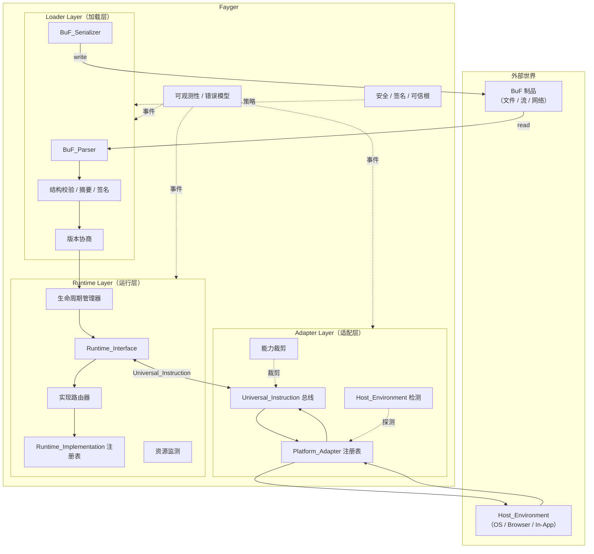

# 第 2 章 总体架构

## 2.1 三层划分

Fayger 在垂直方向被划分为三层。每一层在自己的分工内完成职责，层与层之间只通过明确定义的契约通信。



## 2.2 各层职责

### 加载层（Loader Layer）

- 通过 *BuF_Source* 抽象从任意存储后端读取 BuF（本地文件、HTTP Range、对象存储、IPFS、用户自定义后端）。
- 把字节流解析为内存对象。
- 校验结构合法性、内容摘要、签名。
- 与当前 Fayger 协商 BuF schema 与 Runtime_Interface 版本。
- 根据调用方提供的 *LoadProfile*，按 Section 粒度选择被加载的子集，跳过当前运行环境不需要或装不下的 Section。
- 根据 *LoadStrategy* 选择一次性读完（Eager）或仅读取头部 + 索引、运行时按需读取段体（Lazy）。
- 把已就绪的 BuF 内存对象交给运行层。
- 反向能力：把内存对象重新序列化回字节流，用于工具链回写、缓存或重打包。

### 运行层（Runtime Layer）

- 暴露 *Runtime_Interface* 作为语言无关的契约。
- 维护 *Runtime_Implementation* 注册表，按 BuF_Manifest 中的策略路由到具体实现。
- 管理每个 BuF_Instance 的生命周期（Loaded → Initialized → Running → Suspended → Terminated / Failed）。
- 监测每个实例的资源使用，按 BuF_Manifest 中的配额执行限流或暂停。
- 通过 Universal_Instruction 与适配层通信，自身不依赖任何具体宿主。

### 适配层（Adapter Layer）

- 维护一组 *Platform_Adapter*，每个对应一类终端 / 操作系统 / 宿主。
- 启动时检测当前 Host_Environment，匹配并选用合适的适配器。
- 把运行层产生的 Universal_Instruction 翻译为系统调用，把宿主事件归一化回 Universal_Event。
- 对 BuF 声明的能力集合执行裁剪，得到当前宿主下实际可用的能力子集。

## 2.3 调用方向与依赖规则

依赖方向是设计能否长期演化的关键。Fayger 采用如下硬性规则：

- **加载层 → 运行层**：单向。加载层完成后把 BuF 内存对象交付出去，不持有 BuF_Instance。
- **运行层 ↔ 适配层**：通过 Universal_Instruction 与 Universal_Event 数据类型双向通信。运行层不直接 import 任何 Platform_Adapter 类型。
- **运行层 → 加载层**：禁止。如果运行层需要再次序列化 BuF（例如热更新），通过加载层暴露的服务接口调用，而不是反向引用其内部类型。
- **适配层 → 宿主**：单向。Platform_Adapter 持有宿主 SDK 与系统调用引用；运行层永远不直接 import 宿主库。
- **横切层（可观测性 / 安全）→ 三层**：通过事件总线与策略接口侵入。三层向外发布事件、向横切层查询策略，但不反向依赖横切层的具体实现。

这套规则的核心目的是：**新增一种宿主不应该改动运行层；更换一种运行层实现不应该改动适配层**。

## 2.4 借鉴的体系

### 借鉴 JVM 的链式加载阶段

加载层在内部进一步切分为类似 JVM 的阶段，便于错误定位与单测：

```
Read(Header/Manifest/Index) → Parse → Verify(Structural)
  → Verify(Digest of Header/Manifest/Index) → Verify(Signature)
  → NegotiateVersion → Select(Sections by LoadProfile) → Resolve(Dependencies)
  → Read(Selected Section Bodies)?  → HandOff(to Runtime)
```

`Select(Sections by LoadProfile)` 阶段根据当前终端能力与体积约束筛选要加载的 Section。`Read(Selected Section Bodies)` 仅在 LoadStrategy = Eager 时执行；Lazy 模式下被选中段的读取与校验推迟到首次访问。每一阶段失败都产生带阶段标签的错误，进入统一错误模型（见第 6 章）。

### 借鉴 Docker / OCI 的制品组织

BuF 制品的物理组织对应 OCI Image：

| OCI 概念 | BuF 对应物 |
| --- | --- |
| Image Manifest | BuF_Manifest |
| Image Config | BuF_Manifest 中的 `runtime` / `capabilities` / `quotas` 字段 |
| Layers | BuF Sections（code / data / assets / signature） |
| Distribution Spec | 第一阶段以单文件制品为基线，未来扩展 |
| Runtime Spec | Runtime_Interface |
| containerd | Runtime_Layer（生命周期管理 + 路由） |
| runc | Runtime_Implementation（具体执行器） |

### 借鉴 WASM / WASI 的能力安全模型

适配层采用 capability-based security：

- BuF_Manifest 声明 `requested_capabilities`（如 `fs.read`、`net.http`、`ui.dom`）。
- Platform_Adapter 声明 `available_capabilities`。
- 实际授予的能力 = `requested ∩ available ∩ host_policy`，三者皆不为空集时才允许进入 `Running`。
- 未声明的能力对 BuF 不可见（默认拒绝），与 WASI 的 host import 显式注入语义一致。

## 2.5 第一阶段范围与非目标

**第一阶段覆盖**：

- 单 BuF 加载与执行，多 BuF_Instance 并发但默认无共享。
- 解释执行路径，预留 ExecutionStrategy 抽象以便未来加入 JIT。
- 桌面 / 服务器 / 浏览器 / In-App 四类内置 Platform_Adapter。
- 同步与异步指令派发，单进程内多实例隔离。

**第一阶段非目标**：

- 跨 BuF_Instance 的共享内存与 IPC 协议。
- JIT 编译与机器码生成。
- 分布式调度与多节点 Fayger 协同。
- BuF 的差量分发与分层缓存（先以单文件制品为基线，预留分层结构）。
