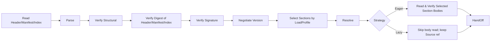
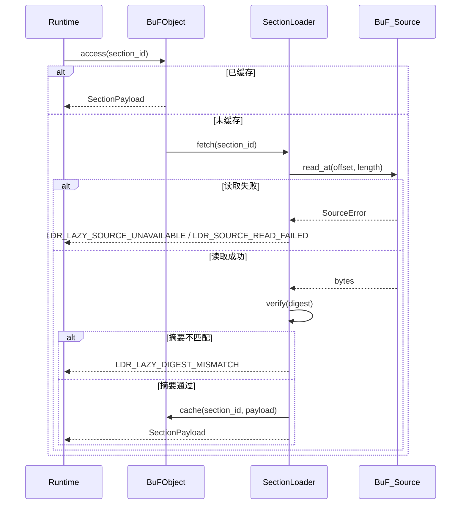

# 第 3 章 加载层

加载层是 Fayger 与外部 BuF 制品之间的边界。它的职责是：从任意存储后端读取 BuF，按当前运行环境与调用方策略选择加载哪些段、何时加载，把字节变成一个可以被运行层接管的、内部一致的 BuF 内存对象，或者在任意一步失败时给出可定位、可分类的错误。

## 3.1 BuF 制品格式

BuF 采用 **Header + Manifest + Section Index + Sections + Trailer** 的五段式结构，借鉴 JAR / OCI Image / WASM 的复合组织：

```
+------------------------------------------------------------+
| Header        | magic="BUF\0" | format_version | flags     |
|               | manifest_offset, manifest_length            |
|               | section_index_offset, section_index_length  |
+------------------------------------------------------------+
| Manifest      | CBOR-encoded BuFManifest                    |
+------------------------------------------------------------+
| Section Index | [(section_id, kind, offset, length, digest, |
|               |   visibility, profile_constraints)]         |
+------------------------------------------------------------+
| Sections      | [code | data | assets | signature | ...]   |
+------------------------------------------------------------+
| Trailer       | total_length | manifest_digest | crc32     |
+------------------------------------------------------------+
```

设计要点：

- **Magic + Format Version**：前 8 字节固定，便于工具识别与拒绝错误流。
- **Manifest 单独成段**：可在不解码 Sections 段体的情况下完成版本协商、profile 选择与能力裁剪（与 OCI Image Manifest 同构）。
- **Section Index 是 Lazy 模式的可信索引**：每条索引项包含位置、长度、digest、visibility 与 profile_constraints。Section_Index 必须在加载阶段被完整读取并通过整体摘要校验，因为 Lazy 模式下的后续按需读取依赖该索引中的 offset 与 digest。
- **Trailer**：包含整体长度与 Manifest 摘要，用于检测截断与防止"先签名后篡改 Manifest"攻击。
- **编码选择**：Manifest 与 Section_Index 使用 CBOR 的确定性编码模式（RFC 8949 §4.2），保证序列化字节序唯一，是往返一致性的基石。
- **签名作用范围**：Header || Manifest_minus_signature || Section_Index。被跳过或尚未读取的 Section 段体不参与签名计算，因此部分加载与完整加载在签名验证上等价。

## 3.2 BuF_Manifest 字段约定

```idl
struct BuFManifest {
  // 版本协商
  schema_version: SemVer
  runtime_interface_min: SemVer
  deprecation_notice: Option<String>

  // 入口与运行层选择
  entry: EntryPoint
  runtime: RuntimeRequirement {
    preferred_impl: Option<ImplementationId>
    selection_strategy: enum { Strict, PreferThenAny, Any }
  }

  // 能力声明
  capabilities: CapabilitySet
  quotas: Option<ResourceQuota>

  // 内容索引
  sections: List<SectionDescriptor> {
    id: SectionId
    kind: enum { Code, Data, Asset, Signature, Custom(String) }
    digest: Digest
    length: u64
    visibility: SectionVisibility           // Required | Optional
    profile_constraints: ProfileConstraints // 缺省视为无约束
  }

  // 签名（可选）
  signature: Option<SignatureBlock>

  extensions: Map<String, CborValue>
}

struct ProfileConstraints {
  required_capabilities: Set<Capability>
  max_size: Option<u64>
  required_features: Set<Feature>
}
```

`schema_version` 与 `runtime_interface_min` 分别独立演进。前者控制 BuF 格式兼容；后者控制 Runtime_Interface 兼容（与 JVM 中 class file version 与 JVM API level 分离的做法一致）。

## 3.3 加载链

加载层内部按 JVM 风格切分为多个阶段：



各阶段职责：

- **Read Header/Manifest/Index**：通过 BuF_Source 取出 Header / Manifest / Section_Index / Trailer。无论 Eager 还是 Lazy，这一组数据都必须在 load 调用返回前读完。
- **Parse**：解析 Manifest 与 Section_Index（不解码段体）。
- **Verify Structural**：检查 magic、版本字段、Section 边界、Manifest 必填字段。
- **Verify Digest of Header/Manifest/Index**：校验 Header、Manifest、Section_Index 的整体摘要（通过 Trailer 中的 `manifest_digest` 等字段）。每个 Section 段体的 digest 在该段被实际读取时校验。
- **Verify Signature**：当 Manifest 含签名信息或处于强制签名模式时执行。签名作用范围只覆盖头部三段，不依赖 Section 段体是否被读取。
- **Negotiate Version**：检查 schema 版本与 Runtime_Interface 最低版本是否兼容。
- **Select Sections by LoadProfile**：按调用方传入的 LoadProfile 与当前 Host_Environment 决定 Section 的选中集合，详见 3.7。
- **Resolve**：解析 BuF 之间的依赖（第一阶段为单 BuF，预留接口）。
- **Read Selected Section Bodies**：仅 Eager 模式执行；逐段从 BuF_Source 读取并校验 digest。
- **HandOff**：把内存对象提交给运行层。Lazy 模式下对象内部持有 BuF_Source 引用与 SectionLoader。

每一阶段失败都在错误对象中标注阶段名与定位信息，并在 `context.phase` 中标注 `eager` 或 `lazy`。

## 3.4 BuF_Source：多源存储抽象

```idl
interface BuF_Source {
  read_at(offset: u64, length: u64) -> Result<Bytes, SourceError>
  length() -> Result<u64, SourceError>
  stat() -> Result<SourceStat, SourceError>     // 可选
  close() -> Result<(), SourceError>             // 可选
}
```

设计要点：

- 加载层只依赖 `read_at` 与 `length` 两个最小操作。
- 任何能提供随机访问读的存储介质都可以作为 BuF_Source：本地文件、HTTP Range 请求、对象存储 SDK、IPFS 网关、嵌入式设备的分块 Flash、用户自定义后端。
- BuF_Source 不要求实现 stream 顺序读，因为 Lazy 模式按 offset 跳读。
- 对小型设备（无人机、摄像头），BuF_Source 实现可以做带 LRU 的小缓存或直接走分块 Flash，加载层不感知具体策略。

## 3.5 BuF_Parser 与 BuF_Serializer

```idl
interface BuF_Parser {
  parse(bytes: Bytes) -> Result<BuFObject, ParseError>
}

interface BuF_Serializer {
  serialize(obj: BuFObject) -> Result<Bytes, SerializeError>
}
```

在 LoaderPipeline 内部，Parser 通常以"取一段 → 解析一段"的方式调用 BuF_Source；纯字节流的 `parse(bytes)` 是单元测试与工具链场景下的简化入口。

### 内存对象（含部分加载）

```idl
struct BuFObject {
  manifest: BuFManifest
  raw_header: Header
  raw_trailer: Trailer

  selected_sections: Set<SectionId>
  skipped_sections: List<SkipRecord>     // (id, reasons)
  strategy: LoadStrategy
  source_ref: Option<BuF_Source>          // 仅 Lazy 模式持有
  loader: Option<SectionLoader>           // 仅 Lazy 模式持有
  sections: Map<SectionId, SectionPayload> // Eager 全量；Lazy 按需缓存
}

enum SkipReason {
  CapabilityNotGranted, OverMaxSize, FeatureMissing, ExplicitlyDisabled
}
```

往返一致性在部分加载下的语义：等价关系按 `selected_sections` 范围比较，被跳过的 Section 不参与对比，但 `skipped_sections` 列表本身参与对比。

## 3.6 LoaderPipeline 接口

```idl
struct LoadProfile {
  target_class: TargetClass             // desktop | server | browser | inapp | embedded | drone | camera | …
  capabilities: Set<Capability>
  max_section_bytes: Option<u64>
  features: Set<Feature>
}

enum LoadStrategy { Eager, Lazy }
enum SectionVisibility { Required, Optional }

struct LoaderPolicy {
  require_signature: bool
  trusted_roots: TrustedRootSet
  allowed_schema_versions: VersionRange
}

interface LoaderPipeline {
  load(
    source: BuF_Source,
    profile: LoadProfile,
    strategy: LoadStrategy,
    policy: LoaderPolicy
  ) -> Result<BuFObject, LoaderError>
}
```

`load` 在调用返回前一定会读取并校验 Header / Manifest / Section_Index。是否在返回前读取 Section 段体取决于 `strategy`。

## 3.7 部分加载：按运行环境选择 Section

终端形态多样，性能差距巨大：桌面机器可以加载完整 BuF，无人机或摄像头则可能只需要 BuF 中的"控制 + 视频编解码"段。Section 选择算法：

对每个 `s ∈ manifest.sections`，定义谓词

```
fits(s) = s.profile_constraints.required_capabilities ⊆ profile.capabilities
        ∧ (s.profile_constraints.max_size ∉ 已设置 ∨ s.length ≤ s.profile_constraints.max_size)
        ∧ s.profile_constraints.required_features ⊆ profile.features
```

选择结果：

- `selected = { s : fits(s) }`，进入 `BuFObject.selected_sections`。
- `s ∈ sections \ selected ∧ s.visibility == Required` ⟹ load 失败，返回 `LDR_PROFILE_REQUIRED_SECTION_MISSING`，错误 context 含 `section_id` 与未满足的约束项。
- `s ∈ sections \ selected ∧ s.visibility == Optional` ⟹ 进入 `skipped_sections`，记录原因（CapabilityNotGranted / OverMaxSize / FeatureMissing / ExplicitlyDisabled）。

选择是确定性的：相同 (manifest, host_env, profile) 下，selected 与 skipped_sections 完全相同。

### 用例

| 终端 | 典型 LoadProfile | 选择行为 |
| --- | --- | --- |
| 桌面 | capabilities 全集，max_section_bytes 不设 | 选中所有 Section |
| 服务器 | 禁用 ui，max_section_bytes 不设 | 跳过 ui 资源段（若声明依赖 ui） |
| 浏览器 | 仅 net.fetch / net.websocket / ui.dom，max_section_bytes ≈ 8 MiB | 跳过过大资源段，跳过依赖 proc 能力的段 |
| 无人机 | 极小 capabilities + max_section_bytes ≈ 1 MiB + features.realtime | 仅加载 control 与 codec 段，跳过教学资源 |
| 摄像头 | capabilities 仅 io.frame + crypto + net.rtsp | 仅加载视频处理与上行段 |

## 3.8 加载策略：Eager vs Lazy

### Eager

- `load` 调用返回前读取并校验所有 `selected_sections` 的段体。
- 适合 BuF 体量小、启动后无网络访问需求、或希望"一次到位"。
- 加载阶段错误的 `phase == "eager"`。

### Lazy

- `load` 调用返回前仅读取并校验 Header / Manifest / Section_Index。
- 被选中段在第一次访问时由 SectionLoader 触发读取与 digest 校验。
- 适合 BuF 体量大、按需运行、或源在远端（HTTP / 对象存储）。
- 后续访问产生的错误 `phase == "lazy"`，与启动期错误可被独立处理。

```idl
interface SectionLoader {
  fetch(id: SectionId) -> Result<SectionPayload, LoaderError>
  is_loaded(id: SectionId) -> bool
  loaded_ids() -> Set<SectionId>
}
```

### Lazy 模式按需读取流程



### Eager / Lazy 等价性

对相同 (source, profile, policy)，无论 strategy 取 Eager 还是 Lazy：

- `selected_sections` 与 `skipped_sections` 完全相同。
- 把 Lazy 结果按 `selected_sections` 全部触发一次读取后，与 Eager 结果在 sections 上逐字节相等。
- Lazy 仅在时间上推迟读取与校验，不引入语义差异。

这条性质用属性测试持续验证。

## 3.9 摘要与签名校验

### 摘要

- Header / Manifest / Section_Index 的整体摘要在 load 阶段一定校验。
- 每个 Section 段体的 digest 来自 Section_Index 中的不可变快照：Eager 模式在 load 阶段统一校验，Lazy 模式在首次访问时校验。
- 任一段不匹配返回 `LDR_DIGEST_MISMATCH`（Eager）或 `LDR_LAZY_DIGEST_MISMATCH`（Lazy），错误上下文包含失败的 `section_id`。

### 签名

签名作用范围是 `Header || Manifest_minus_signature || Section_Index`。这意味着：

- 即使部分加载，签名验证依然完整。
- 跳过的 Section 不影响签名结果。
- 调整 Section_Index 中的 offset / length / digest 都会让签名失效。

签名校验的决策：

| 条件 | 期望结果 |
| --- | --- |
| 强制签名模式开启 ∧ 无签名 | `Err(LDR_SIGNATURE_FAIL)`，原因 `MissingSignature` |
| 有签名 ∧ 验证失败 | `Err(LDR_SIGNATURE_FAIL)`，原因 `InvalidSignature` |
| 有签名 ∧ 验证通过 | `Ok` |
| 强制签名模式关闭 ∧ 无签名 | `Ok` |

可信根集合由 *TrustStore* 维护，更新后下一次加载即生效（详见第 7 章）。

**关键顺序**：签名校验先于 Section 选择。先按整体 Manifest 签名验证制品来源，再据 LoadProfile 决定加载哪些 Section。这避免基于"被选中子集"的弱化签名语义。

## 3.10 版本协商

版本协商使用一张决策表：

| 条件 | 期望结果 |
| --- | --- |
| schema 版本不在支持范围 | `Err(LDR_SCHEMA_UNSUPPORTED)`，含期望范围 |
| Runtime_Interface 最低版本高于当前 | `Err(LDR_RUNTIME_VERSION_TOO_HIGH)`，含 required / provided |
| schema 在支持范围且未弃用，Runtime 满足 | `Ok` |
| schema 已弃用但仍受支持 | `Ok`，附弃用提示 |

弃用提示通过 `BuFObject.manifest.deprecation_notice` 透出，便于上层工具 surface 给用户。

## 3.11 错误码

加载层产生的稳定错误码：

| 错误码 | 触发条件 |
| --- | --- |
| `LDR_PARSE_FAIL` | BuF 字节流不符合格式规范 |
| `LDR_DIGEST_MISMATCH` | Section 摘要不匹配（Eager 阶段） |
| `LDR_LAZY_DIGEST_MISMATCH` | Section 摘要不匹配（Lazy 首次访问） |
| `LDR_SIGNATURE_FAIL` | 签名缺失（强制模式下）或签名无效 |
| `LDR_SCHEMA_UNSUPPORTED` | schema 版本不在支持范围 |
| `LDR_RUNTIME_VERSION_TOO_HIGH` | 所需 Runtime_Interface 高于当前提供 |
| `LDR_MISSING_REQUIRED_FIELD` | 序列化时 Manifest 缺必填字段 |
| `LDR_PROFILE_REQUIRED_SECTION_MISSING` | 当前 profile 下 Required Section 不可加载 |
| `LDR_LAZY_SOURCE_UNAVAILABLE` | Lazy 后续访问 BuF_Source 不可用 |
| `LDR_SOURCE_READ_FAILED` | BuF_Source 读取错误（Eager 或 Lazy） |

每个错误的 `context` 至少包含失败定位与原因键值对，并通过 `context.phase = "eager" | "lazy"` 标注阶段，便于工具链一致诊断。
