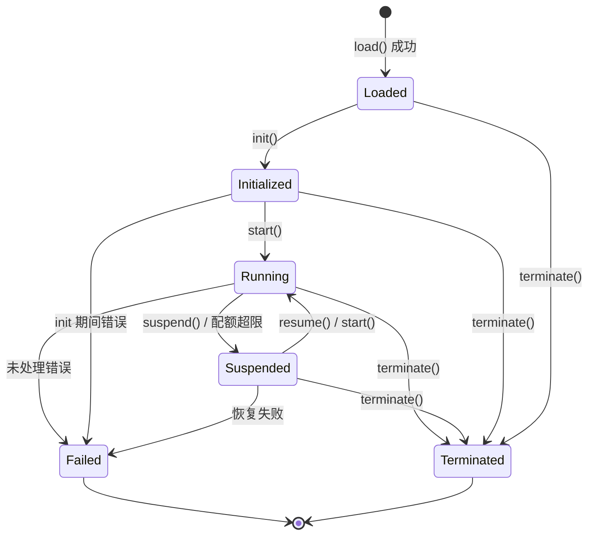

# 第 4 章 运行层

运行层是 BuF 语义的执行者。它向上接收加载层交付的 BuF_Object，向下通过 Universal_Instruction 与适配层通信，自身不依赖任何具体宿主。

## 4.1 Runtime_Interface（语言中立契约）

Runtime_Interface 是运行层对外的稳定契约。所有 Runtime_Implementation 必须以语义等价的方式实现这份契约，无论它使用 Rust trait、Go interface、TypeScript interface 还是其他语言机制。

```idl
interface Runtime_Interface {
  // 元信息
  rt_version() -> RuntimeInterfaceVersion
  capabilities() -> Set<RuntimeCapability>

  // 生命周期
  load(obj: BuFObject) -> Result<InstanceId, RuntimeError>
  init(id: InstanceId) -> Result<(), RuntimeError>
  start(id: InstanceId) -> Result<(), RuntimeError>
  suspend(id: InstanceId) -> Result<(), RuntimeError>
  resume(id: InstanceId) -> Result<(), RuntimeError>
  terminate(id: InstanceId) -> Result<(), RuntimeError>

  // 状态查询
  state(id: InstanceId) -> Result<LifecycleState, RuntimeError>
  failure_info(id: InstanceId) -> Result<Option<FailureInfo>, RuntimeError>

  // 与适配层通信
  emit(id: InstanceId, instr: UniversalInstruction) -> Result<UniversalReply, AdapterError>
  on_event(id: InstanceId, event: UniversalEvent) -> Result<(), RuntimeError>
}
```

设计风格上同时借鉴：

- **OCI Runtime Spec** 的"配置 + 命令"分离：load 提交配置，init / start / suspend / resume / terminate 是命令。
- **JVM 执行引擎** 的状态查询习惯：state 与 failure_info 在任意时刻都可查询。

## 4.2 Runtime_Implementation 注册与路由

```idl
interface RuntimeRegistry {
  register(impl: Runtime_Implementation) -> Result<RegistrationId, RegistryError>
  list() -> List<RuntimeImplementationDescriptor>
  resolve(manifest: BuFManifest) -> Result<RegistrationId, RegistryError>
}
```

### 注册时的方法完备性校验

注册时由 RuntimeRegistry 校验候选实现是否覆盖 Runtime_Interface 的全部必需方法：

- 令 `R` 为 Runtime_Interface 必需方法集合，`I = implemented_methods(impl)`。
- `register(impl)` 成功 当且仅当 `R ⊆ I`。
- 否则返回 `RT_IMPL_MISSING_METHODS`，并在 `context.missing_methods` 中给出 `R \ I`。

这个校验是注册时一次完成的，运行期不再付出代价。

### 路由策略

BuF_Manifest 中通过 `runtime.preferred_impl` 与 `runtime.selection_strategy` 表达对运行层实现的偏好。`resolve(manifest)` 的行为：

- `Strict`：必须选用 `preferred_impl`，且其与 manifest 兼容；否则返回 `RT_IMPL_NOT_FOUND`。
- `PreferThenAny`：优先 `preferred_impl`；若不可用，回退到任意兼容实现。
- `Any`：在所有兼容实现中任选其一。

"兼容"指实现的 `rt_version()` ≥ `manifest.runtime_interface_min` 且 `capabilities()` 覆盖 manifest 的最小能力集。

同一个 Fayger 实例可同时存在多个已注册实现（例如一个 Rust 实现配桌面，一个 TypeScript 实现配浏览器）。具体路由结果对调用方应当是可预测、可调试的。

## 4.3 BuF_Instance 生命周期

### 状态机



### 合法迁移表

| 当前状态 | 允许的目标状态 |
| --- | --- |
| Loaded | Initialized, Terminated, Failed |
| Initialized | Running, Terminated, Failed |
| Running | Suspended, Terminated, Failed |
| Suspended | Running, Terminated, Failed |
| Terminated | （终态） |
| Failed | （终态） |

非法迁移示例：`Loaded → Running`（缺少 init）、`Terminated → 任意`、`Failed → Running`。

收到非法迁移指令时返回 `RT_ILLEGAL_TRANSITION`，错误 context 包含 `current_state` 与 `allowed_set`，状态保持不变。

### 失败状态

进入 `Failed` 的实例必须保留：

- 触发失败的最后一条 Universal_Instruction。
- 触发失败的错误对象（含整条 cause 链）。

这些信息通过 `failure_info(id)` 查询，直到实例被显式销毁。

## 4.4 BuF_Instance 数据区与隔离

每个 BuF_Instance 拥有独立的 RuntimeDataArea：

- 独立的堆 / 调用栈 / 句柄表。
- 独立的指令派发队列。
- 独立的资源使用计数器。

不同实例之间默认无共享对象指针。这一点借鉴 JVM 每线程独立 PC / 栈、每实例独立方法区的做法。

形式化地，对任意两个并发存在的实例 `i₁`、`i₂`：

```
data_area(i₁) ∩ data_area(i₂) == ∅
```

且对 `i₁` 的任何写操作都不会改变 `data_area(i₂)` 中的任何字节。这是测试阶段的核心隔离性属性之一。

## 4.5 资源监测与配额

```idl
interface ResourceMonitor {
  attach(id: InstanceId, quota: ResourceQuota)
  sample(id: InstanceId) -> ResourceUsage
}
```

监测策略：

- 当 BuF_Manifest 声明了 CPU / 内存 / I/O 配额时，`ResourceMonitor` 周期性采样。
- 任一维度超限时，发出 `QuotaExceeded` 事件，并由生命周期管理器把实例迁移至 `Suspended`。
- 暂停事件的 `context.resource` 等于首次超限的资源类型，`context.usage` 等于首次超限时的采样值。

资源监测使用宿主能力（cgroups、浏览器 Performance API、平台计时器等），具体由对应 Platform_Adapter 提供。运行层只消费归一化后的采样值。

## 4.6 实例之间的故障隔离

任一实例进入 `Failed` 不应影响其他处于 `Running` 状态的实例：

- 故障实例的资源由 LifecycleManager 单独回收。
- 其他实例的 Universal_Instruction 派发不受影响。
- 事件总线对故障实例与正常实例分别归类，避免互相阻塞。

形式化地：N 个实例并发运行，其中任一 `iₖ` 故障，则其余 `iⱼ`（`j ≠ k`）的状态时间线与 Universal_Instruction 序列与无故障基线一致。

## 4.7 与适配层的接口形态

运行层向适配层发出 `UniversalInstruction`，适配层回送 `UniversalReply` 或 `UniversalEvent`：

```idl
fn emit(id: InstanceId, instr: UniversalInstruction) -> Result<UniversalReply, AdapterError>
fn on_event(id: InstanceId, event: UniversalEvent) -> Result<(), RuntimeError>
```

运行层只依赖这两个数据类型，不依赖任何具体 Platform_Adapter 类型。这条规则用静态依赖检查保证（见第 8 章工具链建议）。

## 4.8 错误码

运行层产生的稳定错误码：

| 错误码 | 触发条件 |
| --- | --- |
| `RT_ILLEGAL_TRANSITION` | 非法的生命周期迁移 |
| `RT_IMPL_NOT_FOUND` | 路由策略未找到匹配实现 |
| `RT_IMPL_MISSING_METHODS` | 注册的实现缺必需方法 |
| `RT_QUOTA_EXCEEDED` | 资源使用超限，触发 Suspended |
| `RT_INSTANCE_FAILED` | 实例进入 Failed |
