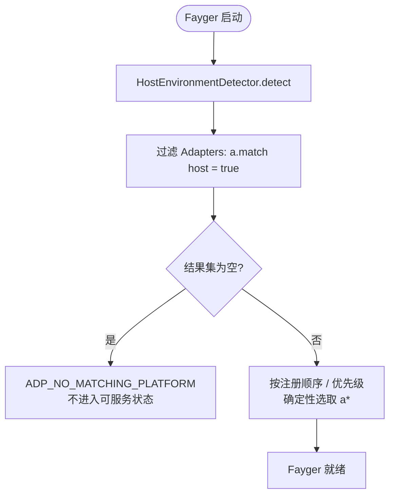
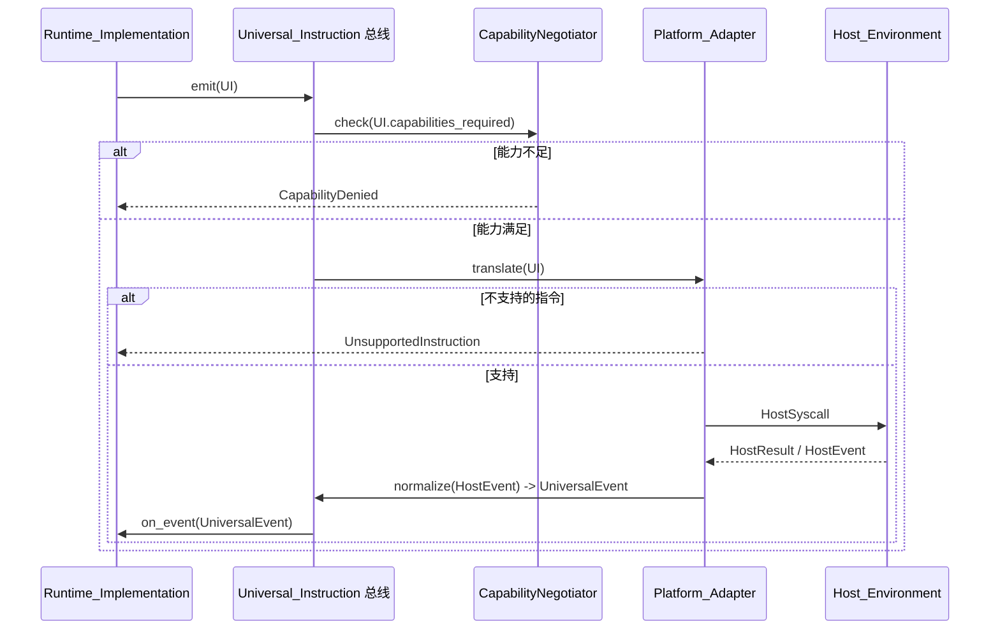

# 第 5 章 适配层

适配层是 Fayger 与 Host_Environment 之间的边界。它接收运行层发出的 Universal_Instruction，把它翻译成宿主能理解的系统调用；同时把宿主产生的事件归一化为 Universal_Event 回送运行层。

新增一种宿主只需要新增一个 Platform_Adapter，运行层与加载层无需任何改动。

## 5.1 Universal_Instruction 数据形态

```idl
struct UniversalInstruction {
  category: InstructionCategory
  opcode: u16
  operands: TLV[]
  capabilities_required: Set<Capability>
}

struct UniversalEvent {
  category: EventCategory
  opcode: u16
  payload: TLV[]
}
```

设计要点：

- **category** 是粗粒度分类（io / net / ui / time / random / crypto / proc / host）。
- **opcode** 是类内编号，2 字节，预留高位作为实验性指令。
- **operands** 是 TLV（type-length-value）序列，便于跨语言解码与扩展。
- **capabilities_required** 是这条指令需要的能力集，作为能力裁剪的输入。

### 类别集合（第一阶段）

| 类别 | 说明 | 借鉴 |
| --- | --- | --- |
| `io` | 文件 / 标准流 | POSIX read / write |
| `net` | 网络 I/O | WASI sock_* |
| `ui` | UI 渲染与输入 | DOM / 终端 TUI / Canvas |
| `time` | 时钟与定时器 | clock_time_get |
| `random` | 随机数 | random_get |
| `crypto` | 加密原语 | WASI crypto |
| `proc` | 进程 / 线程 / 信号 | POSIX |
| `host` | 宿主特定调用 | JNI / extism |

8 个类别中预留 8 位用于未来扩展。

### 编码

每条指令以下述布局编码：

```
+--------+--------+----------+-------------------+
| cat(1) | op(2)  | caps(2)  | operands(TLV...)  |
+--------+--------+----------+-------------------+
```

- `cat`：1 字节，预留高位标志位。
- `op`：2 字节。
- `caps`：2 字节能力位图（第一阶段使用低位 16 项；超过则使用扩展段）。
- `operands`：每个 operand 为 `(type:1, length:varint, value)`。

## 5.2 Platform_Adapter 抽象

```idl
interface Platform_Adapter {
  descriptor() -> AdapterDescriptor
  match(host: HostEnvironment) -> bool
  translate(instr: UniversalInstruction) -> Result<HostSyscall, AdapterError>
  normalize(raw: HostEvent) -> Result<UniversalEvent, AdapterError>
}

struct AdapterDescriptor {
  platform_id: String
  supported_capabilities: Set<Capability>
  supported_instructions: Set<InstructionId>
}
```

每个适配器对自己支持的能力与指令集自描述，使能力裁剪与"不支持指令"决策都成为本地查表操作，不依赖运行期试错。

## 5.3 Host_Environment 检测与适配选择

```idl
interface HostEnvironmentDetector {
  detect() -> HostEnvironment
}

struct HostEnvironment {
  platform_id: String
  os_kind: OsKind
  arch: Arch
  sandbox_kind: SandboxKind
  runtime_features: Set<Feature>
}
```

启动时的选择流程：



确定性选择指：在同一组适配器与同一个 Host_Environment 下，多次启动选出的适配器一致。这避免了"幽灵适配器"问题。

## 5.4 能力裁剪

```idl
interface CapabilityNegotiator {
  negotiate(
    requested: Set<Capability>,
    available: Set<Capability>,
    policy: HostPolicy
  ) -> NegotiationResult
}

struct NegotiationResult {
  granted: Set<Capability>
  denied: Set<Capability>
  warnings: List<Capability>
}
```

裁剪的集合代数：

- `granted = requested ∩ available ∩ policy`
- `denied = requested \ granted`
- `warnings`：在宿主上以受限形式提供的能力（例如浏览器 fetch 限制下的 `net.http`）。

如果 `manifest.required_capabilities \ granted ≠ ∅`，`start()` 必须返回错误，错误 context.missing 等于差集，实例不进入 Running。这是"能力不足时禁止启动"的硬约束。

未声明的能力对 BuF 不可见（默认拒绝），与 WASI 的 host import 显式注入语义一致。

## 5.5 双向翻译流程



要点：

- 能力检查发生在 translate 之前，避免不必要的下沉调用。
- "不支持指令" 是一个确定性的本地决策（查表），不会触发任何宿主调用。
- 宿主事件经过 `normalize` 才回到运行层，运行层永远不接触原始宿主事件结构。

## 5.6 第一阶段内置适配器

| 适配器 | 适用场景 | 能力裁剪要点 |
| --- | --- | --- |
| **NativeDesktop_Adapter** | Linux / macOS / Windows 桌面 | 能力近似全集，`ui` / `proc` / `io` / `net` 完整可用 |
| **Server_Adapter** | 无 GUI 的服务器场景 | 禁用 `ui` 类别，`proc` 受策略限制 |
| **Browser_Adapter** | 基于 Web API | 禁用 `proc` 与大部分 `io`，`net` 受 fetch / WebSocket 限制；强能力裁剪 |
| **InApp_Adapter** | 嵌入到宿主应用进程 | 能力由宿主显式注入，最严格；`host` 类别的可用 opcode 由宿主声明 |

这些适配器作为参考实现存在。第三方仍可注册自己的适配器，例如嵌入式终端、特定 IDE 内嵌等。

## 5.7 跨平台一致性

同一个 BuF 在不同 Platform_Adapter 上加载并执行，运行层观察到的 Lifecycle_State 序列与发出的 Universal_Instruction 序列必须一致：

- 任何会导致序列偏离的差异，必须由"能力裁剪"在 start 前拒绝，而不是在执行中悄悄发散。
- 任何看似"等价但路径不同"的优化，禁止把不同路径暴露到 Universal_Instruction 序列中。

这条性质用属性测试以一对 mock 适配器在能力相同的前提下并行运行，比较序列是否相等来验证。

## 5.8 错误码

适配层产生的稳定错误码：

| 错误码 | 触发条件 |
| --- | --- |
| `ADP_NO_MATCHING_PLATFORM` | 没有适配器匹配当前宿主 |
| `ADP_UNSUPPORTED_INSTRUCTION` | 当前适配器不支持该指令 |
| `ADP_CAPABILITY_DENIED` | 能力被裁剪后不足以执行该指令 |
| `ADP_HOST_CALL_FAILED` | 适配器把指令翻译为系统调用后宿主侧失败 |

`ADP_UNSUPPORTED_INSTRUCTION` 必须保证不触发任何宿主调用，仅返回错误。这是"默认拒绝"姿态在指令层的体现。
