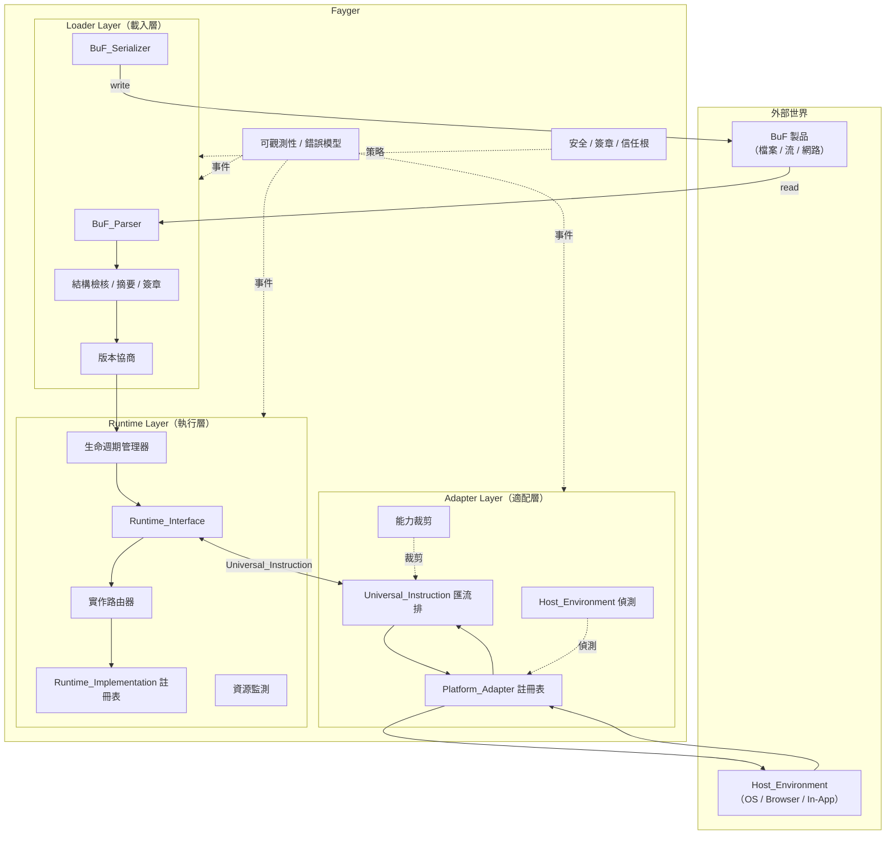

# 第 2 章 總體架構

## 2.1 三層劃分

Fayger 在垂直方向被劃分為三層。每一層在自己的分工內完成職責，層與層之間只透過明確定義的契約溝通。



## 2.2 各層職責

### 載入層（Loader Layer）

- 透過 *BuF_Source* 抽象從任意儲存後端讀取 BuF（本機檔案、HTTP Range、物件儲存、IPFS、使用者自訂後端）。
- 把位元組流解析為記憶體物件。
- 檢核結構合法性、內容摘要、簽章。
- 與當前 Fayger 協商 BuF schema 與 Runtime_Interface 版本。
- 根據呼叫方提供的 *LoadProfile*，按 Section 粒度選擇被載入的子集，跳過當前執行環境不需要或裝不下的 Section。
- 根據 *LoadStrategy* 選擇一次性讀完（Eager）或僅讀取標頭 + 索引、執行時按需讀取段體（Lazy）。
- 把已就緒的 BuF 記憶體物件交給執行層。
- 反向能力：把記憶體物件重新序列化回位元組流，用於工具鏈回寫、快取或重新打包。

### 執行層（Runtime Layer）

- 暴露 *Runtime_Interface* 作為語言無關的契約。
- 維護 *Runtime_Implementation* 註冊表，按 BuF_Manifest 中的策略路由到具體實作。
- 管理每個 BuF_Instance 的生命週期（Loaded → Initialized → Running → Suspended → Terminated / Failed）。
- 監測每個實例的資源使用，按 BuF_Manifest 中的配額執行限流或暫停。
- 透過 Universal_Instruction 與適配層溝通，自身不相依任何具體宿主。

### 適配層（Adapter Layer）

- 維護一組 *Platform_Adapter*，每個對應一類終端 / 作業系統 / 宿主。
- 啟動時偵測當前 Host_Environment，比對並選用合適的適配器。
- 把執行層產生的 Universal_Instruction 轉譯為系統呼叫，把宿主事件正規化回 Universal_Event。
- 對 BuF 宣告的能力集合執行裁剪，得到當前宿主下實際可用的能力子集。

## 2.3 呼叫方向與相依規則

相依方向是設計能否長期演化的關鍵。Fayger 採用如下硬性規則：

- **載入層 → 執行層**：單向。載入層完成後把 BuF 記憶體物件交付出去，不持有 BuF_Instance。
- **執行層 ↔ 適配層**：透過 Universal_Instruction 與 Universal_Event 資料型別雙向溝通。執行層不直接 import 任何 Platform_Adapter 型別。
- **執行層 → 載入層**：禁止。如果執行層需要再次序列化 BuF（例如熱更新），透過載入層暴露的服務介面呼叫，而不是反向參照其內部型別。
- **適配層 → 宿主**：單向。Platform_Adapter 持有宿主 SDK 與系統呼叫參照；執行層永遠不直接 import 宿主程式庫。
- **橫切層（可觀測性 / 安全）→ 三層**：透過事件匯流排與策略介面侵入。三層向外發布事件、向橫切層查詢策略，但不反向相依橫切層的具體實作。

這套規則的核心目的是：**新增一種宿主不應該改動執行層；更換一種執行層實作不應該改動適配層**。

## 2.4 借鑑的體系

### 借鑑 JVM 的鏈式載入階段

載入層在內部進一步切分為類似 JVM 的階段，便於錯誤定位與單元測試：

```
Read(Header/Manifest/Index) → Parse → Verify(Structural)
  → Verify(Digest of Header/Manifest/Index) → Verify(Signature)
  → NegotiateVersion → Select(Sections by LoadProfile) → Resolve(Dependencies)
  → Read(Selected Section Bodies)?  → HandOff(to Runtime)
```

`Select(Sections by LoadProfile)` 階段根據當前終端能力與體積約束篩選要載入的 Section。`Read(Selected Section Bodies)` 僅在 LoadStrategy = Eager 時執行；Lazy 模式下被選中段的讀取與檢核延後到首次存取。每一階段失敗都產生帶階段標籤的錯誤，進入統一錯誤模型（見第 6 章）。

### 借鑑 Docker / OCI 的製品組織

BuF 製品的物理組織對應 OCI Image：

| OCI 概念 | BuF 對應物 |
| --- | --- |
| Image Manifest | BuF_Manifest |
| Image Config | BuF_Manifest 中的 `runtime` / `capabilities` / `quotas` 欄位 |
| Layers | BuF Sections（code / data / assets / signature） |
| Distribution Spec | 第一階段以單檔案製品為基線，未來擴充 |
| Runtime Spec | Runtime_Interface |
| containerd | Runtime_Layer（生命週期管理 + 路由） |
| runc | Runtime_Implementation（具體執行器） |

### 借鑑 WASM / WASI 的能力安全模型

適配層採用 capability-based security：

- BuF_Manifest 宣告 `requested_capabilities`（如 `fs.read`、`net.http`、`ui.dom`）。
- Platform_Adapter 宣告 `available_capabilities`。
- 實際授予的能力 = `requested ∩ available ∩ host_policy`，三者皆不為空集時才允許進入 `Running`。
- 未宣告的能力對 BuF 不可見（預設拒絕），與 WASI 的 host import 顯式注入語意一致。

## 2.5 第一階段範圍與非目標

**第一階段涵蓋**：

- 單 BuF 載入與執行，多 BuF_Instance 並發但預設無共享。
- 直譯執行路徑，預留 ExecutionStrategy 抽象以便未來加入 JIT。
- 桌面 / 伺服器 / 瀏覽器 / In-App 四類內建 Platform_Adapter。
- 同步與非同步指令派送，單行程內多實例隔離。

**第一階段非目標**：

- 跨 BuF_Instance 的共享記憶體與 IPC 協定。
- JIT 編譯與機器碼產生。
- 分散式排程與多節點 Fayger 協同。
- BuF 的差量分發與分層快取（先以單檔案製品為基線，預留分層結構）。
