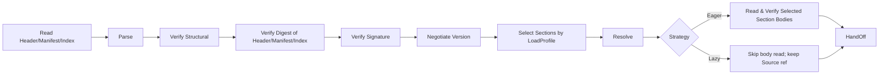
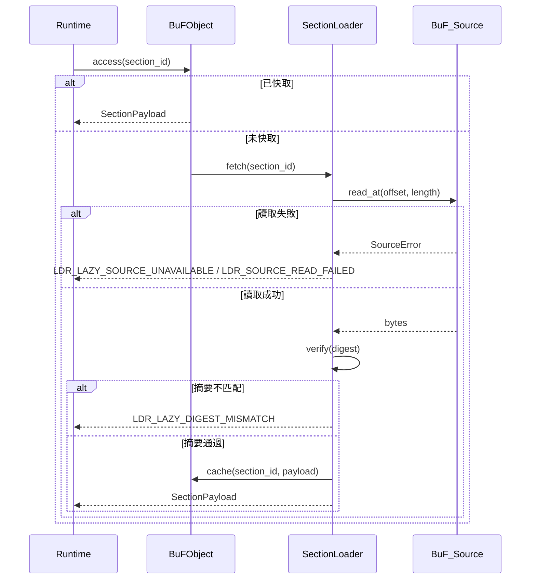

# 第 3 章 載入層

載入層是 Fayger 與外部 BuF 製品之間的邊界。它的職責是：從任意儲存後端讀取 BuF，按當前執行環境與呼叫方策略選擇載入哪些段、何時載入，把位元組變成一個可以被執行層接管的、內部一致的 BuF 記憶體物件，或者在任意一步失敗時給出可定位、可分類的錯誤。

## 3.1 BuF 製品格式

BuF 採用 **Header + Manifest + Section Index + Sections + Trailer** 的五段式結構，借鑑 JAR / OCI Image / WASM 的複合組織：

```
+------------------------------------------------------------+
| Header        | magic="BUF\0" | format_version | flags     |
|               | manifest_offset, manifest_length            |
|               | section_index_offset, section_index_length  |
+------------------------------------------------------------+
| Manifest      | CBOR-encoded BuFManifest                    |
+------------------------------------------------------------+
| Section Index | [(section_id, kind, offset, length, digest, |
|               |   visibility, profile_constraints)]         |
+------------------------------------------------------------+
| Sections      | [code | data | assets | signature | ...]   |
+------------------------------------------------------------+
| Trailer       | total_length | manifest_digest | crc32     |
+------------------------------------------------------------+
```

設計要點：

- **Magic + Format Version**：前 8 位元組固定，便於工具識別與拒絕錯誤流。
- **Manifest 單獨成段**：可在不解碼 Sections 段體的情況下完成版本協商、profile 選擇與能力裁剪（與 OCI Image Manifest 同構）。
- **Section Index 是 Lazy 模式的可信索引**：每條索引項包含位置、長度、digest、visibility 與 profile_constraints。Section_Index 必須在載入階段被完整讀取並透過整體摘要檢核，因為 Lazy 模式下的後續按需讀取相依該索引中的 offset 與 digest。
- **Trailer**：包含整體長度與 Manifest 摘要，用於偵測截斷與防止「先簽章後竄改 Manifest」攻擊。
- **編碼選擇**：Manifest 與 Section_Index 使用 CBOR 的確定性編碼模式（RFC 8949 §4.2），保證序列化位元組序唯一，是往返一致性的基石。
- **簽章作用範圍**：Header || Manifest_minus_signature || Section_Index。被跳過或尚未讀取的 Section 段體不參與簽章運算，因此部分載入與完整載入在簽章驗證上等價。

## 3.2 BuF_Manifest 欄位約定

```idl
struct BuFManifest {
  // 版本協商
  schema_version: SemVer
  runtime_interface_min: SemVer
  deprecation_notice: Option<String>

  // 入口與執行層選擇
  entry: EntryPoint
  runtime: RuntimeRequirement {
    preferred_impl: Option<ImplementationId>
    selection_strategy: enum { Strict, PreferThenAny, Any }
  }

  // 能力宣告
  capabilities: CapabilitySet
  quotas: Option<ResourceQuota>

  // 內容索引
  sections: List<SectionDescriptor> {
    id: SectionId
    kind: enum { Code, Data, Asset, Signature, Custom(String) }
    digest: Digest
    length: u64
    visibility: SectionVisibility           // Required | Optional
    profile_constraints: ProfileConstraints // 預設視為無約束
  }

  // 簽章（可選）
  signature: Option<SignatureBlock>

  extensions: Map<String, CborValue>
}

struct ProfileConstraints {
  required_capabilities: Set<Capability>
  max_size: Option<u64>
  required_features: Set<Feature>
}
```

`schema_version` 與 `runtime_interface_min` 分別獨立演進。前者控制 BuF 格式相容；後者控制 Runtime_Interface 相容（與 JVM 中 class file version 與 JVM API level 分離的做法一致）。

## 3.3 載入鏈

載入層內部按 JVM 風格切分為多個階段：



各階段職責：

- **Read Header/Manifest/Index**：透過 BuF_Source 取出 Header / Manifest / Section_Index / Trailer。無論 Eager 還是 Lazy，這一組資料都必須在 load 呼叫返回前讀完。
- **Parse**：解析 Manifest 與 Section_Index（不解碼段體）。
- **Verify Structural**：檢查 magic、版本欄位、Section 邊界、Manifest 必填欄位。
- **Verify Digest of Header/Manifest/Index**：檢核 Header、Manifest、Section_Index 的整體摘要（透過 Trailer 中的 `manifest_digest` 等欄位）。每個 Section 段體的 digest 在該段被實際讀取時檢核。
- **Verify Signature**：當 Manifest 含簽章資訊或處於強制簽章模式時執行。簽章作用範圍只涵蓋標頭三段，不相依 Section 段體是否被讀取。
- **Negotiate Version**：檢查 schema 版本與 Runtime_Interface 最低版本是否相容。
- **Select Sections by LoadProfile**：按呼叫方傳入的 LoadProfile 與當前 Host_Environment 決定 Section 的選中集合，詳見 3.7。
- **Resolve**：解析 BuF 之間的相依（第一階段為單 BuF，預留介面）。
- **Read Selected Section Bodies**：僅 Eager 模式執行；逐段從 BuF_Source 讀取並檢核 digest。
- **HandOff**：把記憶體物件提交給執行層。Lazy 模式下物件內部持有 BuF_Source 參照與 SectionLoader。

每一階段失敗都在錯誤物件中標註階段名與定位資訊，並在 `context.phase` 中標註 `eager` 或 `lazy`。

## 3.4 BuF_Source：多源儲存抽象

```idl
interface BuF_Source {
  read_at(offset: u64, length: u64) -> Result<Bytes, SourceError>
  length() -> Result<u64, SourceError>
  stat() -> Result<SourceStat, SourceError>     // 可選
  close() -> Result<(), SourceError>             // 可選
}
```

設計要點：

- 載入層只相依 `read_at` 與 `length` 兩個最小操作。
- 任何能提供隨機存取讀取的儲存媒介都可以作為 BuF_Source：本機檔案、HTTP Range 請求、物件儲存 SDK、IPFS 閘道、嵌入式裝置的分塊 Flash、使用者自訂後端。
- BuF_Source 不要求實作 stream 順序讀取，因為 Lazy 模式按 offset 跳讀。
- 對小型裝置（無人機、攝影機），BuF_Source 實作可以做帶 LRU 的小快取或直接走分塊 Flash，載入層不感知具體策略。

## 3.5 BuF_Parser 與 BuF_Serializer

```idl
interface BuF_Parser {
  parse(bytes: Bytes) -> Result<BuFObject, ParseError>
}

interface BuF_Serializer {
  serialize(obj: BuFObject) -> Result<Bytes, SerializeError>
}
```

在 LoaderPipeline 內部，Parser 通常以「取一段 → 解析一段」的方式呼叫 BuF_Source；純位元組流的 `parse(bytes)` 是單元測試與工具鏈場景下的簡化入口。

### 記憶體物件（含部分載入）

```idl
struct BuFObject {
  manifest: BuFManifest
  raw_header: Header
  raw_trailer: Trailer

  selected_sections: Set<SectionId>
  skipped_sections: List<SkipRecord>     // (id, reasons)
  strategy: LoadStrategy
  source_ref: Option<BuF_Source>          // 僅 Lazy 模式持有
  loader: Option<SectionLoader>           // 僅 Lazy 模式持有
  sections: Map<SectionId, SectionPayload> // Eager 全量；Lazy 按需快取
}

enum SkipReason {
  CapabilityNotGranted, OverMaxSize, FeatureMissing, ExplicitlyDisabled
}
```

往返一致性在部分載入下的語意：等價關係按 `selected_sections` 範圍比較，被跳過的 Section 不參與比較，但 `skipped_sections` 列表本身參與比較。

## 3.6 LoaderPipeline 介面

```idl
struct LoadProfile {
  target_class: TargetClass             // desktop | server | browser | inapp | embedded | drone | camera | …
  capabilities: Set<Capability>
  max_section_bytes: Option<u64>
  features: Set<Feature>
}

enum LoadStrategy { Eager, Lazy }
enum SectionVisibility { Required, Optional }

struct LoaderPolicy {
  require_signature: bool
  trusted_roots: TrustedRootSet
  allowed_schema_versions: VersionRange
}

interface LoaderPipeline {
  load(
    source: BuF_Source,
    profile: LoadProfile,
    strategy: LoadStrategy,
    policy: LoaderPolicy
  ) -> Result<BuFObject, LoaderError>
}
```

`load` 在呼叫返回前一定會讀取並檢核 Header / Manifest / Section_Index。是否在返回前讀取 Section 段體取決於 `strategy`。

## 3.7 部分載入：按執行環境選擇 Section

終端形態多樣，效能差距巨大：桌機可以載入完整 BuF，無人機或攝影機則可能只需要 BuF 中的「控制 + 視訊編解碼」段。Section 選擇演算法：

對每個 `s ∈ manifest.sections`，定義謂詞

```
fits(s) = s.profile_constraints.required_capabilities ⊆ profile.capabilities
        ∧ (s.profile_constraints.max_size ∉ 已設定 ∨ s.length ≤ s.profile_constraints.max_size)
        ∧ s.profile_constraints.required_features ⊆ profile.features
```

選擇結果：

- `selected = { s : fits(s) }`，進入 `BuFObject.selected_sections`。
- `s ∈ sections \ selected ∧ s.visibility == Required` ⟹ load 失敗，回傳 `LDR_PROFILE_REQUIRED_SECTION_MISSING`，錯誤 context 含 `section_id` 與未滿足的約束項。
- `s ∈ sections \ selected ∧ s.visibility == Optional` ⟹ 進入 `skipped_sections`，記錄原因（CapabilityNotGranted / OverMaxSize / FeatureMissing / ExplicitlyDisabled）。

選擇是確定性的：相同 (manifest, host_env, profile) 下，selected 與 skipped_sections 完全相同。

### 用例

| 終端 | 典型 LoadProfile | 選擇行為 |
| --- | --- | --- |
| 桌面 | capabilities 全集，max_section_bytes 不設 | 選中所有 Section |
| 伺服器 | 停用 ui，max_section_bytes 不設 | 跳過 ui 資源段（若宣告相依 ui） |
| 瀏覽器 | 僅 net.fetch / net.websocket / ui.dom，max_section_bytes ≈ 8 MiB | 跳過過大資源段，跳過相依 proc 能力的段 |
| 無人機 | 極小 capabilities + max_section_bytes ≈ 1 MiB + features.realtime | 僅載入 control 與 codec 段，跳過教學資源 |
| 攝影機 | capabilities 僅 io.frame + crypto + net.rtsp | 僅載入視訊處理與上傳段 |

## 3.8 載入策略：Eager vs Lazy

### Eager

- `load` 呼叫返回前讀取並檢核所有 `selected_sections` 的段體。
- 適合 BuF 體量小、啟動後無網路存取需求、或希望「一次到位」。
- 載入階段錯誤的 `phase == "eager"`。

### Lazy

- `load` 呼叫返回前僅讀取並檢核 Header / Manifest / Section_Index。
- 被選中段在第一次存取時由 SectionLoader 觸發讀取與 digest 檢核。
- 適合 BuF 體量大、按需執行、或來源在遠端（HTTP / 物件儲存）。
- 後續存取產生的錯誤 `phase == "lazy"`，與啟動期錯誤可被獨立處理。

```idl
interface SectionLoader {
  fetch(id: SectionId) -> Result<SectionPayload, LoaderError>
  is_loaded(id: SectionId) -> bool
  loaded_ids() -> Set<SectionId>
}
```

### Lazy 模式按需讀取流程



### Eager / Lazy 等價性

對相同 (source, profile, policy)，無論 strategy 取 Eager 還是 Lazy：

- `selected_sections` 與 `skipped_sections` 完全相同。
- 把 Lazy 結果按 `selected_sections` 全部觸發一次讀取後，與 Eager 結果在 sections 上逐位元組相等。
- Lazy 僅在時間上延後讀取與檢核，不引入語意差異。

這條性質用屬性測試持續驗證。

## 3.9 摘要與簽章檢核

### 摘要

- Header / Manifest / Section_Index 的整體摘要在 load 階段一定檢核。
- 每個 Section 段體的 digest 來自 Section_Index 中的不可變快照：Eager 模式在 load 階段統一檢核，Lazy 模式在首次存取時檢核。
- 任一段不匹配回傳 `LDR_DIGEST_MISMATCH`（Eager）或 `LDR_LAZY_DIGEST_MISMATCH`（Lazy），錯誤上下文包含失敗的 `section_id`。

### 簽章

簽章作用範圍是 `Header || Manifest_minus_signature || Section_Index`。這意味著：

- 即使部分載入，簽章驗證依然完整。
- 跳過的 Section 不影響簽章結果。
- 調整 Section_Index 中的 offset / length / digest 都會讓簽章失效。

簽章檢核的決策：

| 條件 | 期望結果 |
| --- | --- |
| 強制簽章模式開啟 ∧ 無簽章 | `Err(LDR_SIGNATURE_FAIL)`，原因 `MissingSignature` |
| 有簽章 ∧ 驗證失敗 | `Err(LDR_SIGNATURE_FAIL)`，原因 `InvalidSignature` |
| 有簽章 ∧ 驗證通過 | `Ok` |
| 強制簽章模式關閉 ∧ 無簽章 | `Ok` |

信任根集合由 *TrustStore* 維護，更新後下一次載入即生效（詳見第 7 章）。

**關鍵順序**：簽章檢核先於 Section 選擇。先按整體 Manifest 簽章驗證製品來源，再依 LoadProfile 決定載入哪些 Section。這避免基於「被選中子集」的弱化簽章語意。

## 3.10 版本協商

版本協商使用一張決策表：

| 條件 | 期望結果 |
| --- | --- |
| schema 版本不在支援範圍 | `Err(LDR_SCHEMA_UNSUPPORTED)`，含期望範圍 |
| Runtime_Interface 最低版本高於當前 | `Err(LDR_RUNTIME_VERSION_TOO_HIGH)`，含 required / provided |
| schema 在支援範圍且未棄用，Runtime 滿足 | `Ok` |
| schema 已棄用但仍受支援 | `Ok`，附棄用提示 |

棄用提示透過 `BuFObject.manifest.deprecation_notice` 透出，便於上層工具揭露給使用者。

## 3.11 錯誤碼

載入層產生的穩定錯誤碼：

| 錯誤碼 | 觸發條件 |
| --- | --- |
| `LDR_PARSE_FAIL` | BuF 位元組流不符合格式規範 |
| `LDR_DIGEST_MISMATCH` | Section 摘要不匹配（Eager 階段） |
| `LDR_LAZY_DIGEST_MISMATCH` | Section 摘要不匹配（Lazy 首次存取） |
| `LDR_SIGNATURE_FAIL` | 簽章缺失（強制模式下）或簽章無效 |
| `LDR_SCHEMA_UNSUPPORTED` | schema 版本不在支援範圍 |
| `LDR_RUNTIME_VERSION_TOO_HIGH` | 所需 Runtime_Interface 高於當前提供 |
| `LDR_MISSING_REQUIRED_FIELD` | 序列化時 Manifest 缺必填欄位 |
| `LDR_PROFILE_REQUIRED_SECTION_MISSING` | 當前 profile 下 Required Section 不可載入 |
| `LDR_LAZY_SOURCE_UNAVAILABLE` | Lazy 後續存取 BuF_Source 不可用 |
| `LDR_SOURCE_READ_FAILED` | BuF_Source 讀取錯誤（Eager 或 Lazy） |

每個錯誤的 `context` 至少包含失敗定位與原因鍵值對，並透過 `context.phase = "eager" | "lazy"` 標註階段，便於工具鏈一致診斷。
