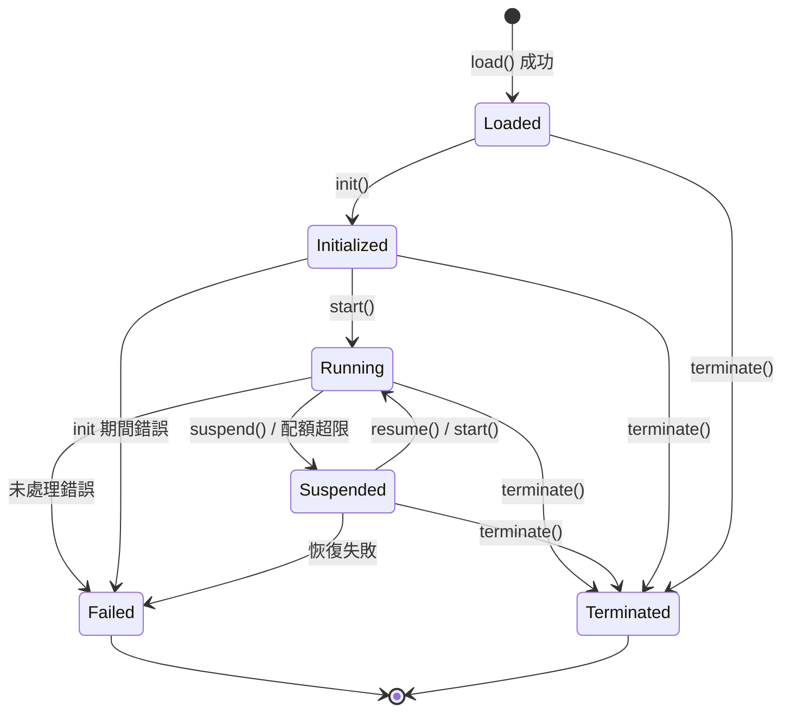

# 第 4 章 執行層

執行層是 BuF 語意的執行者。它向上接收載入層交付的 BuF_Object，向下透過 Universal_Instruction 與適配層溝通，自身不相依任何具體宿主。

## 4.1 Runtime_Interface（語言中立契約）

Runtime_Interface 是執行層對外的穩定契約。所有 Runtime_Implementation 必須以語意等價的方式實作這份契約，無論它使用 Rust trait、Go interface、TypeScript interface 還是其他語言機制。

```idl
interface Runtime_Interface {
  // 中繼資訊
  rt_version() -> RuntimeInterfaceVersion
  capabilities() -> Set<RuntimeCapability>

  // 生命週期
  load(obj: BuFObject) -> Result<InstanceId, RuntimeError>
  init(id: InstanceId) -> Result<(), RuntimeError>
  start(id: InstanceId) -> Result<(), RuntimeError>
  suspend(id: InstanceId) -> Result<(), RuntimeError>
  resume(id: InstanceId) -> Result<(), RuntimeError>
  terminate(id: InstanceId) -> Result<(), RuntimeError>

  // 狀態查詢
  state(id: InstanceId) -> Result<LifecycleState, RuntimeError>
  failure_info(id: InstanceId) -> Result<Option<FailureInfo>, RuntimeError>

  // 與適配層溝通
  emit(id: InstanceId, instr: UniversalInstruction) -> Result<UniversalReply, AdapterError>
  on_event(id: InstanceId, event: UniversalEvent) -> Result<(), RuntimeError>
}
```

設計風格上同時借鑑：

- **OCI Runtime Spec** 的「設定 + 命令」分離：load 提交設定，init / start / suspend / resume / terminate 是命令。
- **JVM 執行引擎** 的狀態查詢習慣：state 與 failure_info 在任意時刻都可查詢。

## 4.2 Runtime_Implementation 註冊與路由

```idl
interface RuntimeRegistry {
  register(impl: Runtime_Implementation) -> Result<RegistrationId, RegistryError>
  list() -> List<RuntimeImplementationDescriptor>
  resolve(manifest: BuFManifest) -> Result<RegistrationId, RegistryError>
}
```

### 註冊時的方法完備性檢核

註冊時由 RuntimeRegistry 檢核候選實作是否涵蓋 Runtime_Interface 的全部必需方法：

- 令 `R` 為 Runtime_Interface 必需方法集合，`I = implemented_methods(impl)`。
- `register(impl)` 成功 若且唯若 `R ⊆ I`。
- 否則回傳 `RT_IMPL_MISSING_METHODS`，並在 `context.missing_methods` 中給出 `R \ I`。

這個檢核是註冊時一次完成的，執行期不再付出代價。

### 路由策略

BuF_Manifest 中透過 `runtime.preferred_impl` 與 `runtime.selection_strategy` 表達對執行層實作的偏好。`resolve(manifest)` 的行為：

- `Strict`：必須選用 `preferred_impl`，且其與 manifest 相容；否則回傳 `RT_IMPL_NOT_FOUND`。
- `PreferThenAny`：優先 `preferred_impl`；若不可用，回退到任意相容實作。
- `Any`：在所有相容實作中任選其一。

「相容」指實作的 `rt_version()` ≥ `manifest.runtime_interface_min` 且 `capabilities()` 涵蓋 manifest 的最小能力集。

同一個 Fayger 實例可同時存在多個已註冊實作（例如一個 Rust 實作配桌面，一個 TypeScript 實作配瀏覽器）。具體路由結果對呼叫方應當是可預測、可除錯的。

## 4.3 BuF_Instance 生命週期

### 狀態機



### 合法遷移表

| 當前狀態 | 允許的目標狀態 |
| --- | --- |
| Loaded | Initialized, Terminated, Failed |
| Initialized | Running, Terminated, Failed |
| Running | Suspended, Terminated, Failed |
| Suspended | Running, Terminated, Failed |
| Terminated | （終態） |
| Failed | （終態） |

非法遷移範例：`Loaded → Running`（缺少 init）、`Terminated → 任意`、`Failed → Running`。

收到非法遷移指令時回傳 `RT_ILLEGAL_TRANSITION`，錯誤 context 包含 `current_state` 與 `allowed_set`，狀態保持不變。

### 失敗狀態

進入 `Failed` 的實例必須保留：

- 觸發失敗的最後一條 Universal_Instruction。
- 觸發失敗的錯誤物件（含整條 cause 鏈）。

這些資訊透過 `failure_info(id)` 查詢，直到實例被顯式銷毀。

## 4.4 BuF_Instance 資料區與隔離

每個 BuF_Instance 擁有獨立的 RuntimeDataArea：

- 獨立的堆疊 / 呼叫堆疊 / 控制代碼表。
- 獨立的指令派送佇列。
- 獨立的資源使用計數器。

不同實例之間預設無共享物件指標。這一點借鑑 JVM 每執行緒獨立 PC / 堆疊、每實例獨立方法區的做法。

形式化地，對任意兩個並發存在的實例 `i₁`、`i₂`：

```
data_area(i₁) ∩ data_area(i₂) == ∅
```

且對 `i₁` 的任何寫入操作都不會改變 `data_area(i₂)` 中的任何位元組。這是測試階段的核心隔離性質之一。

## 4.5 資源監測與配額

```idl
interface ResourceMonitor {
  attach(id: InstanceId, quota: ResourceQuota)
  sample(id: InstanceId) -> ResourceUsage
}
```

監測策略：

- 當 BuF_Manifest 宣告了 CPU / 記憶體 / I/O 配額時，`ResourceMonitor` 週期性取樣。
- 任一維度超限時，發出 `QuotaExceeded` 事件，並由生命週期管理器把實例遷移至 `Suspended`。
- 暫停事件的 `context.resource` 等於首次超限的資源類型，`context.usage` 等於首次超限時的取樣值。

資源監測使用宿主能力（cgroups、瀏覽器 Performance API、平台計時器等），具體由對應 Platform_Adapter 提供。執行層只消費正規化後的取樣值。

## 4.6 實例之間的故障隔離

任一實例進入 `Failed` 不應影響其他處於 `Running` 狀態的實例：

- 故障實例的資源由 LifecycleManager 單獨回收。
- 其他實例的 Universal_Instruction 派送不受影響。
- 事件匯流排對故障實例與正常實例分別歸類，避免互相阻塞。

形式化地：N 個實例並發執行，其中任一 `iₖ` 故障，則其餘 `iⱼ`（`j ≠ k`）的狀態時間軸與 Universal_Instruction 序列與無故障基線一致。

## 4.7 與適配層的介面形態

執行層向適配層發出 `UniversalInstruction`，適配層回送 `UniversalReply` 或 `UniversalEvent`：

```idl
fn emit(id: InstanceId, instr: UniversalInstruction) -> Result<UniversalReply, AdapterError>
fn on_event(id: InstanceId, event: UniversalEvent) -> Result<(), RuntimeError>
```

執行層只相依這兩個資料型別，不相依任何具體 Platform_Adapter 型別。這條規則用靜態相依檢查保證（見第 8 章工具鏈建議）。

## 4.8 錯誤碼

執行層產生的穩定錯誤碼：

| 錯誤碼 | 觸發條件 |
| --- | --- |
| `RT_ILLEGAL_TRANSITION` | 非法的生命週期遷移 |
| `RT_IMPL_NOT_FOUND` | 路由策略未找到匹配實作 |
| `RT_IMPL_MISSING_METHODS` | 註冊的實作缺必需方法 |
| `RT_QUOTA_EXCEEDED` | 資源使用超限，觸發 Suspended |
| `RT_INSTANCE_FAILED` | 實例進入 Failed |
