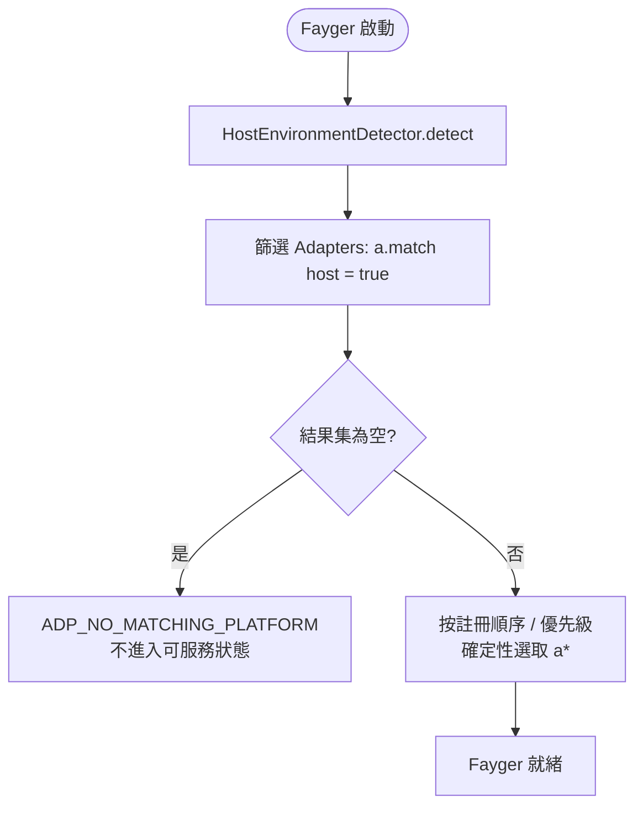
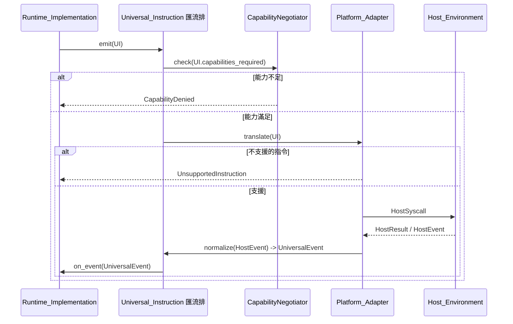

# 第 5 章 適配層

適配層是 Fayger 與 Host_Environment 之間的邊界。它接收執行層發出的 Universal_Instruction，把它轉譯成宿主能理解的系統呼叫；同時把宿主產生的事件正規化為 Universal_Event 回送執行層。

新增一種宿主只需要新增一個 Platform_Adapter，執行層與載入層無需任何改動。

## 5.1 Universal_Instruction 資料形態

```idl
struct UniversalInstruction {
  category: InstructionCategory
  opcode: u16
  operands: TLV[]
  capabilities_required: Set<Capability>
}

struct UniversalEvent {
  category: EventCategory
  opcode: u16
  payload: TLV[]
}
```

設計要點：

- **category** 是粗粒度分類（io / net / ui / time / random / crypto / proc / host）。
- **opcode** 是類內編號，2 位元組，預留高位作為實驗性指令。
- **operands** 是 TLV（type-length-value）序列，便於跨語言解碼與擴充。
- **capabilities_required** 是這條指令需要的能力集，作為能力裁剪的輸入。

### 類別集合（第一階段）

| 類別 | 說明 | 借鑑 |
| --- | --- | --- |
| `io` | 檔案 / 標準流 | POSIX read / write |
| `net` | 網路 I/O | WASI sock_* |
| `ui` | UI 渲染與輸入 | DOM / 終端 TUI / Canvas |
| `time` | 時鐘與計時器 | clock_time_get |
| `random` | 隨機數 | random_get |
| `crypto` | 加密原語 | WASI crypto |
| `proc` | 行程 / 執行緒 / 訊號 | POSIX |
| `host` | 宿主特定呼叫 | JNI / extism |

8 個類別中預留 8 位用於未來擴充。

### 編碼

每條指令以下述配置編碼：

```
+--------+--------+----------+-------------------+
| cat(1) | op(2)  | caps(2)  | operands(TLV...)  |
+--------+--------+----------+-------------------+
```

- `cat`：1 位元組，預留高位旗標位。
- `op`：2 位元組。
- `caps`：2 位元組能力位元圖（第一階段使用低位 16 項；超過則使用擴充段）。
- `operands`：每個 operand 為 `(type:1, length:varint, value)`。

## 5.2 Platform_Adapter 抽象

```idl
interface Platform_Adapter {
  descriptor() -> AdapterDescriptor
  match(host: HostEnvironment) -> bool
  translate(instr: UniversalInstruction) -> Result<HostSyscall, AdapterError>
  normalize(raw: HostEvent) -> Result<UniversalEvent, AdapterError>
}

struct AdapterDescriptor {
  platform_id: String
  supported_capabilities: Set<Capability>
  supported_instructions: Set<InstructionId>
}
```

每個適配器對自己支援的能力與指令集自描述，使能力裁剪與「不支援指令」決策都成為本地查表操作，不相依執行期試錯。

## 5.3 Host_Environment 偵測與適配選擇

```idl
interface HostEnvironmentDetector {
  detect() -> HostEnvironment
}

struct HostEnvironment {
  platform_id: String
  os_kind: OsKind
  arch: Arch
  sandbox_kind: SandboxKind
  runtime_features: Set<Feature>
}
```

啟動時的選擇流程：



確定性選擇指：在同一組適配器與同一個 Host_Environment 下，多次啟動選出的適配器一致。這避免了「幽靈適配器」問題。

## 5.4 能力裁剪

```idl
interface CapabilityNegotiator {
  negotiate(
    requested: Set<Capability>,
    available: Set<Capability>,
    policy: HostPolicy
  ) -> NegotiationResult
}

struct NegotiationResult {
  granted: Set<Capability>
  denied: Set<Capability>
  warnings: List<Capability>
}
```

裁剪的集合代數：

- `granted = requested ∩ available ∩ policy`
- `denied = requested \ granted`
- `warnings`：在宿主上以受限形式提供的能力（例如瀏覽器 fetch 限制下的 `net.http`）。

如果 `manifest.required_capabilities \ granted ≠ ∅`，`start()` 必須回傳錯誤，錯誤 context.missing 等於差集，實例不進入 Running。這是「能力不足時禁止啟動」的硬約束。

未宣告的能力對 BuF 不可見（預設拒絕），與 WASI 的 host import 顯式注入語意一致。

## 5.5 雙向轉譯流程



要點：

- 能力檢查發生在 translate 之前，避免不必要的下沉呼叫。
- 「不支援指令」是一個確定性的本地決策（查表），不會觸發任何宿主呼叫。
- 宿主事件經過 `normalize` 才回到執行層，執行層永遠不接觸原始宿主事件結構。

## 5.6 第一階段內建適配器

| 適配器 | 適用場景 | 能力裁剪要點 |
| --- | --- | --- |
| **NativeDesktop_Adapter** | Linux / macOS / Windows 桌面 | 能力近似全集，`ui` / `proc` / `io` / `net` 完整可用 |
| **Server_Adapter** | 無 GUI 的伺服器場景 | 停用 `ui` 類別，`proc` 受策略限制 |
| **Browser_Adapter** | 基於 Web API | 停用 `proc` 與大部分 `io`，`net` 受 fetch / WebSocket 限制；強能力裁剪 |
| **InApp_Adapter** | 嵌入到宿主應用程式行程 | 能力由宿主顯式注入，最嚴格；`host` 類別的可用 opcode 由宿主宣告 |

這些適配器作為參考實作存在。第三方仍可註冊自己的適配器，例如嵌入式終端、特定 IDE 內嵌等。

## 5.7 跨平台一致性

同一個 BuF 在不同 Platform_Adapter 上載入並執行，執行層觀察到的 Lifecycle_State 序列與發出的 Universal_Instruction 序列必須一致：

- 任何會導致序列偏離的差異，必須由「能力裁剪」在 start 前拒絕，而不是在執行中悄悄發散。
- 任何看似「等價但路徑不同」的最佳化，禁止把不同路徑暴露到 Universal_Instruction 序列中。

這條性質用屬性測試以一對 mock 適配器在能力相同的前提下並行執行，比較序列是否相等來驗證。

## 5.8 錯誤碼

適配層產生的穩定錯誤碼：

| 錯誤碼 | 觸發條件 |
| --- | --- |
| `ADP_NO_MATCHING_PLATFORM` | 沒有適配器匹配當前宿主 |
| `ADP_UNSUPPORTED_INSTRUCTION` | 當前適配器不支援該指令 |
| `ADP_CAPABILITY_DENIED` | 能力被裁剪後不足以執行該指令 |
| `ADP_HOST_CALL_FAILED` | 適配器把指令轉譯為系統呼叫後宿主側失敗 |

`ADP_UNSUPPORTED_INSTRUCTION` 必須保證不觸發任何宿主呼叫，僅回傳錯誤。這是「預設拒絕」姿態在指令層的體現。
