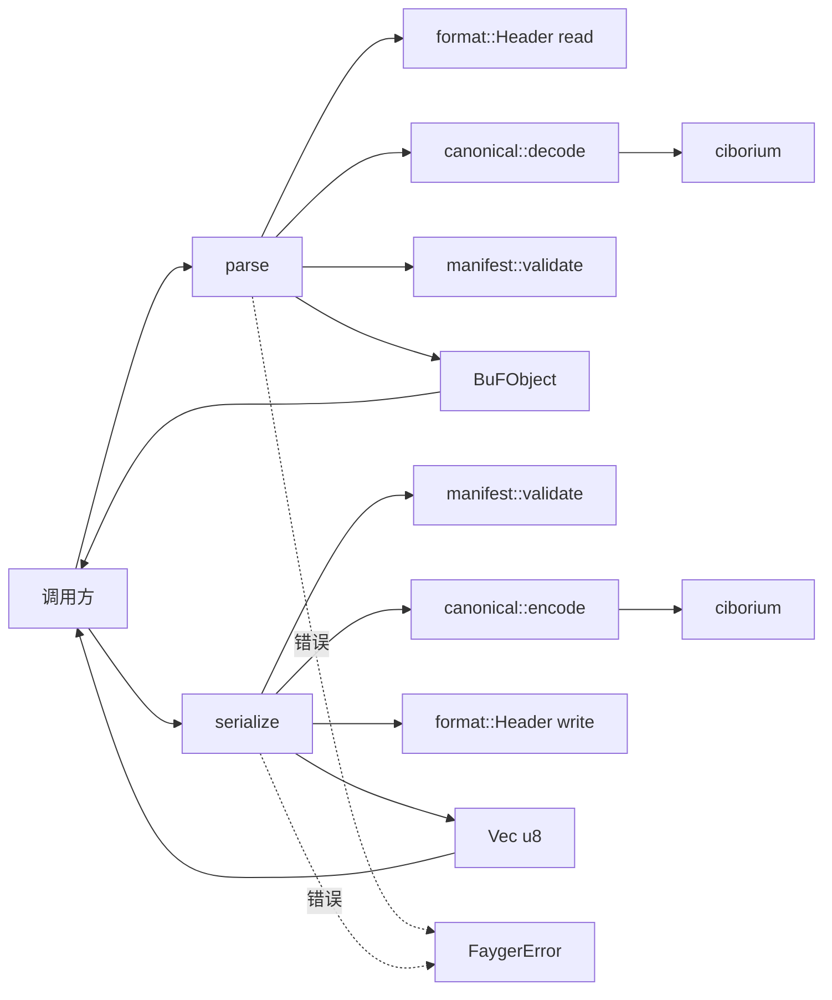

# Design Document

## Overview

本文是 M0 里程碑（BuF 核心：格式定义、Parser、Serializer、往返一致性）的技术设计。它把蓝图 §3.1–§3.5 的内容收敛成一组可实施的 Rust 工程决策。

设计目标按优先级：

1. **正确性优先**：往返一致性必须通过 PBT 持续验证；Manifest 与 Section_Index 的字节序列必须可重现。
2. **可演进**：M0 的接口与类型必须为 M1+ 留好扩展点；错误模型已按蓝图 §6 形态实现，未来里程碑只新增枚举值，不改结构。
3. **最小依赖**：能不引入第三方 crate 就不引入；引入的依赖必须有清晰收益。
4. **多平台前瞻**：M0 是 std-only，但所有公开 API 不依赖 std 独有类型（如 `std::path::Path`）。未来要切到 `alloc` 模式时改动局部。

## Architecture

### M0 在蓝图里的位置

蓝图把 BuF 加载流程拆成多阶段（Read → Parse → Verify Structural → Verify Digest → Verify Signature → Negotiate Version → Select Sections → Resolve → Read Section Bodies → HandOff）。M0 仅落实其中：

- **Parse**：完整实现，包括 Header / Manifest / Section_Index / Sections / Trailer 的解析。
- **Verify Structural**：完整实现（必填字段、磁数、offset 边界、长度一致）。
- **HandOff**：M0 把 BuFObject 直接交给调用方；尚无 Runtime 接收方。

其他阶段在 M0 不实现：
- Verify Digest / Verify Signature / Negotiate Version 推迟到 M1（Verify Digest）/ M2（Negotiate Version）/ M4（Verify Signature）。
- Select Sections / Read Section Bodies / Resolve 推迟到 M5 / M6。

### Crate 拓扑

```
release/dev/core/
├── Cargo.toml               (workspace 根)
├── rust-toolchain.toml
├── rustfmt.toml
└── crates/
    ├── fayger-error/        (FaygerError + Layer + ErrorCode + ContextValue)
    │   ├── Cargo.toml
    │   └── src/lib.rs
    └── fayger-buf/          (格式 + Parser + Serializer + Canonical CBOR)
        ├── Cargo.toml
        └── src/
            ├── lib.rs
            ├── canonical.rs (Canonical CBOR 编码器)
            ├── format.rs    (Header / Trailer 字节布局)
            ├── manifest.rs  (BuFManifest / SectionDescriptor / SemVer 等)
            ├── object.rs    (BuFObject / Section)
            ├── parser.rs    (parse(&[u8]) -> Result<BuFObject>)
            ├── serializer.rs(serialize(&BuFObject) -> Result<Vec<u8>>)
            └── testing.rs   (proptest strategies，feature-gated)
```

依赖方向：

- `fayger-error` 不依赖任何其他工作区 crate。
- `fayger-buf` 依赖 `fayger-error`。

外部依赖（在 `[workspace.dependencies]` 集中管理版本）：

| Crate | 用途 | 落地于 |
| --- | --- | --- |
| `ciborium` | CBOR 解码（tagged Value） | fayger-buf |
| `binrw` | Header / Trailer 字节布局派生 | fayger-buf |
| `serde` (+ derive) | Manifest 等结构的派生 | fayger-buf |
| `proptest` | PBT 主框架 | fayger-buf (dev-deps) |
| `proptest-regressions` | 反例归档 | fayger-buf (dev-deps) |

### 调用方向



## Components and Interfaces

### `fayger-error` crate

```rust
//! 统一错误模型。蓝图 §6.1 的 FaygerError 在 Rust 中的载体。

#[non_exhaustive]
#[derive(Debug, Clone, PartialEq, Eq, Hash)]
pub enum Layer {
    Loader,
    Runtime,    // 后续里程碑使用
    Adapter,    // 后续里程碑使用
    Host,       // 后续里程碑使用
}

#[non_exhaustive]
#[derive(Debug, Clone, PartialEq, Eq, Hash)]
pub enum ErrorCode {
    /// BuF 字节流不符合格式规范。
    LdrParseFail,
    /// 序列化时 Manifest 缺必填字段。
    LdrMissingRequiredField,
    // 后续里程碑追加，#[non_exhaustive] 保证不破坏二进制兼容。
}

#[derive(Debug, Clone, PartialEq, Eq)]
pub enum ContextValue {
    String(String),
    U64(u64),
    I64(i64),
    Bool(bool),
    Bytes(Vec<u8>),
    List(Vec<ContextValue>),
    Map(BTreeMap<String, ContextValue>),
}

#[derive(Debug)]
pub struct FaygerError {
    pub code: ErrorCode,
    pub source_layer: Layer,
    pub message: String,
    pub context: BTreeMap<String, ContextValue>,
    pub cause: Option<Box<FaygerError>>,
}

impl FaygerError {
    pub fn new(code: ErrorCode, source_layer: Layer, message: impl Into<String>) -> Self;
    pub fn with_context(mut self, key: &str, value: ContextValue) -> Self;
    pub fn with_cause(mut self, cause: FaygerError) -> Self;
}

impl std::fmt::Display for FaygerError { /* code: message {context...} */ }
impl std::error::Error for FaygerError {
    fn source(&self) -> Option<&(dyn std::error::Error + 'static)> {
        self.cause.as_deref().map(|e| e as _)
    }
}
```

设计要点：

- **`#[non_exhaustive]`** 在 `Layer` 与 `ErrorCode` 上：调用方在 match 时必须写 `_ =>`，未来加变体不破坏调用代码。
- **`context` 用 `BTreeMap`**：保证遍历顺序确定（调试输出与往返一致性更友好）。
- **`ContextValue`** 不依赖 ciborium，避免 `fayger-error` 反向依赖 `fayger-buf`。
- 不实现 `Clone for FaygerError`：避免 cause 链浅拷贝陷阱。需要的话可以加 `#[derive(Clone)]`，等到真有诉求再说。

### `fayger-buf` crate

#### 模块 `format`：Header 与 Trailer

```rust
//! BuF 的固定字节布局段（Header / Trailer）。

use binrw::{BinRead, BinWrite};

pub const BUF_MAGIC: [u8; 4] = *b"BUF\0";
pub const HEADER_SIZE: usize = 8 + 8 + 8 + 8 + 8 + 8;
//                              magic+ver  + 4 个 u64 offset/len
pub const TRAILER_SIZE: usize = 8 + 32 + 4;
//                              total_length + manifest_digest + crc32

#[derive(BinRead, BinWrite, Debug, PartialEq, Eq, Clone)]
#[brw(little, magic = b"BUF\0")]
pub struct Header {
    pub format_version: u32,
    pub manifest_offset: u64,
    pub manifest_length: u64,
    pub section_index_offset: u64,
    pub section_index_length: u64,
}

#[derive(BinRead, BinWrite, Debug, PartialEq, Eq, Clone)]
#[brw(little)]
pub struct Trailer {
    pub total_length: u64,
    pub manifest_digest: [u8; 32],   // M0 占位（写零，不校验）
    pub crc32: u32,                  // M0 占位（写零，不校验）
}

pub const FORMAT_VERSION_M0: u32 = 1;
```

#### 模块 `canonical`：Canonical CBOR

实现 RFC 8949 §4.2 子集，足以支撑 M0 范围。

设计：

```rust
//! Canonical CBOR encoder/decoder 包装。
//!
//! 只暴露最小 API：
//!   - canonical_encode: Serialize 派生类型 -> Vec<u8>，保证 canonical
//!   - canonical_decode: &[u8] -> Deserialize 派生类型，强制 canonical（拒绝非 canonical 输入）

pub fn canonical_encode<T: serde::Serialize>(value: &T) -> Result<Vec<u8>, CborError>;
pub fn canonical_decode<T: for<'de> serde::Deserialize<'de>>(bytes: &[u8]) -> Result<T, CborError>;

pub struct CborError { /* 内部错误，由 parser/serializer 转 FaygerError */ }
```

实现策略：

1. **encode**：先用 `ciborium::value::to_value` 把任意 Serialize 类型转 `ciborium::value::Value`，再走自写 `write_canonical(value, out)` 函数。
   - **map keys**：必须按 lex 序排序；ciborium::value::Value 中 map 已是 `Vec<(Value, Value)>`，我们排序后写入。
   - **integers**：选最短表示（0..=23 一字节、24..=255 两字节、…）；ciborium 的 Encoder 默认就是最短，确认即可。
   - **definite length**：禁止 indefinite length（CBOR 0x5f / 0x7f / 0x9f / 0xbf），ciborium 默认 definite。
   - **floats**：M0 不允许 float（拒绝 Manifest 中出现）；canonical 规则要求最短 float，但我们干脆禁掉。

2. **decode**：用 `ciborium::de::from_reader` 解码到 `ciborium::value::Value`，再 `validate_canonical(&value)`，最后 `from_value::<T>(value)`。
   - validate_canonical 检查 map keys 已序、integer 是最短表示、不含 indefinite length。
   - 任何不满足都报 `CborError::NonCanonical`。

3. **结构**：
```rust
mod canonical {
    pub(crate) fn write_canonical(v: &ciborium::value::Value, out: &mut Vec<u8>);
    pub(crate) fn validate_canonical(v: &ciborium::value::Value) -> Result<(), CborError>;
}
```

4. **测试**：单元测试覆盖每条 canonical 规则（写 fixture：非 canonical 输入应被拒）。

#### 模块 `manifest`：BuFManifest 与子结构

```rust
//! Manifest 与子类型定义。
//!
//! 与蓝图 §3.2 保持一致；M0 不实现的字段（signature / quotas）保留为可选。

use serde::{Deserialize, Serialize};
use std::collections::{BTreeMap, BTreeSet};

#[derive(Debug, Clone, PartialEq, Eq, Serialize, Deserialize)]
pub struct BuFManifest {
    pub schema_version: SemVer,
    pub runtime_interface_min: SemVer,

    #[serde(skip_serializing_if = "Option::is_none", default)]
    pub deprecation_notice: Option<String>,

    pub entry: EntryPoint,

    #[serde(skip_serializing_if = "Option::is_none", default)]
    pub runtime: Option<RuntimeRequirement>,

    #[serde(default, skip_serializing_if = "BTreeSet::is_empty")]
    pub capabilities: BTreeSet<String>,

    #[serde(skip_serializing_if = "Option::is_none", default)]
    pub quotas: Option<ResourceQuota>,

    pub sections: Vec<SectionDescriptor>,

    #[serde(default, skip_serializing_if = "Option::is_none")]
    pub signature: Option<SignatureBlock>,

    /// 顶层未知字段会进 extensions（serde 通过自定义反序列化方法支持）。
    #[serde(default, skip_serializing_if = "BTreeMap::is_empty")]
    pub extensions: BTreeMap<String, ciborium::value::Value>,
}

#[derive(Debug, Clone, PartialEq, Eq, Serialize, Deserialize)]
#[serde(deny_unknown_fields)]   // 嵌套结构严格
pub struct SectionDescriptor {
    pub id: String,
    pub kind: SectionKind,
    pub digest: Digest,                 // M0 占位
    pub length: u64,
    pub visibility: SectionVisibility,  // M0 默认 Required
    pub profile_constraints: ProfileConstraints,  // M0 默认空
}

#[derive(Debug, Clone, PartialEq, Eq, Serialize, Deserialize)]
#[serde(rename_all = "snake_case", deny_unknown_fields)]
pub enum SectionKind {
    Code,
    Data,
    Asset,
    Signature,
    Custom(String),
}

#[derive(Debug, Clone, PartialEq, Eq, Serialize, Deserialize)]
#[serde(deny_unknown_fields)]
pub struct Digest {
    pub algorithm: String,    // 例如 "sha256"
    pub value: Vec<u8>,
}

#[derive(Debug, Clone, PartialEq, Eq, Serialize, Deserialize)]
#[serde(rename_all = "snake_case", deny_unknown_fields)]
pub enum SectionVisibility {
    Required,
    Optional,
}

#[derive(Debug, Clone, PartialEq, Eq, Default, Serialize, Deserialize)]
#[serde(deny_unknown_fields)]
pub struct ProfileConstraints {
    #[serde(default, skip_serializing_if = "BTreeSet::is_empty")]
    pub required_capabilities: BTreeSet<String>,
    #[serde(skip_serializing_if = "Option::is_none", default)]
    pub max_size: Option<u64>,
    #[serde(default, skip_serializing_if = "BTreeSet::is_empty")]
    pub required_features: BTreeSet<String>,
}

#[derive(Debug, Clone, PartialEq, Eq, Serialize, Deserialize)]
pub struct SemVer {
    pub major: u32,
    pub minor: u32,
    pub patch: u32,
    #[serde(default, skip_serializing_if = "Option::is_none")]
    pub pre: Option<String>,
}

impl SemVer {
    pub fn parse(s: &str) -> Result<Self, ParseSemVerError>;
    pub fn to_string(&self) -> String;
}

// EntryPoint / RuntimeRequirement / ResourceQuota / SignatureBlock 同样按蓝图定义。

impl BuFManifest {
    /// 检查必填字段、SemVer 合法性等。Parser 与 Serializer 都会调。
    pub fn validate(&self) -> Result<(), FaygerError>;
}
```

设计要点：

- **`SemVer`**：用结构体（不引入 `semver` crate），M0 阶段只做语法校验。CBOR 中编码为 `"x.y.z[-pre]"` 字符串。
- **`SectionKind::Custom(String)`**：保持与蓝图一致；CBOR 编码为 `[1, "name"]` 二元 array（serde 的 enum 默认行为），便于版本演进。
- **`Digest` / `SectionVisibility` / `ProfileConstraints`**：M0 占位但完整定义，确保 round-trip 时这些字段不被丢失。
- **顶层 `extensions`**：serde 默认的 `#[serde(flatten)]` 配合 BTreeMap 不直接支持。M0 实现自定义 Deserialize：先反序列化为 `BTreeMap<String, Value>`，已知字段提取出来，剩余进 extensions。这部分是 manifest.rs 的核心样板代码（约 80 行）。
- **未知 SectionKind**：枚举不开放未知值（`#[serde(deny_unknown_fields)]` 等价于此）。后续 schema 升级时通过 Custom variant 容纳。

#### 模块 `object`：BuFObject

```rust
#[derive(Debug, Clone, PartialEq, Eq)]
pub struct BuFObject {
    pub manifest: BuFManifest,

    /// 按 manifest.sections 中的顺序保存的 section 内容字节。
    /// `sections.len() == manifest.sections.len()`，且 `sections[i]` 对应 `manifest.sections[i]`。
    pub sections: Vec<Section>,

    pub raw_header: format::Header,
    pub raw_trailer: format::Trailer,
}

#[derive(Debug, Clone, PartialEq, Eq)]
pub struct Section {
    pub id: String,         // 与 manifest 中对应 SectionDescriptor.id 一致
    pub payload: Vec<u8>,
}

impl BuFObject {
    /// 一致性自检：sections 与 manifest.sections 必须一一对应。
    pub fn check_consistency(&self) -> Result<(), FaygerError>;
}
```

#### 模块 `parser`

```rust
pub fn parse(bytes: &[u8]) -> Result<BuFObject, FaygerError>;

// 内部分解（私有）
fn read_header(bytes: &[u8]) -> Result<format::Header, FaygerError>;
fn read_trailer(bytes: &[u8]) -> Result<format::Trailer, FaygerError>;
fn read_manifest(bytes: &[u8], header: &format::Header) -> Result<BuFManifest, FaygerError>;
fn read_section_index(bytes: &[u8], header: &format::Header) -> Result<Vec<SectionIndexEntry>, FaygerError>;
fn read_sections(bytes: &[u8], index: &[SectionIndexEntry], total_length: u64) -> Result<Vec<Section>, FaygerError>;

#[derive(Debug, Clone, PartialEq, Eq, Serialize, Deserialize)]
#[serde(deny_unknown_fields)]
struct SectionIndexEntry {
    section_id: String,
    kind: SectionKind,
    offset: u64,
    length: u64,
    digest: Digest,
    visibility: SectionVisibility,
    profile_constraints: ProfileConstraints,
}
```

错误映射规则：

| 触发条件 | ErrorCode | context.reason |
| --- | --- | --- |
| 字节流长度 < HEADER_SIZE + TRAILER_SIZE | LdrParseFail | "Truncated" |
| 前 4 字节 != "BUF\0" | LdrParseFail | "MagicMismatch" |
| Header.{manifest,section_index}_offset/_length 越界 | LdrParseFail | "OffsetOutOfBounds" |
| Manifest CBOR 解码失败 | LdrParseFail | "ManifestInvalid" |
| Manifest 必填字段缺失 | LdrParseFail | "ManifestMissingField" |
| Section_Index CBOR 解码失败 | LdrParseFail | "SectionIndexInvalid" |
| Section_Index 条目 offset+length 越界 | LdrParseFail | "SectionOutOfBounds" |
| Section_Index 与 Manifest.sections 不一致 | LdrParseFail | "SectionMismatch" |
| Trailer.total_length != bytes.len() | LdrParseFail | "TrailerLengthMismatch" |
| Manifest 或 Section_Index 不是 canonical CBOR | LdrParseFail | "NonCanonicalCbor" |

#### 模块 `serializer`

```rust
pub fn serialize(obj: &BuFObject) -> Result<Vec<u8>, FaygerError>;

// 内部
fn build_section_index(obj: &BuFObject) -> Result<Vec<SectionIndexEntry>, FaygerError>;
fn write_canonical_manifest(m: &BuFManifest) -> Result<Vec<u8>, FaygerError>;
fn write_canonical_section_index(idx: &[SectionIndexEntry]) -> Result<Vec<u8>, FaygerError>;
```

序列化流程：

1. `obj.check_consistency()`（sections 与 manifest 对齐）。
2. `obj.manifest.validate()`（必填字段）。
3. 序列化 Manifest 为 canonical CBOR → `manifest_bytes`。
4. 由 obj.sections 反推 Section_Index（offset 按顺序累加），序列化为 canonical CBOR → `index_bytes`。
5. 计算各 offset：`manifest_offset = HEADER_SIZE`、`section_index_offset = manifest_offset + manifest_length`、第一个 section_offset = `section_index_offset + index_bytes.len()`。
6. 写 Header。
7. 拼接 Manifest / Index / Sections。
8. 计算 total_length，写 Trailer（manifest_digest 与 crc32 占位填零）。

错误映射：

| 触发条件 | ErrorCode | context |
| --- | --- | --- |
| BuFManifest 缺必填字段 | LdrMissingRequiredField | `missing_fields: [...]` |
| BuFObject.sections 与 manifest.sections 长度不一致 | LdrMissingRequiredField | `reason: "SectionInconsistency"`, `expected, actual` |
| 某 Section.id 与 manifest.sections[i].id 不一致 | LdrMissingRequiredField | `reason: "SectionInconsistency"`, `index, expected_id, actual_id` |
| canonical 编码内部错误 | LdrParseFail | `reason: "CanonicalEncodeFail"` |

注意：Serializer 触发 LdrParseFail 听起来反直觉，但 canonical 编码失败本质是格式产出失败，复用 LdrParseFail 即可（蓝图错误码集以语义为先）。

## Data Models

### BuF 字节布局精确表

```
偏移            长度    字段                            备注
0               4       magic = "BUF\0"
4               4       format_version: u32 LE         M0 = 1
8               8       manifest_offset: u64 LE
16              8       manifest_length: u64 LE
24              8       section_index_offset: u64 LE
32              8       section_index_length: u64 LE
40              [可变]  Manifest CBOR                  manifest_offset = 40
40+M            [可变]  Section_Index CBOR             section_index_offset = 40 + M, M = manifest_length
40+M+I          [可变]  Sections 段                    I = section_index_length
total_length-44 8       total_length: u64 LE
total_length-36 32      manifest_digest                M0 全零
total_length-4  4       crc32: u32 LE                  M0 = 0
```

约束：

- `manifest_offset == HEADER_SIZE = 40`。
- `section_index_offset == manifest_offset + manifest_length`。
- 第一个 section 的 offset = `section_index_offset + section_index_length`。
- `total_length == bytes.len()`。

### Section_Index 条目 CBOR 结构

```cbor
[
  {
    "section_id": "code",
    "kind": "code",
    "offset": 0,
    "length": 1234,
    "digest": { "algorithm": "sha256", "value": h'00..00' },
    "visibility": "required",
    "profile_constraints": {}
  },
  ...
]
```

`offset` 是相对于 Sections 段开头的偏移，不是相对于 BuF 文件开头。这样裁剪 / 重打包不会让 Section_Index 失效。

## Error Handling

### 关键错误流

```mermaid
flowchart TB
    Parse[parse&#40;bytes&#41;] --> CheckLen{长度足够?}
    CheckLen -- 否 --> ErrTrunc[Truncated]
    CheckLen -- 是 --> ReadH[读 Header]
    ReadH -- magic 不匹配 --> ErrMagic[MagicMismatch]
    ReadH -- 越界 --> ErrOOB[OffsetOutOfBounds]
    ReadH -- 成功 --> Manifest[解析 Manifest CBOR]
    Manifest -- CBOR 失败 --> ErrCbor[ManifestInvalid]
    Manifest -- 必填缺 --> ErrField[ManifestMissingField]
    Manifest -- 非 canonical --> ErrNonCan[NonCanonicalCbor]
    Manifest -- 成功 --> Index[解析 Section_Index]
    Index -- 失败 --> ErrIdx[SectionIndexInvalid]
    Index -- 成功 --> Sections[读 Sections]
    Sections -- 越界 --> ErrSec[SectionOutOfBounds]
    Sections -- mismatch --> ErrMis[SectionMismatch]
    Sections -- 成功 --> Trailer[读 Trailer]
    Trailer -- total_length 不一致 --> ErrTL[TrailerLengthMismatch]
    Trailer -- 成功 --> Object[BuFObject]
```



### 默认安全姿态

- **拒绝非 canonical CBOR**：M0 的 Parser 严格拒绝任何非 canonical 编码的 Manifest 或 Section_Index。这比"接受 + 重新规范化"更安全（避免歧义攻击）。
- **拒绝未知顶层枚举值**：`SectionKind` 等 enum 不接受未知字符串，避免数据降级风险。
- **保留原始 raw_header / raw_trailer**：BuFObject 中存储原始字节版本，`serialize → parse → ` 等价时所有占位字段保持不变。

## Correctness Properties

> 这些性质从需求文档 Requirement 5 与 Requirement 7 中提取，对应 PBT 测试。

### Property 1: 往返一致性（结构等价）

*For any* 合法的 BuFObject `o`，令 `bytes = serialize(o)`，则 `parse(bytes)` 必须成功并产出 `o'`，使 `o ≡ o'`（结构相等）。

**Validates: Requirements 5.1, 5.3**

### Property 2: 往返一致性（字节级强往返）

*For any* 合法的 BuF 字节流 `bytes`，令 `o = parse(bytes)`，则 `serialize(o)` 必须输出 `bytes' == bytes`。

**Validates: Requirements 5.2**

### Property 3: 字节流破坏被检测

*For any* 合法字节流 `bytes` 与任意单点破坏 `corrupt`（位翻转、单字节截断、修改 magic、修改 Header offset 字段、修改 Manifest CBOR 中任一字节、改 total_length），`parse(corrupt(bytes))` 必须返回 `Err`。

**Validates: Requirements 7.1, 3.3, 3.4, 3.5, 3.7, 3.8**

### Property 4: 必填字段缺失被拒

*For any* 合法 BuFObject `o` 与任一必填字段名 `f`（`schema_version`、`runtime_interface_min`、`entry`、`sections`），令 `o' = remove(o, f)`，则 `serialize(o')` 必须返回 `LDR_MISSING_REQUIRED_FIELD`，且 `error.context.missing_fields` 包含 `f`。

**Validates: Requirements 4.4, 7.1**

### Property 5: Section_Index 自相矛盾被检测

*For any* 合法字节流 `bytes`，令 `bytes' = bytes` 但其中某个 Section_Index 条目的 offset 或 length 被改成不可能的值（offset > Sections 长度、length > 实际 section 长度），则 `parse(bytes')` 必须返回 `LDR_PARSE_FAIL` 且 `error.context.reason == "SectionOutOfBounds"`。

**Validates: Requirements 3.6, 7.1**

## Testing Strategy

### 测试金字塔

```
         ┌──────────────────────┐
         │   集成快照测试 (1-3)  │
         │   (固定字节序列文件)  │
         └──────────────────────┘
       ┌─────────────────────────────┐
       │     PBT (Property tests)     │
       │   (4 项 properties × 500x)   │
       └─────────────────────────────┘
   ┌──────────────────────────────────────┐
   │       单元测试 (各模块函数)            │
   │   header read/write、canonical 等     │
   └──────────────────────────────────────┘
```

### PBT 生成器（在 `fayger-buf::testing` 模块，feature = "testing"）

```rust
pub fn arb_semver() -> impl Strategy<Value = SemVer> {
    (any::<u16>(), any::<u16>(), any::<u16>(), prop::option::of("[a-z0-9]{1,8}"))
        .prop_map(|(maj, min, pat, pre)| SemVer {
            major: maj as u32,
            minor: min as u32,
            patch: pat as u32,
            pre,
        })
}

pub fn arb_section() -> impl Strategy<Value = Section> {
    ("[a-z][a-z0-9_-]{0,31}", prop::collection::vec(any::<u8>(), 0..1024))
        .prop_map(|(id, payload)| Section { id, payload })
}

pub fn arb_buf_object() -> impl Strategy<Value = BuFObject> {
    (
        arb_semver(),
        arb_semver(),
        prop::collection::vec(arb_section(), 0..8),
    )
        .prop_map(|(sv, rt_min, sections)| build_buf_object(sv, rt_min, sections))
}
```

### 单元测试

- `format::Header` round-trip：write Header → bytes → read → 比对相等。
- `canonical::write_canonical`：每条 RFC 8949 §4.2 规则一个用例（map keys ordering、shortest int、definite length）。
- `manifest::validate`：每个必填字段单独删除，断言错误。
- `manifest::semver::parse`：包含合法 / 非法字符串。

### 快照测试

- `tests/fixtures/minimal.buf`：手工构造的最小合法 BuF（空 sections）。
- `tests/fixtures/two_sections.buf`：含两个 Section（Code + Asset），用于回归。
- 测试：`parse(fixture) == 预期 BuFObject`，`serialize(预期 BuFObject) == fixture`。

### 反例归档

`proptest-regressions/<test_name>.txt` 自动生成，进 git 跟踪。每条 PBT 测试以 `proptest_config(ProptestConfig { failure_persistence: ... })` 显式设置归档目录。

### CI 矩阵

```yaml
strategy:
  matrix:
    rust: [stable]
    os: [ubuntu-latest, macos-latest, windows-latest]

steps:
  - run: cargo fmt --all -- --check
  - run: cargo clippy --workspace --all-targets --all-features -- -D warnings
  - run: cargo test --workspace --all-features
  - run: cargo doc --workspace --no-deps
```

注：M0 暂不交叉编译至嵌入式 / WASM，那是 M1+ 的工作。

## Dependency Versions

放在 `release/dev/core/Cargo.toml` 的 `[workspace.dependencies]`：

```toml
[workspace.dependencies]
ciborium = "0.2"            # 0.2.x 自 2023 起稳定
binrw = "0.14"
serde = { version = "1.0", features = ["derive"] }
proptest = "1.5"
proptest-regressions = "0.4"
```

`rust-toolchain.toml`：

```toml
[toolchain]
channel = "stable"
components = ["rustfmt", "clippy"]
```

`rustfmt.toml` 留空（默认 style）。

## Open Questions

- **Q1**：`manifest_digest`（Trailer 中 32 字节）M0 阶段是否要写入实际的 sha256，即便 Parser 不校验？
  - 利：未来 M1 启用校验时不需要重做样例；
  - 弊：M0 阶段引入 sha2 依赖；
  - 倾向：M0 写零，M1 同时引入 sha2 与校验逻辑。
- **Q2**：Manifest 中 `extensions` 是否允许包含 binary（CBOR major type 2）？
  - 当前设计允许（`ciborium::value::Value::Bytes`）。
  - 风险：用户用它绕过我们的 schema，但这正是 extensions 的本意。
- **Q3**：Section payload 是否要限制最大长度？
  - 蓝图未规定。M0 不做限制（PBT 用 0..1024 范围，但运行时不强制）。

这三个问题在 M0 实现阶段保持当前默认；如有变更，明确升级到需求文档。
