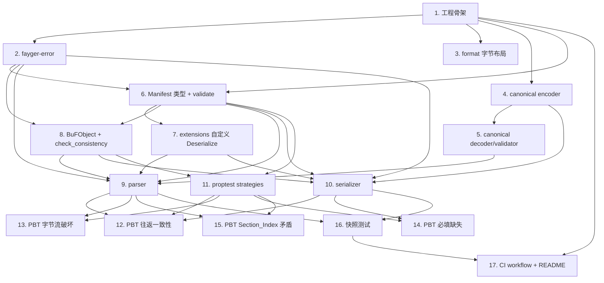

# Implementation Plan

## Overview

本任务清单基于 `requirements.md` 与 `design.md`，把 M0 的实现拆成 17 个独立可完成的任务。每个任务的产出都直接对应需求文档中的某条验收条款。

每个任务的脚注说明它在依赖关系中的位置，以及完成后能跑哪些验证。任务以 1.x 顺序号编号，便于在 PR 标题里引用，例如 `feat(m0/4): canonical encoder for primitive types`。

## Tasks

- [ ] 1. 工程骨架与依赖锁定
  - 在 `release/dev/core/` 创建 `Cargo.toml`（workspace）、`rust-toolchain.toml`（stable）、`rustfmt.toml`（默认）。
  - 在 `[workspace.dependencies]` 锁定 ciborium、binrw、serde、proptest、proptest-regressions 的具体小版本。
  - 在 `[workspace.lints]` 设置 `unsafe_code = "forbid"`、clippy pedantic+nursery+unwrap_used 警告级。
  - 在 `crates/fayger-error/` 与 `crates/fayger-buf/` 各建空 `Cargo.toml` 与空 `src/lib.rs`，确保 `cargo check --workspace` 通过。
  - 在 `release/dev/core/` 添加最小 `.github/workflows/ci.yml`：fmt / clippy / test / doc。
  - _Requirements: 约束与假设_

- [ ] 2. fayger-error：FaygerError 与配套类型
  - 实现 `Layer`、`ErrorCode`、`ContextValue`、`FaygerError` 类型，全部按 `design.md` §"`fayger-error` crate"。
  - 实现 `FaygerError::new`、`with_context`、`with_cause` 构造器。
  - 实现 `Display` 与 `std::error::Error::source`。
  - `Layer` 与 `ErrorCode` 加 `#[non_exhaustive]`。
  - 单元测试：构造一个三层 cause 链，断言 `source()` 链可遍历；断言 `Display` 输出格式稳定。
  - _Requirements: 6.1, 6.2, 6.3, 6.4_

- [ ] 3. fayger-buf::format：Header 与 Trailer 字节布局
  - 在 `format.rs` 用 binrw 派生 `Header` 与 `Trailer`。
  - 定义常量 `BUF_MAGIC`、`HEADER_SIZE`、`TRAILER_SIZE`、`FORMAT_VERSION_M0`。
  - 单元测试：构造 Header → 写出字节 → 读回 → 比对相等；测试 magic 不匹配返回 binrw 错误；测试越界返回 binrw 错误。
  - 不直接对外暴露 binrw 错误：调用方拿到 `binrw::Error` 自行 map 到 `FaygerError`（这一步在 parser 任务中完成）。
  - _Requirements: 1.2, 1.3, 1.7_

- [ ] 4. fayger-buf::canonical：canonical CBOR 编码器
  - 在 `canonical.rs` 实现 `write_canonical(value: &ciborium::value::Value, out: &mut Vec<u8>)`。
  - 实现规则：integer 用最短编码、definite length、map keys 按字节序列升序排序、拒绝写出 floats。
  - 单元测试：每条规则一个用例（手工构造 Value，断言输出字节）。
  - 集成测试：用 RFC 8949 §4.2.2 中的样例验证。
  - _Requirements: 1.4, 1.5, 4.3_

- [ ] 5. fayger-buf::canonical：canonical 验证器
  - 实现 `validate_canonical(value: &ciborium::value::Value) -> Result<(), CborError>`。
  - 规则与任务 4 对应：检测非最短整数、indefinite length、未排序 map keys、float。
  - 顶层入口 `canonical_decode<T>` 内部：先 `from_reader::<Value>` → `validate_canonical(&v)` → `from_value::<T>(v)`。
  - 单元测试：构造非 canonical 输入断言失败；canonical 输入正常通过。
  - _Requirements: 1.4, 1.5_

- [ ] 6. fayger-buf::manifest：Manifest 类型与 SemVer
  - 实现 `SemVer` 结构与 `parse` / `to_string` / `Display`。
  - 实现 `Digest`、`SectionKind`、`SectionVisibility`、`ProfileConstraints`、`SectionDescriptor`。
  - 实现 `BuFManifest`（先用 plain serde derive，不含顶层 extensions 的自定义反序列化）。
  - 实现 `BuFManifest::validate(&self) -> Result<(), FaygerError>`：检查必填字段非默认值、SemVer 合法性。
  - 单元测试：每个必填字段单独构造缺失场景，断言 validate 返回 LdrMissingRequiredField；context.missing_fields 包含正确名称。
  - _Requirements: 2.1, 2.2, 2.3, 2.4, 4.4_

- [ ] 7. fayger-buf::manifest：顶层 extensions 自定义 Deserialize
  - 为 BuFManifest 实现 `Deserialize`：先反序列化为 `BTreeMap<String, ciborium::Value>`，已知字段提取，剩余进 `extensions`。
  - 对应自定义 `Serialize`：扁平展开 extensions（与已知字段同级），保证 round-trip 不在结构上发生变化。
  - 单元测试：构造一个含未知顶层字段的 CBOR 字节流，反序列化后该字段进入 extensions；再序列化 → 再反序列化，比对相等。
  - _Requirements: 2.2, 2.3, 5.1_

- [ ] 8. fayger-buf::object：BuFObject 与一致性自检
  - 实现 `Section { id, payload }` 与 `BuFObject { manifest, sections, raw_header, raw_trailer }`。
  - 实现 `BuFObject::check_consistency(&self) -> Result<(), FaygerError>`：sections.len() == manifest.sections.len()，逐项 id 一致。
  - 单元测试：构造一致 / 不一致两类对象，断言行为。
  - _Requirements: 4.5_

- [ ] 9. fayger-buf::parser：parse(&[u8]) -> Result<BuFObject>
  - 实现 `parse` 顶层函数。流程见 `design.md` §"`parser` 模块"。
  - 把 binrw 错误、ciborium 错误、canonical 错误统一映射为 `FaygerError(LdrParseFail)` 并填充 `context.reason`。
  - 内部分解 `read_header` / `read_manifest` / `read_section_index` / `read_sections` / `read_trailer`，全部为私有函数。
  - 单元测试：错误条件每条至少一个用例（Truncated / MagicMismatch / OffsetOutOfBounds / ManifestInvalid / ManifestMissingField / SectionIndexInvalid / SectionOutOfBounds / SectionMismatch / TrailerLengthMismatch / NonCanonicalCbor）。
  - _Requirements: 3.1, 3.2, 3.3, 3.4, 3.5, 3.6, 3.7, 3.8, 6.1_

- [ ] 10. fayger-buf::serializer：serialize(&BuFObject) -> Result<Vec<u8>>
  - 实现 `serialize` 顶层函数。流程见 `design.md` §"`serializer` 模块"。
  - 调用 `manifest.validate()` 与 `object.check_consistency()`。
  - 写 Header → Manifest（canonical CBOR）→ Section_Index（canonical CBOR）→ Sections payload → Trailer（manifest_digest 写零、crc32 写零）。
  - 单元测试：构造合法 BuFObject 序列化后再 parse，断言相等；构造缺字段对象，断言 serialize 返回 LdrMissingRequiredField + 正确 missing_fields。
  - _Requirements: 4.1, 4.2, 4.3, 4.4, 4.5_

- [ ] 11. fayger-buf::testing：proptest strategies（feature-gated）
  - 在 `testing.rs` 实现 `arb_semver`、`arb_section_kind`、`arb_section`、`arb_manifest_skeleton`、`arb_buf_object`。
  - 用 `[features] testing = []` 控制是否暴露这些 strategies。
  - 内部测试模块直接 `#[cfg(test)]` 引用。
  - _Requirements: 5.3, 7.1_

- [ ] 12. PBT：Property 1 + Property 2 往返一致性
  - 在 `tests/round_trip.rs` 实现 Property 1（结构等价）与 Property 2（字节级强往返）。
  - 配置 `ProptestConfig { cases: 500, .. }`。
  - 配置 `proptest-regressions/round_trip.txt`，加入 git。
  - 文件头注释：`// Feature: fayger-m0, Property 1: round-trip equivalence (structural)`。
  - _Requirements: 5.1, 5.2, 5.3, 5.4_

- [ ] 13. PBT：Property 3 字节流破坏被检测
  - 在 `tests/corruption.rs` 实现：从合法字节流派生 4 种破坏（位翻转、截断、改 magic、改 header offset），断言 parse 返回正确 ErrorCode 与 reason。
  - cases ≥ 500。
  - _Requirements: 7.1, 3.3, 3.4, 3.5, 3.7, 3.8_

- [ ] 14. PBT：Property 4 必填字段缺失被拒
  - 在 `tests/missing_field.rs` 实现：从合法 BuFObject 派生缺字段版本，断言 serialize 失败且 missing_fields 命中。
  - cases ≥ 500。
  - _Requirements: 4.4, 7.1_

- [ ] 15. PBT：Property 5 Section_Index 自相矛盾被检测
  - 在 `tests/section_index.rs` 实现：从合法字节流派生篡改了 offset / length 的版本，断言 parse 返回 SectionOutOfBounds。
  - cases ≥ 500。
  - _Requirements: 3.6, 7.1_

- [ ] 16. 快照测试与样例字节流
  - 用一次性脚本（或 cargo run 驱动）生成 `tests/fixtures/minimal.buf` 与 `tests/fixtures/two_sections.buf`，提交进 git。
  - 在 `tests/fixtures.rs` 写两个测试：`parse(minimal.buf) == 预期 BuFObject`；`serialize(预期 BuFObject) == minimal.buf`（字节级等价）；同样为 two_sections 写一对。
  - _Requirements: 7.2_

- [x] 17. CI workflow 完整化与文档
  - 完善 `.github/workflows/ci.yml`：fmt + clippy + test + doc，覆盖 ubuntu / macos / windows 三平台。
  - 在 `release/dev/core/README.md` 写"如何本地运行测试 / 运行 PBT / 查看反例归档"。
  - _Requirements: 7.3, 7.4_

## Task Dependency Graph

依赖图以"波次（waves）"形式描述，每一波内的任务可以并行进行；后一波必须在前一波完全完成后开始。

```json
{
  "waves": [
    {
      "wave": 1,
      "tasks": [1],
      "description": "工程骨架与依赖锁定，所有后续任务的前置"
    },
    {
      "wave": 2,
      "tasks": [2, 3, 4],
      "description": "三个基础模块并行：错误模型、字节布局、canonical 编码器"
    },
    {
      "wave": 3,
      "tasks": [5, 6],
      "description": "canonical 解码验证 + Manifest 类型（依赖 4 与 2）"
    },
    {
      "wave": 4,
      "tasks": [7, 8],
      "description": "extensions 自定义反序列化 + BuFObject 一致性自检（依赖 6）"
    },
    {
      "wave": 5,
      "tasks": [9, 10, 11],
      "description": "Parser、Serializer、proptest strategies（依赖前面所有类型与编解码）"
    },
    {
      "wave": 6,
      "tasks": [12, 13, 14, 15, 16],
      "description": "全部 PBT 与快照测试（依赖 Parser/Serializer/strategies 就绪）"
    },
    {
      "wave": 7,
      "tasks": [17],
      "description": "CI workflow 完整化与 README"
    }
  ]
}
```

可视化依赖：



## Notes

### 依赖路径要点

- 任务 1 是所有后续任务的前置（项目骨架与依赖未锁定时无法编译）。
- 任务 2（fayger-error）是任务 6/8/9/10 的前置（这些任务都返回 FaygerError）。
- 任务 4（canonical encoder）必须先于任务 10（serializer），后者用它写 Manifest 与 Section_Index。
- 任务 5（canonical validator）必须先于任务 9（parser），后者拒绝非 canonical 输入。
- 任务 7（extensions）依赖任务 6 的字段定义；可与任务 8 并行。
- 任务 11（proptest strategies）依赖类型定义已就位；可与任务 9 / 10 部分并行（先实现各 strategy 的简化版，等任务 9/10 完成后再补全到完整 BuFObject strategy）。
- PBT 任务 12-15 必须在任务 9 与 10 之后；任务 16 同样。
- 任务 17 在所有产出齐全后做 CI 完整化；轻量 CI（仅 fmt/clippy/test）已在任务 1 中具备。

### 风险与备选

- **风险 R1：BuFManifest 顶层 extensions 自定义 Deserialize 复杂度被低估**。
  - 应对：任务 7 单独成项；如复杂度超预期，先用 `#[serde(flatten)]` 替代方案（虽然 flatten 不完全等价，但可让 PBT 跑起来），再迭代到完整自定义实现。
- **风险 R2：canonical CBOR 实现与 ciborium 内部行为不一致**。
  - 应对：任务 4 完成后立即跑 RFC 8949 §4.2.2 的样例做差分；如发现 ciborium 的中间表示丢失了某些细节（例如 byte string 与 text string 的精确区分），考虑直接对 `Value` 做手写 encode 而非依赖 `to_value`。
- **风险 R3：proptest strategies 对 BuFObject 的生成器导致测试运行慢**。
  - 应对：在 strategy 中限制 sections 长度上界（payload ≤ 1 KiB）、控制 sections 数量（≤ 8）。在 PBT cases 数与覆盖度间取折衷。

### 完成标准

M0 完成的判定：

1. 所有 17 个任务的复选框都打勾。
2. `cargo test --workspace` 在 ubuntu / macos / windows 全部通过。
3. `cargo clippy --workspace --all-targets --all-features -- -D warnings` 通过。
4. PBT 反例归档目录存在但为空（即没有未修复的反例）。
5. `release/dev/core/README.md` 已写本地复现步骤。
6. 在 PR 中合回 `release/dev`，PR 描述列出每个任务的 commit 链接。
