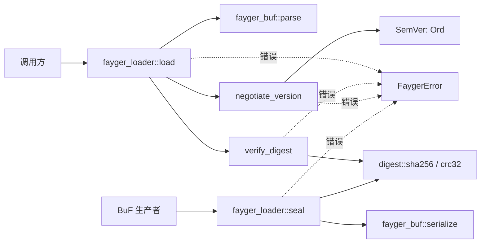
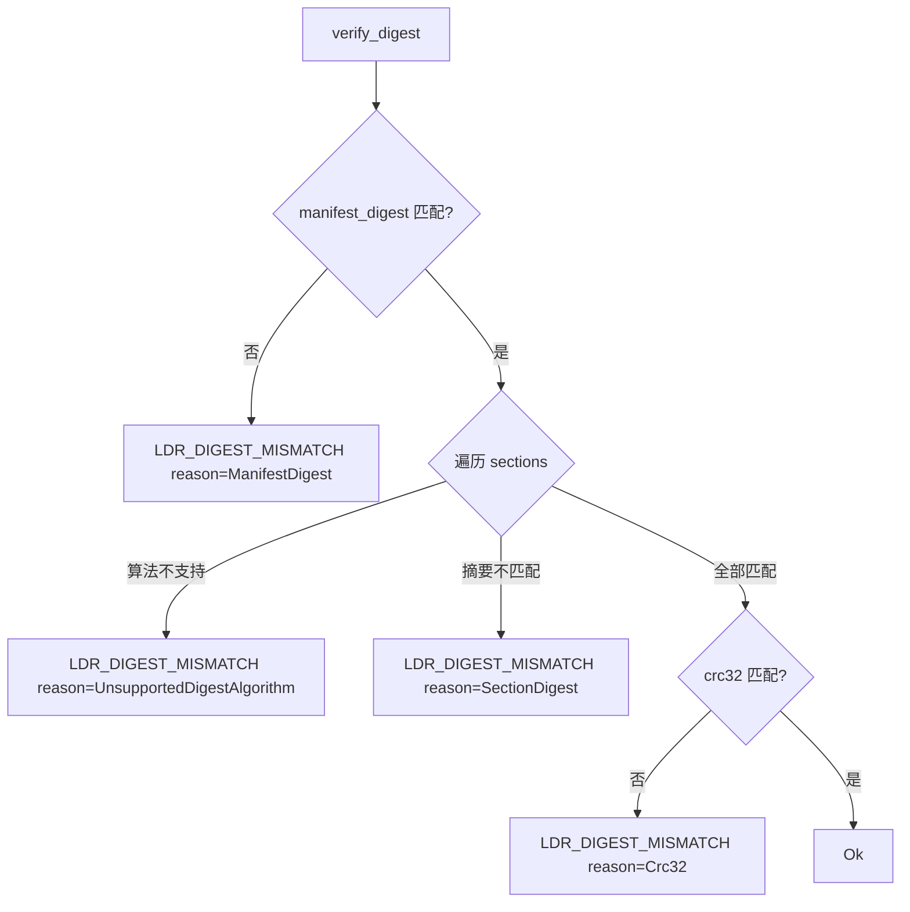
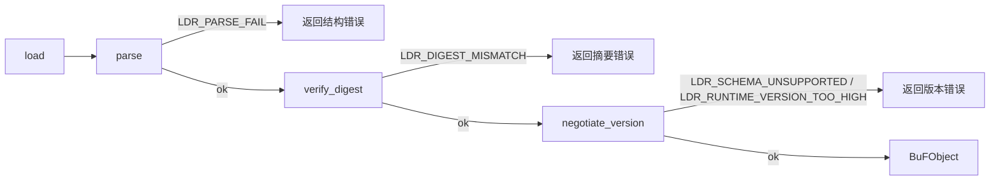

# Design Document

## Overview

本文是 M1 里程碑（加载链：Verify(Digest) + Negotiate(Version)）的技术设计。M1 在 M0 已交付的 `fayger-buf`（格式 + Parser + Serializer）与 `fayger-error`（统一错误模型）之上，新增一条加载链入口，把"结构上合法的字节"提升为"完整性已校验、版本兼容的内存对象"。

设计目标按优先级：

1. **正确性优先**：Verify(Digest) 的三类校验（manifest_digest / section digest / crc32）必须可被 PBT 持续验证；任何单点篡改在不更新对应摘要时必须被检出。
2. **不破坏 M0 契约**：M0 的 `parse` / `serialize` 在 M1 保持 digest 无关——它们继续原样读写占位字段。摘要的计算与校验全部位于新的加载链组件，绝不回写 M0 的解析/序列化路径。
3. **可演进**：加载链编排为线性阶段序列，M4（签名）只需在 Verify(Digest) 与 Negotiate(Version) 之间插入 Verify(Signature)，M5/M6（Source / Profile）只需替换"取字节"的前端，不动后续阶段。
4. **最小依赖**：仅为 SHA-256 与 CRC-32 各引入一个纯 Rust、无 unsafe 暴露面的成熟 crate。

## Architecture

### M1 在蓝图加载链里的位置

蓝图加载链：

```
Read → Parse → Verify(Structural) → Verify(Digest of Header/Manifest/Index)
  → Verify(Signature) → Negotiate(Version) → Select(Sections) → Resolve
  → Read(Section Bodies)? → HandOff
```

- M0 落实：Read（整段字节已在内存）、Parse、Verify(Structural)、HandOff（直接交还调用方）。
- **M1 落实：Verify(Digest)（manifest_digest + 每段 section digest + crc32）、Negotiate(Version)（schema 范围 + 弃用 + runtime 最低版本）。**
- 仍未实现：Verify(Signature)（M4）、Select / Resolve / Read Bodies（M5/M6）。

M1 的加载链入口 `load(bytes, policy)` 串联 M0 `parse` 之后的两阶段：

```
load(bytes, policy):
    obj = fayger_buf::parse(bytes)        // M0：Parse + Verify(Structural)
    verify_digest(bytes, &obj)            // M1：Verify(Digest)
    notice = negotiate_version(&obj.manifest, policy)  // M1：Negotiate(Version)
    obj.manifest.deprecation_notice = notice
    return obj
```

注意 Verify(Digest) 同时需要**原始字节** `bytes`（用于 manifest_digest 与 crc32 的区间摘要）与**解析后的对象** `obj`（用于按 section 取 payload 与声明摘要）。这两者都已在 `parse` 完成后可用，无需重新读取。

### Crate 拓扑（M1 新增 fayger-loader）

```
release/dev/core/
├── Cargo.toml               (workspace 根：新增 member crates/fayger-loader，新增 sha2 / crc32fast 依赖)
└── crates/
    ├── fayger-error/        (M0：FaygerError + Layer + ErrorCode；M1 追加 3 个 ErrorCode 变体)
    ├── fayger-buf/          (M0：格式 + Parser + Serializer；M1 为 SemVer 追加 Ord，新增 digest_regions 辅助常量/函数)
    └── fayger-loader/       (M1 新增：digest 校验、版本协商、封装、load 入口)
        ├── Cargo.toml
        └── src/
            ├── lib.rs       (pub use：load / seal / LoadPolicy / verify_digest / negotiate_version)
            ├── digest.rs    (sha256 / crc32 基元 + 区间计算辅助)
            ├── verify.rs    (verify_digest：manifest_digest + section digest + crc32)
            ├── seal.rs      (seal：计算并填入全部摘要)
            ├── version.rs   (LoadPolicy + negotiate_version)
            └── load.rs      (load：加载链编排)
```

依赖方向：

- `fayger-error`：无工作区依赖（M1 只追加枚举变体）。
- `fayger-buf`：依赖 `fayger-error`（M1 只为 SemVer 加 `Ord`，并暴露一个计算 `sections_offset` 的小辅助；不引入 sha2/crc32）。
- `fayger-loader`：依赖 `fayger-buf` + `fayger-error` + `sha2` + `crc32fast`。

为什么 digest 基元放 `fayger-loader` 而非 `fayger-buf`：M0 的核心契约是"格式与往返"，刻意保持 digest 无关（`parse`/`serialize` 不计算摘要）。把 sha2/crc32 依赖隔离在 loader crate，可让只需要 BuF 格式读写的下游（例如纯打包工具）不必拉入摘要依赖。

### 调用方向



## Components and Interfaces

### `fayger-error` crate（M1 增量）

仅在 `ErrorCode` 枚举追加三个变体（已标注 `#[non_exhaustive]`，不破坏既有匹配）：

```rust
#[non_exhaustive]
pub enum ErrorCode {
    // ----- Loader 层 (M0) -----
    LdrParseFail,
    LdrMissingRequiredField,
    // ----- Loader 层 (M1) -----
    /// `LDR_DIGEST_MISMATCH`：manifest_digest / section digest / crc32 校验失败，
    /// 或声明了不支持的摘要算法。具体由 context.reason 区分。
    LdrDigestMismatch,
    /// `LDR_SCHEMA_UNSUPPORTED`：schema_version 不在支持区间内。
    LdrSchemaUnsupported,
    /// `LDR_RUNTIME_VERSION_TOO_HIGH`：runtime_interface_min 高于当前提供版本。
    LdrRuntimeVersionTooHigh,
}
```

`as_str` 对应追加：

| 变体 | 稳定字符串 |
| --- | --- |
| `LdrDigestMismatch` | `LDR_DIGEST_MISMATCH` |
| `LdrSchemaUnsupported` | `LDR_SCHEMA_UNSUPPORTED` |
| `LdrRuntimeVersionTooHigh` | `LDR_RUNTIME_VERSION_TOO_HIGH` |

### `fayger-buf` crate（M1 增量）

**1. SemVer 比较（`manifest/semver.rs`）**

M0 已有 `SemVer` 结构与 `parse` / `Display`，但未实现比较。M1 补 `PartialOrd` / `Ord`：

```rust
impl Ord for SemVer {
    fn cmp(&self, other: &Self) -> Ordering {
        // 1. major / minor / patch 数值升序
        // 2. 平级时按 SemVer 2.0.0 §11：有 pre < 无 pre
        // 3. 都有 pre：按点分标识符逐段比较（数字段按数值、含非数字段按 ASCII、
        //    数字段 < 非数字段、真前缀更短者更低）
    }
}
impl PartialOrd for SemVer {
    fn partial_cmp(&self, other: &Self) -> Option<Ordering> { Some(self.cmp(other)) }
}
```

预发布段比较细则（SemVer 2.0.0 §11.4）：

- 把 `pre` 按 `.` 拆成标识符序列。
- 逐段比较：两段都是纯数字 → 按数值比较；否则按 ASCII 字典序；数字段恒小于含字母段。
- 较短一方若是较长一方的真前缀，则较短一方优先级更低。

注意：M0 的 `SemVer` 已 `derive(PartialEq, Eq, Hash)`，与新加的 `Ord` 一致（相等当且仅当四字段全等）。这满足"全序"中相等关系与比较关系的一致性。

**2. digest 区间辅助（`format.rs` 增量）**

加载链需要知道"Header || Manifest || Section_Index"在文件中的终点（即 sections 段起点）。这个值可从已解析的 `Header` 推导，但为避免在 loader 里重复魔法计算，`fayger-buf` 暴露一个纯函数：

```rust
impl Header {
    /// Manifest 摘要覆盖区间的终点（= sections 段起点）。
    /// 等于 section_index_offset + section_index_length。
    #[must_use]
    pub fn sections_offset(&self) -> Option<u64> {
        self.section_index_offset.checked_add(self.section_index_length)
    }
}
```

这是 `fayger-buf` 在 M1 唯一的对外行为新增，且与 digest 无关（不引入 sha2 依赖），符合范围边界 12.5。

### `fayger-loader` crate（M1 主体）

#### 模块 `digest`：摘要与校验和基元

```rust
//! SHA-256 与 CRC-32 基元，外加区间辅助。

/// 对字节切片计算 SHA-256，返回 32 字节。
pub fn sha256(bytes: &[u8]) -> [u8; 32];

/// 对字节切片计算 CRC-32（IEEE），返回 u32。
pub fn crc32(bytes: &[u8]) -> u32;
```

实现：`sha256` 包装 `sha2::Sha256`；`crc32` 包装 `crc32fast::Hasher`。两者都是确定性纯函数。

#### 模块 `verify`：Verify(Digest)

```rust
/// 对一段已成功 parse 的 BuF 执行完整性校验。
///
/// 需要原始字节 `bytes`（区间摘要 / crc32）与解析后的对象 `obj`
/// （按 section 取 payload 与声明摘要）。
pub fn verify_digest(bytes: &[u8], obj: &BuFObject) -> Result<(), FaygerError>;
```

执行顺序（任一失败立即返回）：

1. **Manifest 摘要**：`sections_offset = obj.raw_header.sections_offset()`；计算 `sha256(&bytes[0..sections_offset])`，与 `obj.raw_trailer.manifest_digest` 比较。不一致 → `LDR_DIGEST_MISMATCH` + `reason="ManifestDigest"`。
2. **Section 段体摘要**：遍历 `obj.manifest.sections` 与 `obj.sections`（M0 已保证一一对应）。对每段：
   - 若 `descriptor.digest.algorithm != "sha256"` → `LDR_DIGEST_MISMATCH` + `reason="UnsupportedDigestAlgorithm"` + `section_id` + `algorithm`。
   - 否则计算 `sha256(&section.payload)`，与 `descriptor.digest.value` 比较；不一致 → `reason="SectionDigest"` + `section_id` + `expected` + `actual`。
3. **crc32**：计算 `crc32(&bytes[0..total_length-4])`，与 `obj.raw_trailer.crc32` 比较。不一致 → `reason="Crc32"` + `expected` + `actual`。

设计取舍：先 Manifest 摘要、再 section、最后 crc32。Manifest 摘要覆盖头部元数据（含 section_index 中声明的各段 digest），逻辑上"先信任元数据骨架，再逐段核对内容，最后做整体随机损坏兜底"。crc32 放最后是因为它能检测前两步覆盖不到的区域（如 Trailer 自身 manifest_digest 字段的损坏），形成最外层防线。

错误映射表：

| 触发条件 | ErrorCode | context.reason | 关键 context 字段 |
| --- | --- | --- | --- |
| manifest_digest 不匹配 | LdrDigestMismatch | "ManifestDigest" | expected, actual |
| section 算法不支持 | LdrDigestMismatch | "UnsupportedDigestAlgorithm" | section_id, algorithm |
| section 摘要不匹配 | LdrDigestMismatch | "SectionDigest" | section_id, expected, actual |
| crc32 不匹配 | LdrDigestMismatch | "Crc32" | expected, actual |

#### 模块 `seal`：封装

```rust
/// 计算并填入全部摘要与 crc32，使对象再序列化后可通过 verify_digest。
///
/// 步骤：
/// 1. 校验 obj（manifest.validate + check_consistency）——与 serialize 一致。
/// 2. 对每段计算 sha256，写入 manifest.sections[i].digest（algorithm="sha256"）。
/// 3. serialize 一次得到完整字节，借此拿到精确布局，计算 manifest_digest 与 crc32。
/// 4. 把 manifest_digest 与 crc32 写回 obj.raw_trailer。
pub fn seal(obj: &mut BuFObject) -> Result<(), FaygerError>;
```

实现要点——为什么需要"先 serialize 一次"：manifest_digest 覆盖 `[0, sections_offset)`，而 sections_offset 取决于 Manifest 与 Section_Index 的 canonical 编码长度，这只有 serialize 后才精确已知。流程：

1. `obj.manifest.validate()?; obj.check_consistency()?;`
2. 计算每段 `sha256(payload)`，写入 `descriptor.digest`。**注意**：写入 section digest 会改变 Manifest 内容，从而改变 Manifest 编码长度与 manifest_digest 覆盖区间，所以必须在此步之后再 serialize。
3. 先把 `raw_trailer.manifest_digest`、`raw_trailer.crc32` 置零（占位），`serialize(obj)` → `bytes0`。此时 `bytes0` 的 section digest 已是真值，但 trailer 两字段为零。
4. `sections_offset = obj.raw_header.sections_offset()`（serialize 已回填 header 的 offset/length；但 seal 拿到的是临时序列化结果——见下）。计算 `manifest_digest = sha256(&bytes0[0..sections_offset])`，写入 `obj.raw_trailer.manifest_digest`。
5. 计算 crc32：crc32 覆盖 `[0, total_length-4)`，其中包含已写入真值的 manifest_digest。所以需要把第 4 步的 manifest_digest 先落到字节里。做法：再 `serialize(obj)` → `bytes1`（此时 manifest_digest 已是真值、crc32 仍为旧值零），`crc32 = crc32(&bytes1[0..total_length-4])`，写入 `obj.raw_trailer.crc32`。

  为避免对 `serialize` 内部 header 回填的依赖，seal 直接对 `bytes0` / `bytes1` 用 `parse` 不必要——它可以从 `bytes` 切片长度与 header 重新读 offset。更简单且自洽的实现：seal 内部解析自己刚序列化出的 `bytes0` 的 Header（用 `fayger_buf::parse` 或读取前 40 字节）拿到精确 `sections_offset` 与 `total_length`。设计选择用一次 `parse(&bytes0)` 复用既有逻辑，避免手算偏移。

  注：seal 调用 `serialize` 两次（一次拿布局算 manifest_digest，一次把 manifest_digest 落字节算 crc32）。两次 serialize 对 M0 是纯函数（确定性），代价是常数级，换取实现正确性与简单性，可接受。

封装后的不变式（由 PBT Property 1 保证）：`verify_digest(serialize(sealed_obj), parse(serialize(sealed_obj)))` 全通过。

#### 模块 `version`：Negotiate(Version)

```rust
/// 加载方提供的版本策略。
#[derive(Debug, Clone)]
pub struct LoadPolicy {
    /// 支持的 schema 版本闭区间 [low, high]。
    pub supported_schema_range: (SemVer, SemVer),
    /// 弃用但仍支持的 schema 版本集合。
    pub deprecated_schemas: BTreeSet<SemVer>,
    /// 当前 Fayger 提供的 Runtime_Interface 版本。
    pub runtime_interface_provided: SemVer,
}

/// 执行版本协商。返回 Some(notice) 表示命中弃用；None 表示正常。
pub fn negotiate_version(
    manifest: &BuFManifest,
    policy: &LoadPolicy,
) -> Result<Option<String>, FaygerError>;
```

决策（严格按此顺序，对应 Req 8.3：schema 错误优先于 runtime 错误）：

1. `s = manifest.schema_version`。若 `s < low || s > high` → `Err(LDR_SCHEMA_UNSUPPORTED)` + `expected_range`(low, high) + `schema_version`。
2. `r = manifest.runtime_interface_min`。若 `r > policy.runtime_interface_provided` → `Err(LDR_RUNTIME_VERSION_TOO_HIGH)` + `required` + `provided`。
3. 若 `policy.deprecated_schemas.contains(&s)` → `Ok(Some(notice))`，notice 形如 `"schema version {s} is deprecated"`。
4. 否则 `Ok(None)`。

决策表（对应需求 Req 7 / 8）：

| 条件 | 结果 |
| --- | --- |
| `s ∉ [low, high]` | `Err(LDR_SCHEMA_UNSUPPORTED)` |
| `s ∈ [low, high]` 且 `r > provided` | `Err(LDR_RUNTIME_VERSION_TOO_HIGH)` |
| `s ∈ [low, high] \ deprecated` 且 `r ≤ provided` | `Ok(None)` |
| `s ∈ deprecated`（且在区间内）且 `r ≤ provided` | `Ok(Some(notice))` |

#### 模块 `load`：加载链编排

```rust
pub fn load(bytes: &[u8], policy: &LoadPolicy) -> Result<BuFObject, FaygerError> {
    let mut obj = fayger_buf::parse(bytes)?;        // 阶段 1：Parse + Verify(Structural)
    verify_digest(bytes, &obj)?;                     // 阶段 2：Verify(Digest)
    let notice = negotiate_version(&obj.manifest, policy)?;  // 阶段 3：Negotiate(Version)
    obj.manifest.deprecation_notice = notice;
    Ok(obj)
}
```

阶段顺序即错误优先级（Req 9.3）：结构 → 摘要 → 版本。`?` 的短路天然保证"最先失败阶段的错误被返回"。

## Data Models

### Verify(Digest) 覆盖区间图

```
文件字节布局（M0 已固化）：
+--------+----------+---------------+------------+-------------------------+
| Header | Manifest | Section_Index | Sections   | Trailer                 |
| 40B    | M        | I             | S          | total_len|m_digest|crc32|
+--------+----------+---------------+------------+-------------------------+
0        40         40+M            40+M+I       total-44  total-36  total-4

manifest_digest 覆盖： [0, 40+M+I)  = [0, sections_offset)
section[i] digest 覆盖：sections 段内第 i 段 payload 字节
crc32 覆盖：           [0, total-4)  （含 Trailer 的 total_length 与 manifest_digest，
                                       不含 crc32 自身末 4 字节）
```

关键点：

- manifest_digest **不**覆盖 Sections 段，所以单独篡改某段 payload 不会破坏 manifest_digest——这正是为什么需要独立的 section digest。两者职责互补。
- crc32 覆盖几乎整文件（除自身），是对随机损坏的兜底；它**会**覆盖 manifest_digest 字段本身，因此 manifest_digest 被改而 crc32 未同步更新时，crc32 校验也会失败（双重防线）。
- section digest 的真值被写进 Manifest（即 section_index），而 Manifest 又被 manifest_digest 覆盖。所以"改了某段 payload 又想瞒过去"需要同时改 payload digest（在 Manifest 里）并重算 manifest_digest 并重算 crc32——任一不同步都会被检出。

### LoadPolicy 示例

```rust
LoadPolicy {
    supported_schema_range: (SemVer::parse("1.0.0")?, SemVer::parse("1.9.9")?),
    deprecated_schemas: [SemVer::parse("1.0.0")?].into_iter().collect(),
    runtime_interface_provided: SemVer::parse("1.2.0")?,
}
```

- BuF 声明 `schema_version=1.0.0` → 在区间内、属弃用 → 加载通过，带 notice。
- BuF 声明 `schema_version=2.0.0` → 超上界 → `LDR_SCHEMA_UNSUPPORTED`。
- BuF 声明 `runtime_interface_min=1.5.0` → 高于 provided 1.2.0 → `LDR_RUNTIME_VERSION_TOO_HIGH`。

### SemVer 全序

M1 引入的 `Ord` 满足：

- 自反：`a.cmp(a) == Equal`。
- 反对称：`a ≤ b ∧ b ≤ a ⟹ a == b`。
- 传递：`a ≤ b ∧ b ≤ c ⟹ a ≤ c`。

与 M0 的 `PartialEq` 一致：`a == b ⟺ a.cmp(b) == Equal`（四字段全等）。

## Error Handling

### Verify(Digest) 错误流



### 加载链错误优先级



### 默认安全姿态

- **算法白名单**：section digest 只接受 `sha256`；未知算法直接拒绝（不静默放过），与 M0"拒绝未知枚举值"一致。
- **区间用 checked 运算**：所有 offset 加法用 `checked_add`，越界返回结构化错误而非 panic（M0 已建立此惯例，M1 沿用）。
- **错误不泄漏内部指针/地址**：context 只放摘要十六进制、id、版本号等可序列化值。

## Correctness Properties

> 这些性质从需求文档 Requirement 11 提取，对应 PBT 测试。沿用 M0 的 `.regressions` 归档机制与 `arb_*` 生成器（在 `fayger-buf::testing` 基础上，loader 测试新增 `arb_load_policy` 等）。

### Property 1: 封装-加载往返

*For any* 合法 BuFObject `o`（结构一致、必填齐全），令 `seal(&mut o)` 后 `bytes = serialize(o)`，则 `load(bytes, policy_accepting(o))` 必须成功，且其 `verify_digest` 三类校验全通过；进一步 `serialize(load(...)) == bytes`（继承 M0 字节级强往返）。

**Validates: Requirements 5.4, 9.4, 11.1**

### Property 2: 摘要篡改被检测

*For any* 经封装并序列化的合法字节流 `bytes` 与任意单点修改 `m`（翻转 `[0, total-4)` 区间内任一比特，但不重新封装），`load(m(bytes), policy)` 必须返回 `LDR_DIGEST_MISMATCH`。具体地：篡改落在 `[0, sections_offset)` → `ManifestDigest` 或 `Crc32`；落在某段 payload → `SectionDigest` 或 `Crc32`；落在 Trailer 的 manifest_digest 字段 → `Crc32`。

**Validates: Requirements 2.2, 3.2, 4.2, 11.1**

### Property 3: crc32 篡改被检测

*For any* 经封装的合法字节流 `bytes`，若仅修改其 crc32 末 4 字节为任意不同值，则 `load(bytes', policy)` 必须返回 `LDR_DIGEST_MISMATCH` 且 `reason == "Crc32"`。

**Validates: Requirements 4.2, 11.1**

### Property 4: 版本协商决策表

*For any* `(schema_version, runtime_interface_min, policy)` 组合，`negotiate_version` 的结果必须满足设计文档决策表：`s ∉ range` ⟹ `Err(LDR_SCHEMA_UNSUPPORTED)`；`s ∈ range ∧ r > provided` ⟹ `Err(LDR_RUNTIME_VERSION_TOO_HIGH)`；`s ∈ range\deprecated ∧ r ≤ provided` ⟹ `Ok(None)`；`s ∈ deprecated ∧ r ≤ provided` ⟹ `Ok(Some(_))`。且 schema 错误优先于 runtime 错误。

**Validates: Requirements 7.1, 7.2, 7.3, 7.4, 8.1, 8.2, 8.3, 9.3, 11.1**

### Property 5: SemVer 全序

*For any* SemVer 三元组 `(a, b, c)`：`cmp` 满足自反、反对称、传递；且与 `==` 一致（`a==b ⟺ cmp(a,b)==Equal`）；且预发布版本严格低于同 major.minor.patch 的正式版本。

**Validates: Requirements 6.1, 6.2, 6.3, 6.4, 11.1**

## Testing Strategy

### 测试金字塔

```
        ┌──────────────────────────┐
        │ 集成快照测试 (sealed.buf) │
        └──────────────────────────┘
      ┌───────────────────────────────┐
      │  PBT (5 properties × ≥500x)   │
      └───────────────────────────────┘
   ┌──────────────────────────────────────┐
   │ 单元测试：sha256/crc32 已知向量、     │
   │ verify 各 reason、negotiate 决策表、   │
   │ SemVer 比较边界                        │
   └──────────────────────────────────────┘
```

### 单元测试

- `digest`：SHA-256 用 NIST 已知向量（空串、"abc"）核对；CRC-32 用已知向量（"" → 0、"123456789" → 0xCBF43926）核对。
- `verify`：构造经封装的合法对象，分别篡改 manifest 区间 / section payload / crc32 / 算法标识，断言对应 reason。
- `version`：决策表逐行一个用例。
- `semver`：`1.0.0 < 1.0.1 < 1.1.0 < 2.0.0`；`1.0.0-alpha < 1.0.0`；`1.0.0-alpha < 1.0.0-alpha.1 < 1.0.0-beta < 1.0.0-beta.2 < 1.0.0-beta.11`（SemVer §11 经典样例）。

### PBT 生成器（loader 测试内）

复用 `fayger_buf::testing::arb_buf_object`，新增：

```rust
fn arb_sealed_bytes() -> impl Strategy<Value = Vec<u8>>;   // arb_buf_object -> seal -> serialize
fn arb_load_policy_for(m: &BuFManifest) -> LoadPolicy;     // 构造一个接受该 manifest 的 policy
fn arb_semver() -> impl Strategy<Value = SemVer>;          // 复用 fayger_buf::testing
```

### 快照测试

- `tests/fixtures/sealed.buf`：一个经 `seal` 的两段 BuF（Code + Asset），提交进 git。
- 测试：`load(sealed.buf, policy)` 成功；篡改任一字节后 `load` 失败。
- 提供 `#[ignore]` 的重生成器测试，便于格式演进时刷新 fixture（沿用 M0 惯例）。

### 反例归档

沿用 M0：每个 PBT 文件 `failure_persistence = WithSource("regressions")`，`.regressions` 文件进 git。

### CI

复用 `.github/workflows/ci-m0.yml`，把 paths 触发与 workspace 构建自然覆盖到新 crate（workspace 级 `cargo test --workspace` 已含 fayger-loader）。无需新增 workflow 文件；如需要，可把 `ci-m0.yml` 更名为通用 `ci-core.yml`（M1 任务中处理 README 与 CI 说明，不强制改名）。

## Dependency Versions

在 `release/dev/core/Cargo.toml` 的 `[workspace.dependencies]` 新增：

```toml
sha2 = "0.10"        # 纯 Rust SHA-2，活跃维护，no_std 友好
crc32fast = "1.4"    # 纯 Rust CRC-32 (IEEE)，活跃维护
```

两者均 `unsafe` 暴露面可控；workspace 已 `unsafe_code = "forbid"` 作用于本仓 crate（不约束依赖），依赖内部的 SIMD 优化属其自身实现细节。

`fayger-loader/Cargo.toml`：

```toml
[dependencies]
fayger-buf = { path = "../fayger-buf" }
fayger-error = { path = "../fayger-error" }
sha2 = { workspace = true }
crc32fast = { workspace = true }

[dev-dependencies]
fayger-buf = { path = "../fayger-buf", features = ["testing"] }
proptest = { workspace = true }
```

## Open Questions

- **Q1**：crc32 的字节范围是否应包含 manifest_digest 字段？
  - 决定：**包含**。crc32 覆盖 `[0, total-4)`，含 manifest_digest 与 total_length。好处是 crc32 成为最外层兜底，连 manifest_digest 字段自身的损坏也能被 crc32 捕获。
- **Q2**：seal 需要两次 serialize，是否值得优化为一次？
  - 决定：M1 不优化。两次 serialize 是确定性常数代价，换取实现直观、不依赖 serialize 内部布局细节。若 M5+ 出现大制品封装性能问题再议。
- **Q3**：section digest 是否支持除 sha256 外的算法（如 sha512 / blake3）？
  - 决定：M1 只支持 sha256，其余声明一律 `UnsupportedDigestAlgorithm`。多算法支持可在后续里程碑随需求加入（错误码已为此预留 reason 维度）。
