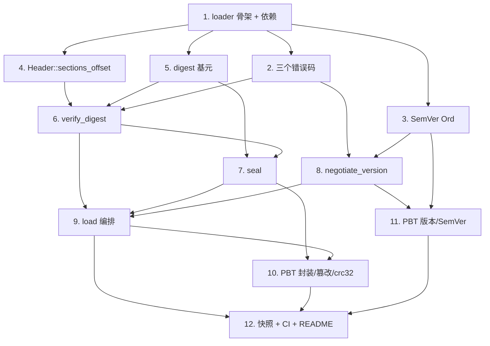

# Implementation Plan

## Overview

本任务清单基于 `requirements.md` 与 `design.md`，把 M1（加载链：Verify(Digest) + Negotiate(Version)）的实现拆成 12 个独立可完成的任务。每个任务的产出都直接对应需求文档中的某条验收条款。

任务以 1.x 顺序号编号，便于在 PR 标题里引用，例如 `feat(m1/4): manifest digest verification`。

## Tasks

- [x] 1. 依赖锁定与 fayger-loader 骨架
  - 在根 `Cargo.toml` 的 `[workspace.dependencies]` 新增 `sha2 = "0.10"`、`crc32fast = "1.4"`，并把 `crates/fayger-loader` 加入 `[workspace].members`。
  - 新建 `crates/fayger-loader/Cargo.toml`（依赖 fayger-buf、fayger-error、sha2、crc32fast；dev-deps：fayger-buf[testing]、proptest）与空 `src/lib.rs`，沿用 workspace lints。
  - 确认 `cargo check --workspace` 通过。
  - _Requirements: 约束与假设、12.1, 12.2, 12.3_

- [x] 2. fayger-error：新增三个 M1 错误码
  - 在 `ErrorCode` 枚举追加 `LdrDigestMismatch`、`LdrSchemaUnsupported`、`LdrRuntimeVersionTooHigh`。
  - 在 `as_str` 追加对应稳定字符串 `LDR_DIGEST_MISMATCH` / `LDR_SCHEMA_UNSUPPORTED` / `LDR_RUNTIME_VERSION_TOO_HIGH`。
  - 单元测试：新增三个码的 `as_str` 与 `Display` 一致性；既有两码不变。
  - _Requirements: 10.1, 10.2, 10.4_

- [x] 3. fayger-buf：SemVer 全序比较
  - 为 `SemVer` 实现 `Ord` / `PartialOrd`：major→minor→patch 数值升序；平级时按 SemVer 2.0.0 §11（有 pre < 无 pre；都有 pre 时按点分标识符逐段比较，数字段按数值、含字母段按 ASCII、数字段 < 含字母段、真前缀更短者更低）。
  - 单元测试：`1.0.0<1.0.1<1.1.0<2.0.0`；`1.0.0-alpha<1.0.0`；`1.0.0-alpha<1.0.0-alpha.1<1.0.0-beta<1.0.0-beta.2<1.0.0-beta.11`；与 `==` 一致性。
  - _Requirements: 6.1, 6.2, 6.3, 6.4_

- [x] 4. fayger-buf：Header::sections_offset 辅助
  - 在 `format.rs` 为 `Header` 新增 `sections_offset(&self) -> Option<u64>`（= `section_index_offset.checked_add(section_index_length)`）。
  - 单元测试：正常值返回 Some；溢出返回 None。
  - 确认不引入任何 digest 依赖（保持 M0 parse/serialize 行为不变）。
  - _Requirements: 12.4, 12.5, 2.1_

- [x] 5. fayger-loader::digest：sha256 / crc32 基元
  - 在 `digest.rs` 实现 `sha256(&[u8]) -> [u8; 32]`（包装 sha2::Sha256）与 `crc32(&[u8]) -> u32`（包装 crc32fast）。
  - 单元测试：SHA-256 已知向量（空串、"abc"）；CRC-32 已知向量（"" → 0、"123456789" → 0xCBF43926）；确定性（重复调用相等）。
  - _Requirements: 1.1, 1.2, 1.3, 1.4_

- [x] 6. fayger-loader::verify：Verify(Digest)
  - 在 `verify.rs` 实现 `verify_digest(bytes: &[u8], obj: &BuFObject) -> Result<(), FaygerError>`。
  - 顺序：manifest_digest（区间 `[0, sections_offset)`）→ 逐段 section digest（算法白名单 sha256）→ crc32（区间 `[0, total-4)`）。
  - 错误映射：reason ∈ {ManifestDigest, UnsupportedDigestAlgorithm, SectionDigest, Crc32}，附 expected/actual/section_id/algorithm 等 context。
  - 单元测试：构造手工封装的合法对象，分别篡改四类目标，断言对应 reason；空 sections 跳过段校验。
  - _Requirements: 2.1, 2.2, 2.3, 3.1, 3.2, 3.3, 3.4, 4.1, 4.2, 4.3, 10.3_

- [x] 7. fayger-loader::seal：封装
  - 在 `seal.rs` 实现 `seal(obj: &mut BuFObject) -> Result<(), FaygerError>`。
  - 步骤：validate + check_consistency → 每段写 sha256 digest → serialize 取布局算 manifest_digest 写回 → 再 serialize 算 crc32 写回。
  - 单元测试：seal 后 `verify_digest(serialize(obj), parse(serialize(obj)))` 全通过；缺字段/不一致对象被拒（错误码与 M0 serialize 一致）。
  - _Requirements: 5.1, 5.2, 5.3, 5.4, 5.5_

- [x] 8. fayger-loader::version：LoadPolicy + negotiate_version
  - 在 `version.rs` 定义 `LoadPolicy { supported_schema_range, deprecated_schemas, runtime_interface_provided }` 与 `negotiate_version(manifest, policy) -> Result<Option<String>, FaygerError>`。
  - 决策顺序：schema 范围 → runtime 最低版本 → 弃用提示（schema 错误优先于 runtime 错误）。
  - 单元测试：决策表逐行一个用例（含上下界、弃用命中、runtime 过高、schema 与 runtime 同时不通过时返回 schema 错误）。
  - _Requirements: 7.1, 7.2, 7.3, 7.4, 8.1, 8.2, 8.3, 10.3_

- [x] 9. fayger-loader::load：加载链编排
  - 在 `load.rs` 实现 `load(bytes, policy) -> Result<BuFObject, FaygerError>`：parse → verify_digest → negotiate_version → 写入 deprecation_notice。
  - 在 `lib.rs` `pub use`：`load`、`seal`、`verify_digest`、`negotiate_version`、`LoadPolicy`、`digest::{sha256, crc32}`。
  - 单元测试：端到端 happy path（seal→serialize→load 成功且 notice 正确）；阶段优先级（构造同时违反结构/摘要/版本的输入，断言按 parse>digest>version 返回）。
  - _Requirements: 9.1, 9.2, 9.3, 9.4, 9.5_

- [x] 10. PBT：Property 1 + Property 2 + Property 3（封装-加载往返 / 摘要篡改 / crc32 篡改）
  - 在 `tests/seal_load.rs` 实现 Property 1（seal→serialize→load 成功 + 字节级强往返）。
  - 在 `tests/digest_tamper.rs` 实现 Property 2（翻转 `[0,total-4)` 任一比特，load 返回 LDR_DIGEST_MISMATCH）与 Property 3（仅改末 4 字节 crc32 → reason=Crc32）。
  - `ProptestConfig { cases: 500, .. }`；`failure_persistence = WithSource("regressions")`，`.regressions` 进 git。
  - 新增生成器 `arb_sealed_bytes` / `arb_load_policy_for`（复用 `fayger_buf::testing::arb_buf_object`）。
  - _Requirements: 5.4, 9.4, 2.2, 3.2, 4.2, 11.1, 11.4_

- [x] 11. PBT：Property 4 + Property 5（版本协商决策表 / SemVer 全序）
  - 在 `tests/version_negotiation.rs` 实现 Property 4（随机 schema/runtime/policy 组合满足决策表，schema 错误优先）。
  - 在 `tests/semver_order.rs` 实现 Property 5（自反/反对称/传递/与==一致/pre<release）。
  - cases ≥ 500；`.regressions` 进 git。
  - _Requirements: 6.1, 6.2, 6.3, 6.4, 7.x, 8.x, 9.3, 11.1_

- [x] 12. 快照测试、CI 与文档
  - 生成 `tests/fixtures/sealed.buf`（经 seal 的两段 BuF），提交进 git；`tests/fixtures.rs`：`load(sealed.buf, policy)` 成功、篡改任一字节后失败；提供 `#[ignore]` 重生成器。
  - 确认 `.github/workflows/ci-m0.yml` 的 workspace 级 test/clippy/doc 自然覆盖 fayger-loader（无需新 workflow）。
  - 更新 `release/dev/core/README.md`：新增 fayger-loader crate 说明、M1 PBT 概览与本地复现步骤；更新里程碑状态。
  - _Requirements: 11.2, 11.3, 11.5_

## Task Dependency Graph

依赖图以"波次（waves）"形式描述，每一波内的任务可以并行进行；后一波必须在前一波完全完成后开始。

```json
{
  "waves": [
    {
      "wave": 1,
      "tasks": [1],
      "description": "依赖锁定与 fayger-loader 骨架，所有后续任务前置"
    },
    {
      "wave": 2,
      "tasks": [2, 3, 4, 5],
      "description": "并行基础件：错误码、SemVer 比较、Header 辅助、digest 基元"
    },
    {
      "wave": 3,
      "tasks": [6, 8],
      "description": "Verify(Digest)（依赖 4/5）与 Negotiate(Version)（依赖 2/3）"
    },
    {
      "wave": 4,
      "tasks": [7],
      "description": "seal（依赖 5 与 verify 语义对齐）"
    },
    {
      "wave": 5,
      "tasks": [9],
      "description": "load 编排（依赖 6/7/8）"
    },
    {
      "wave": 6,
      "tasks": [10, 11],
      "description": "全部 PBT（依赖 seal/load/negotiate/semver 就绪）"
    },
    {
      "wave": 7,
      "tasks": [12],
      "description": "快照、CI、README"
    }
  ]
}
```

可视化依赖：



## Notes

### 依赖路径要点

- 任务 1 是所有后续任务前置（loader crate 与 sha2/crc32 依赖未就位时无法编译）。
- 任务 4（Header::sections_offset）与任务 5（digest 基元）共同支撑任务 6（verify_digest）。
- 任务 7（seal）依赖任务 6 的 digest 语义对齐：seal 写入的摘要必须正好能让 verify_digest 通过；两者放相邻波次便于联调。
- 任务 9（load）是三阶段编排，依赖 6/7/8 全部就位。
- PBT（10/11）必须在 seal/load/negotiate/semver 之后。

### 风险与备选

- **风险 R1：seal 两次 serialize 的 manifest_digest 区间计算出错（off-by-one）**。
  - 应对：seal 内部复用 `parse(&bytes0)` 读回精确 Header，避免手算 sections_offset；任务 7 单测直接断言 seal→verify 闭环。
- **风险 R2：crc32 是否包含 manifest_digest 字段的语义分歧**。
  - 应对：设计已定为"crc32 覆盖 `[0, total-4)`，包含 manifest_digest"。任务 6 单测显式覆盖"只改 manifest_digest 字节 → crc32 也失败"。
- **风险 R3：SemVer 预发布比较的边界（数字段 vs 字母段、真前缀）实现易错**。
  - 应对：任务 3 用 SemVer §11 经典样例链做单测；任务 11 用 PBT 验证全序三性质。

### 完成标准

M1 完成的判定：

1. 所有 12 个任务的复选框都打勾。
2. `cargo test --workspace --all-features` 在 ubuntu / macos / windows 全部通过（含 M0 既有测试不回归）。
3. `cargo clippy --workspace --all-targets --all-features -- -D warnings` 通过。
4. PBT 反例归档目录存在但无未修复反例。
5. `release/dev/core/README.md` 已更新 fayger-loader 说明与 M1 复现步骤。
6. 在 PR 中合回 `release/dev`，PR 描述列出每个任务的 commit 链接。
