# Design Document

## Overview

本文是 M10 里程碑（运行层↔适配层统一桥接）的技术设计。M10 把运行层执行流经适配层派发到 `HostSyscall`，并在失败时构造 `[Runtime, Adapter]` 跨层错误链。

设计核心是**经运行层 `Adapter` trait 这一既有接缝粘合两层**，从而尊重蓝图 §8.8「运行层不得 import Platform_Adapter 类型」的分层约束：

```
fayger-runtime  ──提供 trait Adapter（接缝）──┐
                                              │ 实现
fayger-adapter  ──AdapterRegistry/翻译/裁剪──┐│
                                            ││
fayger-bridge (M10 新增) ───────────────────┴┴── BridgeAdapter: impl runtime::Adapter
   依赖 runtime + adapter，把两层粘合；依赖方向单向无环
```

`Runtime<A: Adapter>` 已是泛型，`Runtime::adapter(&self) -> &A` 已暴露。M10 无需修改运行层即可：构造 `Runtime<BridgeAdapter>`、跑完生命周期、再从 `rt.adapter()` 读回桥接记录的 `DispatchOutcome` 列表。

设计目标按优先级：

1. **打通三层主路径**：BuF → 运行层执行 → 适配层选择/裁剪/翻译 → `HostSyscall`，可被 PBT 验证。
2. **尊重分层**：`fayger-runtime` 不依赖 `fayger-adapter`；桥接经 `Adapter` trait 接缝完成；依赖方向单向无环。
3. **跨层错误链**：适配层失败经 `FaygerError::wrap` 包装为 `RT_INSTANCE_FAILED` 的 cause，`layer_chain() == [Runtime, Adapter]`。
4. **不破坏既有契约、不新增依赖、不新增错误码**：纯加性消费 M0–M9 API。

## Architecture

### 桥接数据流（一次 step 派发）

```
Runtime<BridgeAdapter>::step(id):
    instr_rt = program[pc]                  # 运行层最小指令（category:u8, opcode, operands）
    adapter.dispatch(&instr_rt)             # 运行层调用 Adapter trait
       └─ BridgeAdapter::dispatch:
            instr_adp = to_adapter_instruction(instr_rt, mapping)   # 翻译为适配层指令
            outcome   = registry.dispatch(&instr_adp)               # 选择已定；裁剪+翻译
            self.outcomes.push(outcome)      # 记录 Ok(HostSyscall) | Err(ADP_*)
```

> `Runtime::step` 内部对 `adapter.dispatch` 是单向调用（无返回值），因此桥接把每次派发结果**记录在 BridgeAdapter 内部**，运行结束后由 `run_bridged` 从 `rt.adapter().outcomes()` 读出汇总。这既不改运行层 `Adapter` trait，又拿到了适配层派发结果。

### run_bridged 端到端

```
run_bridged(obj, host, policy, mapping) -> Result<BridgeReport, FaygerError>:
    registry = AdapterRegistry::new()
    registry.register(NativeDesktop / Server / Browser / InApp)
    registry.select(host, policy)?          # 无匹配 → ADP_NO_MATCHING_PLATFORM
    platform_id = 被选中适配器的 platform_id
    bridge = BridgeAdapter::new(registry, mapping)
    rt = Runtime::new(bridge)
    id = rt.load(obj)?; rt.init(id)?; rt.start(id)?
    while rt.step(id)? {}                    # 每步经 BridgeAdapter 派发并记录
    rt.terminate(id)?
    outcomes = rt.adapter().outcomes()       # 读回派发结果
    BridgeReport {
        final_state: rt.state(id)?,          # Terminated
        dispatched: outcomes.len(),
        syscalls: outcomes 中 Ok 的 HostSyscall 列表,
        failures: outcomes 中 Err 的数量,
        platform_id,
    }
```

### Crate 拓扑

```
release/dev/core/crates/fayger-bridge/      (M10 新增)
├── Cargo.toml      (依赖 fayger-runtime / fayger-adapter / fayger-buf / fayger-error；dev: proptest)
└── src/
    ├── lib.rs          (pub use)
    ├── mapping.rs      (InstructionMapping / to_adapter_instruction)
    ├── adapter.rs      (BridgeAdapter: impl runtime::Adapter；DispatchOutcome)
    ├── run.rs          (run_bridged / BridgeReport / register_builtin_adapters)
    └── error.rs        (wrap_dispatch_failure：ADP_* → RT_INSTANCE_FAILED cause)

release/dev/core/crates/fayger-cli/         (M10 扩展)
└── src/{args.rs, commands.rs, lib.rs}      (新增 Bridge 子命令 + bridge_object 核心)
```

## Components and Interfaces

### `fayger-bridge::mapping`

运行层 `UniversalInstruction`（记为 `rt::UniversalInstruction`）与适配层的同名类型（`adp::UniversalInstruction`）是**不同 crate 的不同类型**。翻译策略：

```rust
use fayger_adapter::{Capability, InstructionCategory, UniversalInstruction as AdpInstruction};
use fayger_runtime::UniversalInstruction as RtInstruction;
use std::collections::BTreeSet;

/// 运行层指令 → 适配层指令的翻译策略。
#[derive(Debug, Clone, Default)]
pub struct InstructionMapping {
    /// 覆盖目标类别；None 时用 InstructionCategory::from_raw(rt.category)。
    pub category: Option<InstructionCategory>,
    /// 覆盖目标 opcode；None 时保留 rt.opcode。
    pub opcode: Option<u16>,
    /// 翻译产物声明的所需能力。
    pub capabilities_required: BTreeSet<Capability>,
}

impl InstructionMapping {
    /// 规范映射：把每条运行层指令视作一次 Io.op0 宿主写（无需能力）。
    pub fn canonical_io() -> Self;
    /// 声明该映射需要的能力（builder）。
    pub fn requiring<I, S>(self, caps: I) -> Self where I: IntoIterator<Item = S>, S: Into<String>;
}

/// 纯翻译。
#[must_use]
pub fn to_adapter_instruction(instr: &RtInstruction, mapping: &InstructionMapping) -> AdpInstruction;
```

翻译规则（Req 1）：
- `category = mapping.category.unwrap_or(InstructionCategory::from_raw(instr.category))`。
- `opcode   = mapping.opcode.unwrap_or(instr.opcode)`。
- `operands = instr.operands.clone()`（原样保留）。
- `capabilities_required = mapping.capabilities_required.clone()`。

> `canonical_io()`：`category = Some(Io)`，`opcode = Some(0)`，`capabilities_required = ∅`。因 M2 运行层程序是「每段一条、operands 为段长」的最小 mock，规范映射把它当作一次「宿主 I/O 写」。`Io.op0` 是四类内置适配器都支持的指令（`keys_for` 的第 0 项），故能力充分宿主上恒可派发成功。

### `fayger-bridge::adapter`

```rust
/// 一次桥接派发的结果。
pub type DispatchOutcome = Result<HostSyscall, FaygerError>;

/// 实现运行层 Adapter trait 的桥接适配器。
pub struct BridgeAdapter {
    registry: AdapterRegistry,        // 已 select 的注册表
    mapping: InstructionMapping,
    outcomes: Vec<DispatchOutcome>,   // 按派发顺序记录
}

impl BridgeAdapter {
    pub fn new(registry: AdapterRegistry, mapping: InstructionMapping) -> Self;
    pub fn outcomes(&self) -> &[DispatchOutcome];
}

impl fayger_runtime::Adapter for BridgeAdapter {
    fn dispatch(&mut self, instr: &fayger_runtime::UniversalInstruction) {
        let adp = to_adapter_instruction(instr, &self.mapping);
        self.outcomes.push(self.registry.dispatch(&adp));
    }
}

/// 单条桥接派发（纯，给定已 select 注册表与 mapping）。
pub fn dispatch_one(registry: &AdapterRegistry, mapping: &InstructionMapping,
                    instr: &fayger_runtime::UniversalInstruction) -> DispatchOutcome;
```

> `registry.dispatch` 已实现「未可服务 → ADP_NO_MATCHING_PLATFORM；能力不足 → ADP_CAPABILITY_DENIED（先于支持判定）；不支持 → ADP_UNSUPPORTED_INSTRUCTION；否则翻译为 HostSyscall」。桥接直接复用，能力裁剪与支持判定语义与适配层完全一致（Req 3）。

### `fayger-bridge::run`

```rust
#[derive(Debug, Clone, PartialEq, Eq)]
pub struct BridgeReport {
    pub final_state: LifecycleState,
    pub dispatched: usize,
    pub syscalls: Vec<HostSyscall>,
    pub failures: usize,
    pub platform_id: String,
}

/// 注册四类内置适配器（稳定顺序）。
pub fn register_builtin_adapters() -> AdapterRegistry;

/// 端到端桥接运行。
/// # Errors
/// 无匹配适配器（ADP_NO_MATCHING_PLATFORM）或运行层步骤失败时返回。
pub fn run_bridged(obj: BuFObject, host: &HostEnvironment, policy: &HostPolicy,
                   mapping: InstructionMapping) -> Result<BridgeReport, FaygerError>;
```

### `fayger-bridge::error`

```rust
/// 把适配层错误包装为 RT_INSTANCE_FAILED 的 cause（跨层错误链）。
#[must_use]
pub fn wrap_dispatch_failure(adp_error: FaygerError) -> FaygerError {
    FaygerError::wrap(
        ErrorCode::RtInstanceFailed, Layer::Runtime,
        "instruction dispatch failed in the adapter layer", adp_error,
    )
}
```

> `layer_chain() == [Runtime, Adapter]`（外层 Runtime，cause 为原 `ADP_*` 错误，其 `source_layer == Adapter`）。`wrap` 不改写被包装错误（M8 已保证），满足 Req 4.3。

### `fayger-cli`（M10 扩展，加性）

- `args.rs`：`Command::Bridge { path }`；`parse_args` 识别 `bridge <file>`（缺 path → Usage）。
- `commands.rs`：`bridge_object(obj) -> Result<BridgeReport, CliError>`（用 `detect_host_environment()` 的画像 + `HostPolicy::allow_all(画像能力)` + `canonical_io` 映射调用 `run_bridged`）；`render_bridge_report`。
- `lib.rs`：`run_cli` 分派 `Bridge`：read_file → load → bridge_object → 打印报告与 syscalls。
- `fayger-cli` 新增依赖 `fayger-bridge`、`fayger-adapter`。

## Data Models

### 桥接派发决策（图）

```mermaid
flowchart TB
    RT[Runtime.step 派发 rt 指令] --> BA[BridgeAdapter.dispatch]
    BA --> TR[to_adapter_instruction]
    TR --> RD[registry.dispatch&#40;adp 指令&#41;]
    RD --> CAP{能力足够?}
    CAP -- 否 --> E1[ADP_CAPABILITY_DENIED] --> REC[记录 Err]
    CAP -- 是 --> SUP{指令被支持?}
    SUP -- 否 --> E2[ADP_UNSUPPORTED_INSTRUCTION] --> REC
    SUP -- 是 --> OK[HostSyscall] --> REC2[记录 Ok]
```



### 翻译字段保持表

| 适配层指令字段 | 取值 |
| --- | --- |
| category | `mapping.category` 否则 `from_raw(rt.category)` |
| opcode | `mapping.opcode` 否则 `rt.opcode` |
| operands | `rt.operands`（原样） |
| capabilities_required | `mapping.capabilities_required` |

### 跨层错误链不变式

`wrap_dispatch_failure(adp)` 满足：`code == RT_INSTANCE_FAILED`；`source_layer == Runtime`；`root_cause() == adp`（`adp.code ∈ ADP_*`，`adp.source_layer == Adapter`）；`layer_chain() == [Runtime, Adapter]`；`depth() == adp.depth() + 1`。

## Error Handling

### M10 错误映射

| 触发 | 表达 | 层链 |
| --- | --- | --- |
| 无匹配适配器 | `ADP_NO_MATCHING_PLATFORM`（run_bridged 直接返回） | [Adapter] |
| 指令能力不足 | `ADP_CAPABILITY_DENIED`（记入 outcome） | [Adapter] |
| 指令不被支持 | `ADP_UNSUPPORTED_INSTRUCTION`（记入 outcome） | [Adapter] |
| 需以错误链表达派发失败 | `wrap_dispatch_failure` → `RT_INSTANCE_FAILED` cause `ADP_*` | [Runtime, Adapter] |

> M10 不新增错误码（Req 8）。能力不足/不支持的 outcome 默认记录在 `BridgeReport.failures` 计数中；需要把它升级为「实例失败」时用 `wrap_dispatch_failure` 构造跨层链。M10 的 `run_bridged` 默认不因单条派发失败而中止运行（记录 failures），以便报告完整派发情况；CLI 与 PBT 据 failures 判定。

### 默认安全姿态

- **分层不破坏**：`fayger-runtime` 不依赖 `fayger-adapter`；桥接经 trait 接缝（Req 5.1）。
- **能力裁剪默认生效**：经 `registry.dispatch`，与适配层同一裁剪语义（Req 3）。
- **不 panic**：全路径 `Result`；无匹配适配器返回 `ADP_NO_MATCHING_PLATFORM`。
- **确定性**：翻译、派发、报告在固定宿主画像与内置适配器顺序下可重放。
- **不触达真实宿主**：`translate` 仍是 mock，产出 `HostSyscall` 数据（Req 8.1）。

## Correctness Properties

> 对应 PBT。沿用前序里程碑的 `.regressions` 归档与 `cases: 500` 配置。

### Property 1: 指令翻译确定性与字段保持

*For any* 运行层指令与映射：`to_adapter_instruction` 产出的适配层指令 `operands` 等于输入 `operands`，`capabilities_required` 等于映射声明，`category`/`opcode` 遵守覆盖规则；且同输入两次调用结果相等。

**Validates: Requirements 1.1, 1.2, 1.3, 1.4, 1.5, 1.6**

### Property 2: 桥接运行在能力充分宿主上 syscall 数等于 section 数

*For any* 由随机 section 列表 pack 出的 BuF：在 native-desktop 画像 + 全能力策略 + 规范映射下 `run_bridged`，最终状态为 `Terminated`，`dispatched == section 数`，`syscalls.len() == section 数`，`failures == 0`，且每个 syscall 的 `platform_id == "native-desktop"`、`args` 等于被派发指令 operands（段长小端）。

**Validates: Requirements 2.2, 2.3, 2.4, 2.6**

### Property 3: 能力裁剪拒绝越权指令

*For any* 声明了一个宿主未授予能力的映射：`dispatch_one` 在已选中注册表上返回 `ADP_CAPABILITY_DENIED`，`context.missing` 非空且为未授予能力的子集。

**Validates: Requirements 3.1, 3.2, 3.4**

### Property 4: 不支持指令被拒

*For any* 映射到所选适配器不支持的指令种类（如 Browser 上的 `Proc`，且无能力要求以避免先被能力拦截）：`dispatch_one` 返回 `ADP_UNSUPPORTED_INSTRUCTION`。

**Validates: Requirements 3.3**

### Property 5: 跨层错误链顺序保持

*For any* 适配层 `ADP_*` 错误：`wrap_dispatch_failure` 产出的链 `layer_chain() == [Runtime, Adapter]`、`root_cause().code` 为该 `ADP_*`、被包装错误的 `code/source_layer/context` 未改写、`depth()` 比原错误多 1。

**Validates: Requirements 4.1, 4.2, 4.3, 4.4**

## Testing Strategy

### 测试金字塔

```
        ┌────────────────────────────────────────┐
        │ 端到端：load 链产物 → run_bridged →       │
        │ syscall 序列与 section 一致 + 跨层错误链   │
        └────────────────────────────────────────┘
      ┌──────────────────────────────────────────────┐
      │  PBT (5 properties × ≥500x)                   │
      └──────────────────────────────────────────────┘
   ┌────────────────────────────────────────────────────┐
   │ 单元：to_adapter_instruction、dispatch_one、          │
   │ run_bridged（desktop/browser/无匹配）、wrap_failure   │
   └────────────────────────────────────────────────────┘
```

### 单元测试

- `mapping`：默认/覆盖 category、opcode 保留、operands 保留、能力声明、canonical_io。
- `adapter`：BridgeAdapter 记录每次 outcome；dispatch_one Ok/Err 分支。
- `run`：native-desktop 上规范映射跑通（Terminated + syscalls==sections）；browser 上要求 proc.spawn 的映射被能力拒；无匹配画像 → ADP_NO_MATCHING_PLATFORM。
- `error`：wrap_dispatch_failure 层链与不改写。

### PBT 生成器

```rust
fn arb_rt_instruction();          // 随机运行层指令
fn arb_mapping();                 // 随机映射（含能力）
fn arb_sections();                // 复用 M9 风格（id 唯一）
fn arb_adp_error();               // 随机 ADP_* 错误
```

### 端到端测试

`fayger-bridge/tests/bridge_e2e.rs`：用 `fayger-loader::seal`+`serialize`+`load` 产出 BuF（或直接构造 BuFObject），在 native-desktop 画像上 `run_bridged`，断言 syscall 序列与 section 一致、platform_id 正确；再构造一次 browser 上需要 proc 能力的派发，`wrap_dispatch_failure` 后断言 `[Runtime, Adapter]`。

`fayger-cli/tests/cli_e2e.rs` 增补：`run_cli(["bridge", ...])` 路径（用 pack 出的临时内容经 run_cli 不便落盘，改为对 `bridge_object` 的纯内存断言 + 未知/缺参的退出码）。

### 反例归档 / CI

沿用前序里程碑：每个 PBT 文件 `failure_persistence = WithSource("regressions")`，`.regressions` 进 git。`ci-m0.yml` 的 workspace 级命令自然覆盖新 crate。

## Dependency Versions

M10 不引入新的第三方运行时依赖。`fayger-bridge` 依赖工作区内 `fayger-runtime` / `fayger-adapter` / `fayger-buf` / `fayger-error`；dev-dependency 用既有 `proptest`。`fayger-cli` 新增对 `fayger-bridge` / `fayger-adapter` 的依赖。

## Open Questions

- **Q1**：桥接放在新 crate 还是塞进 runtime/adapter 之一？
  - 决定：新 crate `fayger-bridge`。塞进 runtime 会迫使 runtime 依赖 adapter（违反 §8.8）；塞进 adapter 会让 adapter 依赖 runtime（语义颠倒）。独立集成层最干净，依赖方向单向无环。
- **Q2**：`Runtime::step` 对 adapter 的派发无返回值，桥接如何拿到 `HostSyscall`/错误？
  - 决定：BridgeAdapter 内部记录 `outcomes`，运行结束由 `rt.adapter()` 读回。无需改运行层 `Adapter` trait（保持 M2 契约），符合「加性」。
- **Q3**：运行层最小指令（category:u8）如何映射到适配层 8 类？
  - 决定：默认 `canonical_io`（全部当作 `Io.op0` 宿主写），因 M2 程序本就是最小 mock；同时提供 `from_raw` 透传与显式覆盖，供未来运行层采用完整指令集时演进。
- **Q4**：单条派发失败是否立即中止 run_bridged？
  - 决定：不中止，记入 `failures` 并继续，使报告完整反映整段派发；需要「失败即实例失败」时用 `wrap_dispatch_failure` 在调用方构造跨层链。这与 M2「step 不因 adapter 返回而改变生命周期」一致。
