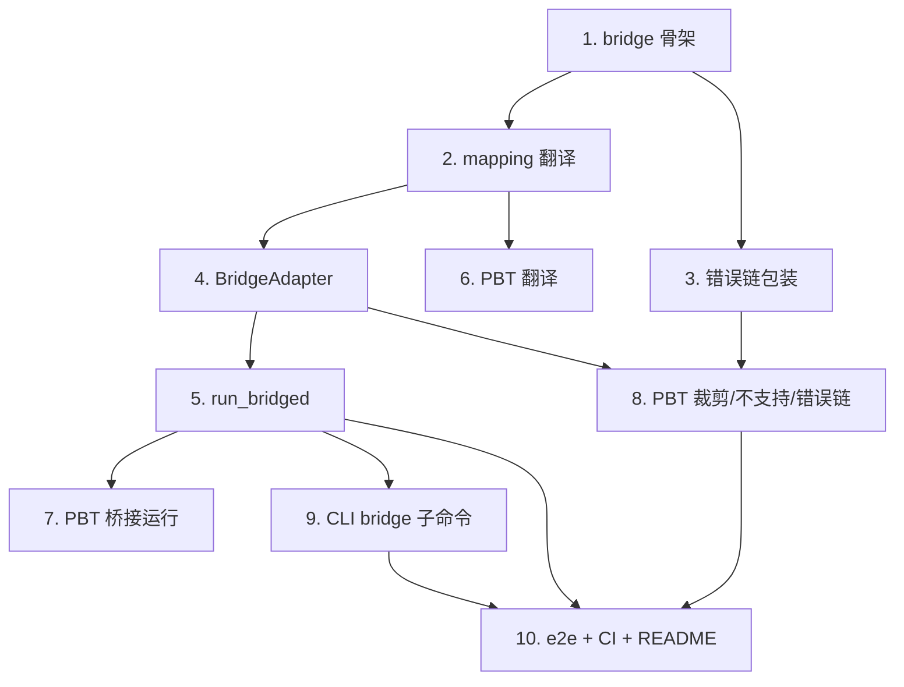

# Implementation Plan

## Overview

本任务清单基于 `requirements.md` 与 `design.md`，把 M10（运行层↔适配层统一桥接）的实现拆成 10 个独立可完成的任务。每个任务的产出都直接对应需求文档中的某条验收条款。

任务以 1.x 顺序号编号，便于在 PR 标题里引用，例如 `feat(m10/2): instruction mapping`。

## Tasks

- [x] 1. fayger-bridge crate 骨架
  - 新增 crate `fayger-bridge`（加入 workspace members；依赖 `fayger-runtime` / `fayger-adapter` / `fayger-buf` / `fayger-error`；dev: `proptest`）。
  - `lib.rs` 模块声明与 `pub use` 占位。
  - 验证：`cargo check -p fayger-bridge` 通过；确认 `fayger-runtime` 未依赖 `fayger-adapter`。
  - _Requirements: 5.1, 5.2, 5.5, 8.4_

- [x] 2. mapping：指令翻译
  - `mapping.rs`：`InstructionMapping { category, opcode, capabilities_required }` + `canonical_io()` + `requiring()`；`to_adapter_instruction(rt_instr, mapping) -> adp::UniversalInstruction`。
  - 翻译规则：category 覆盖否则 from_raw；opcode 覆盖否则保留；operands 原样；capabilities_required = mapping。
  - 单元测试：默认/覆盖 category、opcode 保留、operands 保留、能力声明、canonical_io。
  - _Requirements: 1.1, 1.2, 1.3, 1.4, 1.5, 1.6_

- [x] 3. error：跨层错误链包装
  - `error.rs`：`wrap_dispatch_failure(adp_error) -> FaygerError`（RT_INSTANCE_FAILED + cause）。
  - 单元测试：layer_chain==[Runtime,Adapter]、root_cause 为 ADP_*、不改写被包装错误、depth+1。
  - _Requirements: 4.1, 4.2, 4.3, 4.4, 8.3_

- [x] 4. adapter：BridgeAdapter + dispatch_one
  - `adapter.rs`：`DispatchOutcome`、`BridgeAdapter`（impl `fayger_runtime::Adapter`，记录 outcomes）、`outcomes()`、`dispatch_one(registry, mapping, rt_instr)`。
  - 单元测试：dispatch 记录每次 outcome；dispatch_one Ok（HostSyscall）/Err（能力/不支持）分支。
  - _Requirements: 2.1, 3.1, 3.2, 3.3, 3.4_

- [x] 5. run：run_bridged + BridgeReport
  - `run.rs`：`register_builtin_adapters()`、`BridgeReport`、`run_bridged(obj, host, policy, mapping)`（注册→select→Runtime<BridgeAdapter> 跑生命周期→读 outcomes 汇总）。
  - 单元测试：native-desktop 规范映射 Terminated + syscalls==sections + failures 0 + platform_id；无匹配画像 → ADP_NO_MATCHING_PLATFORM。
  - _Requirements: 2.2, 2.3, 2.4, 2.5, 2.6_

- [x] 6. PBT：Property 1（翻译确定性与字段保持）
  - `fayger-bridge/tests/mapping_props.rs`：随机 rt 指令 + 映射；断言字段保持与确定性。
  - `ProptestConfig { cases: 500, .. }`；`.regressions` 进 git；arb_rt_instruction / arb_mapping 生成器。
  - _Requirements: 1.1-1.6, 7.1_

- [x] 7. PBT：Property 2（桥接运行 syscall 数等于 section 数）
  - `fayger-bridge/tests/run_props.rs`：随机 section 列表构造 BuF，native-desktop + 全能力 + canonical_io；断言 Terminated、dispatched/syscalls==sections、failures 0、platform_id、args==operands。
  - cases ≥ 500；`.regressions` 进 git。
  - _Requirements: 2.2, 2.3, 2.4, 2.6, 7.1_

- [x] 8. PBT：Property 3 + 4 + 5（能力裁剪 / 不支持 / 错误链）
  - `fayger-bridge/tests/dispatch_props.rs`：P3（越权能力被 ADP_CAPABILITY_DENIED）+ P4（不支持指令被 ADP_UNSUPPORTED_INSTRUCTION）+ P5（wrap_dispatch_failure 层链顺序保持）。
  - cases ≥ 500；`.regressions` 进 git；arb_adp_error / 受限映射生成器。
  - _Requirements: 3.1, 3.3, 3.4, 4.1-4.4, 7.1_

- [x] 9. CLI 接入：bridge 子命令
  - `fayger-cli` 新增依赖 `fayger-bridge` / `fayger-adapter`；`args.rs` 加 `Command::Bridge { path }` 与解析（缺 path → Usage）；`commands.rs` 加 `bridge_object` + `render_bridge_report`；`lib.rs` `run_cli` 分派 bridge（read_file→load→bridge_object→打印）；usage_text 增 bridge 主题。
  - 单元测试：parse bridge；run_cli bridge 用 pack 内存对象经 bridge_object 跑通；缺 path → Usage。
  - _Requirements: 6.1, 6.2, 6.3, 6.4_

- [x] 10. 端到端测试、CI 确认与文档
  - `fayger-bridge/tests/bridge_e2e.rs`：load 链产物 → run_bridged（desktop）断言 syscall 序列与 section 一致；browser 上需 proc 能力的派发 → wrap_dispatch_failure → [Runtime,Adapter]。
  - 确认 `ci-m0.yml` workspace 级检查覆盖新 crate。
  - 更新 `release/dev/core/README.md`：新增 `fayger-bridge` crate 行、bridge 子命令、M10 PBT 概览与里程碑状态；`docs/INSTALL.md` 补 `fayger bridge` 用法（可选）。
  - _Requirements: 7.2, 7.3, 7.5_

## Task Dependency Graph

```json
{
  "waves": [
    { "wave": 1, "tasks": [1], "description": "crate 骨架" },
    { "wave": 2, "tasks": [2, 3], "description": "翻译 + 错误链（依赖 1）" },
    { "wave": 3, "tasks": [4], "description": "BridgeAdapter（依赖 2）" },
    { "wave": 4, "tasks": [5], "description": "run_bridged（依赖 4）" },
    { "wave": 5, "tasks": [6, 7, 8], "description": "PBT（6 依赖 2；7 依赖 5；8 依赖 4/3）" },
    { "wave": 6, "tasks": [9], "description": "CLI bridge 子命令（依赖 5）" },
    { "wave": 7, "tasks": [10], "description": "端到端 + CI + README（依赖 5/8/9）" }
  ]
}
```

可视化依赖：



## Notes

### 依赖路径要点

- 任务 1（骨架）是基础；任务 2（翻译）与 3（错误链）依赖 1。
- 任务 4（BridgeAdapter）依赖 2；任务 5（run_bridged）依赖 4。
- PBT：6 依赖 2，7 依赖 5，8 依赖 3/4；CLI（9）依赖 5；收尾（10）依赖 5/8/9。

### 风险与备选

- **风险 R1：误让 fayger-runtime 依赖 fayger-adapter**。
  - 应对：桥接经运行层 `Adapter` trait 接缝；依赖只加在 fayger-bridge。任务 1 显式核对 runtime 的 Cargo.toml 不含 adapter。
- **风险 R2：两个 crate 同名 `UniversalInstruction` 混淆**。
  - 应对：在 bridge 内用 `as RtInstruction` / `as AdpInstruction` 别名区分。任务 2 落实。
- **风险 R3：step 单向派发拿不到 syscall**。
  - 应对：BridgeAdapter 内部记录 outcomes，运行后从 `rt.adapter()` 读回。任务 4/5 落实。
- **风险 R4：能力裁剪语义与适配层不一致**。
  - 应对：直接复用 `AdapterRegistry::dispatch`，不另写裁剪逻辑。任务 4 落实。

### 完成标准

M10 完成的判定：

1. 所有 10 个任务的复选框都打勾。
2. `cargo test --workspace --all-features` 在 ubuntu / macos / windows 全部通过（含前序里程碑既有测试不回归）。
3. `cargo clippy --workspace --all-targets --all-features -- -D warnings` 通过。
4. PBT 反例归档目录存在但无未修复反例。
5. `fayger bridge <file>` 可在本机宿主上把一个 BuF 经适配层运行并打印 HostSyscall。
6. `release/dev/core/README.md` 已更新 M10 说明。
7. 确认 `fayger-runtime` 仍未依赖 `fayger-adapter`（分层不破坏）。
8. 在 PR 中合回 `release/dev`，PR 描述列出每个任务的 commit 链接。
