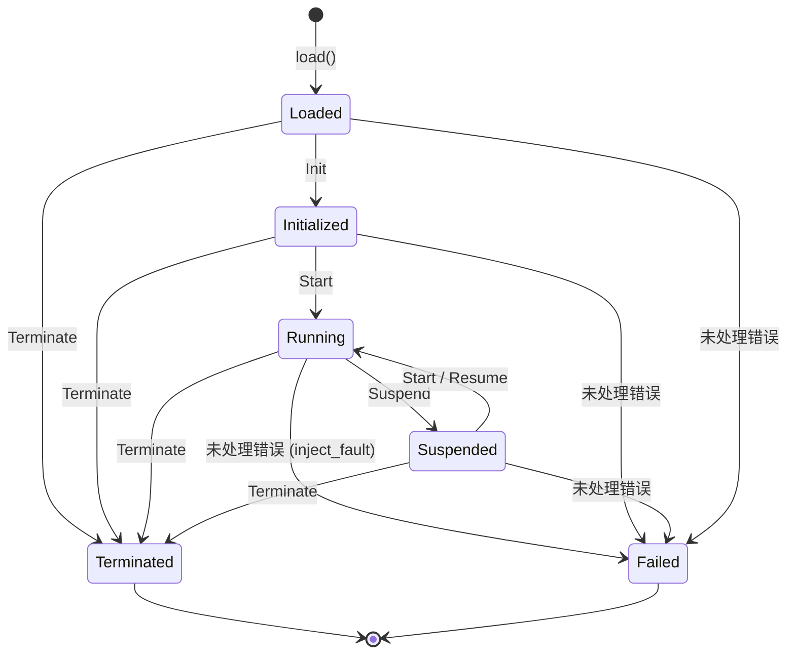

# Design Document

## Overview

本文是 M2 里程碑（运行层骨架：Runtime_Interface + 生命周期 + Mock Adapter）的技术设计。M2 在 M0（`fayger-buf`）与 M1（`fayger-loader`）之上新增 `fayger-runtime` crate，把"一个被加载的 BuFObject"提升为"一个可被启动/暂停/恢复/停止、并向适配层派发指令的 BuF_Instance"。

设计目标按优先级：

1. **正确性优先**：生命周期状态机的合法迁移、非法拒绝、失败保留必须以可被 PBT 验证的形式表达；注册完备性与路由是确定性的集合/选择运算。
2. **不破坏既有契约**：M2 不改 M0/M1 的任何对外行为，只新增运行层组件与运行层错误码（`#[non_exhaustive]` 保证不破坏既有 match）。
3. **可演进**：Runtime_Interface 通过最小 `UniversalInstruction` 与适配层解耦；M3 替换 Mock Adapter 为真实 Platform_Adapter、把占位指令扩展为 8 类 TLV 指令集，均不触动运行层契约。执行路径抽象出 `ExecutionStrategy`-风格的步进，为后续 JIT/AOT 预留。
4. **跨语言完备性建模**：Rust trait 编译期即保证方法齐全，无法表达"实现缺方法"。因此把注册完备性建在数据层（`RuntimeDescriptor.supported_operations`），覆盖插件式/跨语言实现注册，并使该性质可测。

## Architecture

### M2 在蓝图三层结构里的位置

```
Loader Layer (M0+M1)  ──HandOff──▶  Runtime Layer (M2)  ──Universal_Instruction──▶  Adapter Layer (Mock@M2 / 真实@M3)
                                          │
                                          ├─ RuntimeRegistry：注册完备性 + 路由
                                          ├─ Runtime_Implementation：参考实现（mock 解释执行）
                                          ├─ LifecycleManager：状态机
                                          └─ Instance 表：InstanceId → 实例运行时数据
```

- **加载层 → 运行层**：单向。运行层 `load(obj)` 接收一个已由 M1 加载链产出的 `BuFObject`，创建实例。运行层不反向依赖加载层（不依赖 `fayger-loader`）。
- **运行层 ↔ 适配层**：运行层只依赖 `UniversalInstruction` 与 `Adapter` trait，不依赖任何具体 Adapter。M2 提供 `MockAdapter`（记录收到的指令）。
- **运行层错误**：统一 `FaygerError`，`source_layer = Runtime`。

### Crate 拓扑（M2 新增 fayger-runtime）

```
release/dev/core/
├── Cargo.toml               (workspace 根：新增 member crates/fayger-runtime)
└── crates/
    ├── fayger-error/        (M0/M1；M2 追加 5 个 Runtime 错误码变体)
    ├── fayger-buf/          (M0/M1；M2 不改)
    ├── fayger-loader/       (M1；M2 不改；端到端测试用它构造输入)
    └── fayger-runtime/      (M2 新增)
        ├── Cargo.toml
        └── src/
            ├── lib.rs        (pub use：Runtime, RuntimeInterface, RuntimeRegistry, ...)
            ├── instruction.rs(UniversalInstruction / UniversalEvent 最小占位)
            ├── adapter.rs    (Adapter trait + MockAdapter)
            ├── lifecycle.rs  (LifecycleState / LifecycleCommand / 合法迁移函数)
            ├── interface.rs  (RuntimeInterface trait + RuntimeOperation + RuntimeDescriptor)
            ├── registry.rs   (RuntimeRegistry：注册完备性 + 路由)
            ├── instance.rs   (InstanceId / FailureInfo / 实例运行时数据)
            └── runtime.rs    (Runtime：参考实现，组合 lifecycle + adapter + mock 执行)
```

依赖方向：

- `fayger-error`：M2 只追加枚举变体。
- `fayger-runtime` → `fayger-buf` + `fayger-error`（**不**依赖 `fayger-loader`）。

### 调用方向

```mermaid
flowchart LR
    Loaded[BuFObject (M1 已加载)] --> RtLoad[Runtime::load]
    RtLoad --> Inst[BuF_Instance: Loaded]
    Inst --> Init[init] --> Start[start] --> Step[step → emit]
    Step --> Adapter[Adapter::dispatch]
    Start --> Suspend[suspend] --> Resume[resume]
    Inst --> Terminate[terminate]
    Step -. fault .-> Failed[Failed + FailureInfo]

    Registry[RuntimeRegistry] -. register/resolve .-> RtLoad
```

## Components and Interfaces

### `fayger-error` crate（M2 增量）

在 `ErrorCode` 追加五个变体（`#[non_exhaustive]` 已就位）：

```rust
#[non_exhaustive]
pub enum ErrorCode {
    // M0 / M1 ...
    // ----- Runtime 层 (M2) -----
    /// `RT_ILLEGAL_TRANSITION`：对当前生命周期状态不允许的迁移指令。
    RtIllegalTransition,
    /// `RT_IMPL_NOT_FOUND`：路由找不到满足策略与兼容性的实现。
    RtImplNotFound,
    /// `RT_IMPL_MISSING_METHODS`：注册的实现缺少必需操作。
    RtImplMissingMethods,
    /// `RT_INSTANCE_FAILED`：实例执行中发生未处理错误，进入 Failed。
    RtInstanceFailed,
    /// `RT_INSTANCE_NOT_FOUND`：以未知 InstanceId 调用运行层操作。
    RtInstanceNotFound,
}
```

`as_str` 追加对应稳定字符串（`RT_ILLEGAL_TRANSITION` 等）。

### 模块 `instruction`：最小 Universal_Instruction

M2 只需要一个可被派发、可比较、可记录的占位类型；完整 8 类指令集与 TLV 编码是 M3。

```rust
/// 最小 Universal_Instruction 占位（M2）。M3 会扩展为 8 类指令集 + TLV 编码。
#[derive(Debug, Clone, PartialEq, Eq)]
pub struct UniversalInstruction {
    pub category: u8,        // M3 将替换为 InstructionCategory 枚举
    pub opcode: u16,
    pub operands: Vec<u8>,   // M3 将替换为 TLV 序列
}

/// 适配层回送的事件占位（M2）。
#[derive(Debug, Clone, PartialEq, Eq)]
pub struct UniversalEvent {
    pub category: u8,
    pub opcode: u16,
    pub payload: Vec<u8>,
}
```

### 模块 `adapter`：Adapter trait + MockAdapter

```rust
/// 适配层接收端契约（M2 最小形态）。
pub trait Adapter {
    /// 接收运行层派发的一条 Universal_Instruction。
    fn dispatch(&mut self, instr: &UniversalInstruction);
}

/// 记录型 Mock Adapter：把收到的指令按序存入 Vec，供测试断言。
#[derive(Debug, Default)]
pub struct MockAdapter {
    pub received: Vec<UniversalInstruction>,
}
impl Adapter for MockAdapter {
    fn dispatch(&mut self, instr: &UniversalInstruction) {
        self.received.push(instr.clone());
    }
}
```

> 设计取舍：M2 的 `Adapter::dispatch` 不返回结果、不回送事件（`on_event` 在 Runtime_Interface 中声明但 M2 的参考实现里是 no-op 入口）。完整的双向翻译、`UnsupportedInstruction`、能力裁剪是 M3。

### 模块 `lifecycle`：状态机

```rust
#[derive(Debug, Clone, Copy, PartialEq, Eq, Hash)]
pub enum LifecycleState { Loaded, Initialized, Running, Suspended, Terminated, Failed }

#[derive(Debug, Clone, Copy, PartialEq, Eq, Hash)]
pub enum LifecycleCommand { Init, Start, Suspend, Resume, Terminate }

impl LifecycleState {
    pub fn is_terminal(self) -> bool { matches!(self, Self::Terminated | Self::Failed) }

    /// 返回当前状态下被允许的命令集合（确定性、稳定排序）。
    pub fn allowed_commands(self) -> &'static [LifecycleCommand];

    /// 应用一条命令。Ok(next) 表示合法迁移；Err(()) 表示非法（调用方据此构造 RT_ILLEGAL_TRANSITION）。
    pub fn apply(self, cmd: LifecycleCommand) -> Result<LifecycleState, ()>;
}
```

合法迁移表（与需求 Requirement 5.6 一致；`Failed` 由执行期 fault 触发，不在命令表内）：

| 当前状态 | Init | Start | Suspend | Resume | Terminate |
| --- | --- | --- | --- | --- | --- |
| Loaded | →Initialized | — | — | — | →Terminated |
| Initialized | — | →Running | — | — | →Terminated |
| Running | — | — | →Suspended | — | →Terminated |
| Suspended | — | →Running | — | →Running | →Terminated |
| Terminated | — | — | — | — | — |
| Failed | — | — | — | — | — |

注：`Suspended` 同时接受 `Start` 与 `Resume`（两者都回到 `Running`），与需求 5.2/5.3 一致。`Terminated`/`Failed` 拒绝一切命令。

### 模块 `interface`：Runtime_Interface 契约

```rust
/// Runtime_Interface 的必需操作枚举。用于注册完备性建模与属性测试。
#[derive(Debug, Clone, Copy, PartialEq, Eq, Hash, PartialOrd, Ord)]
pub enum RuntimeOperation {
    Load, Init, Start, Suspend, Resume, Terminate, State, FailureInfo, Emit, OnEvent,
}
impl RuntimeOperation {
    /// 全部必需操作（REQUIRED_OPERATIONS）。
    pub fn required() -> BTreeSet<RuntimeOperation>;
}

/// 对一个 Runtime_Implementation 的数据化描述。
#[derive(Debug, Clone, PartialEq, Eq)]
pub struct RuntimeDescriptor {
    pub impl_id: String,
    pub rt_version: SemVer,                          // 复用 fayger-buf 的 SemVer (M1 Ord)
    pub supported_operations: BTreeSet<RuntimeOperation>,
}

/// Runtime_Interface（Rust trait 表达）。
///
/// 通过 Universal_Instruction 与适配层通信（emit），不引用任何 Platform_Adapter 类型。
pub trait RuntimeInterface {
    fn rt_version(&self) -> SemVer;
    fn descriptor(&self) -> RuntimeDescriptor;

    fn load(&mut self, obj: BuFObject) -> Result<InstanceId, FaygerError>;
    fn init(&mut self, id: InstanceId) -> Result<(), FaygerError>;
    fn start(&mut self, id: InstanceId) -> Result<(), FaygerError>;
    fn suspend(&mut self, id: InstanceId) -> Result<(), FaygerError>;
    fn resume(&mut self, id: InstanceId) -> Result<(), FaygerError>;
    fn terminate(&mut self, id: InstanceId) -> Result<(), FaygerError>;

    fn state(&self, id: InstanceId) -> Result<LifecycleState, FaygerError>;
    fn failure_info(&self, id: InstanceId) -> Result<Option<FailureInfo>, FaygerError>;
}
```

> `emit` / `on_event` 在 `RuntimeOperation` 中作为必需操作建模（注册完备性需要），但在 M2 的 trait 上不作为公开方法暴露——它们是运行层与适配层的内部协作点，由参考实现 `Runtime` 在 `step`/执行路径内部调用 `Adapter::dispatch`。这样保持 trait 面向调用方的简洁，同时满足"契约覆盖 emit/on_event"的注册校验语义。M3 会把双向通信提升为显式接口。

### 模块 `registry`：注册与路由

```rust
pub struct RegistrationId(pub usize);  // 注册顺序索引，提供确定性

pub struct RuntimeRegistry {
    entries: Vec<RuntimeDescriptor>,   // 按注册顺序
}

impl RuntimeRegistry {
    pub fn new() -> Self;

    /// 注册完备性：supported_operations ⊇ REQUIRED_OPERATIONS。
    pub fn register(&mut self, desc: RuntimeDescriptor) -> Result<RegistrationId, FaygerError>;
    pub fn list(&self) -> &[RuntimeDescriptor];

    /// 按 manifest.runtime 的策略路由。确定性：按注册顺序取首个兼容者。
    pub fn resolve(&self, manifest: &BuFManifest) -> Result<RegistrationId, FaygerError>;
}
```

`register` 完备性：`missing = REQUIRED \ desc.supported_operations`；非空则 `RT_IMPL_MISSING_METHODS` + `missing_methods`（有序列表）。

`resolve` 决策（确定性：候选集合按注册顺序遍历，取首个）：

| manifest.runtime | 行为 |
| --- | --- |
| `Some{ Strict, preferred }` | preferred 已注册且兼容 → 它；否则 `RT_IMPL_NOT_FOUND` |
| `Some{ PreferThenAny, preferred }` | preferred 兼容 → 它；否则首个兼容者；无 → `RT_IMPL_NOT_FOUND` |
| `Some{ Any, .. }` 或 `None` | 首个兼容者；无 → `RT_IMPL_NOT_FOUND` |

兼容：`compatible(desc, manifest) = desc.rt_version >= manifest.runtime_interface_min`（M1 SemVer 全序）。

### 模块 `instance`：实例运行时数据

```rust
#[derive(Debug, Clone, Copy, PartialEq, Eq, Hash)]
pub struct InstanceId(pub u64);

/// 失败上下文。
#[derive(Debug, Clone)]
pub struct FailureInfo {
    pub last_instruction: Option<UniversalInstruction>,
    pub error: FaygerError,
}

/// 单实例的运行时数据（参考实现内部）。
struct InstanceData {
    state: LifecycleState,
    program: Vec<UniversalInstruction>,  // 从 BuFObject 派生的 mock 程序
    pc: usize,                           // program counter（已派发到第几条）
    failure: Option<FailureInfo>,
    last_instruction: Option<UniversalInstruction>,
}
```

### 模块 `runtime`：参考实现

`Runtime` 持有实例表与一个 `Adapter`，实现 `RuntimeInterface`，并额外暴露驱动执行的 `step`：

```rust
pub struct Runtime<A: Adapter> {
    descriptor: RuntimeDescriptor,
    adapter: A,
    instances: BTreeMap<u64, InstanceData>,
    next_id: u64,
}

impl<A: Adapter> Runtime<A> {
    pub fn new(adapter: A) -> Self;  // descriptor 取参考实现的固定 id + rt_version + 全操作集
    pub fn adapter(&self) -> &A;

    /// 推进一步执行：仅当实例处于 Running 时派发下一条指令；返回是否仍有指令可派发。
    /// 派发的指令记入 last_instruction，pc 前进。
    pub fn step(&mut self, id: InstanceId) -> Result<bool, FaygerError>;

    /// 注入未处理错误（测试 / fault 用）：把实例迁移到 Failed 并保留 FailureInfo。
    pub fn inject_fault(&mut self, id: InstanceId, error: FaygerError) -> Result<(), FaygerError>;
}
```

`load(obj)` 行为：从 `obj` 派生一个**确定性的 mock 程序**——每个 Section 生成一条 `UniversalInstruction { category=0, opcode=index, operands = payload 的前若干字节摘要 }`（具体见 Data Models）。这让"执行序列仅依赖 BuFObject 内容"（Requirement 6.4）成立，且跨适配器一致（为 M3 的跨平台序列一致性 Property 11 预埋基线）。

`step(id)` 行为：

1. 取实例；不存在 → `RT_INSTANCE_NOT_FOUND`。
2. 若 `state != Running` → 不派发，返回 `Ok(false)`（Requirement 6.2：Suspended 不派发）。
3. 若 `pc < program.len()`：`adapter.dispatch(&program[pc])`；`last_instruction = Some(program[pc])`；`pc += 1`；返回 `Ok(true)`。
4. 否则（程序耗尽）返回 `Ok(false)`。

生命周期方法（init/start/suspend/resume/terminate）统一走 `lifecycle::apply`：

```
fn transition(&mut self, id, cmd):
    data = self.instances.get_mut(id) or RT_INSTANCE_NOT_FOUND
    match data.state.apply(cmd):
        Ok(next) => { data.state = next; Ok(()) }
        Err(()) => Err(RT_ILLEGAL_TRANSITION + current_state + allowed_commands)
```

`inject_fault`：实例存在且非终态 → `state=Failed`，`failure=Some(FailureInfo{ last_instruction, error })`，`error.code = RT_INSTANCE_FAILED`。

## Data Models

### Mock 程序派生规则（确定性）

给定 `BuFObject obj`，mock 程序定义为：

```
program = [ UniversalInstruction {
              category: 0,
              opcode: i as u16,                 // i 为 section 在 manifest.sections 的序号
              operands: derive_operands(obj.sections[i].payload),
            } for i in 0..obj.sections.len() ]
```

其中 `derive_operands(payload)` 取 payload 的长度（小端 u32 的 4 字节）作为 operands（不读取 payload 内容字节本身，确保"不执行 BuF 内容"）。空 sections 的 BuF 产生空程序（`step` 立即返回 `Ok(false)`）。

该规则保证：
- 执行序列仅由 `obj`（其 sections 数量与各 payload 长度）决定，与 Adapter 类型无关（Requirement 6.4）。
- 确定性：相同 `obj` 总是产生相同 program。
- 不"执行"内容：只用 payload 长度，不解释 payload 字节（Requirement 10.6）。

### 生命周期状态机（图）



### InstanceId 分配

`Runtime.next_id` 从 0 单调递增，每次 `load` 取当前值并自增。保证同一 Runtime 内 InstanceId 互不相同（Requirement 4.3）。

## Error Handling

### 运行层错误映射

| 触发条件 | ErrorCode | 关键 context |
| --- | --- | --- |
| 未知 InstanceId | RtInstanceNotFound | instance_id |
| 非法生命周期迁移 / 终态收命令 | RtIllegalTransition | current_state, command, allowed_commands |
| 注册缺操作 | RtImplMissingMethods | missing_methods（有序列表）|
| 路由无兼容/策略不满足 | RtImplNotFound | strategy, preferred_impl?, runtime_interface_min |
| 注入未处理错误 | RtInstanceFailed | instance_id（保留在 FailureInfo.error）|

所有错误 `source_layer = Runtime`，`cause = None`（跨层错误链是 M8）。

### 生命周期错误流

```mermaid
flowchart TB
    Cmd[transition&#40;id, cmd&#41;] --> Find{实例存在?}
    Find -- 否 --> NF[RT_INSTANCE_NOT_FOUND]
    Find -- 是 --> Apply{apply&#40;state, cmd&#41;}
    Apply -- Ok&#40;next&#41; --> Set[state = next; Ok]
    Apply -- Err --> Illegal[RT_ILLEGAL_TRANSITION + current_state + allowed_commands]
```



### 默认安全姿态

- **终态不可逆**：`Terminated` / `Failed` 拒绝一切命令（`allowed_commands` 为空）。
- **Suspended 不派发**：`step` 在非 `Running` 状态绝不调用 `adapter.dispatch`。
- **确定性路由**：候选按注册顺序取首个，避免不确定行为。
- **不 panic**：实例查找与状态迁移走 `Result`，无 `unwrap`。

## Correctness Properties

> 从需求 Requirement 9 提取，对应 PBT。沿用 M0/M1 的 `.regressions` 归档与 `proptest` 配置。

### Property 1: 生命周期合法迁移与非法拒绝

*For any* 初始 `Loaded` 实例与命令序列 `cmds`，逐条应用：合法命令使状态按迁移表前进；非法命令返回 `RT_ILLEGAL_TRANSITION`、状态不变、`context` 含 `current_state` 与 `allowed_commands`；任何时刻状态都落在 6 个合法状态内；终态后任何命令都被拒绝。

**Validates: Requirements 5.1–5.8, 9.1**

### Property 2: 注册完备性集合代数

*For any* RuntimeDescriptor `d`，`register(d)` 成功 ⟺ `REQUIRED ⊆ d.supported_operations`；失败时 `missing_methods == REQUIRED \ d.supported_operations`。

**Validates: Requirements 2.3, 2.4, 9.1**

### Property 3: 路由策略决策与确定性

*For any* 已注册实现集合与 manifest，`resolve` 的结果满足策略决策表；且对相同输入多次调用返回相同 RegistrationId；返回的实现恒兼容（`rt_version >= runtime_interface_min`）。

**Validates: Requirements 3.2–3.6, 9.1**

### Property 4: 失败保留

*For any* 任意非终态实例，`inject_fault(id, e)` 后：`state == Failed`；`failure_info(id)` 为 `Some`，其 `error.code == RT_INSTANCE_FAILED`，且 `last_instruction` 等于失败前最后一次 `step` 派发的指令（若有）。非 `Failed` 实例的 `failure_info` 为 `None`。

**Validates: Requirements 7.1–7.4, 9.1**

### Property 5: 暂停停止派发 / 恢复后继续

*For any* 走完 `load→init→start` 的实例与一段 step/suspend/resume 操作序列：在 `Suspended` 期间每次 `step` 都不增加 Adapter 收到的指令数；整个过程中 Adapter 收到的指令序列恰为 mock 程序的一个前缀，且其顺序与 program 顺序一致。

**Validates: Requirements 6.1–6.4, 9.1, 9.2**

## Testing Strategy

### 测试金字塔

```
        ┌───────────────────────────────┐
        │ 端到端：load→init→start→suspend │
        │ →resume→terminate + 指令断言    │
        └───────────────────────────────┘
      ┌───────────────────────────────────┐
      │  PBT (5 properties × ≥500x)        │
      └───────────────────────────────────┘
   ┌──────────────────────────────────────────┐
   │ 单元：lifecycle.apply 全表、registry 决策、 │
   │ runtime.step 派发、inject_fault            │
   └──────────────────────────────────────────┘
```

### 单元测试

- `lifecycle`：`apply` 对 6×5 状态×命令组合逐格断言；`allowed_commands` 与 `is_terminal`。
- `registry`：完备子集/缺操作；三种策略 × (preferred 命中/缺失/不兼容) 组合；空注册表。
- `runtime`：`load` 返回递增 id 且状态 `Loaded`；`step` 在各状态的派发与否；`inject_fault` 终态保护。
- `instruction`/`adapter`：MockAdapter 记录顺序。

### PBT 生成器（fayger-runtime 测试内）

```rust
fn arb_lifecycle_command() -> impl Strategy<Value = LifecycleCommand>;
fn arb_command_sequence() -> impl Strategy<Value = Vec<LifecycleCommand>>;  // 0..=16
fn arb_runtime_operation_set() -> impl Strategy<Value = BTreeSet<RuntimeOperation>>;  // 必需集合的随机子集/超集
fn arb_descriptor() -> impl Strategy<Value = RuntimeDescriptor>;
// 复用 fayger-buf::testing::{arb_buf_object, arb_semver}
```

### 端到端测试

`tests/end_to_end.rs`：用 `fayger-loader::seal + serialize`（或直接构造 BuFObject）→ `Runtime::load` → 走 `Init→Start→step×N→Suspend→step（不派发）→Resume→step→Terminate`，断言 `MockAdapter.received` 是 mock 程序的预期前缀、终态为 `Terminated`。

### 反例归档 / CI

沿用 M0/M1：每个 PBT 文件 `failure_persistence = WithSource("regressions")`，`.regressions` 进 git。workspace 级 `cargo test/clippy/doc` 自然覆盖新 crate，无需新 workflow。

## Dependency Versions

M2 不引入新的第三方运行时依赖。

`fayger-runtime/Cargo.toml`：

```toml
[dependencies]
fayger-buf = { path = "../fayger-buf" }
fayger-error = { path = "../fayger-error" }

[dev-dependencies]
fayger-buf = { path = "../fayger-buf", features = ["testing"] }
fayger-loader = { path = "../fayger-loader" }   # 仅端到端测试构造输入用
proptest = { workspace = true }
```

## Open Questions

- **Q1**：`emit`/`on_event` 是否要作为 `RuntimeInterface` trait 的公开方法？
  - 决定：M2 **不**作为公开 trait 方法，仅在 `RuntimeOperation` 枚举中作为"必需操作"参与注册完备性校验；实际派发由参考实现 `step` 内部调用 `Adapter::dispatch`。理由：M2 的适配通信是单向占位，公开它会过早固化 M3 才定型的双向接口。M3 提升为显式接口。
- **Q2**：`Suspended` 收到 `Start` 是否合法（而非只接受 `Resume`）？
  - 决定：合法。需求 5.2 明确"`Initialized` 或 `Suspended` 收到 `Start` → `Running`"。`Resume` 是 `Suspended→Running` 的同义命令，两者都接受。
- **Q3**：mock 程序是否应读取 payload 内容？
  - 决定：不读取，只用 payload 长度派生 operands。保证"不执行 BuF 内容"（Requirement 10.6）且执行序列确定。真实解释执行是后续阶段（蓝图 ExecutionStrategy）。
