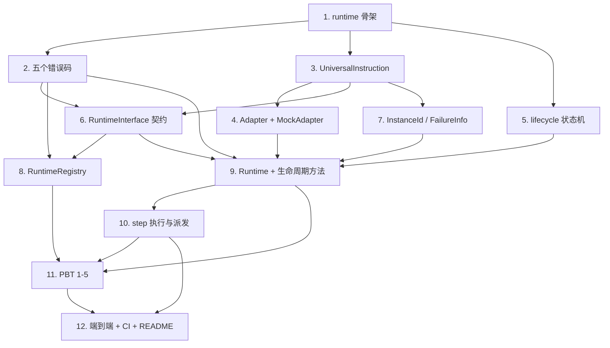

# Implementation Plan

## Overview

本任务清单基于 `requirements.md` 与 `design.md`，把 M2（运行层骨架：Runtime_Interface + 生命周期 + Mock Adapter）的实现拆成 12 个独立可完成的任务。每个任务的产出都直接对应需求文档中的某条验收条款。

任务以 1.x 顺序号编号，便于在 PR 标题里引用，例如 `feat(m2/5): lifecycle state machine`。

## Tasks

- [x] 1. fayger-runtime 骨架与 workspace 接入
  - 在根 `Cargo.toml` 的 `[workspace].members` 加入 `crates/fayger-runtime`。
  - 新建 `crates/fayger-runtime/Cargo.toml`（依赖 fayger-buf、fayger-error；dev-deps：fayger-buf[testing]、fayger-loader、proptest）与空 `src/lib.rs`，沿用 workspace lints。
  - 确认 `cargo check --workspace` 通过。
  - _Requirements: 约束与假设、10.1, 10.2_

- [x] 2. fayger-error：新增五个 Runtime 错误码
  - 在 `ErrorCode` 追加 `RtIllegalTransition`、`RtImplNotFound`、`RtImplMissingMethods`、`RtInstanceFailed`、`RtInstanceNotFound`。
  - 在 `as_str` 追加 `RT_ILLEGAL_TRANSITION` / `RT_IMPL_NOT_FOUND` / `RT_IMPL_MISSING_METHODS` / `RT_INSTANCE_FAILED` / `RT_INSTANCE_NOT_FOUND`。
  - 单元测试：新增五码的 `as_str` 与 `Display` 一致性；M0/M1 既有码不变。
  - _Requirements: 8.1, 8.2, 8.4_

- [x] 3. fayger-runtime::instruction：最小 Universal_Instruction
  - 在 `instruction.rs` 定义 `UniversalInstruction { category: u8, opcode: u16, operands: Vec<u8> }` 与 `UniversalEvent`。
  - 派生 `Debug, Clone, PartialEq, Eq`。
  - 单元测试：相等/克隆语义。
  - _Requirements: 10.1_

- [x] 4. fayger-runtime::adapter：Adapter trait + MockAdapter
  - 在 `adapter.rs` 定义 `Adapter` trait（`dispatch(&mut self, &UniversalInstruction)`）与 `MockAdapter { received: Vec<_> }`。
  - 单元测试：MockAdapter 按序记录派发的指令。
  - _Requirements: 6.1, 10.2_

- [x] 5. fayger-runtime::lifecycle：状态机
  - 在 `lifecycle.rs` 定义 `LifecycleState`、`LifecycleCommand`，实现 `is_terminal`、`allowed_commands`、`apply`。
  - `apply` 严格按设计文档迁移表；非法返回 `Err(())`。
  - 单元测试：6×5 状态×命令逐格断言；终态拒绝一切命令；`allowed_commands` 与表一致。
  - _Requirements: 5.1, 5.2, 5.3, 5.4, 5.5, 5.6, 5.7, 5.8_

- [x] 6. fayger-runtime::interface：Runtime_Interface 契约
  - 在 `interface.rs` 定义 `RuntimeOperation` 枚举与 `RuntimeOperation::required()`（10 个必需操作）。
  - 定义 `RuntimeDescriptor { impl_id, rt_version: SemVer, supported_operations }`。
  - 定义 `RuntimeInterface` trait（rt_version / descriptor / load / init / start / suspend / resume / terminate / state / failure_info），方法返回 `Result<_, FaygerError>`。
  - 单元测试：`required()` 含全部 10 个操作。
  - _Requirements: 1.1, 1.2, 1.3, 2.2_

- [x] 7. fayger-runtime::instance：InstanceId / FailureInfo / InstanceData
  - 在 `instance.rs` 定义 `InstanceId(u64)`、`FailureInfo { last_instruction, error }`、内部 `InstanceData { state, program, pc, failure, last_instruction }`。
  - 单元测试：InstanceId 相等/哈希；FailureInfo 构造。
  - _Requirements: 4.1, 7.2_

- [x] 8. fayger-runtime::registry：注册完备性 + 路由
  - 在 `registry.rs` 实现 `RuntimeRegistry`：`register`（完备性，缺操作→`RT_IMPL_MISSING_METHODS` + `missing_methods`）、`list`、`resolve`（三策略 + 兼容性 + 确定性，无果→`RT_IMPL_NOT_FOUND`）。
  - `compatible(desc, manifest) = desc.rt_version >= manifest.runtime_interface_min`。
  - 单元测试：完备/缺操作；Strict/PreferThenAny/Any × (命中/缺失/不兼容)；确定性（重复 resolve 相同结果）。
  - _Requirements: 2.1, 2.3, 2.4, 2.5, 3.1, 3.2, 3.3, 3.4, 3.5, 3.6_

- [x] 9. fayger-runtime::runtime：参考实现 + 生命周期方法
  - 在 `runtime.rs` 实现 `Runtime<A: Adapter>`：`new`、`adapter`、`load`（派生 mock 程序、状态 `Loaded`、递增 InstanceId）、`init/start/suspend/resume/terminate`（走 `lifecycle::apply`，未知 id→`RT_INSTANCE_NOT_FOUND`，非法→`RT_ILLEGAL_TRANSITION` + `current_state` + `allowed_commands`）、`state`、`failure_info`、`inject_fault`。
  - 为 `Runtime` 实现 `RuntimeInterface` trait。
  - 单元测试：load 后状态/递增 id；各生命周期方法的合法迁移与非法拒绝；未知 id 错误。
  - _Requirements: 1.3, 1.4, 4.1, 4.2, 4.3, 5.x, 7.1, 7.2, 7.3, 7.4_

- [x] 10. fayger-runtime::runtime：step 执行与派发
  - 实现 `step(id)`：未知 id→`RT_INSTANCE_NOT_FOUND`；非 `Running`→不派发返回 `Ok(false)`；`Running` 且有指令→`adapter.dispatch`、记 `last_instruction`、`pc+=1`、`Ok(true)`；程序耗尽→`Ok(false)`。
  - mock 程序派生：每个 section 一条指令，operands = payload 长度（小端 u32），不读 payload 内容。
  - 在 `lib.rs` `pub use` 全部公开类型。
  - 单元测试：Running 派发、Suspended 不派发、Resume 后恢复、空 sections 立即 false。
  - _Requirements: 6.1, 6.2, 6.3, 6.4, 10.6_

- [x] 11. PBT：Property 1-5
  - `tests/lifecycle.rs`：Property 1（合法迁移/非法拒绝/终态保护）。
  - `tests/registry.rs`：Property 2（注册完备性集合代数）+ Property 3（路由决策与确定性）。
  - `tests/failure.rs`：Property 4（失败保留）。
  - `tests/dispatch.rs`：Property 5（暂停停止派发/恢复继续，Adapter 收到的是 program 前缀）。
  - 各 `ProptestConfig { cases: 500, .. }`；`failure_persistence = WithSource("regressions")`，`.regressions` 进 git。新增生成器（命令序列、操作集合、descriptor）。
  - _Requirements: 9.1, 9.3, 9.4, 5.x, 6.x, 7.x, 2.x, 3.x_

- [x] 12. 端到端测试、CI 与文档
  - `tests/end_to_end.rs`：用 fayger-loader 封装一个 BuF（或直接构造 BuFObject）→ `Runtime::load` → `Init→Start→step×N→Suspend→step(不派发)→Resume→step→Terminate`，断言 MockAdapter 指令序列与终态。
  - 确认 `ci-m0.yml` 的 workspace 级 test/clippy/doc 自然覆盖 fayger-runtime（无需新 workflow）。
  - 更新 `release/dev/core/README.md`：新增 fayger-runtime crate 说明、M2 PBT 概览与本地复现步骤；更新里程碑状态。
  - _Requirements: 9.2, 9.3, 9.5_

## Task Dependency Graph

```json
{
  "waves": [
    { "wave": 1, "tasks": [1], "description": "fayger-runtime 骨架与 workspace 接入" },
    { "wave": 2, "tasks": [2, 3, 5], "description": "并行基础件：错误码、指令类型、状态机" },
    { "wave": 3, "tasks": [4, 6, 7], "description": "Adapter、Runtime_Interface 契约、实例数据（依赖 3）" },
    { "wave": 4, "tasks": [8], "description": "registry 注册与路由（依赖 6）" },
    { "wave": 5, "tasks": [9], "description": "Runtime 参考实现 + 生命周期方法（依赖 4/5/6/7）" },
    { "wave": 6, "tasks": [10], "description": "step 执行与派发（依赖 9）" },
    { "wave": 7, "tasks": [11], "description": "全部 PBT（依赖 8/9/10）" },
    { "wave": 8, "tasks": [12], "description": "端到端、CI、README" }
  ]
}
```

可视化依赖：



## Notes

### 依赖路径要点

- 任务 1 是所有后续任务前置（crate 与 workspace 接入未就位时无法编译）。
- 任务 3（UniversalInstruction）被 4/6/7 共同依赖（adapter 派发它、interface 在 RuntimeOperation 中引用 emit/on_event 语义、instance 在 FailureInfo 里保存它）。
- 任务 9（Runtime）是核心组合点，依赖 adapter(4) + lifecycle(5) + interface(6) + instance(7) + 错误码(2)。
- 任务 10（step）在 Runtime 就绪后补执行路径；PBT(11) 必须在 8/9/10 之后。

### 风险与备选

- **风险 R1：注册完备性无法用 Rust trait 表达**。
  - 应对：设计已决定在数据层（RuntimeDescriptor.supported_operations）建模完备性，任务 6/8 据此实现并由 PBT 验证集合代数。
- **风险 R2：生命周期 `Suspended` 同时接受 Start 与 Resume 的歧义**。
  - 应对：迁移表明确两者都 →Running；任务 5 单测覆盖该格，任务 11 PBT 覆盖全序列。
- **风险 R3：step 在非 Running 误派发**。
  - 应对：任务 10 把"非 Running 不调用 dispatch"作为硬约束；任务 11 Property 5 用 PBT 验证 Adapter 收到的恒为 program 前缀。

### 完成标准

M2 完成的判定：

1. 所有 12 个任务的复选框都打勾。
2. `cargo test --workspace --all-features` 在 ubuntu / macos / windows 全部通过（含 M0/M1 既有测试不回归）。
3. `cargo clippy --workspace --all-targets --all-features -- -D warnings` 通过。
4. PBT 反例归档目录存在但无未修复反例。
5. `release/dev/core/README.md` 已更新 fayger-runtime 说明与 M2 复现步骤。
6. 在 PR 中合回 `release/dev`，PR 描述列出每个任务的 commit 链接。
