# Design Document

## Overview

本文是 M3 里程碑（适配层：Universal_Instruction 8 类指令集 + Platform_Adapter 注册 + 能力裁剪）的技术设计。M3 新增 `fayger-adapter` crate，把"运行层发出的平台无关指令"翻译为"目标宿主可执行的形态"，并通过能力裁剪在受限宿主上安全降级。

设计目标按优先级：

1. **正确性优先**：适配器选择、不支持指令判定、能力裁剪都建模为可被 PBT 验证的集合/选择运算；跨适配器一致性以 property 表达。
2. **不破坏既有契约**：M3 不改 M0/M1/M2 的任何对外行为，只新增适配层组件与适配层错误码（`#[non_exhaustive]` 保证不破坏既有 match）。
3. **可移植性优先**：运行层只产出 Universal_Instruction，永不直接引用任何宿主 SDK；新增宿主只需新增一个 Platform_Adapter，不动运行层。
4. **mock 翻译基线**：M3 内置四类适配器的 `translate` 产出确定性 HostSyscall 数据结构（不触达真实系统调用）。真实 FFI/WASM 绑定是 `release/dev/adapters/` 的后续工作。借鉴 WASI 的 capability-based security 与 OCI 的 capabilities 裁剪。

## Architecture

### M3 在蓝图三层结构里的位置

```
Loader (M0/M1) ──▶ Runtime (M2) ──Universal_Instruction──▶ Adapter (M3) ──HostSyscall──▶ Host
                                                              │
                                                              ├─ HostEnvironmentDetector
                                                              ├─ AdapterRegistry：matches → 选中 → 可服务
                                                              ├─ CapabilityNegotiator：granted = req ∩ avail ∩ policy
                                                              └─ Platform_Adapter ×4：NativeDesktop / Server / Browser / InApp
```

派发主流程（AdapterRegistry 处于可服务状态后）：

```
dispatch(instr):
    if instr.capabilities_required ⊄ granted: return ADP_CAPABILITY_DENIED { missing }
    if key(instr) ∉ adapter.supported_instructions: return ADP_UNSUPPORTED_INSTRUCTION { category, opcode }
    return adapter.translate(instr)  // HostSyscall（mock）
```

### Crate 拓扑（M3 新增 fayger-adapter）

```
release/dev/core/
├── Cargo.toml               (workspace 根：新增 member crates/fayger-adapter)
└── crates/
    ├── fayger-error/        (M0/M1/M2；M3 追加 4 个 Adapter 错误码变体)
    ├── fayger-buf/          (不改)
    ├── fayger-loader/       (不改)
    ├── fayger-runtime/      (不改)
    └── fayger-adapter/      (M3 新增)
        ├── Cargo.toml
        └── src/
            ├── lib.rs        (pub use)
            ├── instruction.rs(UniversalInstruction / UniversalEvent / InstructionCategory / InstructionKey)
            ├── capability.rs (Capability / HostPolicy / CapabilityNegotiator / NegotiationResult)
            ├── host.rs       (HostEnvironment / HostEnvironmentDetector / HostSyscall / HostEvent)
            ├── adapter.rs    (PlatformAdapter trait + AdapterDescriptor)
            ├── builtin.rs    (四类内置适配器：NativeDesktop / Server / Browser / InApp)
            └── registry.rs   (AdapterRegistry：选择 + 可服务 + dispatch)
```

依赖方向：

- `fayger-error`：M3 只追加枚举变体。
- `fayger-adapter` → `fayger-error`（**不**依赖 fayger-runtime；二者各自有 Universal_Instruction 形态，统一桥接留待后续集成里程碑，见需求 §11.5）。

> 设计取舍：M3 的 `UniversalInstruction` 是适配层视角的完整形态（含 `category` 枚举与 `capabilities_required`），与 M2 运行层里那个最小占位 `UniversalInstruction` 是**不同 crate 的不同类型**。这是有意的：M2 的占位只为驱动生命周期，M3 才定型完整指令模型。把两者统一是后续集成工作（运行层改用 fayger-adapter 的指令类型），不在 M3 范围（§11.5）。

## Components and Interfaces

### `fayger-error` crate（M3 增量）

```rust
#[non_exhaustive]
pub enum ErrorCode {
    // M0 / M1 / M2 ...
    // ----- Adapter 层 (M3) -----
    /// `ADP_NO_MATCHING_PLATFORM`：没有适配器匹配当前 HostEnvironment。
    AdpNoMatchingPlatform,
    /// `ADP_UNSUPPORTED_INSTRUCTION`：当前适配器不支持该指令种类。
    AdpUnsupportedInstruction,
    /// `ADP_CAPABILITY_DENIED`：指令所需能力（或 BuF 必需能力）未被授予。
    AdpCapabilityDenied,
    /// `ADP_HOST_CALL_FAILED`：宿主调用失败（M3 mock 翻译不触发，保留给真实绑定）。
    AdpHostCallFailed,
}
```

`as_str` 追加 `ADP_NO_MATCHING_PLATFORM` 等稳定字符串。

### 模块 `instruction`

```rust
/// 8 类指令类别（固定）。
#[derive(Debug, Clone, Copy, PartialEq, Eq, Hash, PartialOrd, Ord)]
pub enum InstructionCategory { Io, Net, Ui, Time, Random, Crypto, Proc, Host }

/// 指令种类键：(category, opcode)。用于支持判定与未支持错误。
#[derive(Debug, Clone, Copy, PartialEq, Eq, Hash, PartialOrd, Ord)]
pub struct InstructionKey { pub category: InstructionCategory, pub opcode: u16 }

/// 平台无关指令。
#[derive(Debug, Clone, PartialEq, Eq)]
pub struct UniversalInstruction {
    pub category: InstructionCategory,
    pub opcode: u16,
    pub operands: Vec<u8>,
    pub capabilities_required: BTreeSet<Capability>,
}
impl UniversalInstruction { pub fn key(&self) -> InstructionKey; }

/// 宿主事件归一化表示。
#[derive(Debug, Clone, PartialEq, Eq)]
pub struct UniversalEvent { pub category: InstructionCategory, pub opcode: u16, pub payload: Vec<u8> }
```

### 模块 `capability`

```rust
/// 能力标识。M3 用 newtype 包裹 String，保证集合运算语义清晰。
#[derive(Debug, Clone, PartialEq, Eq, PartialOrd, Ord, Hash)]
pub struct Capability(pub String);
impl Capability { pub fn new(s: impl Into<String>) -> Self; }

/// 宿主策略：在该宿主上允许授予的能力集合。
#[derive(Debug, Clone, Default)]
pub struct HostPolicy { pub allowed: BTreeSet<Capability> }

/// 裁剪结果。
#[derive(Debug, Clone, PartialEq, Eq)]
pub struct NegotiationResult { pub granted: BTreeSet<Capability>, pub denied: BTreeSet<Capability> }

/// 纯函数能力裁剪：granted = requested ∩ available ∩ policy.allowed；denied = requested \ granted。
pub fn negotiate(
    requested: &BTreeSet<Capability>,
    available: &BTreeSet<Capability>,
    policy: &HostPolicy,
) -> NegotiationResult;
```

`negotiate` 实现（确定性集合代数）：

```
inter = requested ∩ available ∩ policy.allowed
granted = inter
denied = requested \ granted
```

### 模块 `host`

```rust
/// 宿主环境画像。
#[derive(Debug, Clone, PartialEq, Eq)]
pub struct HostEnvironment {
    pub platform_id: String,                 // 由检测器或测试注入，如 "native-desktop"
    pub os_kind: String,                     // "linux" / "macos" / "windows" / "browser" / "inapp" / ...
    pub arch: String,                        // "x86_64" / "aarch64" / "wasm32" / ...
    pub sandbox_kind: String,                // "none" / "browser" / "inapp"
    pub available_capabilities: BTreeSet<Capability>,
}

/// 宿主调用描述（mock 翻译产出）。
#[derive(Debug, Clone, PartialEq, Eq)]
pub struct HostSyscall {
    pub platform_id: String,                 // 哪个适配器翻译的
    pub name: String,                        // 形如 "io.op7"
    pub args: Vec<u8>,                       // = instr.operands（mock 直传）
}

/// 宿主原始事件占位。
#[derive(Debug, Clone, PartialEq, Eq)]
pub struct HostEvent { pub raw_category: u8, pub raw_opcode: u16, pub raw_payload: Vec<u8> }

/// 宿主环境检测器。M3 提供可注入画像的实现，便于测试与确定性。
pub trait HostEnvironmentDetector { fn detect(&self) -> HostEnvironment; }

/// 固定画像检测器（注入一个 HostEnvironment）。
pub struct FixedDetector(pub HostEnvironment);
impl HostEnvironmentDetector for FixedDetector { fn detect(&self) -> HostEnvironment { self.0.clone() } }
```

### 模块 `adapter`

```rust
/// 适配器描述符。
#[derive(Debug, Clone, PartialEq, Eq)]
pub struct AdapterDescriptor {
    pub platform_id: String,
    pub supported_capabilities: BTreeSet<Capability>,
    pub supported_instructions: BTreeSet<InstructionKey>,
}

/// Platform_Adapter 契约。
pub trait PlatformAdapter {
    fn descriptor(&self) -> AdapterDescriptor;
    fn matches(&self, host: &HostEnvironment) -> bool;
    fn translate(&self, instr: &UniversalInstruction) -> Result<HostSyscall, FaygerError>;
    fn normalize(&self, event: &HostEvent) -> Result<UniversalEvent, FaygerError>;
}
```

`translate` 的默认行为（内置适配器共用一个 helper）：

```
if instr.key() ∉ descriptor.supported_instructions:
    return ADP_UNSUPPORTED_INSTRUCTION { category, opcode, platform_id }
HostSyscall { platform_id, name = "{cat}.op{opcode}", args = instr.operands.clone() }
```

`normalize` 的默认行为：把 `raw_category`（0..=7）映射回 InstructionCategory（越界则归 `Host`），`raw_opcode`/`raw_payload` 直传。

### 模块 `builtin`：四类内置适配器

每类适配器用同一个内部结构 `BuiltinAdapter { descriptor, match_os_kinds }` 实例化，差异仅在描述符与匹配的 os_kind 集合：

| 适配器 | platform_id | matches(host) when host.os_kind ∈ | supported_capabilities | supported_instructions |
| --- | --- | --- | --- | --- |
| NativeDesktop | `native-desktop` | {linux, macos, windows} 且 sandbox=none | 全 8 类基础能力 | 全 8 类各若干 opcode |
| Server | `server` | {linux, macos, windows} 且 sandbox=none **服务器画像**（os_kind 带 `-server` 或 platform_id 指明） | 除 `ui.*` 外 | 除 `Ui` 外 |
| Browser | `browser` | {browser} 或 sandbox=browser | 受限：无 `proc.*`，`io.*`/`net.*` 子集 | 无 `Proc`，`Io`/`Net` 子集 |
| InApp | `inapp` | {inapp} 或 sandbox=inapp | 仅注入集合（默认仅 `host.call`） | 仅 `Host` 类基础 opcode |

> 匹配歧义处理：NativeDesktop 与 Server 都可能匹配同一桌面 OS 画像。M3 用 `sandbox_kind` 与一个显式的"服务器画像"信号区分；AdapterRegistry 的选择是"按注册顺序取首个 matches 为真者"，确定性。测试用例显式构造无歧义画像（如 Server 画像 `os_kind="linux", sandbox="none", platform_id="server"` 配合 Server 适配器 matches 检查 platform_id 优先）。为避免歧义，`matches` 实现优先比对 `host.platform_id == descriptor.platform_id`；仅当 host 未指定 platform_id（空串）时回退到 os_kind/sandbox 启发式。

内置适配器能力集合用稳定的 Capability 字符串常量定义（如 `fs.read`、`fs.write`、`net.http`、`ui.dom`、`time.now`、`random.bytes`、`crypto.hash`、`proc.spawn`、`host.call`），每类按上表取子集。

### 模块 `registry`：AdapterRegistry

```rust
pub struct AdapterRegistry {
    adapters: Vec<Box<dyn PlatformAdapter>>,  // 按注册顺序
    selected: Option<usize>,                  // 可服务状态：已选中适配器索引
    granted: BTreeSet<Capability>,            // 选中后基于 host + policy 算出的授予能力
}

impl AdapterRegistry {
    pub fn new() -> Self;
    pub fn register(&mut self, adapter: Box<dyn PlatformAdapter>);

    /// 依宿主环境选择适配器，进入可服务状态。
    /// 同时基于 host.available_capabilities ∩ adapter.supported_capabilities ∩ policy 计算 granted。
    pub fn select(&mut self, host: &HostEnvironment, policy: &HostPolicy)
        -> Result<(), FaygerError>;  // 无匹配 → ADP_NO_MATCHING_PLATFORM

    pub fn is_serviceable(&self) -> bool;
    pub fn granted(&self) -> &BTreeSet<Capability>;

    /// 校验一组 BuF 必需能力是否被满足。
    pub fn check_required(&self, required: &BTreeSet<Capability>)
        -> Result<(), FaygerError>;  // required \ granted ≠ ∅ → ADP_CAPABILITY_DENIED { missing }

    /// 派发一条指令：能力检查 → 支持判定 → 翻译。
    pub fn dispatch(&self, instr: &UniversalInstruction)
        -> Result<HostSyscall, FaygerError>;
}
```

`select` 中 `granted` 的计算：把 `host.available_capabilities` 作为 `available` 的一部分，与适配器 `supported_capabilities`、`policy.allowed` 取三方交集。即 `granted = supported_capabilities ∩ available_capabilities ∩ policy.allowed`（与 `negotiate` 同义，`requested` 在 select 阶段取适配器声明的 supported 作为上界；指令级的 `requested` 在 dispatch 时逐条检查）。

> 语义说明：M3 区分两层能力门槛——
> - **select 阶段**：算出该宿主上"原则上可授予"的 `granted`（适配器能力 ∩ 宿主可用 ∩ 策略允许）。
> - **dispatch 阶段**：每条指令的 `capabilities_required` 必须 ⊆ `granted`，否则 `ADP_CAPABILITY_DENIED`。
> - **check_required**：BuF 整体声明的必需能力 `required` 必须 ⊆ `granted`，否则拒绝进入可运行状态。

`dispatch` 流程（未可服务 → `ADP_NO_MATCHING_PLATFORM`）：

```
selected = self.selected ? else ADP_NO_MATCHING_PLATFORM
if instr.capabilities_required ⊄ granted: ADP_CAPABILITY_DENIED { missing = required \ granted }
adapter[selected].translate(instr)   // 内部再做 supported_instructions 判定 → ADP_UNSUPPORTED_INSTRUCTION
```

## Data Models

### 能力裁剪集合关系（图）

```
        requested (指令或 BuF 声明)
           │
   ┌───────┼───────────┐
   │       │           │
available  policy.allowed
（适配器）   （宿主策略）
   └───────┼───────────┘
           ▼
      granted = requested ∩ available ∩ policy
      denied  = requested \ granted
```

不变式：`granted ⊆ requested`、`granted ⊆ available`、`granted ⊆ policy.allowed`、`granted ∪ denied = requested`、`granted ∩ denied = ∅`。

### 适配器选择决策（图）

```mermaid
flowchart TB
    Sel[select&#40;host, policy&#41;] --> Match{存在 matches&#40;host&#41; 的适配器?}
    Match -- 否 --> NoMatch[ADP_NO_MATCHING_PLATFORM]
    Match -- 是 --> Pick[按注册顺序取首个匹配者]
    Pick --> Grant[granted = supported ∩ available ∩ policy]
    Grant --> Service[进入可服务状态]
```



### 派发决策（图）

```mermaid
flowchart TB
    D[dispatch&#40;instr&#41;] --> S{可服务?}
    S -- 否 --> NM[ADP_NO_MATCHING_PLATFORM]
    S -- 是 --> Cap{caps_required ⊆ granted?}
    Cap -- 否 --> CD[ADP_CAPABILITY_DENIED missing]
    Cap -- 是 --> Sup{key ∈ supported_instructions?}
    Sup -- 否 --> US[ADP_UNSUPPORTED_INSTRUCTION category/opcode]
    Sup -- 是 --> T[translate → HostSyscall]
```



### 内置适配器能力矩阵（mock 基线）

```
Capability        Native  Server  Browser  InApp(默认)
fs.read             ✓       ✓       ✓         ✗
fs.write            ✓       ✓       ✗         ✗
net.http            ✓       ✓       ✓         ✗
ui.dom              ✓       ✗       ✓         ✗
time.now            ✓       ✓       ✓         ✓(若注入)
random.bytes        ✓       ✓       ✓         ✗
crypto.hash         ✓       ✓       ✓         ✗
proc.spawn          ✓       ✓       ✗         ✗
host.call           ✓       ✓       ✓         ✓
```

InApp 默认仅 `host.call`（最严格）；其余能力由宿主显式注入扩充。

## Error Handling

### 适配层错误映射

| 触发条件 | ErrorCode | 关键 context |
| --- | --- | --- |
| select 无匹配适配器 | AdpNoMatchingPlatform | platform_id（host 的）|
| dispatch 未可服务 | AdpNoMatchingPlatform | — |
| 指令所需能力未授予 / BuF 必需能力缺失 | AdpCapabilityDenied | missing（差集）|
| 指令种类不被适配器支持 | AdpUnsupportedInstruction | category, opcode, platform_id |
| 宿主调用失败（真实绑定保留）| AdpHostCallFailed | （M3 mock 不触发）|

所有错误 `source_layer = Adapter`，`cause = None`（跨层错误链是 M8）。

### 默认安全姿态

- **默认拒绝**：未声明 / 未授予的能力对指令不可见，能力检查不通过即拒绝（与 WASI 显式注入一致）。
- **不支持指令不触达宿主**：`ADP_UNSUPPORTED_INSTRUCTION` 在翻译前返回，绝不产生 HostSyscall。
- **确定性选择**：按注册顺序取首个匹配，避免不确定行为；`matches` 优先比对 platform_id 消除桌面/服务器歧义。
- **不 panic**：集合运算与查找走 `Result`/`Option`，无 `unwrap`。

## Correctness Properties

> 从需求 Requirement 10 提取，对应 PBT。沿用前序里程碑的 `.regressions` 归档与 `proptest` 配置。

### Property 1: 适配器选择决策性

*For any* HostEnvironment 与已注册适配器集合，`select` 的结果满足：无 `matches` 为真者 ⟹ `ADP_NO_MATCHING_PLATFORM` 且不进入可服务；存在匹配者 ⟹ 选中按注册顺序首个匹配者且进入可服务；对相同输入多次 select 返回相同选择。

**Validates: Requirements 4.2, 4.3, 4.4, 10.1**

### Property 2: 能力裁剪集合代数

*For any* 三元组 `(requested, available, policy)`，令 `r = negotiate(...)`，则：`r.granted == requested ∩ available ∩ policy.allowed`；`r.denied == requested \ r.granted`；`r.granted ∩ r.denied == ∅`；`r.granted ∪ r.denied == requested`。

**Validates: Requirements 5.1, 5.2, 5.3, 5.4, 10.1**

### Property 3: 不支持指令处理

*For any* 适配器与一条 InstructionKey 不在其 `supported_instructions` 中的指令，`translate`（及通过 dispatch 且能力满足时）必返回 `ADP_UNSUPPORTED_INSTRUCTION`，context 含 category/opcode，且不产生 HostSyscall。反之 key 在集合内且能力满足时返回 `Ok(HostSyscall)`。

**Validates: Requirements 2.5, 7.3, 7.4, 10.1**

### Property 4: 必需能力缺失拒绝

*For any* 可服务的 registry 与必需能力集合 `required`，`check_required(required)` 成功 ⟺ `required ⊆ granted`；失败时 `missing == required \ granted`。同理 dispatch 对指令 `capabilities_required` 的检查。

**Validates: Requirements 6.1, 6.2, 6.3, 7.1, 7.2, 10.1**

### Property 5: 跨适配器行为一致性

*For any* 两个声明相同 `supported_capabilities` 与相同 `supported_instructions` 的适配器、相同 `(host, policy)` 与同一指令序列：两者的 dispatch 接受/拒绝判定逐条一致；对受支持且能力满足的指令，翻译产出的 HostSyscall 在 `name` 与 `args` 上一致（仅 `platform_id` 可不同）。

**Validates: Requirements 8.1, 8.2, 10.1**

## Testing Strategy

### 测试金字塔

```
        ┌──────────────────────────────────┐
        │ 端到端：detect → select → 裁剪 →  │
        │ dispatch 一组指令 + 结果断言       │
        └──────────────────────────────────┘
      ┌────────────────────────────────────────┐
      │  PBT (5 properties × ≥500x)             │
      └────────────────────────────────────────┘
   ┌───────────────────────────────────────────────┐
   │ 单元：negotiate 集合等式、四类内置适配器描述符、 │
   │ matches、translate 支持/不支持、registry 选择    │
   └───────────────────────────────────────────────┘
```

### 单元测试

- `capability`：negotiate 在空集 / 真子集 / 相等 / 不交等边界的集合等式。
- `builtin`：四类适配器的 platform_id、能力矩阵关键格（Server 无 ui.*、Browser 无 proc.*、InApp 默认仅 host.call）、matches 对各 os_kind/platform_id。
- `adapter`：translate 对支持/不支持 key 的两类结果；normalize 的 0..=7 映射与越界归 Host。
- `registry`：select 无匹配 / 有匹配 / 确定性；check_required；dispatch 的能力/支持/未可服务三类分支。

### PBT 生成器（fayger-adapter 测试内）

```rust
fn arb_category() -> impl Strategy<Value = InstructionCategory>;
fn arb_capability_set() -> impl Strategy<Value = BTreeSet<Capability>>;   // 取自固定能力字典
fn arb_instruction() -> impl Strategy<Value = UniversalInstruction>;
fn arb_host_environment() -> impl Strategy<Value = HostEnvironment>;
fn arb_adapter_descriptor() -> impl Strategy<Value = AdapterDescriptor>;  // 用于自定义可注册适配器
```

### 端到端测试

`tests/end_to_end.rs`：构造 Browser 画像（sandbox=browser）→ 注册四类内置适配器 → select 选中 Browser → 对一条 `proc.spawn` 指令 dispatch（应 `ADP_CAPABILITY_DENIED` 或 `ADP_UNSUPPORTED_INSTRUCTION`，取决于建模）→ 对一条 `net.http` 指令 dispatch（应得到 HostSyscall）→ 断言。

### 反例归档 / CI

沿用前序里程碑：每个 PBT 文件 `failure_persistence = WithSource("regressions")`，`.regressions` 进 git。workspace 级 `cargo test/clippy/doc` 自然覆盖新 crate。

## Dependency Versions

M3 不引入新的第三方运行时依赖。

`fayger-adapter/Cargo.toml`：

```toml
[dependencies]
fayger-error = { path = "../fayger-error" }

[dev-dependencies]
proptest = { workspace = true }
```

## Open Questions

- **Q1**：M3 的 `UniversalInstruction` 与 M2 的占位 `UniversalInstruction` 是否应统一为同一类型？
  - 决定：M3 不统一。两者在不同 crate、服务不同目的（M2 驱动生命周期、M3 定型指令模型）。统一（运行层改用适配层指令类型）是后续集成里程碑工作（§11.5）。这样 M3 可独立完成、独立测试，不回改 M2。
- **Q2**：NativeDesktop 与 Server 对同一桌面 OS 画像的匹配歧义如何消除？
  - 决定：`matches` 优先比对 `host.platform_id == descriptor.platform_id`；host 未指定（空串）时回退 os_kind/sandbox 启发式。AdapterRegistry 选择按注册顺序取首个匹配，确定性。测试用显式 platform_id 构造无歧义画像。
- **Q3**：能力字典是开放字符串还是固定枚举？
  - 决定：M3 用 `Capability(String)` 开放字符串 + 一组稳定常量。开放性便于宿主注入自定义能力（与 extensions 思路一致）；集合运算对字符串天然成立。固定枚举会过早封闭，留待若需强约束时再加校验层。
