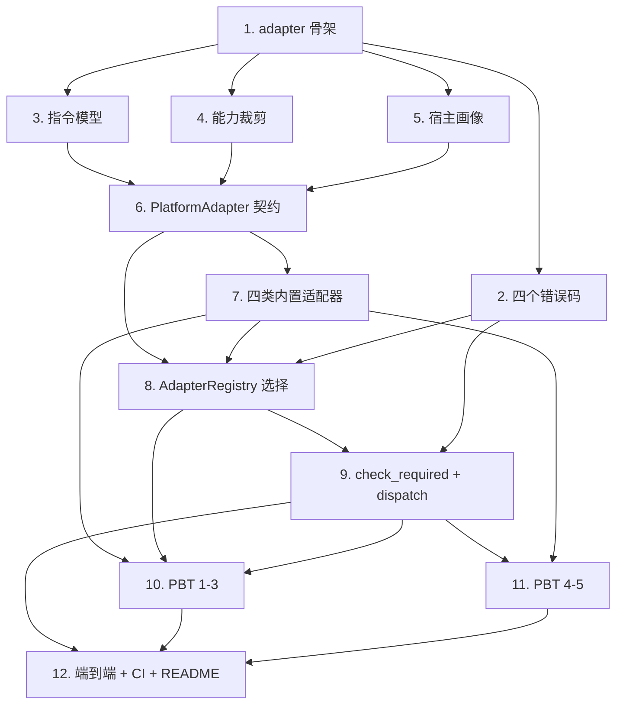

# Implementation Plan

## Overview

本任务清单基于 `requirements.md` 与 `design.md`，把 M3（适配层：Universal_Instruction 8 类指令集 + Platform_Adapter 注册 + 能力裁剪）的实现拆成 12 个独立可完成的任务。每个任务的产出都直接对应需求文档中的某条验收条款。

任务以 1.x 顺序号编号，便于在 PR 标题里引用，例如 `feat(m3/5): capability negotiation`。

## Tasks

- [x] 1. fayger-adapter 骨架与 workspace 接入
  - 在根 `Cargo.toml` 的 `[workspace].members` 加入 `crates/fayger-adapter`。
  - 新建 `crates/fayger-adapter/Cargo.toml`（依赖 fayger-error；dev-deps：proptest）与空 `src/lib.rs`，沿用 workspace lints。
  - 确认 `cargo check --workspace` 通过。
  - _Requirements: 约束与假设、11.5_

- [x] 2. fayger-error：新增四个 Adapter 错误码
  - 在 `ErrorCode` 追加 `AdpNoMatchingPlatform`、`AdpUnsupportedInstruction`、`AdpCapabilityDenied`、`AdpHostCallFailed`。
  - 在 `as_str` 追加 `ADP_NO_MATCHING_PLATFORM` / `ADP_UNSUPPORTED_INSTRUCTION` / `ADP_CAPABILITY_DENIED` / `ADP_HOST_CALL_FAILED`。
  - 单元测试：新增四码的 `as_str` 与 `Display` 一致性；前序里程碑既有码不变。
  - _Requirements: 9.1, 9.2, 9.4_

- [x] 3. fayger-adapter::instruction：指令模型
  - 在 `instruction.rs` 定义 `InstructionCategory`（8 类）、`InstructionKey { category, opcode }`、`UniversalInstruction { category, opcode, operands, capabilities_required }`、`UniversalEvent`。
  - 实现 `UniversalInstruction::key()`。
  - 单元测试：8 类齐全；key 提取；相等/克隆。
  - _Requirements: 1.1, 1.2, 1.3, 1.4_

- [x] 4. fayger-adapter::capability：能力与裁剪
  - 在 `capability.rs` 定义 `Capability(String)`、`HostPolicy { allowed }`、`NegotiationResult { granted, denied }`，实现纯函数 `negotiate(requested, available, policy)`。
  - 单元测试：空集 / 真子集 / 相等 / 不交的集合等式（granted/denied 满足不变式）。
  - _Requirements: 5.1, 5.2, 5.3, 5.4_

- [x] 5. fayger-adapter::host：宿主画像与检测器
  - 在 `host.rs` 定义 `HostEnvironment`、`HostSyscall`、`HostEvent`、`HostEnvironmentDetector` trait 与 `FixedDetector`。
  - 单元测试：FixedDetector 回放注入的画像。
  - _Requirements: 4.1, 1.4_

- [x] 6. fayger-adapter::adapter：PlatformAdapter 契约
  - 在 `adapter.rs` 定义 `AdapterDescriptor { platform_id, supported_capabilities, supported_instructions }` 与 `PlatformAdapter` trait（descriptor / matches / translate / normalize）。
  - 提供共用 helper：`translate_via_descriptor`（不支持 key → `ADP_UNSUPPORTED_INSTRUCTION`，否则 HostSyscall）与 `normalize_default`（0..=7 → category，越界归 Host）。
  - 单元测试：helper 对支持/不支持 key 的两类结果；normalize 映射。
  - _Requirements: 2.1, 2.2, 2.3, 2.4, 2.5_

- [x] 7. fayger-adapter::builtin：四类内置适配器
  - 在 `builtin.rs` 用内部 `BuiltinAdapter` 实例化 NativeDesktop / Server / Browser / InApp，按设计文档能力矩阵设置 `supported_capabilities` 与 `supported_instructions`；`matches` 优先比对 platform_id，回退 os_kind/sandbox。
  - 定义稳定能力字符串常量（fs.read/fs.write/net.http/ui.dom/time.now/random.bytes/crypto.hash/proc.spawn/host.call）。
  - 单元测试：四类 platform_id；Server 无 ui.*、Browser 无 proc.*、InApp 默认仅 host.call；matches 对各画像。
  - _Requirements: 3.1, 3.2, 3.3, 3.4, 3.5, 3.6_

- [x] 8. fayger-adapter::registry：AdapterRegistry 选择与可服务
  - 在 `registry.rs` 实现 `AdapterRegistry`：`register`、`select`（无匹配→`ADP_NO_MATCHING_PLATFORM`，匹配→按注册顺序取首个并算 granted）、`is_serviceable`、`granted`。
  - granted = adapter.supported_capabilities ∩ host.available_capabilities ∩ policy.allowed。
  - 单元测试：无匹配错误；有匹配选中与 granted 计算；确定性。
  - _Requirements: 4.2, 4.3, 4.4, 5.1_

- [x] 9. fayger-adapter::registry：check_required 与 dispatch
  - 实现 `check_required(required)`（required \ granted ≠ ∅ → `ADP_CAPABILITY_DENIED { missing }`）。
  - 实现 `dispatch(instr)`：未可服务→`ADP_NO_MATCHING_PLATFORM`；caps_required ⊄ granted→`ADP_CAPABILITY_DENIED`；否则 adapter.translate（内部支持判定 → `ADP_UNSUPPORTED_INSTRUCTION` 或 HostSyscall）。
  - 在 `lib.rs` `pub use` 全部公开类型。
  - 单元测试：dispatch 三类分支；check_required 满足/缺失。
  - _Requirements: 6.1, 6.2, 6.3, 7.1, 7.2, 7.3, 7.4, 7.5_

- [x] 10. PBT：Property 1-3
  - `tests/selection.rs`：Property 1（适配器选择决策性）。
  - `tests/capability.rs`：Property 2（能力裁剪集合代数）。
  - `tests/unsupported.rs`：Property 3（不支持指令处理）。
  - 各 `ProptestConfig { cases: 500, .. }`；`failure_persistence = WithSource("regressions")`，`.regressions` 进 git。新增生成器（category、capability set、instruction、host、descriptor）。
  - _Requirements: 10.1, 10.4, 4.x, 5.x, 2.5, 7.3, 7.4_

- [x] 11. PBT：Property 4-5
  - `tests/required.rs`：Property 4（必需能力缺失拒绝）。
  - `tests/cross_adapter.rs`：Property 5（跨适配器行为一致性）。
  - cases ≥ 500；`.regressions` 进 git。
  - _Requirements: 6.x, 7.1, 7.2, 8.1, 8.2, 10.1_

- [x] 12. 端到端测试、CI 与文档
  - `tests/end_to_end.rs`：构造 Browser 画像 → 注册四类内置适配器 → select 选中 Browser → 对 proc/net 指令 dispatch → 断言能力裁剪与翻译结果。
  - 确认 `ci-m0.yml` 的 workspace 级 test/clippy/doc 自然覆盖 fayger-adapter（无需新 workflow）。
  - 更新 `release/dev/core/README.md`：新增 fayger-adapter crate 说明、M3 PBT 概览与本地复现步骤；更新里程碑状态。
  - _Requirements: 10.2, 10.3, 10.5_

## Task Dependency Graph

```json
{
  "waves": [
    { "wave": 1, "tasks": [1], "description": "fayger-adapter 骨架与 workspace 接入" },
    { "wave": 2, "tasks": [2, 3, 4, 5], "description": "并行基础件：错误码、指令模型、能力裁剪、宿主画像" },
    { "wave": 3, "tasks": [6], "description": "PlatformAdapter 契约（依赖 3/4/5）" },
    { "wave": 4, "tasks": [7], "description": "四类内置适配器（依赖 6）" },
    { "wave": 5, "tasks": [8], "description": "AdapterRegistry 选择与可服务（依赖 6/7）" },
    { "wave": 6, "tasks": [9], "description": "check_required 与 dispatch（依赖 8）" },
    { "wave": 7, "tasks": [10, 11], "description": "全部 PBT（依赖 7/8/9）" },
    { "wave": 8, "tasks": [12], "description": "端到端、CI、README" }
  ]
}
```

可视化依赖：



## Notes

### 依赖路径要点

- 任务 1 是所有后续任务前置。
- 任务 3（指令模型）、4（能力裁剪）、5（宿主画像）共同支撑任务 6（PlatformAdapter 契约）。
- 任务 7（内置适配器）与任务 8（registry 选择）依赖契约就位；任务 9（dispatch）依赖 registry。
- PBT（10/11）必须在 7/8/9 之后；端到端（12）最后。

### 风险与备选

- **风险 R1：NativeDesktop 与 Server 匹配歧义**。
  - 应对：`matches` 优先比对 platform_id；测试构造显式 platform_id 画像。设计已固化此规则。
- **风险 R2：select 阶段 granted 与 dispatch 阶段指令级能力检查语义混淆**。
  - 应对：设计文档明确两层门槛（select 算 granted；dispatch/check_required 用 granted 判定）；任务 8/9 单测分别覆盖。
- **风险 R3：跨适配器一致性 property 因 platform_id 差异误判**。
  - 应对：Property 5 显式只比较 HostSyscall 的 name/args，不比较 platform_id。

### 完成标准

M3 完成的判定：

1. 所有 12 个任务的复选框都打勾。
2. `cargo test --workspace --all-features` 在 ubuntu / macos / windows 全部通过（含前序里程碑既有测试不回归）。
3. `cargo clippy --workspace --all-targets --all-features -- -D warnings` 通过。
4. PBT 反例归档目录存在但无未修复反例。
5. `release/dev/core/README.md` 已更新 fayger-adapter 说明与 M3 复现步骤。
6. 在 PR 中合回 `release/dev`，PR 描述列出每个任务的 commit 链接。
