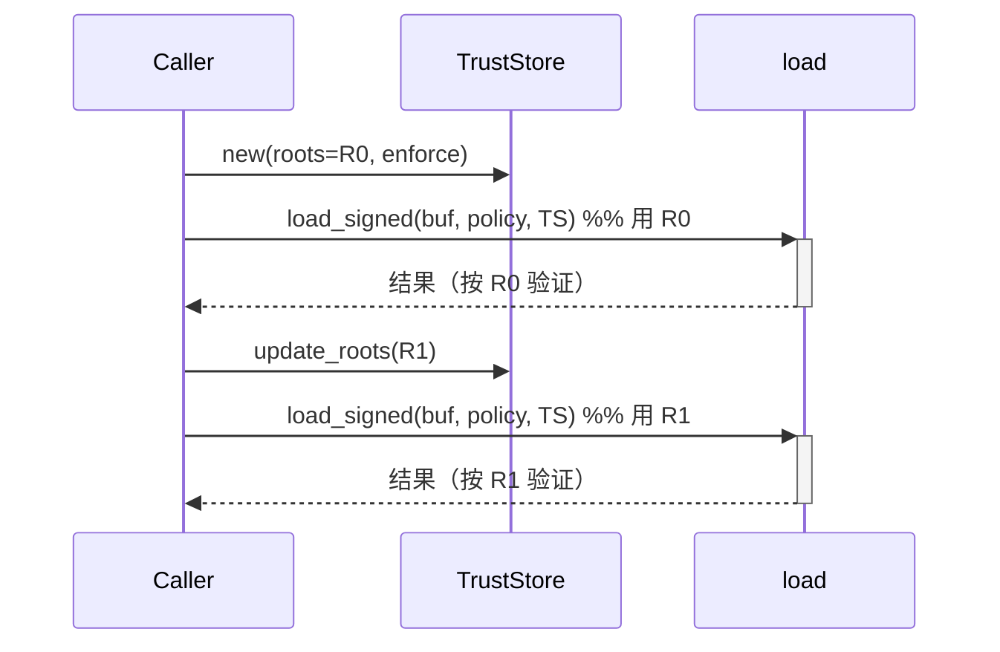

# Design Document

## Overview

本文是 M4 里程碑（签名校验 + 强制签名 + TrustStore）的技术设计。M4 在 `fayger-loader`（M1 加载链）中新增 **Verify(Signature)** 阶段与签名横切组件，并提供"封装+签名"的生产侧操作。

设计目标按优先级：

1. **正确性优先**：签名验证决策表（Absent/Valid/Invalid/UnknownKey/UnsupportedAlgorithm × EnforceMode）、签名作用域的确定性重建、可信根更新可见性，都以可被 PBT 验证的形式表达。
2. **不破坏既有契约**：M4 不改 M0–M3 的对外行为；M1 的 `load(bytes, policy)` 保持签名无关，签名集成通过**新入口** `load_signed(bytes, policy, truststore)` 提供。只新增一个 Loader 错误码 `LDR_SIGNATURE_FAIL`（`#[non_exhaustive]` 保证不破坏既有 match）。
3. **避免自引用循环**：签名作用域用 `Manifest_without_signature`（signature 字段置空后的 canonical 编码），且利用 ed25519 签名定长 64 字节的特性，使"占位签名"与"真实签名"产出的字节布局完全一致——签名作用域在 sign 与 verify 两侧字节级一致。
4. **与 M1 seal 协同**：M4 把"签名"嵌入封装流程，保证最终制品**同时**通过 Verify(Digest) 与 Verify(Signature)。

## Architecture

### M4 在加载链里的位置

蓝图加载链：`Read → Parse → Verify(Structural) → Verify(Digest) → Verify(Signature) → Negotiate(Version) → ...`

- M1 已落实 Parse / Verify(Structural) / Verify(Digest) / Negotiate(Version)。
- **M4 在 Verify(Digest) 与 Negotiate(Version) 之间插入 Verify(Signature)。**

新入口：

```
load_signed(bytes, policy, truststore):
    obj = parse(bytes)                          # M0/M1
    verify_digest(bytes, &obj)                  # M1
    verify_signature(bytes, &obj, truststore)   # M4（新增）
    notice = negotiate_version(&obj.manifest, policy)  # M1
    obj.manifest.deprecation_notice = notice
    return obj
```

错误优先级（`?` 短路）：结构 → 摘要 → **签名** → 版本。

### Crate 拓扑（M4 扩展 fayger-loader）

```
release/dev/core/crates/fayger-loader/src/
├── lib.rs        (pub use 追加：load_signed / sign / seal_and_sign / TrustStore / TrustedRoot / verify_signature)
├── digest.rs     (M1；不改)
├── verify.rs     (M1；不改)
├── seal.rs       (M1；不改)
├── version.rs    (M1；不改)
├── load.rs       (M1 load；追加 load_signed)
├── sig.rs        (M4 新增：ed25519 基元、签名作用域、verify_signature)
├── truststore.rs (M4 新增：TrustedRoot / TrustedRootSet / TrustStore)
└── sign.rs       (M4 新增：sign / seal_and_sign 生产侧)
```

依赖：`fayger-loader` 新增 `ed25519-dalek`（纯 Rust，活跃维护）。其它依赖不变。

### 签名作用域与 digest 区间的关系

```
文件布局（M0/M1 固化）：Header | Manifest(含 signature) | Section_Index | Sections | Trailer

M1 manifest_digest 覆盖： [0, sections_offset)  = Header || Manifest(含 sig) || Section_Index
M4 签名作用域：          Header || Manifest_without_sig || Section_Index
```

两者的 Manifest 部分不同（含 sig vs 不含 sig），这是**有意**的：
- `manifest_digest` 防整体篡改（含签名字段本身的篡改）。
- 签名防来源伪造，用 `Manifest_without_sig` 避免"对包含自身签名的内容签名"的循环。

签名作用域**不含** Sections 段，与顶层 spec design.md §"签名作用范围"一致；被跳过/未读取的 Section 不影响签名。

## Components and Interfaces

### `fayger-error` crate（M4 增量）

```rust
#[non_exhaustive]
pub enum ErrorCode {
    // M0–M3 ...
    /// `LDR_SIGNATURE_FAIL`：签名验证失败。由 context.reason 区分：
    /// MissingSignature / UnknownKey / InvalidSignature / UnsupportedAlgorithm。
    LdrSignatureFail,
}
```

`as_str` 追加 `LDR_SIGNATURE_FAIL`。

### 模块 `sig`：ed25519 基元、签名作用域、Verify(Signature)

```rust
/// ed25519 公钥长度（字节）。
pub const ED25519_PUBLIC_KEY_LEN: usize = 32;
/// ed25519 签名长度（字节）。
pub const ED25519_SIGNATURE_LEN: usize = 64;
/// M4 支持的唯一签名算法标识。
pub const SIG_ALG_ED25519: &str = "ed25519";

/// 用 ed25519 验证签名。公钥 32 字节、签名 64 字节。
/// 返回 Ok(true)=验证通过、Ok(false)=验证不通过、Err=长度等结构错误。
pub fn ed25519_verify(public_key: &[u8], message: &[u8], signature: &[u8])
    -> Result<bool, FaygerError>;

/// 计算签名作用域：Header || canonical(Manifest_without_sig) || Section_Index。
/// 从原始字节与已解析对象重建，确定性、与 signature 字节无关。
pub(crate) fn signed_scope(bytes: &[u8], obj: &BuFObject) -> Result<Vec<u8>, FaygerError>;

/// Verify(Signature) 阶段。
pub fn verify_signature(bytes: &[u8], obj: &BuFObject, truststore: &TrustStore)
    -> Result<VerifyOutcome, FaygerError>;

pub enum VerifyOutcome { Valid, Absent }   // Invalid/UnknownKey/... 走 Err(LDR_SIGNATURE_FAIL)
```

`signed_scope` 重建（sign 与 verify 共用同一函数，保证一致）：

```
sections_offset = obj.raw_header.sections_offset()
header_bytes = bytes[0 .. HEADER_SIZE]
manifest_without_sig = canonical_encode(obj.manifest.clone() with signature=None)
sidx_bytes = bytes[obj.raw_header.section_index_offset .. + section_index_length]
scope = header_bytes || manifest_without_sig || sidx_bytes
```

> 关键：`manifest_without_sig` 用**逻辑重编码**（clone manifest、清空 signature、canonical 编码），不直接切文件里的 Manifest 段（后者含 signature 字节）。`header_bytes` 与 `sidx_bytes` 用文件切片——因 ed25519 签名定长 64 字节，sign 时的占位签名与真实签名产生的 Manifest 编码长度相同，故 header 的 offset 字段与 section_index 的位置在占位/真实两版字节流中完全一致（见 sign 流程）。

`verify_signature` 决策：

```
sig = obj.manifest.signature
match sig:
  None =>
     if truststore.enforce_signature(): Err(LDR_SIGNATURE_FAIL, reason=MissingSignature)
     else: Ok(Absent)
  Some(block) =>
     if block.algorithm != "ed25519": Err(LDR_SIGNATURE_FAIL, reason=UnsupportedAlgorithm, algorithm)
     root = truststore.find(block.public_key_ref)
     if root is None: Err(LDR_SIGNATURE_FAIL, reason=UnknownKey, public_key_ref)
     scope = signed_scope(bytes, obj)
     match ed25519_verify(root.public_key, scope, block.signed_digest):
        Ok(true)  => Ok(Valid)
        Ok(false) => Err(LDR_SIGNATURE_FAIL, reason=InvalidSignature)
        Err(e)    => Err(LDR_SIGNATURE_FAIL, reason=InvalidSignature, detail) // 长度等
```

### 模块 `truststore`：可信根

```rust
/// 一条可信根：key_ref → 公钥字节。
#[derive(Debug, Clone, PartialEq, Eq)]
pub struct TrustedRoot { pub key_ref: String, pub public_key: Vec<u8> }

/// 可信根集合 + 强制签名开关。内存对象。
#[derive(Debug, Clone, Default)]
pub struct TrustStore {
    roots: Vec<TrustedRoot>,
    enforce: bool,
}
impl TrustStore {
    pub fn new(roots: Vec<TrustedRoot>, enforce: bool) -> Self;
    pub fn roots(&self) -> &[TrustedRoot];
    pub fn enforce_signature(&self) -> bool;
    pub fn set_enforce(&mut self, enforce: bool);
    pub fn update_roots(&mut self, roots: Vec<TrustedRoot>);  // 下次加载生效
    pub fn find(&self, key_ref: &str) -> Option<&TrustedRoot>;
}
```

可信根更新可见性（Req 4.3/4.4）天然成立：`load_signed` 每次调用读取**当前** `truststore`；调用方在两次加载之间 `update_roots`，后一次加载即用新集合。无缓存、无快照。

### 模块 `sign`：生产侧封装+签名

```rust
/// 对一个 BuF 对象封装并签名，使其同时通过 Verify(Digest) 与 Verify(Signature)。
///
/// secret_key: ed25519 私钥种子（32 字节）；key_ref: 写入 signature.public_key_ref。
pub fn seal_and_sign(obj: &mut BuFObject, secret_key: &[u8; 32], key_ref: &str)
    -> Result<(), FaygerError>;

/// ed25519 签名基元（生产侧/测试用）：用私钥种子对消息签名，返回 64 字节签名。
pub fn ed25519_sign(secret_key: &[u8; 32], message: &[u8]) -> [u8; 64];

/// 从私钥种子派生公钥（32 字节），便于构造 TrustedRoot。
pub fn ed25519_public_key(secret_key: &[u8; 32]) -> [u8; 32];
```

`seal_and_sign` 流程（嵌入 M1 seal 的两遍序列化，再加签名遍）：

```
1. obj.manifest.validate(); obj.check_consistency()
2. 计算每段 sha256 → obj.manifest.sections[i].digest      （section 摘要就位）
3. 插入占位签名：obj.manifest.signature = Some(SignatureBlock {
      algorithm: "ed25519", public_key_ref: key_ref, signed_digest: [0u8;64] })
   obj.raw_trailer.{manifest_digest, crc32} = 0
4. bytes_p = serialize(obj)            // 占位签名版
   scope = signed_scope(&bytes_p, &reparse_or_obj)   // header || canonical(manifest_without_sig) || section_index
5. sig = ed25519_sign(secret_key, &scope)            // 64 字节
   obj.manifest.signature.signed_digest = sig.to_vec()   // 同长度替换，布局不变
6. bytes_f = serialize(obj)            // 真实签名版；layout 与 bytes_p 一致
   sections_offset = parse(&bytes_f).raw_header.sections_offset()
   obj.raw_trailer.manifest_digest = sha256(bytes_f[0..sections_offset])
7. bytes_g = serialize(obj)            // 写入 manifest_digest 后
   obj.raw_trailer.crc32 = crc32(bytes_g[0..len-4])
8. done. 最终 serialize(obj) 的字节流同时满足 verify_digest 与 verify_signature。
```

> 为什么 scope 在占位版与真实版一致：signature 字段的 `signed_digest` 从 `[0;64]` 换成真实 64 字节，长度不变；`algorithm` 与 `public_key_ref` 不变。故 with-sig Manifest 的 canonical 编码长度不变 → Header 的 manifest_length / section_index_offset 不变 → `bytes_f` 与 `bytes_p` 在 `[0, HEADER_SIZE)` 与 section_index 区间字节级一致。而 scope 的 Manifest 部分用 `manifest_without_sig`（清空 signature 后编码），与 signed_digest 的具体内容无关。三段拼接因此在 sign（基于 bytes_p）与 verify（基于最终 bytes）两侧完全相同。

`ed25519_sign` / `ed25519_public_key` 基于 `ed25519-dalek` 的 `SigningKey::from_bytes(seed)`（确定性，无需 CSPRNG）。

### `load.rs`：load_signed

```rust
pub fn load_signed(
    bytes: &[u8],
    policy: &LoadPolicy,
    truststore: &TrustStore,
) -> Result<BuFObject, FaygerError> {
    let mut obj = fayger_buf::parse(bytes)?;            // 结构
    verify_digest(bytes, &obj)?;                         // 摘要
    verify_signature(bytes, &obj, truststore)?;          // 签名（M4）
    let notice = negotiate_version(&obj.manifest, policy)?;  // 版本
    obj.manifest.deprecation_notice = notice;
    Ok(obj)
}
```

`load`（M1）保持不变。

## Data Models

### 签名验证决策表

| signature | enforce | algorithm | key_ref 命中 | 验证 | 结果 |
| --- | --- | --- | --- | --- | --- |
| None | false | — | — | — | `Ok(Absent)` |
| None | true | — | — | — | `Err(MissingSignature)` |
| Some | * | ≠ed25519 | — | — | `Err(UnsupportedAlgorithm)` |
| Some | * | ed25519 | 否 | — | `Err(UnknownKey)` |
| Some | * | ed25519 | 是 | 通过 | `Ok(Valid)` |
| Some | * | ed25519 | 是 | 不通过 | `Err(InvalidSignature)` |

注：算法检查先于 key_ref 命中检查；key_ref 命中先于实际验证。

### 签名作用域（图）

```
   ┌────────── signed_scope ──────────┐
   │                                   │
[ Header(40B) ][ canonical(Manifest_without_sig) ][ Section_Index ]
   │                  │                                  │
 文件切片         逻辑重编码（清空 signature）        文件切片
[0,HEADER_SIZE)                                  [sidx_off, sidx_off+sidx_len)
```

不变式：`signed_scope` 仅依赖 (header 字节, manifest 去签名内容, section_index 字节)，与 `signature.signed_digest` 的具体字节无关。

### TrustStore 更新时序



## Error Handling

### 签名错误映射

| 触发条件 | ErrorCode | context.reason | 关键 context |
| --- | --- | --- | --- |
| 无签名 + 强制模式 | LdrSignatureFail | MissingSignature | — |
| 算法非 ed25519 | LdrSignatureFail | UnsupportedAlgorithm | algorithm |
| key_ref 不在可信根 | LdrSignatureFail | UnknownKey | public_key_ref |
| 签名验证不通过 | LdrSignatureFail | InvalidSignature | — |
| 公钥/签名长度非法 | LdrSignatureFail | InvalidSignature | detail |

所有错误 `source_layer = Loader`，`cause = None`（跨层错误链是 M8）。

### 默认安全姿态

- **无签名默认放行、强制模式拒绝**：与蓝图一致（默认不强制，可配置强制）。
- **未知 key_ref 即拒**：信任锚必须显式在 TrustStore 中；不回退到任何"任意公钥"。
- **算法白名单**：仅 ed25519；其它一律 UnsupportedAlgorithm。
- **不 panic**：长度非法走 `Result`，ed25519 验证失败返回 `Ok(false)` 而非 panic。

## Correctness Properties

> 从需求 Requirement 8 提取，对应 PBT。沿用前序里程碑的 `.regressions` 归档与配置。

### Property 1: 签名-加载往返

*For any* 合法 BuFObject `o` 与 ed25519 私钥种子 `k`，令 `seal_and_sign(o, k, key_ref)` 后 `bytes = serialize(o)`，用含 `(key_ref, public_key(k))` 的 TrustStore `load_signed(bytes, policy, ts)` 必须成功，且 `verify_signature` 返回 `Valid`、`verify_digest` 通过。

**Validates: Requirements 6.1, 6.2, 6.3, 6.4, 8.1**

### Property 2: 签名验证决策表

*For any* `(has_sig, enforce, algorithm, key_in_store, sig_valid)` 组合，`verify_signature` 的结果满足决策表：无签名×强制→MissingSignature；无签名×非强制→Absent；非 ed25519→UnsupportedAlgorithm；未命中→UnknownKey；命中×通过→Valid；命中×不通过→InvalidSignature。

**Validates: Requirements 3.1–3.6, 8.1**

### Property 3: 签名作用域内篡改被检测

*For any* 已 seal_and_sign 的字节流 `bytes`，对其签名作用域内（Header 或 Manifest 去签名部分或 Section_Index 区间）任一字节的修改（不重新签名），`load_signed` 必返回错误（`LDR_SIGNATURE_FAIL` 或更早的 `LDR_DIGEST_MISMATCH`/`LDR_PARSE_FAIL`）。

**Validates: Requirements 2.1, 2.3, 3.5, 8.1**

### Property 4: 可信根更新可见性

*For any* 由 `update_roots` 与 `load_signed` 组成的时序序列，每次 `load_signed` 的签名验证使用其之前最后一次 `update_roots` 的根集合（若无则初始集合）：移除对应根后加载得 `UnknownKey`，加回后加载得 `Valid`。

**Validates: Requirements 4.3, 4.4, 8.1**

### Property 5: 强制签名模式

*For any* 无签名的合法字节流，`load_signed` 在 `enforce=true` 时必返回 `MissingSignature`、在 `enforce=false` 时通过（其它阶段也通过的前提下）。

**Validates: Requirements 3.1, 3.2, 8.1**

## Testing Strategy

### 测试金字塔

```
        ┌────────────────────────────────────┐
        │ 端到端：keygen → seal_and_sign →    │
        │ load_signed(含/不含公钥) 成功/失败   │
        └────────────────────────────────────┘
      ┌────────────────────────────────────────┐
      │  PBT (5 properties × ≥500x)             │
      └────────────────────────────────────────┘
   ┌───────────────────────────────────────────────┐
   │ 单元：ed25519_verify 已知向量、signed_scope 确定性、│
   │ TrustStore find/update、verify_signature 各 reason │
   └───────────────────────────────────────────────┘
```

### 单元测试

- `sig`：ed25519_verify 对（正确 key/msg/sig）通过、对篡改任一项不通过、对错误长度返回 Err；signed_scope 对同一 obj 两次调用字节一致。
- `truststore`：find 命中/未命中；update_roots 后 find 反映新集合；enforce 开关。
- `sign`：seal_and_sign 后 obj.manifest.signature 为 Some 且长度 64；ed25519_public_key 与 dalek 派生一致。
- `verify_signature`：决策表逐行一个用例（用确定性种子密钥）。

### PBT 生成器（fayger-loader 测试内）

```rust
fn arb_seed() -> impl Strategy<Value = [u8; 32]>;             // 私钥种子
// 复用 fayger_buf::testing::arb_buf_object 构造待签名对象
fn arb_enforce() -> impl Strategy<Value = bool>;
```

### 端到端测试

`tests/signature_e2e.rs`：固定种子 → `ed25519_public_key` → 构造 TrustedRoot → `seal_and_sign` 一个两段 BuF → `serialize` → 含该根的 TrustStore `load_signed` 成功（Valid）；不含该根的 TrustStore `load_signed` 失败（UnknownKey）；强制模式下对未签名 BuF 失败（MissingSignature）。

### 反例归档 / CI

沿用前序里程碑：每个 PBT 文件 `failure_persistence = WithSource("regressions")`，`.regressions` 进 git。workspace 级检查覆盖。

## Dependency Versions

`release/dev/core/Cargo.toml` 的 `[workspace.dependencies]` 新增：

```toml
ed25519-dalek = "2"     # 纯 Rust ed25519，活跃维护
```

`fayger-loader/Cargo.toml` 追加 `ed25519-dalek = { workspace = true }`。

> 用 `SigningKey::from_bytes(&seed)` 做确定性密钥（无需 CSPRNG，无 rand 依赖）。`VerifyingKey::from_bytes` + `verify` 做验证。签名定长 64 字节是 sign/verify 布局一致的关键前提。

## Open Questions

- **Q1**：签名作用域是否应包含 Trailer？
  - 决定：不包含。Trailer 含 manifest_digest 与 crc32，它们由 seal 在签名之后计算；把它们纳入签名会再次引入循环。Trailer 的完整性由 crc32 自身 + manifest_digest（覆盖 [0,sections_offset)）间接保护。
- **Q2**：是否支持 ecdsa-p256 / rsa-pss？
  - 决定：M4 仅 ed25519。其它算法声明一律 `UnsupportedAlgorithm`。多算法在后续里程碑按需加入（reason 维度已预留）。
- **Q3**：seal 与 sign 是否应可独立组合（先 seal 再 sign）？
  - 决定：M4 提供合一的 `seal_and_sign`，因为正确顺序（section 摘要 → 签名 → manifest_digest → crc32）有强耦合；独立组合易错。若后续有热更新等场景需要分步，再拆分并补不变式测试。
