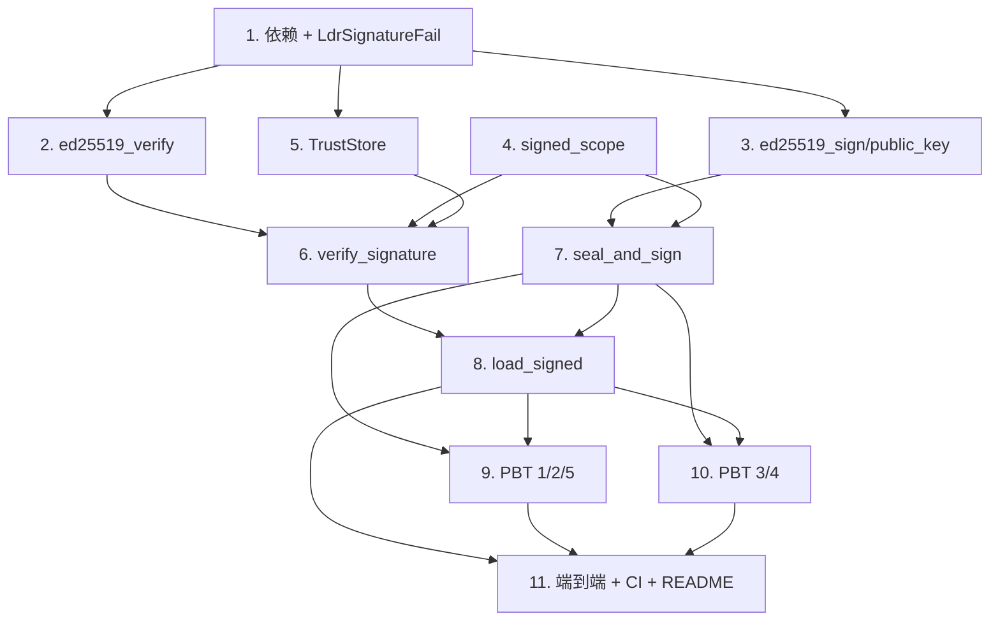

# Implementation Plan

## Overview

本任务清单基于 `requirements.md` 与 `design.md`，把 M4（签名校验 + 强制签名 + TrustStore）的实现拆成 11 个独立可完成的任务。每个任务的产出都直接对应需求文档中的某条验收条款。

任务以 1.x 顺序号编号，便于在 PR 标题里引用，例如 `feat(m4/4): verify_signature decision table`。

## Tasks

- [x] 1. 依赖锁定与错误码
  - 在根 `Cargo.toml` `[workspace.dependencies]` 新增 `ed25519-dalek = "2"`；`fayger-loader/Cargo.toml` 追加该依赖。
  - 在 `fayger-error` 的 `ErrorCode` 追加 `LdrSignatureFail`，`as_str` 追加 `LDR_SIGNATURE_FAIL`。
  - 单元测试：新增码的 `as_str`/`Display` 一致性；既有码不变。确认 `cargo check --workspace` 通过。
  - _Requirements: 7.1, 7.2, 7.4_

- [x] 2. fayger-loader::sig：ed25519 验证基元
  - 在 `sig.rs` 实现 `ed25519_verify(public_key, message, signature) -> Result<bool, FaygerError>`，包装 `ed25519-dalek` 的 `VerifyingKey`。
  - 定义常量 `ED25519_PUBLIC_KEY_LEN`、`ED25519_SIGNATURE_LEN`、`SIG_ALG_ED25519`。
  - 长度非法返回结构化错误而非 panic。
  - 单元测试：正确三元组通过；篡改任一项不通过；错误长度返回 Err。
  - _Requirements: 1.1, 1.2, 1.3, 1.4, 1.5_

- [x] 3. fayger-loader::sign：ed25519 签名与公钥派生
  - 在 `sign.rs` 实现 `ed25519_sign(seed: &[u8;32], msg) -> [u8;64]` 与 `ed25519_public_key(seed: &[u8;32]) -> [u8;32]`，基于 `SigningKey::from_bytes`（确定性，无 CSPRNG）。
  - 单元测试：sign 后用 `ed25519_verify` + 派生公钥可验证通过；公钥派生稳定。
  - _Requirements: 1.1, 6.1_

- [x] 4. fayger-loader::sig：签名作用域计算
  - 在 `sig.rs` 实现 `signed_scope(bytes, obj) -> Result<Vec<u8>, FaygerError>` = `header_bytes || canonical(manifest_without_sig) || section_index_bytes`。
  - manifest_without_sig：clone manifest、signature=None、canonical_encode。
  - 单元测试：同一 obj 两次调用字节一致；signature.signed_digest 内容不影响 scope（占位 vs 真实长度相同 → scope 相同）。
  - _Requirements: 2.1, 2.2, 2.3, 2.4_

- [x] 5. fayger-loader::truststore：TrustedRoot 与 TrustStore
  - 在 `truststore.rs` 定义 `TrustedRoot { key_ref, public_key }`、`TrustStore { roots, enforce }`，实现 `new` / `roots` / `enforce_signature` / `set_enforce` / `update_roots` / `find`。
  - 单元测试：find 命中/未命中；update_roots 后 find 反映新集合；enforce 开关读写。
  - _Requirements: 4.1, 4.2, 4.5, 9.1, 9.3_

- [x] 6. fayger-loader::sig：verify_signature 决策
  - 在 `sig.rs` 实现 `verify_signature(bytes, obj, truststore) -> Result<VerifyOutcome, FaygerError>` 与 `VerifyOutcome { Valid, Absent }`。
  - 决策：None×enforce→MissingSignature；None×!enforce→Absent；非 ed25519→UnsupportedAlgorithm；未命中→UnknownKey；命中×通过→Valid；命中×不通过→InvalidSignature。算法检查先于命中检查。
  - 单元测试：决策表逐行一个用例（确定性种子密钥）。
  - _Requirements: 3.1, 3.2, 3.3, 3.4, 3.5, 3.6, 7.3_

- [x] 7. fayger-loader::sign：seal_and_sign 生产侧
  - 在 `sign.rs` 实现 `seal_and_sign(obj, seed, key_ref)`：validate+consistency → 每段 sha256 → 插入占位签名([0;64]) → serialize 取 scope → ed25519_sign → 同长度替换签名 → 重算 manifest_digest → 重算 crc32。
  - 单元测试：seal_and_sign 后 signature 为 Some 且 signed_digest 长度 64；序列化后 verify_digest 与 verify_signature(含对应根) 均通过。
  - _Requirements: 6.1, 6.2, 6.3, 6.4_

- [x] 8. fayger-loader::load：load_signed 加载链集成
  - 在 `load.rs` 实现 `load_signed(bytes, policy, truststore)`：parse → verify_digest → verify_signature → negotiate_version → 写 deprecation_notice。
  - 在 `lib.rs` `pub use`：`load_signed`、`verify_signature`、`VerifyOutcome`、`seal_and_sign`、`ed25519_sign`、`ed25519_public_key`、`ed25519_verify`、`TrustStore`、`TrustedRoot`。
  - 单元测试：端到端 happy path（seal_and_sign→serialize→load_signed 成功）；阶段优先级（结构>摘要>签名>版本）；M1 `load` 行为不变。
  - _Requirements: 5.1, 5.2, 5.3, 5.4, 5.5_

- [x] 9. PBT：Property 1-2-5（往返 / 决策表 / 强制模式）
  - `tests/sign_load.rs`：Property 1（seal_and_sign→load_signed 成功 Valid + verify_digest 通过）。
  - `tests/sig_decision.rs`：Property 2（决策表全组合）+ Property 5（强制模式：无签名×enforce→MissingSignature，×!enforce→通过）。
  - `ProptestConfig { cases: 500, .. }`；`failure_persistence = WithSource("regressions")`，`.regressions` 进 git。新增生成器（arb_seed、arb_enforce）。
  - _Requirements: 3.1–3.6, 6.1, 6.2, 8.1, 8.4_

- [x] 10. PBT：Property 3-4（作用域篡改 / 可信根更新）
  - `tests/sig_tamper.rs`：Property 3（对签名作用域内任一字节翻转，load_signed 返回错误）。
  - `tests/truststore_visibility.rs`：Property 4（移除根→UnknownKey，加回→Valid；多次 update/load 时序）。
  - cases ≥ 500；`.regressions` 进 git。
  - _Requirements: 2.1, 2.3, 3.5, 4.3, 4.4, 8.1_

- [x] 11. 端到端测试、CI 与文档
  - `tests/signature_e2e.rs`：固定种子 → 派生公钥 → seal_and_sign 两段 BuF → 含根 TrustStore load_signed 成功(Valid)；不含根 → UnknownKey；强制模式对未签名 BuF → MissingSignature。
  - 确认 `ci-m0.yml` 的 workspace 级检查自然覆盖（无需新 workflow）。
  - 更新 `release/dev/core/README.md`：新增 M4 签名说明、PBT 概览与复现步骤；更新里程碑状态。
  - _Requirements: 8.2, 8.3, 8.5_

## Task Dependency Graph

```json
{
  "waves": [
    { "wave": 1, "tasks": [1], "description": "依赖锁定与错误码" },
    { "wave": 2, "tasks": [2, 3, 5], "description": "并行：ed25519 验证基元、签名/公钥、TrustStore" },
    { "wave": 3, "tasks": [4], "description": "签名作用域（依赖对象/canonical）" },
    { "wave": 4, "tasks": [6], "description": "verify_signature 决策（依赖 2/4/5）" },
    { "wave": 5, "tasks": [7], "description": "seal_and_sign（依赖 3/4）" },
    { "wave": 6, "tasks": [8], "description": "load_signed 集成（依赖 6/7）" },
    { "wave": 7, "tasks": [9, 10], "description": "全部 PBT（依赖 6/7/8）" },
    { "wave": 8, "tasks": [11], "description": "端到端、CI、README" }
  ]
}
```

可视化依赖：



## Notes

### 依赖路径要点

- 任务 1 是所有后续前置（依赖与错误码未就位无法编译）。
- 任务 4（signed_scope）被 6（verify）与 7（sign）共用，是两侧一致性的关键；必须先于它们。
- 任务 7（seal_and_sign）的两遍 serialize + 签名遍顺序敏感；任务 7 单测直接断言 seal_and_sign→verify_digest+verify_signature 闭环。
- PBT（9/10）必须在 6/7/8 之后。

### 风险与备选

- **风险 R1：占位签名与真实签名导致 scope 不一致（off-by-length）**。
  - 应对：ed25519 签名定长 64 字节，占位用 `[0;64]`，替换为真实 64 字节布局不变；任务 4 单测显式断言 scope 与 signed_digest 内容无关；任务 7 单测断言闭环。
- **风险 R2：seal_and_sign 与 M1 seal 的 manifest_digest/crc32 顺序冲突**。
  - 应对：设计固定顺序（section 摘要 → 签名 → manifest_digest → crc32）；签名作用域不含 Trailer，避免与 digest 循环。
- **风险 R3：ed25519-dalek API 版本差异（v2 用 SigningKey/VerifyingKey）**。
  - 应对：任务 2/3 完成后立即用已知向量做差分；锁定 v2。

### 完成标准

M4 完成的判定：

1. 所有 11 个任务的复选框都打勾。
2. `cargo test --workspace --all-features` 在 ubuntu / macos / windows 全部通过（含前序里程碑既有测试不回归）。
3. `cargo clippy --workspace --all-targets --all-features -- -D warnings` 通过。
4. PBT 反例归档目录存在但无未修复反例。
5. `release/dev/core/README.md` 已更新 M4 说明与复现步骤。
6. 在 PR 中合回 `release/dev`，PR 描述列出每个任务的 commit 链接。
