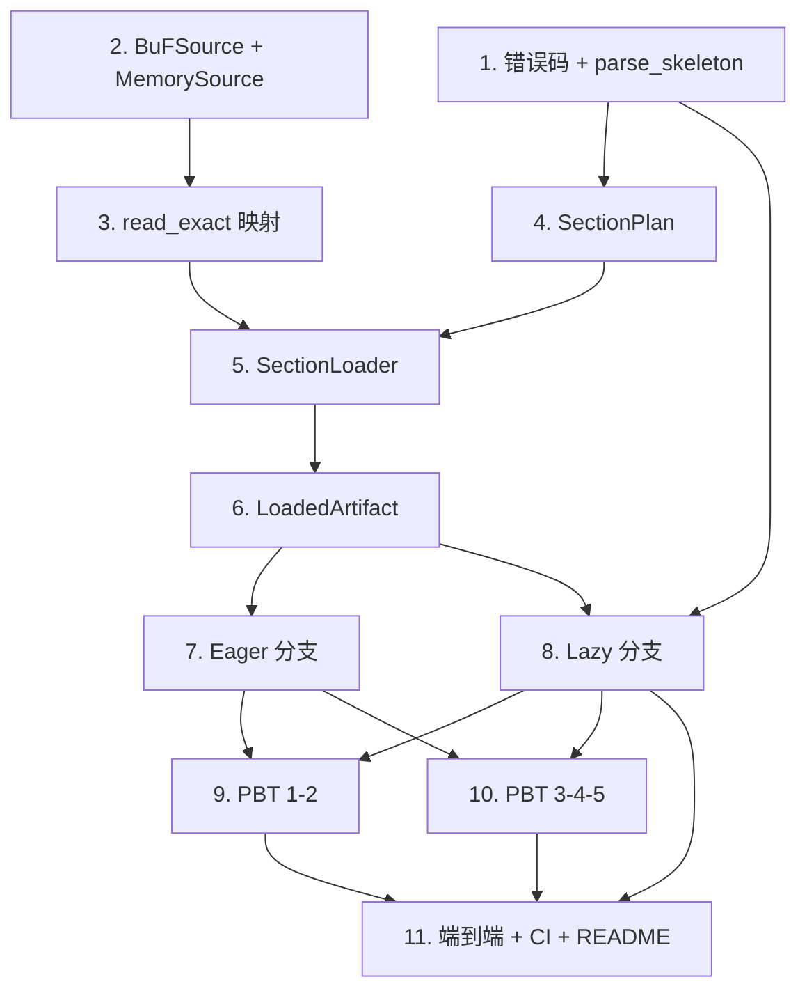

# Implementation Plan

## Overview

本任务清单基于 `requirements.md` 与 `design.md`，把 M5（BuF_Source 抽象 + Eager/Lazy 加载策略）的实现拆成 11 个独立可完成的任务。每个任务的产出都直接对应需求文档中的某条验收条款。

任务以 1.x 顺序号编号，便于在 PR 标题里引用，例如 `feat(m5/6): lazy section loader`。

## Tasks

- [x] 1. 错误码与骨架解析入口
  - 在 `fayger-error` 的 `ErrorCode` 追加 `LdrSourceReadFailed`、`LdrLazySourceUnavailable`、`LdrLazyDigestMismatch`，`as_str` 追加对应稳定字符串。
  - 在 `fayger-buf` 新增 `pub fn parse_skeleton(skeleton, trailer, total_len) -> Result<BuFObject, FaygerError>`（复用 read_header/read_manifest/read_section_index/cross_check，sections 为空，不校验 crc32 与 section digest），`lib.rs` `pub use`。
  - 单元测试：新增三码 as_str/Display；parse_skeleton 得到完整 manifest 与空 sections，篡改骨架被结构校验拒。
  - _Requirements: 7.1, 7.2, 7.4, 3.1, 9.4_

- [x] 2. fayger-loader::source：BuFSource + MemorySource
  - 在 `source.rs` 定义 `SourceError { message }`、`BuFSource` trait（`read_at(&self,off,len)->Result<Vec<u8>,SourceError>`、`length(&self)->Result<u64,SourceError>`）、`MemorySource`。
  - MemorySource：越界返回 Err；命中返回恰好 length 字节。
  - 单元测试：read_at 正常/越界/零长；length。
  - _Requirements: 1.1, 1.2, 1.3, 1.4, 1.5_

- [x] 3. fayger-loader::source：read_exact 映射
  - 实现 `read_exact(source, offset, length, phase) -> Result<Vec<u8>, FaygerError>`：read_at Err → `LDR_SOURCE_READ_FAILED`(eager) 或 `LDR_LAZY_SOURCE_UNAVAILABLE`(lazy)；字节数不符 → `LDR_SOURCE_READ_FAILED`(expected/actual)。
  - 单元测试：成功；source 报错按 phase 映射；短读映射 SourceReadFailed。
  - _Requirements: 4.1, 4.2, 4.3, 4.4, 5.1, 5.2, 5.3_

- [x] 4. fayger-loader::strategy：LoadStrategy + SectionPlan
  - 在 `strategy.rs` 定义 `LoadStrategy { Eager, Lazy }` 与内部 `SectionPlan { id, offset_in_region, length, digest }`，实现从 `manifest.sections` 顺序累加构造 plan 的函数。
  - 单元测试：plan 偏移累加正确；空 sections 得空 plan。
  - _Requirements: 3.1_

- [x] 5. fayger-loader::strategy：SectionLoader
  - 实现 `SectionLoader { source, sections_region_offset, plan, cache }`：`fetch(&mut self, id)`（命中缓存返回；否则 read_exact(lazy) → sha256 校验 → 失配 `LDR_LAZY_DIGEST_MISMATCH` 不缓存 → 通过则缓存）、`is_loaded`、`loaded_ids`。
  - 单元测试：fetch 触发读取并缓存；再次 fetch 不读（用计数 source 验证）；digest 失配不缓存；未知 id 报错。
  - _Requirements: 3.3, 3.4, 3.5, 4.2, 5.3_

- [x] 6. fayger-loader::strategy：LoadedArtifact
  - 实现 `LoadedArtifact { manifest, raw_header, raw_trailer, strategy, eager_sections, loader }` 与统一访问 `section(&mut self, id) -> Result<&[u8], FaygerError>`、`is_eager`、构造器 `eager(...)` / `lazy(...)`。
  - 单元测试：eager 访问任一段不触发 loader；lazy 访问委派 loader。
  - _Requirements: 2.3, 6.2_

- [x] 7. fayger-loader::source_load：Eager 分支
  - 在 `source_load.rs` 实现 `load_from_source(source, Eager)`：length → read_exact(0,total,eager) → parse → verify_digest（错误补标 phase=eager）→ LoadedArtifact::eager。
  - 单元测试：Eager 成功且 sections 齐全；Section digest 失配 → `LDR_DIGEST_MISMATCH` + phase=eager；source 失败 → `LDR_SOURCE_READ_FAILED` + phase=eager。
  - _Requirements: 2.1, 2.2, 2.3, 2.4, 2.5, 4.1, 5.2_

- [x] 8. fayger-loader::source_load：Lazy 分支
  - 实现 `load_from_source(source, Lazy)`：读 Header → sections_region_offset → 读骨架 → 读 Trailer → parse_skeleton → verify_manifest_digest（phase=eager）→ 构造 SectionLoader → LoadedArtifact::lazy。
  - 在 `lib.rs` `pub use`：`load_from_source`、`LoadStrategy`、`LoadedArtifact`、`BuFSource`、`MemorySource`、`SourceError`、`SectionLoader`。
  - 单元测试：Lazy 骨架成功且 eager_sections 为空；返回前不读 Section 段体（计数 source 验证）；骨架 manifest_digest 失配 → phase=eager。
  - _Requirements: 3.1, 3.2, 5.2, 9.6_

- [x] 9. PBT：Property 1-2（等价性 / Lazy 首访校验缓存）
  - `tests/eager_lazy.rs`：Property 1（Eager/Lazy force-all 等价：manifest/header/trailer/各段逐字节）。
  - `tests/lazy_fetch.rs`：Property 2（首访触发恰好一次 read_at + 校验；再访命中缓存；内容与 Eager 一致）。用计数 source。
  - 各 `ProptestConfig { cases: 500, .. }`；`failure_persistence = WithSource("regressions")`，`.regressions` 进 git。新增生成器 arb_sealed_bytes、CountingSource。
  - _Requirements: 6.1, 6.2, 6.3, 3.3, 3.4, 8.1, 8.4_

- [x] 10. PBT：Property 3-4-5（阶段标注 / Lazy 篡改 / read_at 契约）
  - `tests/source_faults.rs`：Property 3（FaultySource 在第 k 次 read_at 失败：Eager→SourceReadFailed/eager，Lazy fetch→LazySourceUnavailable/lazy）+ Property 5（read_at 越界→SourceReadFailed）。
  - `tests/lazy_tamper.rs`：Property 4（篡改某段 payload 后 Lazy 加载成功但该段 fetch→LDR_LAZY_DIGEST_MISMATCH/lazy 且不缓存）。
  - cases ≥ 500；`.regressions` 进 git。
  - _Requirements: 4.1, 4.2, 4.3, 5.1, 5.2, 5.3, 3.5, 1.2, 1.3, 8.1_

- [x] 11. 端到端测试、CI 与文档
  - `tests/source_e2e.rs`：seal 两段 BuF → MemorySource → Eager/Lazy 等价；总是失败的 Source → Lazy 骨架读取失败(eager)；骨架可读但 Section 读取失败的 Source → Lazy fetch `LDR_LAZY_SOURCE_UNAVAILABLE`(lazy)。
  - 确认 `ci-m0.yml` workspace 级检查自然覆盖（无需新 workflow）。
  - 更新 `release/dev/core/README.md`：新增 M5 source/lazy 说明、PBT 概览与复现步骤；更新里程碑状态。
  - _Requirements: 8.2, 8.3, 8.5_

## Task Dependency Graph

```json
{
  "waves": [
    { "wave": 1, "tasks": [1], "description": "错误码 + parse_skeleton" },
    { "wave": 2, "tasks": [2], "description": "BuFSource + MemorySource" },
    { "wave": 3, "tasks": [3, 4], "description": "read_exact 映射 + SectionPlan" },
    { "wave": 4, "tasks": [5], "description": "SectionLoader（依赖 3/4）" },
    { "wave": 5, "tasks": [6], "description": "LoadedArtifact（依赖 5）" },
    { "wave": 6, "tasks": [7, 8], "description": "Eager / Lazy 分支（依赖 6 + 1）" },
    { "wave": 7, "tasks": [9, 10], "description": "全部 PBT（依赖 7/8）" },
    { "wave": 8, "tasks": [11], "description": "端到端、CI、README" }
  ]
}
```

可视化依赖：



## Notes

### 依赖路径要点

- 任务 1（错误码 + parse_skeleton）是 Lazy 分支前置；parse_skeleton 在 fayger-buf 完成。
- 任务 3（read_exact）+ 4（SectionPlan）共同支撑任务 5（SectionLoader）。
- 任务 6（LoadedArtifact）统一两种策略访问入口；任务 7/8 是两个分支。
- PBT（9/10）必须在 7/8 之后。

### 风险与备选

- **风险 R1：parse_skeleton 与 parse 行为分叉**。
  - 应对：parse_skeleton 复用 parse 的私有 helper（read_header/read_manifest/read_section_index/cross_check）；任务 1 单测断言骨架解析的 manifest 与 parse 完整解析的 manifest 一致。
- **风险 R2：Lazy 的 Section 偏移推导与序列化器布局不一致**。
  - 应对：SectionPlan 用 manifest.sections 顺序累加（与 M0 序列化器一致）；Property 1 的等价性会立刻暴露任何偏移错误。
- **风险 R3：阶段标注遗漏（Lazy 骨架读取误标 lazy）**。
  - 应对：设计明确"load 调用栈内一律 eager，仅 fetch 内 lazy"；任务 7/8/10 显式断言 phase。

### 完成标准

M5 完成的判定：

1. 所有 11 个任务的复选框都打勾。
2. `cargo test --workspace --all-features` 在 ubuntu / macos / windows 全部通过（含前序里程碑既有测试不回归）。
3. `cargo clippy --workspace --all-targets --all-features -- -D warnings` 通过。
4. PBT 反例归档目录存在但无未修复反例。
5. `release/dev/core/README.md` 已更新 M5 说明与复现步骤。
6. 在 PR 中合回 `release/dev`，PR 描述列出每个任务的 commit 链接。
